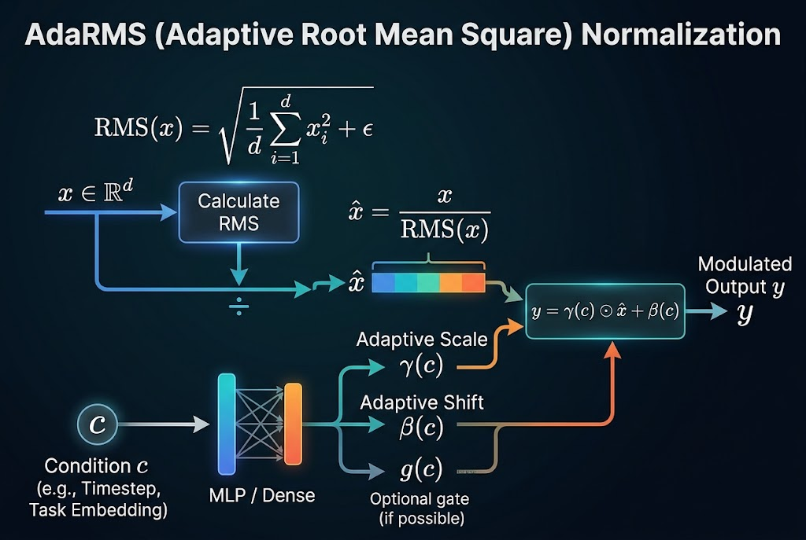
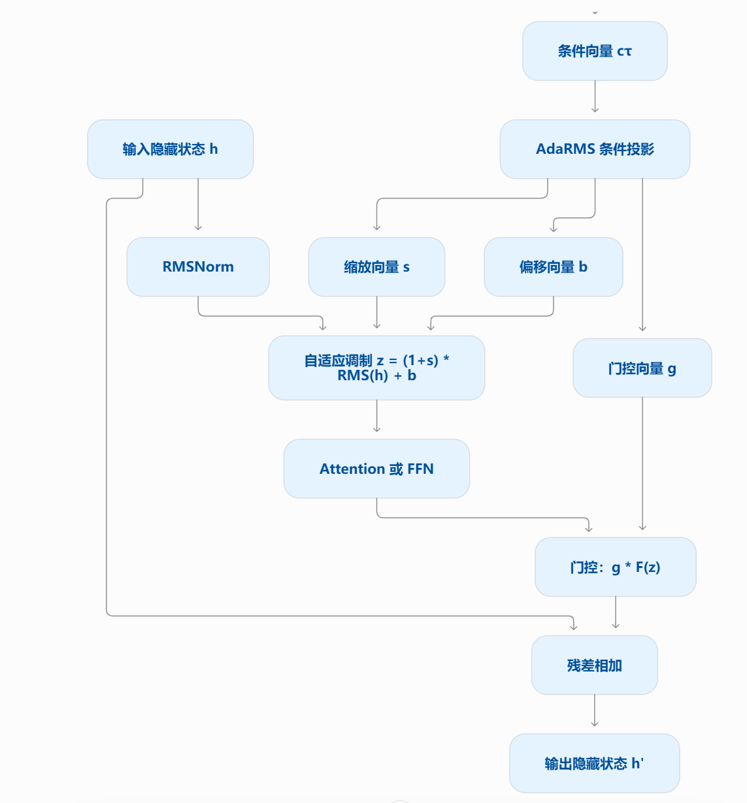

---
tags:
ai: Gemini 4 Argon
---
# Q 1

给我详细解释一下什么是 AdaRMS？必要时配图说明

# A 1

在深度学习（尤其是扩散模型、具身智能 VLA、以及一些新型 Graph Transformer 等）中，**AdaRMS** 是 **Adaptive Root Mean Square Normalization（自适应均方根归一化）** 的简称。

为了让你彻底明白，我们从最基础的 RMS 归一化说起，逐步拆解它是如何变成“自适应”（Ada）的。

### 一、 背景：从 RMSNorm 到 AdaRMS

在神经网络中，为了让训练更稳定，我们会使用各种归一化（Normalization）方法：

1. **LayerNorm (层归一化)**：对一个样本的特征计算均值（Mean）和方差（Variance），然后进行平移和缩放。
2. **RMSNorm (均方根归一化)**：研究发现，LayerNorm 的平移不变性（减去均值）其实没那么重要，起主要稳定作用的是缩放（除以方差/均方根）。RMSNorm 舍弃了均值计算，只计算均方根（Root Mean Square），因此计算速度更快： $\text{RMS}(x) = \sqrt{\frac{1}{d} \sum_{i=1}^d x_i^2 + \epsilon}$ ，$\hat{x} = \frac{x}{\text{RMS}(x)}$ 然后再乘以一个可学习的缩放系数： $y = \gamma \odot \hat{x}$ 。
**那什么是 AdaRMS 呢？**
在很多生成式、条件控制（Conditional）的任务中，网络需要根据外部条件 $c$ （例如：扩散模型里的“时间步 timestep”、机器人 VLA 模型里的“动作/环境状态条件”、或者任务描述 embedding）来动态调整特征的分布。
**AdaRMS** 允许将这个条件 $c$ 动态注入到归一化过程中。相比于静态的 RMSNorm，AdaRMS 每次进行归一化时，**它的缩放（Scale）和平移（Shift）系数不是死板的、可学习的常数，而是根据条件 $c$ 动态计算出来的**。

### 二、 AdaRMS 的核心原理

我们可以通过下方这张架构图直观地理解其工作流程：



1. **输入特征归一化（上半部分）**：
  - 输入特征向量 $x \in \mathbb{R}^d$ 传入后，首先计算其均方根 $\text{RMS}(x)$ 。
  - 用原向量 $x$ 除以该 $\text{RMS}(x)$ ，得到基础归一化特征 $\hat{x}$ （此时特征已被缩放到相似的尺度）。
1. **自适应条件映射（下半部分）**：
  - 接收外部的条件信息 $c$ （如时间步 $t$ 、任务嵌入等）。
  - 将 $c$ 输入一个小型神经网络（MLP / Dense 层）。
  - 动态预测出此时此景最适合的：
    - **自适应缩放系数 $\gamma(c)$ **
    - **自适应平移系数 $\beta(c)$ **
    - *（部分实现中还包含门控系数 $g(c)$ ）*
1. **特征调制（Modulation，右侧部分）**：
  - 将基础归一化特征 $\hat{x}$ 与动态生成的条件系数进行变换： $y = \gamma(c) \odot \hat{x} + \beta(c)$ 其中 $\odot$ 表示逐元素相乘。
  - 最终输出 $y$ 不仅完成了尺度的规范化，还深深烙印上了当前条件 $c$ 的特征。

#### 真正的流程图如下



### 三、 为什么不直接在输入加条件，而要用 AdaRMS？

在有条件生成的网络（如 Diffusion Transformer, DiT）或机器人动作策略网络（VLA）中，你可以通过在 Prompt（提示词）里加入条件，或者在最开始的 Embedding 加上条件。但为什么 AdaRMS 效果更好？

1. **多层、高频、深度的条件控制**： 如果条件只在开头输入一次，随着网络层数加深，条件信号容易在复杂的矩阵乘法中“淡化”。AdaRMS 在每一层的归一化处都重新注入条件（通过多层重复），确保条件对特征幅度和残差更新的影响贯彻始终。
2. **极佳的物理/动作场隔离能力 (Field Separation)**： 在机器人等具身智能控制（VLA）中，条件往往决定了接下来的动作方向。AdaRMS 通过在 Normalization 阶段直接调整特征的幅度和偏移，能够最直接、最强烈地改变网络的向量场（Vector Field）预测，从而根据不同条件（如正常执行、出错重试等）输出截然不同的精准动作。
3. **参数与计算的高效性**： 它不像 Attention 机制那样需要计算庞大的注意力矩阵，仅仅通过对 Layer 进行尺度（Scale）和偏移（Shift）的微调，就完成了高度复杂的“自适应条件控制”，既快又稳。

### 总结

AdaRMS 就像是**给 RMS 归一化装上了一个“根据环境自动变色/微调”的开关**。通过在归一化后引入由外部条件 $c$ 动态生成的缩放与平移系数，它让神经网络能够在不同的时间步、任务、环境状态下，自适应地调整内部特征的表达，是现代条件生成模型和机器人决策网络中非常关键且高效的组件。

# Q 2

为何有些讲解中写的是 $$y = (1+\gamma(c)) \odot \hat{x} + \beta(c)$$

# A 2

写成 $y = (1 + \gamma(c)) \odot \hat{x} + \beta(c)$ 是工程实现与现代架构论文（如 DiT、 $\pi_0$ 等）中最标准的写法。在数学表达上它与 $\gamma(c) \odot \hat{x} + \beta(c)$ 完全等价（仅仅是令 $\gamma_{new}(c) = 1 + \gamma(c)$ ），但在**深度学习的权重初始化和训练稳定性**上，多出来的这个 $1+$ 起到了至关重要的作用。

核心原因在于以下三点：

### 1. 配合“零初始化”（Zero-Initialization），保证初始状态为恒等缩放

在构建包含条件控制 $c$ 的网络（如 Diffusion Transformer）时，预测 $\gamma(c)$ 和 $\beta(c)$ 的那个小型 MLP（Linear 层）通常会采用**零初始化（Zero-Init）**——即在训练刚开始的第 0 步，将 MLP 最后一层的权重（Weight）和偏置（Bias）全部设为 $0$ 。

我们来对比一下第 0 步时两种写法的区别（此时 $\gamma(c) = 0, \beta(c) = 0$ ）：

- **如果不加 $1$ **： $y = 0 \odot \hat{x} + 0 = 0$ 。 输入特征 $\hat{x}$ 直接被清零了！这会导致前向传播的信号在此处完全中断，反向传播时梯度也无法顺利流向前面的网络层（梯度消失），模型极难训练。
- **如果加上 $1$ **： $y = (1 + 0) \odot \hat{x} + 0 = \hat{x}$ 。 在训练刚开始时，AdaRMS 完美退化为一个**标准的、无条件干预的基础 RMSNorm**。信号和梯度可以畅通无阻地流过整个深层网络。随着训练的推进，MLP 才会根据梯度逐渐学习出非零的 $\gamma(c)$ 和 $\beta(c)$ ，平稳地将外部条件 $c$ 的影响“注入”进去。

### 2. 残差思想（Residual Parameterization）：学“微调量”比学“绝对值”更容易

这种 $1 + \gamma(c)$ 的设计与 ResNet 的残差连接（ $y = x + F(x)$ ）有着完全相同的哲学：

- 归一化后的特征 $\hat{x}$ 本身已经处于标准尺度（均方根为 1）。大多数情况下，网络不需要对特征尺度做翻天覆地的改变，只需要根据条件 $c$ 做一点微调。
- 写成 $1 + \gamma(c)$ 后，神经网络的 MLP 只需要去拟合**相对于基准尺度 $1$ 的微小偏移量（Delta）**，即在 $0$ 附近波动的数值。对神经网络而言，由于权重初始化通常集中在 $0$ 附近（如高斯分布或零初始化），让网络输出以 $0$ 为中心的值，远比直接输出以 $1$ 为中心的值要容易和稳定得多。

### 3. 微调预训练模型（Fine-tuning）时的无缝兼容

在许多视觉或具身智能任务中，我们常常先在一个没有该特定条件 $c$ 的大模型上进行预训练，然后在后训练阶段新增一个条件分支 $c$ 。

采用 $(1 + \gamma(c))$ 配合 MLP 零初始化，意味着**在你刚把新条件模块挂载到预训练模型上的那一瞬间，模型的输出与修改前是 100% 一致的**，完全不会破坏预训练好不容易学到的特征分布，随后再在此基础上平滑地微调。

### 代码实现中的直观体现（PyTorch 伪代码）

在实际代码中（例如 DiT 的 `adaLN-Zero` 或相关的 `AdaRMSNorm` 实现），你经常会看到如下标准结构：

```python
class AdaRMSNorm(nn.Module):
    def __init__(self, hidden_size, cond_size):
        super().__init__()
        self.eps = 1e-6
        # 用于从条件 c 预测 scale (gamma) 和 shift (beta) 的线性层
        self.ada_lin = nn.Linear(cond_size, hidden_size * 2)
        
        # 关键步骤：将条件映射层零初始化
        nn.init.zeros_(self.ada_lin.weight)
        nn.init.zeros_(self.ada_lin.bias)

    def forward(self, x, c):
        # 1. 基础 RMS 归一化
        rms = torch.rsqrt(x.pow(2).mean(-1, keepdim=True) + self.eps)
        x_hat = x * rms
        
        # 2. 根据条件 c 动态生成 gamma 和 beta（初始状态下它们全为 0）
        gamma, beta = self.ada_lin(c).chunk(2, dim=-1)
        
        # 3. 加上 1，确保初始状态为 1 * x_hat + 0 = x_hat
        y = (1.0 + gamma) * x_hat + beta
        return y

```

因此，概念科普图或基础公式写成 $\gamma(c) \odot \hat{x} + \beta(c)$ 是为了展示**数学形式上的“缩放 + 平移”本质**；而论文和代码写成 $(1 + \gamma(c)) \odot \hat{x} + \beta(c)$ 则是为了体现**以 $1$ 为基准的残差缩放与零初始化工程技巧**。