# 学习折叠：LeHome Challenge 2026 获奖方案（线上第一、线下第二）

Ilia Larchenko  
ilya.larchenko@gmail.com  
独立研究者

2026 年 6 月

## 摘要

本文介绍我在 **LeHome Challenge 2026** 中采用的方案。这是一项在 ICRA 2026 举办的双臂衣物折叠竞赛。该系统在**线上（仿真）赛的 62 支队伍中排名第一**，并在**真实世界决赛中获得第二名**。系统通过强化学习循环改进视觉—语言—动作（VLA）策略。策略本身就是它的价值函数：预测动作的同一个网络还预测成功概率、任务进度和少量与任务相关的未来量，这些预测用于优势估计、实时失败检测和候选动作选择。

本工作主要将已有的强化学习思想与工程及优化方面的贡献重新组合；这些方法既可以作为一套完整方案，也可以单独使用：

- 将 AWR 与 RECAP 结合，用于流匹配 VLA；

- 通过 HuggingFace Hub 构建异步分布式训练／轨迹采集流水线；

- 通过汤普森采样优化推理时的超参数；

- 一套结合相机对齐工具、强数据增强和类似 DAgger 的人在环（HIL）数据采集的仿真到现实迁移方案。

本报告是一项工程案例研究，而非受控实验：系统是在竞赛压力下迭代构建的，几乎没有开展正式消融实验。因此，我描述的是实际做了什么、最终交付了什么，而不判断哪些部分是必不可少的。

## 1 引言

### 1.1 LeHome Challenge 2026

LeHome Challenge 2026 [1, 2] 是以**可变形物体操作**为核心、由仿真驱动的机器人竞赛。任务是使用**双臂 SO-ARM101** 系统 [4, 3] 折叠一件平放在桌上的衣物。系统包括两条各有 6 个自由度的机械臂，采用 12 维关节动作空间，仿真控制频率为 30 Hz（真实赛为 20 Hz），并配备三台 RGB 相机（一台俯视相机、两台腕部相机）。俯视相机提供深度信息，但我没有使用。评测涵盖四类衣物：长袖上衣、短袖上衣、长裤和短裤（图 1）。

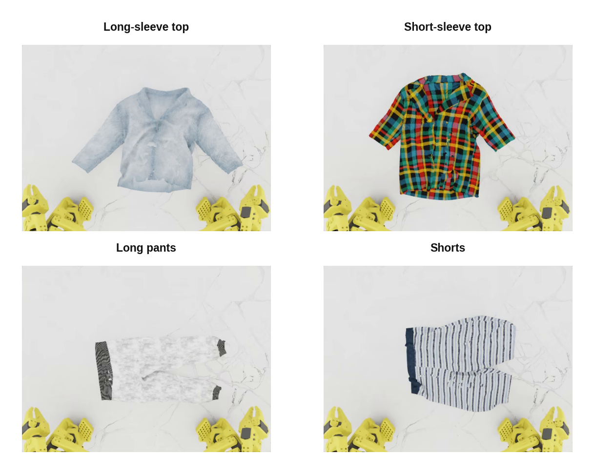

**图 1.** 主办方发布的原始仿真行为克隆数据集中，从俯视相机看到的四类衣物。

成功与否是二元结果，由几何条件定义。每件衣物都有一组关键点，成功判定由成对关键点距离条件组合而成：应当靠拢的关键点对（例如两个袖子）必须比阈值更近，而应当分开的关键点对必须保持在阈值之外。上衣有 5 个条件，裤子有 4 个。我复用这些条件构建稠密的中间奖励（第 6 节）。

竞赛分为两个阶段：

- **线上赛（仿真），2026 年 2—4 月。** 对所有队伍开放，持续接受提交，在 Isaac Sim [5] 中评估，并按总体成功率在公开排行榜上排名。不提供部分得分：一次折叠要么满足全部条件，要么失败。每类衣物评测 20 个实例：其中 10 件为**已见**衣物，主办方提供了脚本策略生成的行为克隆数据集；另外 10 件为**未见**衣物。未见衣物中，每类有 2 件公开（开发期间可以完全访问，但没有主办方训练数据），另有 8 件为私有，从未公开。第 2—8 节介绍这一阶段。

- **真实世界决赛，2026 年 6 月在维也纳 ICRA 举行。** 仿真赛前 8 名在 ICRA 2026 会议现场使用实体机器人接受评测。线下评测的成功标准略有不同，会对部分成功（如折好一个袖子）给予分数，由主办方评审团对结果打分。每类评测 5 件衣物，其中 3 件已见（在主办方 BC 数据集中提供）、2 件未见。第 9 节介绍这一阶段。

一项重要的评测协议细节是：**评测时不提供衣物类别**。衣物随机加载，策略不能读取标签，因此需要衣物类型的策略必须自行推断。我通过一个可学习的衣物类型输入 token 和推理时的分类器初始化流程处理这一问题（§4.2、§7.6）。

竞赛运行于 NVIDIA Isaac Lab（基于 Isaac Sim），使用主办方发布的环境、资产和成功判定器 [1, 2]。

### 1.2 主要挑战

该任务包含多种困难，系统的大多数部分都是为了解决其中某一项：

1. **布料可变形，难以操作。** 轨迹上的细小差异可能导致不同的衣物状态。提供的脚本示范轨迹规整而缺少变化，因此仅对其进行普通行为克隆，鲁棒性并不强。*（这促使我采用第 2 节的强化学习，以及 §3.4／§9.10 的恢复数据。）*

2. **奖励稀疏且为二元值。** 回合结束之前没有可观测的奖励，轻松成功与艰难成功看起来完全一样。所有中间信号都必须通过工程设计构造。*（第 6 节。）*

3. **对未见衣物的泛化。** 排行榜评测集的很大一部分是完全没有训练数据的未见衣物。我应对这一问题的主要手段，是在仿真阶段（§3.3）和真实阶段（§9.8）都采用强域随机化。

4. **无法接触评测机器人。** 在真实赛阶段，我从未使用过实际评测装置，所以迁移过程实际是仿真 $\to$ 我的机器人 $\to$ 他们的机器人，额外包含了一步泛化。*（§9.1。）*

### 1.3 方法概述

以下按阅读顺序概括报告后续内容。

**强化学习训练：飞轮（第 2 节）。** 系统是由三个独立组件组成的**异步循环**，它们只通过 HuggingFace Hub 通信：一个训练工作进程、任意数量的轨迹采集工作进程，以及一个人工 DAgger 工作站。优势同时通过两条途径驱动策略：AWR [6] 通过*采样器*发挥作用（高优势帧被更频繁地加载），RECAP 风格的*优势条件化* [7] 则将优势作为输入，从而支持推理时的无分类器引导。我认为，相比 PPO 风格的方法，这类条件化／重加权方法更适合流匹配 VLA。训练使用单张 H200，轨迹采集主要使用 RTX PRO 6000 GPU。

**数据采集（第 3 节）。** 围绕仿真器构建的一整套机制：由同一个无状态策略服务器服务的并行仿真、多种轨迹采集策略、用于回放和难例挖掘的成功／失败物理状态快照、环境增强引擎，以及针对困难情况的异步 DAgger 循环。

**策略架构（第 4 节）。** 我以团队获得 BEHAVIOR-1K Challenge 2025 冠军的策略 [8] 为起点，该策略本身扩展自 $\pi_{0.5}$ [9]：冻结的 SigLIP 编码器 [16]、Gemma-2B 前缀 Transformer [17]，以及通过流匹配生成 30 步、12 维动作块的 Gemma-300M 动作专家。沿用的组件（并非本文贡献）包括：不使用语言输入、相关流匹配噪声、动作块之间的软修补，以及跨层 KV 缓存混合。针对 LeHome 新增的内容包括：作为主模型一部分的辅助预测头（§5）、衣物类型输入 token（§4.2）、优势条件化（§4.3）、多信号 AdaRMS 条件化（§4.4）、排他自注意力（§4.5），以及平滑的逐时间步动作归一化（§4.6）。

**策略作为自身的价值函数（第 5 节）。** 单个可学习的查询 token 连接一组低成本线性预测头，它们都只读取图像 token：预测成功概率、任务完成度、衣物类型、关键点距离，以及 30 帧之后的未来关键点距离和充当 Q 函数的动作条件成功残差。将价值、Q 函数和低成本世界模型替代物放进策略内部，只需训练和部署一个模型，也使这些信号能与动作头共享表征。

**奖励与优势（第 6 节）。** 根据竞赛自身的关键点条件，为各类衣物设置阶段检查点，将二元成功信号稠密化；失败时收回全部奖励，使回合回报仍保持二元值。成功预测头提供经过衰减的、类似 CUPED 的价值基线，完成度头提供进度信号，再通过 GAE 将二者组合为逐帧优势。随着轨迹数据过时，这些优势会平稳地退化为仅依赖结果的基线。

**推理时优化（第 7 节）。** 同一模型检查点在推理时可能因运行方式不同而表现不同。我**按衣物类型**调整执行长度、播放速度、软修补启用阈值、引导强度、噪声温度和 best-of-N 候选数量，并在轨迹采集过程中用汤普森采样多臂老虎机低成本地在线寻找这些参数。

**线上赛结果（第 8 节）。** 在 62 支队伍中排名第一，总成功率为 79.63%，领先第二名 6.1 个百分点。

**仿真到现实（第 9 节）。** 为期一周的冲刺：从较晚但并非最新的仿真检查点出发，移除仿真专用机制，混合主办方数据、我自己的遥操作／DAgger 数据和增强后的仿真回放进行微调，并采用强增强、运动速度对齐和相机叠加标定工具。最终获得真实世界决赛第二名。

**讨论（第 10 节）。** 我会保留哪些做法、遇到了哪些困难、系统对装置变化出乎意料的鲁棒性、自主探索／恢复这一开放问题，以及为何将两个阶段的方法融入同一流水线有望取得更好效果。

### 1.4 相关工作

基准和仿真器由主办方提供 [1, 2]。策略方面，我通过团队的 **BEHAVIOR-1K** 方案 [8]，直接建立在 **$\pi_{0.5}$** [9]——带流匹配动作专家的 VLA——之上。该方案添加了上文列出的沿用组件，我原样复用。为了通过强化学习改进 VLA，我使用 **AWR** [6]（以及 AWAC [10] 等类似的优势加权回归方法）和 **RECAP** 风格的优势条件化 [7]，后者来自 Physical Intelligence 的 $\pi^{*}_{0.6}$ 工作。人在环组件遵循 **DAgger** [11] 及 HIL-SERL [12] 等相关交互式方法，目标是从在线人工纠正中学习。

## 2 强化学习训练

### 2.1 飞轮

整个系统是由三个独立组件组成的异步循环，它们仅通过 HuggingFace Hub 通信（图 2）：

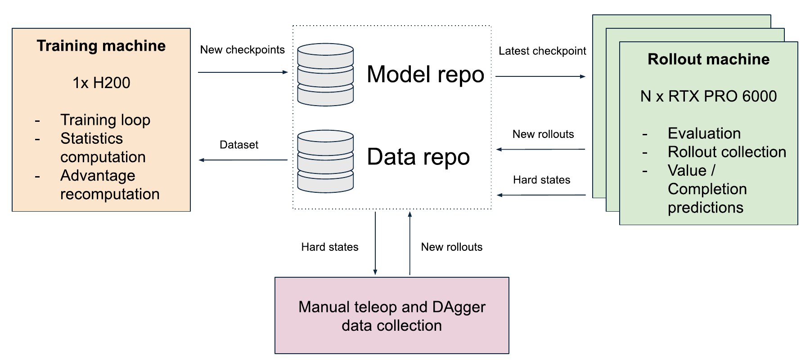

**图 2.** 系统概览：异步训练／轨迹采集／DAgger 飞轮。三个组件只通过 HuggingFace Hub 共享状态。

- **训练工作进程**（一台 GPU 机器）：持续训练，每轮迭代前重新计算所有轨迹数据集的优势，并上传检查点。

- **轨迹采集工作进程**（任意数量的机器）：从 Hub 拉取最新检查点，每台运行 3—5 个并行 Isaac Sim 实例，并上传采集的回合及采集期间预测的价值。由于采集机器只需要连接 Hub，扩展采集规模只需再启动一台机器。

- **人工 DAgger 工作站**：人通过遥操作修复保存的失败状态，生成的回合同样经由 Hub 传输（§3.4）。

系统没有同步屏障：训练器使用已经到达的数据训练，采集工作进程使用当前最新检查点采集。每台机器上的后台 HF-sync 守护进程处理上传和下载，因此训练与采集都不会被网络阻塞。训练器循环的一次迭代为：下载新轨迹 $\to$ 对*全部*轨迹数据集重新计算优势 $\to$ 训练 $\sim$ 1000 步 $\to$ 每 $\sim$ 500 步上传检查点。

### 2.2 为什么使用 AWR + RECAP

如果已有一个经过 BC 预训练、成功率非零的策略，可以从两个方向改进：让它第一次尝试就更干净利落地完成任务，或让它学会从失败中恢复。理想情况下两者兼顾；实际上，我主要在第一轮竞赛做前者、第二轮做后者，这并非完全有意安排。AWR + RECAP 非常适合第一个目标。初始 BC 数据非常规整，没有失败，也没有恢复，因此是很好的精炼基础，却无法提供良好的恢复行为示例。我将恢复能力寄望于 DAgger，但仿真中的遥操作很困难，帮助不大（§3.4）；成功回放和增强让策略更加鲁棒可靠，但鲁棒性并不等于能从已被破坏的状态中*恢复*。

为什么选这一类算法？主流在线强化学习方法——PPO [13] 及其组相对变体 GRPO [14]——建立在对数概率策略梯度更新之上，无法直接顺畅地用于流匹配 VLA。不过，已有工作尝试将类似 PPO 的逻辑适配到流匹配 VLA，其中一些取得了有希望的结果。

另一个问题是，有效动作在预测空间中只占据一个很小的流形。任何“抑制坏动作”的算法，即把概率质量从某些动作处*推开*，大多只会把预测推出这个流形。

相比之下，条件化和重加权方法不会离开该流形：它们只是将概率质量重新分配到策略已经能够生成的好动作*上*。其不足也来自同一特点：探索与发现能力非常有限。对本竞赛而言，这种权衡是有利的；我需要可靠地一次折好衣物，而不是发现本质上全新的行为。

我对条件化／重加权方法的偏好是一种主观判断，直觉上它们应该更适合这个问题。

因此，训练信号通过两种互补方式使用：

- **AWR** [6]：更频繁地用高优势帧训练（§2.3），使模型最终表现优于其平均采样轨迹。

- **RECAP 风格条件化** [7]：将优势作为条件*输入*（§4.3），告诉模型“只预测好动作”，同时支持推理时的无分类器引导（CFG）。

二者各自都是经过验证、可以独立使用的强化学习方法；它们依赖相同的基本要素，优势互补，能够良好结合。

图 3 用一个简化示例展示两种机制对动作分布的影响：行为数据由一个较大的“坏动作”模态和一个较小的“好动作”模态混合组成。

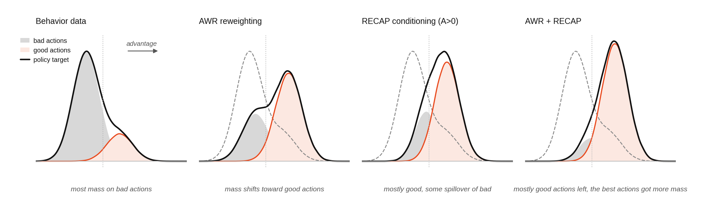

**图 3.** AWR + RECAP 的简化示意图。

AWR 将混合分布重新加权，使其偏向好模态；RECAP 条件化选择正优势切片（主要是好动作，也混入一些坏动作）；同时采用两者后，策略目标几乎全部落在好模态上。

### 2.3 通过采样器而非损失实现 AWR

优势加权回归（AWR）[6] 与 AWAC [10] 等类似的优势加权方法同属强化学习的回归类算法：它不进行策略梯度更新，而是通过监督回归让演员网络拟合数据中的动作，每个样本的权重为 $e^{A/\beta}$。原论文将其推导为约束策略改进问题的解：在保持与采样策略接近（以 KL 衡量）的同时，最大化预期改进。

与原始形式不同，我通过*采样*施加权重，而不是对损失加权；二者在期望上等价，但前者的数据效率更高：

$$
P(\text{sample frame } i) \;\propto\; e^{\mathrm{clip}(A_i,\,-2,\,2)}.
$$

批次上的流匹配损失就是普通、未加权的 MSE。权重为 $e^{-2}$ 的帧并非加载后再降低权重，而是几乎根本不会被加载，因此其图像不会解码，也不占批次槽位。按权重质量计算的有效批次利用率保持为 100%，大部分计算用于真正希望学到的好动作。

这里需要一项校正：辅助预测头（§5，包括成功、完成度、衣物类型等）必须保持*无偏*，因为它们的目标是原始数据分布的统计量，而不是优势倾斜后分布的统计量。因此，每个采样帧都携带一个重要性权重：

$$
w_i = \frac{1}{N \, p_i \, T_{\mathrm{ep}(i)}},
$$

该权重是采样概率的倒数（IS），并按回合长度归一化。所有辅助损失都用 $w_i$ 加权，而动作损失忽略它。BC 和 DAgger 数据源也采用类似机制：逐帧优先级与失败率相关，$P \propto e^{3(1-\mathrm{SR}_{\mathrm{garment}})}$，因此策略仍难以处理的衣物会被过采样，再由 IS 权重校正辅助头的偏差。

### 2.4 运行时多数据集采样

数据集从不合并。加载器保留每个数据源：BC 数据集、全部 DAgger 采集会话，以及迄今收集的每批强化学习轨迹，并在运行时按各数据源份额进行采样。这使数据混合成为一个*配置参数*，而不是预处理步骤：每轮迭代都可以改变份额，无需额外处理。

- **强化学习轨迹数据集**每轮训练迭代按 $0.98$ 衰减（下限为 $0.1$，以剔除过时数据并节省磁盘空间）：新鲜的同策略数据占主导，旧数据逐渐淡出。随着时间推移，数据集的优势也会部分切换到仅依赖结果的分段形式（§6.5）。

- **BC 数据集**保持固定采样率，因此随着总数据集增长，其有效权重逐渐下降并趋于渐近值。BC 数据集内部的采样率取决于衣物的整体成功率，较难的衣物会被更频繁地采样。

- 某些数据集已因衰减而退出采样计划的**旧成功轨迹**，仍以较高权重保留在混合数据中，主要是为了给成功率最低的衣物保留成功示例。

### 2.5 检查点回滚

我发现一个非常实用的技巧：训练并采集一段时间后，**回滚到几天前的检查点，再用此后采集的全部数据继续训练它**，其中也包括较新检查点采集的数据。回滚后的模型一次性看到大量新鲜、多样、部分离策略的经验，而不是与这些经验共同演化。这能可靠地帮助策略跳出持续训练陷入的局部最优。$\pi^{*}_{0.6}$ [7] 实际上系统性地采用了相同做法：每轮强化学习迭代都从同一个基线检查点重新开始。我的做法没有那么系统：第一轮回滚了 3 次，第二轮回滚了 1 次。

### 2.6 训练设置

大部分训练使用单台 H200 机器，批量大小为 192，总计约 30 万步，外加一些临时实验。轨迹采集主要运行在独立的 RTX PRO 6000 GPU 上（也是 §9.10 的 DAgger 工作站）。训练方案本身很简单：$\pi_{0.5}$ 基础权重；首次采集轨迹前先进行 2 万步 BC 预热；余弦学习率（在 10 万步内 $10^{-4} \to 10^{-5}$）；AdamW，并对辅助头增加权重衰减（§5.3）；bfloat16；冻结 SigLIP；每个批次样本使用 5 个流匹配采样。训练时始终启用轻量图像增强（颜色抖动、模糊、俯视相机裁剪／旋转），随后在仿真到现实阶段显著加强（见 §9）。

## 3 数据采集

仿真速度是整个系统的瓶颈：Isaac Sim 中一个回合约需 30 秒。因此，采集端的设计目标是从每个仿真小时中尽可能获取更多有用回合。

### 3.1 基础设施

采集系统经过大量工程优化，这里不详细展开，但完整实现已随代码发布。最关键的要点如下：

- **每台机器运行 3—5 个仿真进程**（竞赛环境不支持单进程多个场景），每个进程都是连接同一个共享、无状态策略服务器的轻量客户端；动作块缓存在客户端。

- **提前终止和恢复**：成功后立即停止；通过卡滞检测器（依据状态、动作及预测价值的方差）截断无望的回合；看门狗负责重启挂起的仿真。

- **采集时记录全部信息**：保存回合及采集期间预测的价值（供 §6.5 的优势计算使用），同时保存叠加奖励／价值／优势信息的调试视频（图 4）。

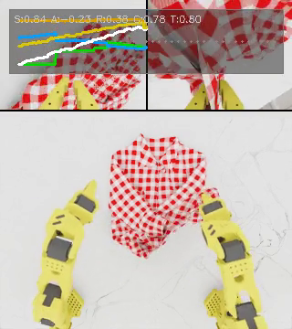

**图 4.** 轨迹调试视频中的一个回合中间帧，合并了三台相机的视图。叠加信息显示逐帧成功概率（$S$）、优势（$A$）、奖励（$R$）、完成度（$C$）和距完成时间（$T$），以及它们在整个回合中的变化曲线。

### 3.2 轨迹采集策略

我使用多种轨迹采集策略，它们在衣物采样逻辑、增强强度和初始状态方面有所不同（表 1）。

| 策略 | 作用 |
| --- | --- |
| random | 从已见衣物池中均匀采样衣物 |
| full | 所有衣物 $\times$ N 个回合 |
| curriculum | 优先选择成功率接近可配置目标值的衣物；与文献 [15] 的按难度选择数据思想相同（该工作偏好成功率约 $\sim$ 50% 的训练问题），这里推广到任意目标值 |
| success replay | 恢复保存的成功回合早期状态，并重新运行（使用更强增强） |
| semi-success replay | 恢复接近成功的状态，以开环方式回放到该状态，再交给当前策略 |
| hard mining | 恢复保存的失败状态，再次尝试 |

**表 1.** 轨迹采集策略。

只有新鲜、无偏的回合——`random`、`full` 和 `curriculum`——计入逐衣物成功率统计；回放和难例挖掘回合会使这些统计产生偏差（它们被刻意设置得比新回合更简单或更难），但仍参与训练。

回放策略基于保存的**物理状态**运行：粒子位置／速度和关节状态，在回合中途制作快照，之后可恢复。

- **成功状态**取自最终成功回合的第 5 步，以 $1 - \mathrm{SR}$ 的概率保存（罕见的成功总会保留）。回放时增加额外增强，且只保留成功回放，从而为困难衣物扩充稀缺的成功数据。

- **失败状态**在经 EMA 平滑的成功预测相对其运行最大值下降超过 0.12 时保存，前提是该最大值曾超过 0.25；也就是策略明显破坏一个原本有希望成功的回合的时刻。难例挖掘恢复这些状态，再试一次。

- **半成功状态**来自已经达到第一个检查点，或曾持续保持较高预测成功率、但最终失败的回合。这些“接近成功却失败”的回合，也可以送入人工 DAgger 队列（§3.4），而不自动重试。

### 3.3 环境增强

我实现了视觉／物理增强逻辑，分两个作用层级：

- **回合级**（重置时随机化，与物理状态一起保存，使回放可以复现）：衣物纹理图案替换、LAB 空间颜色重映射、衣物姿态／缩放／粗糙度扰动、各相机位置／旋转／焦距抖动、机器人基座位置抖动、桌面纹理变换和穹顶灯旋转。回放保存状态时需要保持原始动力学，因此跳过会影响物理的组件（缩放、粗糙度、基座抖动）。

- **逐步级**（每隔几帧重新随机化）：衣物色调、机械臂颜色、穹顶灯强度／颜色／色温。

增强应有多强，取决于谁需要根据增强后的帧执行动作。第一轮竞赛中，常规轨迹大多采用*轻量*设置：图案替换和颜色重映射概率为 $p{=}0.4$，衣物姿态扰动为 $\pm$ 2 cm／$\pm$ 2$^\circ$，缩放扰动为 $\pm$ 5%，并逐步调整颜色色调。这提供了足够的多样性来正则化，又不至于损害当前策略。成功回放则不同：这里策略表现本身并不重要，因此增强明显更强。第二轮（仿真到现实）只采集成功回放，增强力度进一步加大：替换／重映射概率为 $p{=}0.8$，相机姿态和焦距抖动根据真实装置标定，并加入机械臂基座偏移、桌面纹理变换、逐步机械臂颜色及光照色温变化。正是这套增强使仿真轨迹能够用作真实机器人训练数据（仿真到现实部分，§9.8）。

模型端始终启用轻量训练图像增强，独立于环境增强引擎（§2.6）；仿真到现实阶段也大幅加强了这些增强。

### 3.4 人工 DAgger

针对自动策略无法解决的失败模式，我构建了 DAgger 风格 [11] 的循环：将保存的失败或半成功状态载入仿真，通过几秒遥操作纠正衣物，再将控制权交还策略；如果最终折叠成功，就把整个回合保存为示范。

我尽可能让流程异步：常规轨迹采集时保存困难状态，人只花几秒完成实际纠正，修正后的状态上传回 Hub，由下一轮采集读取并作为半成功状态处理。人无需等待策略失败或完成任务，能够连续采集纠正行为；多个仿真并行运行，操作者也不必等待加载。

我开发了仿真和真实机器人两个版本的工具。仿真版本的作用有限：通过仿真界面遥操作机器人确实很难，等工具可用时，策略折衣服已经比我遥操作更好。相比之下，真实机器人版本成为项目最有用的工具之一；真实 DAgger 数据如何采集和加权，见仿真到现实部分（§9.10）。

## 4 策略架构

我以团队为 BEHAVIOR-1K Challenge 构建的架构 [8] 为起点，该架构本身扩展自 $\pi_{0.5}$ [9]。基础结构是：SigLIP-So400m/14 图像编码器 [16] $\to$ Gemma-2B 前缀 Transformer [17]（图像 + 状态 + 辅助 token）$\to$ Gemma-300M 动作专家。动作专家关注前缀 KV 缓存，通过流匹配 [18] 生成 30 步动作块（30 Hz 下为 1 秒，12 维关节增量）。三台 RGB 相机分别位于上方、左腕和右腕，图像均缩放到 224$\times$ 224。视觉骨干被冻结。前缀中的 FAST 动作 token [19] 是仅用于训练的辅助信息，用于塑造 VLM 表征；推理时不存在。

**沿用自 BEHAVIOR-1K** 方案的组件（不属于本工作贡献）：

- 完全移除文本输入：不使用分词器，也没有语言 token。

- 相关流匹配噪声：去噪循环的初始噪声按经验动作协方差采样（使用归一化统计量的 Cholesky 因子，并以 $\beta = 0.5$ 向单位阵收缩）。

- 动作块边界处考虑相关性的软修补：前一块的尾部通过相同协方差结构约束下一块的头部，仅在去噪循环早期的高噪声阶段启用（流时间高于按衣物类型在推理时调优的阈值，§7.2），让最后的低噪声步骤能够自由自我纠正。

- 跨层 KV 缓存混合：动作专家读取前缀 KV 缓存之前，将每层的 K 和 V 替换为所有层的可学习线性组合，使动作专家能够选择关注 VLM 的哪些深度。

- 多样本流匹配：每个批次样本的 5 组独立（噪声、时间）采样共享一次前缀前向传播。

针对 LeHome 的新增部分包括 token 布局变化（§4.1）、衣物类型输入 token（§4.2）、优势条件化（§4.3）、多信号 AdaRMS 条件化（§4.4）、XSA（§4.5），以及动作目标的平滑逐时间步归一化（§4.6）。基于这一布局的辅助预测头见第 5 节。

我按实际情况介绍该架构。它没有经过严格消融：当时我的重点是竞赛和结果优化，而非规范研究，真正的消融研究会成倍增加时间和经费预算。因此，我分享所有细节供参考，但不声称其中哪些真正关键。

### 4.1 模型结构与注意力布局

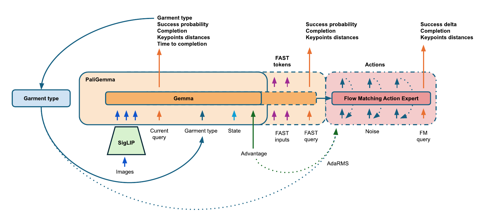

**图 5.** 策略架构。冻结的 SigLIP 编码器为 Gemma-2B 前缀提供输入（图像、当前查询、状态、衣物类型、优势、FAST token 和 FAST 查询）；Gemma-300M 流匹配动作专家读取清理后的前缀，输出 30 步动作块。预测头（橙色）读取前缀；动作专家尾部的 FM 查询承载以动作为条件的未来预测。

图 5 展示总体结构。前缀在分层注意力掩码下组合多个 token 组：每组可以看到自身及其前面的所有组，较早的组永远看不到较后的组（图 6）。

- **图像**（3 台相机）和**当前查询**：后者是所有预测头读取的单个可学习 token（第 5 节）；

- **状态**（12 个关节，离散为 256 个区间，并通过专门的 256 项嵌入表编码）和**衣物类型输入 token**（§4.2）；

- **优势**（§4.3），还可以按样本独立遮蔽；

- **FAST token**（因果注意力）和 **FAST 查询**：只用于训练；在动作专家运行前，二者都会从 KV 缓存中移除。

动作专家后缀由 30 个动作 token 和 **FM 查询**组成，采用完全双向注意力，并关注整个清理后的前缀。

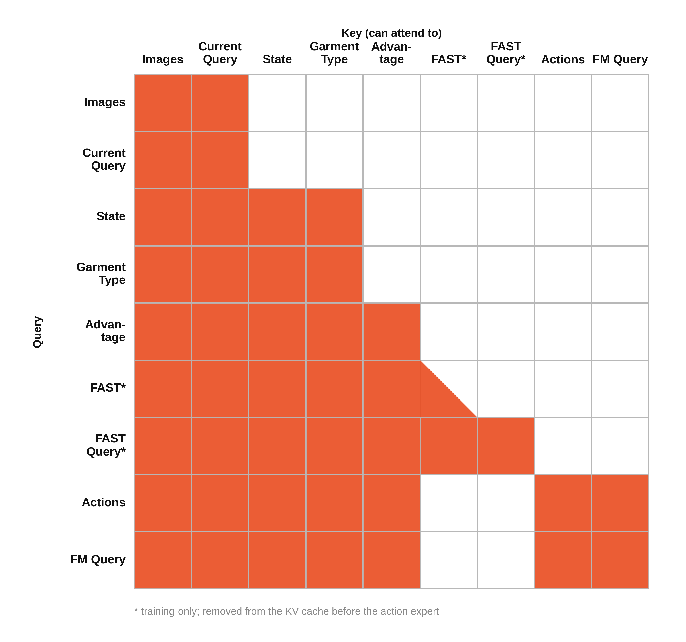

**图 6.** 注意力掩码。

关键设计是将当前查询放入图像组：它看不到状态、衣物类型和优势，因此每个预测头都被迫仅根据像素工作。价值头不能对本体感知状态过拟合，衣物类型头也不能简单复制衣物类型输入 token。

### 4.2 衣物类型输入 token

这是与状态 token 放在一起的可学习嵌入（4 个中选 1 个），用于替代文本提示，告诉模型当前折叠的是哪类衣物。

评测时不会输入衣物类型，因此我实现了一种非常基础的类 System-2 逻辑，与 BEHAVIOR-1K 方案中的阶段预测逻辑类似：

- 训练时，以真实衣物类型作为输入。

- 评测时，模型在回合刚开始时通过辅助预测头（第 5 节）预测衣物类型，并在余下回合中将该预测作为输入。

我没有对它进行消融，但不认为这一步至关重要。训练后期衣物类型预测准确率超过 99%，模型主要在折叠已经失败、衣物非常凌乱时出错。大多数情况下，模型仅凭图像就能正确识别衣物，额外的衣物类型输入并不提供多少新信息。

### 4.3 优势条件化

强化学习训练期间，每帧都有优势 $A$（第 6 节），我以它为条件控制动作专家。这是优势用法中 RECAP 风格 [7] 的一半，另一半是采样（第 2 节）。

- 单个可学习的“优势 token”独占一组：它能看到图像、状态和衣物类型，但这些组都看不到它。

- **训练**：若 $A < 0$，该 token 总被遮蔽（中性）；若 $A \geq 0$，则随机遮蔽，$P(\text{neutral})$ 从 $0.5$（当 $A{=}0$ 时），线性下降到 $0.1$（当 $A \geq 2$ 时）。

- 同一门控还控制 AdaRMS 优势向量（§4.4），使信号通过注意力和每一层的归一化共同传入动作专家。

**推理**：该 token 始终激活。CFG 在共享的前缀 KV 缓存上运行两次动作专家，分别为有条件和无条件前向传播，再以 $\hat{v} = v_u + s\,(v_c - v_u)$ 合并速度，其中 $s$ 按衣物类型设置（§7.3、§7.7）。

### 4.4 AdaRMS 多信号条件化

动作专家原本已使用由流匹配时间导出的条件向量调制每层 RMSNorm（即 $\pi_{0.5}$ 中使用的 AdaRMS）。我向同一向量再加入两个信号：

$$
c \;=\; \underbrace{\mathrm{MLP}(\mathrm{posemb}(t))}_{\text{flow time (existing)}} \;+\; \underbrace{g[\text{garment\_type}]}_{\text{4 learned vectors}} \;+\; \underbrace{\mathbf{1}[\text{advantage active}]\cdot a}_{\text{1 learned vector}}
$$

所有新增向量均零初始化，因此变更前训练的检查点在恢复后的第 0 步表现完全一致。优势项与优势 token 使用相同的逐样本掩码门控（§4.3）。

动机是：在早期实验中，衣物类型和优势对动作预测的条件约束不够强。我观察到，输入已经给出正确衣物类型，模型却执行另一类衣物的动作。前缀中的单个 token 可能信号太弱；AdaRMS 更直接，它调制动作专家的每一层。我没有开展严格消融，但加入 AdaRMS 通道后，肉眼观察到的错误衣物动作减少了。

### 4.5 排他自注意力（XSA）

标准注意力允许每个 token 通过关注自身，轻易地将自己的 value 传到输出。XSA [20] 移除这一路径：注意力计算完成后，减去输出在该 token 自身 value 向量上的投影：

$$
z_t \;=\; y_t - \frac{y_t \cdot v_t}{\lVert v_t \rVert^2 + \varepsilon}\, v_t,
$$

其中，$y_t$ 为标准注意力输出，$v_t$ 为 token 自身的 value。VLM 和动作专家都采用这一机制。

这项工作很新，发表才几个月。初步结果显示，XSA 可以用几乎可忽略的计算开销改善训练和验证损失，因此我试用了它。将其加入预训练模型起初会破坏损失，但恢复速度出乎意料地快，所以我保留了它。这里没有真正的消融，我确实借鉴了“近期流行做法”；而且模型本来就会进行大量后训练，我也不关心灾难性遗忘，因此假定它不至于有害。

### 4.6 动作归一化

动作块在归一化空间中预测，流匹配损失也在该空间计算，因此归一化会塑造目标。动作是相对当前状态的增量，其分散程度随预测时域增长，大致类似随机游走（标准差 $\propto \sqrt{t}$），但实际形状因维度而异，且上一次执行动作与测量状态之间的差异还会造成额外的首步偏移。因此，我采用**逐时间步**归一化，让每个预测位置拥有各自的均值和标准差，而不使用单一全局尺度。后者会过度压缩近期步骤（即实际执行并据此重新规划的步骤 [21]），同时让高方差的尾部主导损失。经验逐时间步标准差在预测时域内可能较噪，因此我不直接使用原始统计值，而采用逐维平滑拟合进行缩放：

$$
\sigma_d(t) \;=\; a_d + s_d\,\sqrt{t + e_d}\,,
$$

均值则使用线性拟合。这样既保留各时间步的幅度轮廓，也使平滑轨迹继续保持平滑。

## 5 辅助预测头

我使用两组辅助预测头：当前帧预测头（§5.1），包括作为价值函数使用的成功与完成度预测；未来预测头（§5.2），充当 Q 函数和低成本准世界模型，预测 30 帧之后的场景状态。

所有当前帧预测头都是连接在单个可学习**当前查询** token（1$\times$ 2048）上的线性探针，该 token 位于图像注意力组中（§4.1）：它们只看到图像，并共享一次 VLM 前向传播。

所有未来预测头都有两份：一份位于前缀中的 FAST token 之后，另一份位于动作专家后缀的尾部，二者都能关注相应的动作表征 token。

将价值／Q 函数放在策略模型内部，也简化了训练流水线：只需训练、部署和管理一个模型版本。从概念上看，预测成功概率或未来状态，与决定最佳动作块需要许多相同的基本要素，因此这些“模型”本就共享大量逻辑。将它们放进同一个网络，可以节省计算、为共享表征提供有用的辅助信号，并促进相互学习。

所有预测头的梯度都会流入 VLM 骨干，不停止梯度；较小的损失权重避免其占主导。

### 5.1 当前帧预测头

表 2 汇总当前帧预测头。

| 预测头 | 输出 | 目标 | 训练数据 |
| --- | --- | --- | --- |
| 成功 | sigmoid | P（回合成功） | 强化学习轨迹 |
| 阶段检查点 | sigmoid | P（达到回合中间检查点） | 强化学习轨迹 |
| 衣物类型 | softmax(4) | 衣物类别 | 全部数据 |
| 完成度 | sigmoid | $t/T$ | 仅成功回合 |
| TTC | sigmoid | 距完成时间（TD） | 全部数据 |
| 关键点距离 | 原始线性输出（21） | 各条件的距离比值 | 强化学习轨迹 |

**表 2.** 当前帧辅助预测头。

**成功预测头**是最主要的预测头，也是整个强化学习系统的价值函数。它预测当前回合最终成功的概率，驱动优势计算（第 6 节）和轨迹采集时的实时失败检测。采用回合二元结果和 BCE 训练。

**完成度预测头**提供基于势函数的进度塑形信号（第 6 节），是除成功价值之外的第二个逐帧信号。它预测回合完成比例 $t/T$，仅使用成功回合训练。不同于成功预测头，它对策略变化稳定：无论由哪个策略产生，任务进度的表现基本一致。

**衣物类型预测头**是 4 类分类器，为推理时的衣物类型初始化提供结果（§4.2）。

**阶段检查点预测头**预测达到回合中间检查点的概率（§6.1）。这是历史遗留组件，最终方案未使用其预测。

**关键点距离预测头。** 竞赛成功判定器将关键点对距离与逐衣物阈值比较（§6.1）。我直接从图像预测这些比值 $d^{(i)} = \mathrm{dist}_i/\mathrm{threshold}_i$：21 个输出按衣物类型划分为切片（top_long [0:5]、top_short [5:10]、pant_long [10:17]、pant_short [17:21]）；只有与当前衣物对应的切片计入损失，其余用 NaN 掩码屏蔽。

这一动机来自世界模型：我希望编码当前状态，并以动作为条件预测未来状态。但完整世界模型代价很高，而且大多数状态不值得预测：机器人状态很简单，只有衣物状态有价值。因此，我不做像素级预测，也不通过潜在空间编码／解码，而只预测衣物最重要的少量数值，也就是定义成功的那些关键点距离。这是一种成本极低的世界模型替代物，但通常只能在仿真中使用，因为目标依赖特权数据。

**距完成时间预测头。** 目标采用 30 步 TD 自举：成功时为 $\tau_t = \hat{\tau}_{t+30} - 30/600$，失败时为 $\hat{\tau}_{t+30}$。这是过去实验留下的预测头，与 $\pi^{*}_{0.6}$ 方法一致，实质上把成功概率与完成百分比结合为一个标量（第 6 节）。我原本想测试它作为替代价值函数的效果，但结果不明确，也没有时间继续研究，所以它仍保留为训练目标，下游不使用。

### 5.2 未来预测头

我还通过两个额外查询 token，预测 30 帧之后的相同量：

**FAST 查询（仅训练）。** 追加在前缀 FAST 块之后，独占一个注意力组（它看到包括 FAST 在内的全部内容，其他 token 看不到它），预测 $t{+}30$ 时的成功、完成度与关键点距离。由于推理时没有 FAST，这个头的唯一作用是在训练期间让 VLM 表征感知未来；动作专家运行前，它会从 KV 缓存中移除。

**FM 查询。** 追加在动作专家后缀尾部，与 30 个动作 token 双向交互，因此它在每个流步骤读取*去噪后的动作*，其预测以策略将要执行的动作为条件。

它预测未来关键点距离，这才是“世界模型”真正所在的位置。它不是真正的世界模型，但可作为极便宜的类似物：许多实际应用最终也是从世界模型预测中提取某种奖励，那为什么不直接预测与奖励有关的状态？

它还预测成功**残差**：

$$
\Delta_{\text{success}} \;=\; y \;-\; \mathrm{sg}\!\left(\hat{P}_{\text{success}}\right),
$$

即真实结果减去停止梯度后的当前成功预测头估计，回答的是：“给定这些具体动作，相比仅基于图像的基线，最终结果会好多少或差多少？”它使用原始线性输出和 MSE 损失。停止梯度可防止这个类似 Q／优势的预测头牵动类似 V 的成功预测头。

流时间加权：损失乘以 $(1-t)$，并完全排除 $t > 0.5$ 的样本。几乎全是噪声的动作块不携带可用的未来信息，干净动作样本应当占主导。

### 5.3 损失权重与训练细节

流匹配动作损失权重为 1.0。最终仿真配置的辅助损失权重见表 3。

| | 权重 | | 权重 |
| --- | --- | --- | --- |
| success | 0.05 | keypoint_distance | 0.02 |
| ttc | 0.05 | wm_fast（$\times$ 3） | 0.01 |
| completion | 0.02 | wm_flow success | 0.1 |
| garment_type | 0.02 | wm_flow completion | 0.05 |
| checkpoint | 0.001 | wm_flow keypoint | 0.02 |
| FAST | 0.01 | | |

**表 3.** 辅助损失权重（最终仿真配置）。

其他细节：

- **成功尾段增强。** 对成功回合最后 20 帧的成功 BCE 施加 20$\times$ 权重。策略在接近成功时失败，会长时间停留于该状态，生成许多“几乎成功但失败”的训练帧，而成功回合立即终止。这导致成功预测在真正成功前反而急剧下降；尾段增强重新平衡这些视觉上相同的“几乎完成”状态的频率，是离线价值尾段校正（§6.2）在训练时的对应措施。

- **正则化。** 辅助头容易严重过拟合训练数据，因此除接近零的基础衰减之外，对其核参数额外施加 0.001 的权重衰减。

- **标签平滑。** 成功目标向逐衣物平均成功率平滑：$y' = y(1-\alpha) + \bar{p}_g\,\alpha$，其中 $\alpha = 0.05$。

### 5.4 预测结果的用途

- **成功 + 完成度** $\to$ 优势计算（第 6 节）与轨迹采集时的实时失败检测（第 3 节）。

- **衣物类型** $\to$ 推理时的衣物类型初始化（§4.2）。

- **$\Delta_{\text{success}}$** $\to$ 推理时的 best-of-N 动作选择：基于共享前缀缓存并行去噪多个候选动作块，执行预测 $\Delta_{\text{success}}$ 最优的那个（细节与注意事项见第 7 节）。

## 6 奖励设计与优势计算

奖励工程是强化学习训练中最重要的步骤之一。给定奖励后，优势估计通常有理论依据，但奖励本身的选择部分仍是一门依赖启发式方法和实验的“艺术”。本节逐步说明我如何得到最终优势函数，包括其中的主观选择。

竞赛指标是回合是否成功这一二元结果，对高效强化学习来说过于稀疏：回合早期的正确动作几乎得不到信号，轻松成功与艰难成功无法区分。常见的稠密化方法包括学习价值／Q 函数、手工设计部分进度奖励、预测完成度或剩余时间，以及组相对基线（GRPO [14]）。我的最终方案结合了这些方法的若干要素。

*注：仿真器也提供一种塑形奖励，用于反映最终衣物形态的“美观程度”，但我没有使用。*

### 6.1 从成功判定器构造稠密奖励

竞赛通过逐衣物关键点距离条件定义成功：上衣有 5 个条件，短裤有 4 个，长裤原有 4 个，我将其扩展为 7 个。每个条件将距离比值 $d^{(i)} = \mathrm{dist}_i/\mathrm{threshold}_i$ 与 1 比较，接近条件要求 $d^{(i)} \le 1$，分离条件要求 $d^{(i)} \ge 1$。我完全复用这些条件构建中间检查点，因此不需要新关键点或新的成功定义。两类上衣和长裤都有一个额外中间检查点；短裤最简单，因此没有额外检查点。

达到中间折叠检查点获得 0.5 奖励；达到完整成功检查点后，累计奖励变为 1.0。

**渐进式第一检查点（仅用于上衣）。** 为进一步稠密化，最初的 $0.5$ 不以单次尖峰形式发放，而是按主要接近距离的缩减比例分配。设 $d_t$ 为主要距离比值，$m_t = \min_{\tau \le t} d_\tau$ 为其运行最小值，$t_1$ 为首次到达检查点的帧，则累计分配的奖励为：

$$
\displaystyle R^{\mathrm{cp1}}_t \;=\; 0.5\,\mathrm{clip}\!\left(\frac{d_0 - m_t}{d_0 - d_{t_1}},\,0,\,1\right), \qquad r_t \mathrel{+}= R^{\mathrm{cp1}}_t - R^{\mathrm{cp1}}_{t-1}.
$$

例如，若折好第一个袖子已经缩小 60% 的距离差，就获得 $0.3$ 奖励（图 7）。

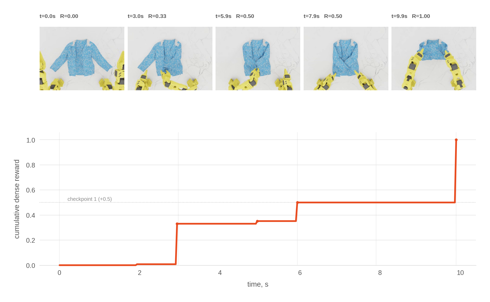

**图 7.** 一个成功长袖上衣回合中的稠密奖励：上方为五个里程碑时刻的俯视帧，下方为累计奖励。最初的 $0.5$ 随主要接近距离缩小而逐渐分配，即渐进式第一检查点；达到完整成功后，总奖励为 $1.0$。

**失败撤回。** 若回合失败，就撤回全部累计奖励，使总回报始终为二元值：$\sum_t r_t =1[\text{success}]$。原因在于，到达检查点可能具有误导性：检查点条件成立时，衣物其余部分可能处于很难最终成功的状态。为避免在结尾产生一个尖锐的负脉冲，从累计奖励最后一次达到最大值的帧 $t_p$ 之后开始，均匀分摊撤回量：

$$
r_t \mathrel{-}= \frac{\sum_\tau r_\tau}{T - t_p - 1}, \qquad t_p < t < T.
$$

因此，中间检查点负责在回合*内部*分配时间上的贡献，而回合级回报仍与真实目标一致。

### 6.2 将成功概率作为价值函数

由于总回报等于成功指示量，价值函数就是：

$$
V(s_t) \;=\; \mathbb{E}[\text{reward remaining}] \;=\; P(\text{success}\mid s_t) - R^{\mathrm{cum}}_t,
$$

因此，只需要一个成功概率预测器即可近似它。标准做法是使用独立价值网络，但这会复杂化流水线并浪费计算。我选择将 $\hat{P}_t$ 训练为 VLA 自身的辅助预测头（第 5 节）：使用共享查询 token，仅关注图像 token，以防模型利用状态捷径过拟合。

价值基线的经典用法是从回报中减去它，以降低方差 [22]。但在这里直接采用 $\text{return} - V(s_t)$ 存在两个问题：

1. **检查点奖励相互抵消。** 当 $V_t = P(\text{success}\mid s_t) - R^{\mathrm{cum}}_t$ 且 $R^{\mathrm{cum}}_{t+1} = R^{\mathrm{cum}}_t + r_t$ 时，TD 残差化简为

    $$
    \displaystyle \delta_t = r_t + V_{t+1} - V_t = P(\text{success}\mid s_{t+1}) - P(\text{success}\mid s_t).
    $$

     奖励同时进入剩余回报和 $R^{\mathrm{cum}}_t$，二者相互抵消，刚构造的稠密奖励就从优势中完全消失了。

2. **方差论证假设预测器完美。** 实际减去的是模型预测 $\hat{V}$，而非 $V$。对于不完美的 $\hat{V}$，完全相减不再是最小化方差的选择。

**衰减后的基线。** 将预测视为带噪声的控制变量，只减去其 $\alpha$ 比例：

$$
\hat{A}_t = G_t - \alpha\,\hat{V}_t, \qquad G_t = 1[\text{success}] - R^{\mathrm{cum}}_t,
$$

 其中 $G_t$ 为观测到的未来剩余回报。方差是关于 $\alpha$ 的二次函数：

$$
\displaystyle \operatorname{Var}\big(G - \alpha\hat{V}\big) = \operatorname{Var}(G) - 2\alpha\operatorname{Cov}(G,\hat{V}) + \alpha^{2}\operatorname{Var}(\hat{V}),
$$

 在以下取值处达到最小：

$$
\alpha^{*} = \frac{\operatorname{Cov}(G,\hat{V})}{\operatorname{Var}(\hat{V})} = \frac{\operatorname{Cov}(V,\hat{V})}{\operatorname{Var}(\hat{V})} = \rho(V,\hat{V})\,\frac{\sigma(V)}{\sigma(\hat{V})}.
$$

 第二个等号成立，是因为给定状态时，结果噪声 $G - V$ 的均值为零，因此它与状态的任何函数都不相关，包括 $\hat{V}$；第一个表达式仅含可观测量。为理解 $\alpha^*$ 的形式，将预测头建模为真实价值加独立误差：$\hat{V} = V + \varepsilon$，其中 $\varepsilon$ 独立于 $(V, G)$，且 $\operatorname{Var}(\varepsilon) = \sigma_\varepsilon^{2}$。于是有 $\operatorname{Cov}(G,\hat{V}) = \sigma_V^{2}$、$\operatorname{Var}(\hat{V}) = \sigma_V^{2} + \sigma_\varepsilon^{2}$，以及

$$
\alpha^{*} = \frac{\sigma_V^{2}}{\sigma_V^{2} + \sigma_\varepsilon^{2}} = \rho^{2}(V,\hat{V}) < 1.
$$

完美预测器得到 $\alpha^{*} = 1$，恢复完全相减，等价于标准优势估计；无用的预测器得到 $\alpha^{*} = 0$，退回原始回报。

**两个问题其实是同一个问题。** 将该比例带入 TD 残差（为清晰起见取 $\gamma = 1$；包含 $\gamma$ 的精确形式见第 6.4 节），得到

$$
\delta_t = (1-\alpha)\,r_t + \alpha\,\big(\hat{P}_{t+1} - \hat{P}_t\big),
$$

 因此，稠密奖励与预测成功概率的变化，按照预测器的可信程度混合。$\alpha = 0$ 时只保留检查点奖励。$\alpha = 1$ 正好对应问题 1 的抵消，但这时它是正确行为，而非错误：若成功概率预测完全准确，中间奖励就不再携带额外信息，$P(\text{success})$ 的变化已经包含全部信号。问题 1 实际上源自对完美预测器的假设。$G - \alpha\hat{V}$ 在 $\alpha < 1$ 时不再是优势的无偏估计，但我仍沿用这一名称，因为它在下游承担优势的作用。

这一想法受到在线实验方差缩减方法的启发。CUPED [23] 从每个实验单位的指标 $Y$ 中，减去能预测该指标的协变量 $X$，并用系数 $\theta$ 缩放，从而降低 A/B 测试方差：

$$
Y_{\mathrm{adj}} = Y - \theta\,\big(X - \mathbb{E}[X]\big), \qquad \theta^{*} = \frac{\operatorname{Cov}(Y,X)}{\operatorname{Var}(X)},
$$

 这在数学上与我们的问题等价。原论文使用实验前的指标值作为 $X$；如今工业界通常使用能够获得的最佳结果预测，这正是价值预测的设置。

该思想本身是教科书中的控制变量／回归调整结论，广为人知，但强化学习论文中的主流优势估计通常并不这样做。

**我的实际做法。** 估计 $\alpha^{*}$ 只需要回报和预测，因此可以直接从轨迹估计，也可以按衣物类型分别估计；前提是预测必须在该预测头未训练过的数据上产生，否则预测头已部分记住结果噪声，朴素估计会偏向 $1$。我的流水线在采集时记录 $\hat{P}_t$（第 6.5 节），恰好就是这种同策略、未见状态上的测量。然而，竞赛期间我在这里犯了一个逻辑错误，并带入本报告 v1：我误以为 $\alpha^{*}$ 需要真实的 $V$，因此无法计算，转而使用凭判断选出的固定系数：

$$
\hat{V}_t = \alpha_s\big(P(\text{success}\mid s_t) - R^{\mathrm{cum}}_t\big), \qquad \alpha_s = 0.5.
$$

 事后在历史轨迹上估计的 $\alpha^{*}$，随衣物类型和训练阶段，大致处于 $0.4$ 到 $0.8$ 之间，$0.5$ 接近中位数，因此这个错误并不严重。现在我建议按衣物动态估计 $\alpha^{*}$，每轮使用新采集的轨迹重新估计。

两项校正使预测头的原始结果更实用：

- **EMA 平滑。** 原始逐动作块预测噪声较大，所有使用方都采用 $\bar{S}_t = \mathrm{EMA}(\hat{P}_t)$，其中 $\alpha_{\mathrm{EMA}} = 0.2$。

- **价值尾段校正。** 预测头在成功结尾附近系统性低估成功率：“几乎完成”的帧绝大多数来自*失败*回合，因为成功立即终止，而差一点成功的回合会在该状态停留很多帧。在已知结果 $y \in \{0,1\}$ 的离线阶段，我对最后 $K{=}30$ 帧的 $\bar{S}$，用朝向 $y$ 的线性插值替换：

  $$
  \displaystyle \bar{S}_{T-K+i} \;=\; \bar{S}_{T-K-1} + \left(y - \bar{S}_{T-K-1}\right)\frac{i}{K}, \qquad i = 1,\dots,K.
  $$

   训练时也处理同一偏差：成功回合最后 20 帧的成功 BCE 损失权重提高为 $20\times$。

### 6.3 完成度预测

只用成功预测头有三个缺点：（1）噪声较大，且对特定状态过拟合；（2）对高成功率衣物几乎不提供信号，因为很快就在 90% 以上饱和；（3）训练期间会漂移，因为同一网络也预测动作，这是有意设计，但会造成不稳定。因此，我加入**完成度预测头**，只用成功回合、以 $t/T$ 为目标通过 MSE 训练，并将其作为第二个进度信号。完成度比成功概率稳定得多：它几乎不随策略演化而变化，甚至在 $P(\text{success}) \approx 1$ 时仍能提供信号。

### 6.4 对两个预测头应用 GAE

两个信号都通过 GAE [22] 聚合（$\gamma = 0.999$、$\lambda = 0.99$），每轮训练迭代前独立进行一次离线计算。

**成功 GAE**：对经过 $\alpha_s$ 衰减的价值基线 $\hat{V}_t = \alpha_s\big(\bar{S}_t - R^{\mathrm{cum}}_t\big)$（第 6.2 节）使用精确 TD 残差，并将终端值固定为真实结果（$\bar{S}_T = y$）：

$$
\displaystyle \delta^{s}_t = r_t + \gamma\,\hat{V}_{t+1} - \hat{V}_t, \qquad A^{s}_t = \delta^{s}_t + \gamma\lambda\,A^{s}_{t+1}, \qquad \alpha_s = 0.5.
$$

展开 $\hat{V}$（使用 $R^{\mathrm{cum}}_{t+1} = R^{\mathrm{cum}}_t + r_t$）并合并 $r_t$ 项，可见衰减后的回报减法也对奖励产生了衰减：

$$
\displaystyle \delta^{s}_t = \big(1-\alpha_s\gamma\big)\,r_t + \alpha_s\big(\gamma\,\bar{S}_{t+1} - \bar{S}_t\big) + \alpha_s(1-\gamma)\,R^{\mathrm{cum}}_t.
$$

当 $\gamma \approx 1$ 时，$\alpha_s(1-\gamma)R^{\mathrm{cum}}_t$ 项消失，剩下的就是按 $(1-\alpha_s\gamma)$ 对奖励进行简单衰减：

$$
\delta^{s}_t \approx \big(1-\alpha_s\gamma\big)\,r_t + \alpha_s\big(\gamma\,\bar{S}_{t+1} - \bar{S}_t\big).
$$

**完成度塑形**：对 EMA 平滑后的完成度预测 $\bar{C}_t$，使用*基于势函数的塑形*项，势函数为 $\Phi_t = \alpha_c\bar{C}_t$，终端值为 $\bar{C}_T = y$：

$$
\delta^{c}_t = \gamma\,\Phi_{t+1} - \Phi_t = \alpha_c\left(\gamma\,\bar{C}_{t+1} - \bar{C}_t\right), \qquad \alpha_c = 0.5,
$$

$$
\Phi^{c}_t = \delta^{c}_t + \gamma\lambda\,\Phi^{c}_{t+1}.
$$

### 6.5 过时轨迹：分段基线与混合

上述 GAE 不能统一用于持续的离策略数据采集循环。$P(\text{success})$ 依赖于策略，预测模型会在迭代间不断演化，也会过拟合已经训练过的数据，使过去轨迹上的预测变得极端而无用。我的解决方法如下：

1. **在采集时预测。** 在轨迹采集期间记录成功／完成度预测，此时是同策略且状态未见，之后不再重新预测。

2. **衰减旧数据。** 每个轨迹数据集的采样份额每轮训练按 $0.98$ 衰减；BC 和 DAgger 数据集保持固定份额。

3. **向客观基线混合。** 随着预测过时，优势从 GAE 转向类似 GRPO [14] 的相对成功信号，后者仅依赖结果，不依赖策略预测：

$$
\tilde{A}_t = w\,A^{s}_t + (1 - w)\,A^{\mathrm{seg}}_t + \Phi^{c}_t,
$$

$$
w = \min(\text{sampling share},\,1).
$$

完成度塑形 $\Phi^{c}$ 对所有数据都保持完整强度，因为完成度头对策略变化稳定，对旧轨迹依然有效。（它作为基于势函数的塑形项加入，而非价值基线，因此不需要成功通道所需的 $R^{\mathrm{cum}}$ 校正。）

**分段分量 $A^{\mathrm{seg}}$。** 在第一个检查点处分割回合，将每段回报与逐衣物经验基线比较（$p_{\mathrm{cp}}$ 为该衣物的检查点到达率，SR 为成功率），并乘以 $G(n)/n$，其中 $G(n) = \frac{1 - (\gamma\lambda)^n}{1 - \gamma\lambda}$ 使逐步量级与 GAE 匹配：

$$
\displaystyle A^{\mathrm{seg}}_t = \begin{cases} \left(R_1 - \tfrac{1}{2}\,p_{\mathrm{cp}}\right) G(n_1)/n_1 & t \le t_1 \\[2pt] \left(R_2 - \left(\mathrm{SR}/p_{\mathrm{cp}} - \tfrac{1}{2}\right)\right) G(n_2)/n_2 & t > t_1 \end{cases}
$$

对于从未到达检查点的回合，则使用 $(R - \mathrm{SR})\,G(T)/T$（基线回退顺序为：衣物均值 $\to$ 类型均值 $\to$ 0.5）。关键性质是：先到达检查点再失败，会使检查点之前的优势为*正*，之后为*负*。

**归一化。** 将混合后的 $\tilde{A}_t$ 除以仅从无偏轨迹计算的单一全局标准差 $\sigma$，再裁剪到 $[-2, 2]$。

### 6.6 精度增强

二元成功指标将勉强过关的折叠和紧致精确的折叠视为相同。优势计算完成后，对每件衣物的成功回合按满足成功条件的紧致程度排序，前 20% 回合的每帧获得固定奖励 $\Delta A = 0.3$。紧致度得分取最终帧距离比值中最差、即最小的条件裕量；每个裕量衡量该条件位于阈值内侧多远，接近条件用 $1 - d^{(i)}$，分离条件用 $d^{(i)} - 1$。窗口内成功次数少于 5 次的衣物跳过。这样训练会偏向高质量折叠，而不是勉强达标的折叠。

### 6.7 优势如何使用

优势通过两种方式驱动训练（详见第 2 节）：AWR 风格 [6] 的优先采样 $P(\text{frame } i) \propto e^{\mathrm{clip}(A_i,\,-2,\,2)}$（图 8），以及 RECAP 风格 [7] 的动作专家优势条件化，后者使推理时的无分类器引导成为可能。

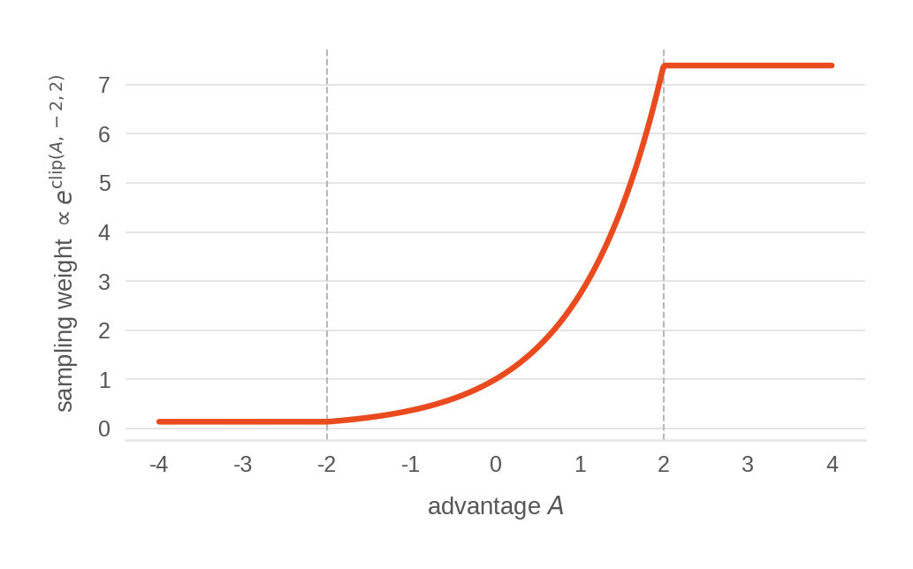

**图 8.** AWR 采样权重随优势变化的关系：$P \propto e^{\mathrm{clip}(A,-2,2)}$。

### 6.8 直观总结

最终公式有些过度设计，很可能可以简化而不损失太多。简而言之，下列情况下动作的优势较高：

- 它带来了客观任务进展，使用定义成功的同一组关键点距离衡量；

- 预测的最终成功概率提高；

- 在最终成功这一条件下，预测完成度提高。

轨迹越过时，其优势就越逐渐退化为稀疏、仅依赖结果的相对成功信号。所有信号都通过类似 GAE 的反向计算聚合，其中 $\gamma\lambda \approx 0.989$。

## 7 推理时优化

同一模型检查点会因*运行方式*不同而取得不同成功率：每个预测动作块实际执行多少、优势条件被放大到什么程度、采样多少候选动作块并重新排序。这些操作都不改变权重，均在部署时决定，却影响很大。本节介绍推理时的所有调节参数，以及如何按衣物类型调优。

策略服务器是**无状态的**：每个推理请求相互独立，调用之间不保留记忆（§2.1、§3.1）。所有推理时*看似*有状态的内容，如滚动动作块缓存、软修补锚点和锁定的衣物类型，都位于客户端（仿真代理或真实机器人运行器）。服务器只负责把观测映射为动作块。

### 7.1 推理约定：动作块执行与去噪

策略始终预测固定的 $H = 30$ 个动作，由短流匹配去噪循环产生（$S = 10$ 个欧拉步，从 $t{=}1$ 的噪声积分到 $t{=}0$ 的干净动作）。动作块如何被*使用*由三个量控制，均原样沿用团队此前的 BEHAVIOR-1K 方案 [8]：

- **执行长度** $n_e$：重新规划前，$H$ 个动作中实际发送给机器人的数量。较小的 $n_e$ 意味着更频繁地重新规划，反应更及时、计算更多；较大的 $n_e$ 则更接近开环。

- **播放拉伸系数** $k$：将执行动作在时间上重缩放为 $\lfloor k\,n_e\rfloor$ 个控制步。当 $k>1$ 时，同样的运动被拉长到更多步骤，机械臂运动更慢。

- **锚点长度** $n_a$：在已执行片段之后保留多少个动作，用于初始化下一动作块（§7.2），约束为 $n_e + n_a \le H$。

### 7.2 动作块之间的软修补

如果每个窗口都从头重新规划，轨迹会在每个动作块边界发生跳变。因此，我把当前块尾部的 $n_a$ 个动作作为下一块的软锚点。下一块去噪时，锚定的动作维度沿流路径被轻柔地拉向这些锚值，再通过动作协方差将这种作用传播到其余维度，使*整个*动作块保持一致，而不仅是重叠部分。锚定仅在去噪循环前段的高噪声阶段启用，即流时间高于阈值 $t_\text{ip}$ 时（回顾：$t{=}1$ 为纯噪声，$t{=}0$ 为干净动作），在最后的低噪声步骤关闭。因此，锚点在早期确定总体方向，但流过程末尾始终允许动作块自由细化和自我纠正，不会被固定在锚点上。具体机制继承自 BEHAVIOR-1K 方案 [8]。

我期望它带来以下好处：

- **模态持续性**：策略保持已选定的行为模态，而不是每个动作块都跳到另一个模态。

- **轨迹平滑**：提高稳定性，同时允许按帧而非按块训练模型，因为数据中的任意 30 步窗口本身就是一个平滑动作块。

- **吞吐量**：实时动作分块（RTC）[24] 及相关方法表明，这类重叠可提高模型的有效吞吐量。

### 7.3 对优势进行无分类器引导

推理时我希望得到策略的最佳行为，而非平均行为。无分类器引导 [25] 放大这一条件作用。每个去噪步骤运行两次动作专家：

- **有条件**：前缀和动作专家条件输入中都保留优势信号；

- **无条件**：从两者中都移除优势信号，

然后对两个速度场做外推：

$$
\hat{v} = v_\text{uncond} + \alpha\,\big(v_\text{cond} - v_\text{uncond}\big).
$$

两次前向传播共享前缀计算，昂贵的视觉—语言前向每个动作块只运行一次，因此引导只使便宜的动作专家成本翻倍，而非整个模型翻倍。引导强度 $\alpha$ 按衣物类型调优，最终提交采用了相当高的 $7$—$9$ 范围（§7.7）。

### 7.4 Best-of-N 候选选择

这里体现了 FM 查询的“Q”头（§5.2）的价值。当候选数量 $N>1$ 时，策略从*同一*前缀采样 $N$ 个动作块，每个使用独立的流匹配初始噪声，因此轨迹会分化。随后按 FM 头预测的 $\Delta_\text{success}$（相对价值基线的动作条件增益，§5.2）评分，并对两次引导前向的结果取平均：

$$
\text{score} = \tfrac{1}{2}\big(\Delta^\text{cond}_\text{success} + \Delta^\text{uncond}_\text{success}\big).
$$

执行得分最高的动作块。由于候选共享前缀，额外成本只有便宜的动作专家。

**全部为负时重试。** 若所有候选都被预测会恶化衣物状态，即 $\Delta_\text{success} < 0$ 对全部 $N$ 个候选成立，则再采样一个更大的批次，从合并后的候选池中选择最佳项。

**该相信哪个 $\Delta$。** 一方面，我们希望按*有条件*的 $\Delta_\text{success}$ 排序，因为它基于更接近实际执行动作的好动作训练。但有条件预测头只在正优势帧上训练，具有乐观偏差。*无条件*预测头在数据分布上无偏，但被评分的动作本身已被引导推向“好的一侧”，因此也存在轻微不匹配。两种分数都不完全可靠，最终方案对二者取平均，作为务实折中。

这居然有效，令我有些惊讶。我的所有实验中，FM 头预测与实际结果或其残差的相关性基本为零，但使用 2—3 个候选的轨迹始终优于单候选。我猜测，对大多数动作块，best-of-N 不起作用，因为候选会收敛到相同或同样好的预测。但在少数模型确实存在多模态的瓶颈状态，选择最佳候选，或避开最差候选，会带来实质帮助。

### 7.5 初始噪声：相关性与温度

初始去噪噪声不是独立同分布高斯噪声，而是根据拟合的动作协方差从 $\mathcal{N}(0,\Sigma)$ 采样，并向单位阵收缩：$\Sigma_\text{reg} = \beta\Sigma + (1-\beta)I$。因此，它保留 12 维动作块的联合结构，这也继承自 BEHAVIOR-1K [8]。

随后用噪声温度 $\tau$，将噪声乘以 $\sqrt{\tau}$。温度小于 1 会减小采样方差，使候选更集中在分布模态附近（§7.7）。

### 7.6 推理时的衣物类型初始化

策略将衣物类型作为*输入*（§4.2），但回合开始时，运行器还不知道眼前是哪类衣物。由于服务器不保存状态，初始化在客户端完成：

1. 对首次观测执行一次不用于动作执行的**预热**推理，读取模型自己预测的衣物类型。

2. 在最初几个动作块中，对预测进行**多数投票**以细化估计。

3. 随后将投票得到的类型**固定**到回合结束，并作为输入反馈给模型。

最初几次调用还采用更短的重新规划窗口，以便类型预测尚未稳定时快速响应。训练后期分类器的准确率为 $>$ 99%，所以单次预热几乎总是正确；投票只是低成本保险。（真实机器人上，在最初动作块期间，客户端还会保持位置不动，等待类型锁定，见仿真到现实部分 §9。）

### 7.7 通过汤普森采样按衣物类型调优

上面的每个参数——执行长度、播放拉伸、锚点长度、软修补启用阈值、引导强度、噪声温度、候选数量——都是可按衣物类型优化的超参数。对全部参数做全面消融和网格搜索会很慢，因此我选择更高效的方法：**在轨迹采集期间在线调优**，为每个参数使用汤普森采样多臂老虎机 [26, 27]。

**臂与后验。** 每个参数的每个候选值都是一条臂，具有 $\text{Beta}(\alpha,\beta)$ 后验（例如引导强度有四条臂）。各参数**独立**优化，这是因子化多臂老虎机，而非在完整乘积空间中联合搜索，因此臂数较少，每条臂的后验都能得到充足数据。

**采样。** 对探索回合，每个参数从各臂后验各采样一次，选择最大者，即标准汤普森采样；拒绝任何违反 $n_e + n_a \le H$ 的组合。回放和难例挖掘回合视为*利用*，改用当前最优的后验均值配置。

**奖励与更新。** 回合结束后，奖励为二元结果减去逐类型基线，即 $r = \text{success} - \overline{\mathrm{SR}}(\text{type})$，并通过 $\alpha\!\mathrel{+}=\!\max(r,0)$、$\beta\!\mathrel{+}=\!\max(-r,0)$ 更新选中的臂。只有 **full／random** 轨迹更新多臂老虎机；回放和课程回合刻意在更简单或更难的子集上运行，会引入偏差。每轮迭代，后验向均匀分布**衰减**，使其跟踪不断变化的策略而非全部历史；各类型后验还会轻度向汇总后验**正则化**。

**提交前冻结。** 后验稳定后，关闭多臂老虎机，将每类衣物的最佳配置固定用于最终运行。仿真赛取值见表 4：

| 参数 | 长袖上衣 | 短袖上衣 | 长裤 | 短裤 |
| --- | --- | --- | --- | --- |
| 执行动作数 $n_e$ | 5 | 5 | 3 | 3 |
| 播放步数 $\lfloor k\,n_e\rfloor$ | 5 | 5 | 3 | 3 |
| 锚定动作数 $n_a$ | 6 | 3 | 3 | 3 |
| 软修补启用阈值 $t_\text{ip}$ | 0.4 | 0.4 | 0.5 | 0.5 |
| 引导强度 $\alpha$ | 7 | 7 | 9 | 7 |
| 噪声温度 $\tau$ | 0.9 | 0.7 | 0.7 | 0.7 |
| 候选数 $N$ | 2 | 3 | 3 | 3 |

**表 4.** 按衣物类型冻结的推理参数（仿真赛）。

不同类型之间的数值差异并不大，说明最终模型使用单一共享配置，很可能也能取得接近的效果。但调优期间，我曾看到个别参数明显偏离汇总取值，我认为这源于训练中各衣物类型*成熟度*不同：短裤很早就达到 $>$ 80% 成功率，策略随后转向优化速度；短袖上衣仍在改进灵巧性和准确性，因此偏好另一种参数设置。

在采集轨迹时优化可以同时解决多个问题：

- 以低成本找到好的超参数；

- 超参数随策略演化，使强化学习运行的每个阶段都接近最佳取值，而不只是结束时；

- 探索免费带来有用的训练变化，例如改变执行速度可以教会策略更快完成任务。

采用汤普森采样的多臂老虎机，是优化随机在线实验（A/B 测试）成本和收敛速度的标准工具。既然用强化学习训练大策略本就昂贵，我认为同一方法也自然适用于推理参数优化。

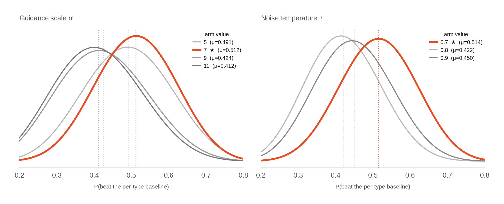

**图 9.** 短裤的汤普森采样后验。

图 9 展示大型训练运行后期，短裤的两个参数实际收敛后的臂后验。每条曲线是一条臂的 $\text{Beta}(\alpha,\beta)$ 后验，表示选择该值优于该类型基线的概率，因此曲线越靠右，该值越受当前多臂老虎机偏好。解读时有两点需要注意：奖励减去了基线，因此所有均值都在 $0.5$ 附近，重要的是*相对*顺序；后验每轮都会衰减，因此反映近期同策略窗口，而非整个运行。臂集合本身是*最终*搜索范围，我在运行中不断调整。引导强度最明显：从保守的 $0$—$2$ 范围开始，看到后验总集中在最高臂后，就反复整体上移范围，直到稳定在图中 $5$—$11$ 左右。其他参数若最佳臂位于边界，我也采取相同但幅度更小的调整。

即使没有受控消融，多臂老虎机的收敛方向本身也能为设计选择提供信息：

- **引导强度**收敛到很高的值：初始搜索空间为 $0$—$2$，但上界始终占优，因此逐渐上移到 $7$—$9$ 区域。

- **候选数量**大于 1 始终有益，但超过 3 没有帮助。这与 best-of-N 主要在*避免非常糟糕的动作块*、而非寻找最优块的解释一致。

- **执行长度**收敛到较小值，说明模型对最近步骤的预测远比远期可靠，因此根据新观测频繁重新规划值得付出成本。

- **播放拉伸**在训练早期偏离执行长度，但最终与之匹配。早期模型不能预测最优速度，因此围绕预测速度额外探索有帮助；到后期则能直接预测正确速度。

- **软修补强度**稳定在轻度引导：少量锚定好于完全没有，但强制性过强的修补会限制模型自我纠正并降低表现。

## 8 线上赛结果

LeHome Challenge 2026 线上赛是仿真赛道：策略在 Isaac Sim 中处理四类衣物，每个回合按折叠成功与否计二元结果，队伍按总体成功率在公开排行榜排名。评测集每类 20 件，共 80 件：10 件主办方提供训练数据的*已见*衣物，以及 10 件*未见*衣物（§1.1）。未见衣物中，每类 2 件公开，我在开发期间可以使用，但没有主办方训练数据；其余每类 8 件为私有，从未公开。我的最终提交获得**第一名**。

这里报告最终排行榜结果，并对策略仍然失败的情况做定性分析。

### 8.1 最终排名

线上赛按总体成功率排名，对全部 80 件衣物各评测 10 次，再对四类衣物等权平均。共有 62 支队伍提交。我的最终策略以 **79.63% 获得第一名**，领先第二名 **6.1 个百分点**，差距显著。排行榜前列见表 5。

| 排名 | 队伍 | 长袖上衣 | 短袖上衣 | 长裤 | 短裤 | 总体 |
| --- | --- | --- | --- | --- | --- | --- |
| **1** | **ilya（本工作）** | 74.5% | **70.0%** | **80.5%** | **93.5%** | **79.63%** |
| 2 | Shubham @ Vorwerk | 73.0% | 62.5% | 71.5% | 87.0% | 73.50% |
| 3 | Dum-E | 76.5% | 62.0% | 75.5% | 79.5% | 73.38% |
| 4 | SCUT-Unlimited | 65.5% | 66.0% | 70.0% | 91.0% | 73.13% |
| 5 | GraspYesAI | 73.5% | 61.0% | 69.0% | 79.0% | 70.63% |
| 6 | sZs | 70.5% | 64.0% | 68.5% | 75.5% | 69.63% |
| 7 | ClothFolder50k | **77.0%** | 56.0% | 58.5% | 82.5% | 68.50% |
| 8 | sisigakgak | 68.0% | 52.5% | 64.0% | 77.5% | 65.50% |
| 9 | RoboAction | 62.5% | 61.0% | 52.5% | 83.0% | 64.75% |
| 10 | MotionCrew | 64.0% | 31.0% | 78.5% | 80.5% | 63.50% |

**表 5.** 线上赛排行榜前列。（完整 62 队排名见竞赛网站 [lehome-challenge.com](https://lehome-challenge.com/)。）

我的逐类型分数为 74.5%／70.0%／80.5%／93.5%。胜利来自整体表现，而非单一衣物类别：短袖上衣、长裤和短裤均独占第一，长袖上衣为第三，仅次于 77.0% 和 76.5%。从绝对值看，短裤最强，为 93.5%，该类次优为 91.0%。对我的策略而言，短裤最容易，短袖上衣最难，这与整个开发期间观察一致，也适用于排行榜上的大多数队伍。短袖上衣最依赖灵巧性，袖子小、容差紧；提交时，强化学习仍在积极改进这一类别。产生该结果的确切检查点已发布于 [huggingface.co/IliaLarchenko/lehome_sim](https://huggingface.co/IliaLarchenko/lehome_sim)。

### 8.2 数据规模与失败分析

按大规模强化学习标准，最终策略所用数据量并不大，但对本竞赛已相当可观：最终轨迹数据集包含约 **12,500 个策略采样回合（$\sim$ 4.3M 帧）**，来自 $\sim$ 140 次采集会话。流水线持续裁剪和重加权这一数据池（第 5—6 节），让过时数据衰减退出；我还刻意彻底丢弃了一些最旧轨迹。因此，整个运行中累计生成的回合数是最终保留窗口的数倍。

我不会称这个方法具有高样本效率；我怀疑小得多的数据集也能达到同样结果。主要问题可能在于缺少恢复逻辑：初始 BC 数据由脚本生成，探索和多样性都很少，策略难以快速探索并找到更好的行为。

对剩余失败情况的一些定性观察：

- **灵巧性与精度。** 策略总体做对了，但最终略微偏离成功标准：折叠看起来几乎正确，某个关键点距离却刚好落在阈值错误的一侧。

- **仿真物理。** 仿真器为计算稳定性简化了部分物理过程，并不总是完美；偶尔会发生抓取失败或衣物从夹爪滑出，并非策略本身真的做错。

- **缺少恢复。** 如前所述，仿真策略没有专门训练恢复能力，探索也较少，所以一旦犯错进入分布外状态，往往直接失败，而非逐步恢复。

部分成功和失败轨迹可以在配套博客中查看：[ilialarchenko.com/projects/lehome2026](https://ilialarchenko.com/projects/lehome2026)。

## 9 仿真到现实迁移（决赛）

竞赛有两轮。此前介绍的全部内容，包括策略、强化学习流水线、推理调优，以及第 8 节的线上第一名，都属于*仿真*赛。*决赛*则是仿真到现实：让在 Isaac Sim 中训练的策略，在真实双臂机器人上折叠真实衣物。

仿真赛我有大约**三个月**，仿真到现实只有**一周多**。因此，本报告绝大多数工作、实验和想法都关于仿真；仿真到现实部分是一次黑客松式冲刺，目标是尽快实现可用迁移并在真实机器人上微调，而非严谨研究。本节记录实际做法，以及我会如何改进。

### 9.1 为什么零样本迁移无效

仿真与现实在很多方面不同：相机传感器及安装位置、机器人机械结构和回程间隙，以及衣物物理特性。提供的仿真器能力很强，但差距仍远大于零样本迁移可承受的范围。

我相当确信，很大一部分问题是策略**过拟合仿真特有细节**。最明显的间接证据来自图像处理测试：模型将每张 640$\times$ 480 相机图像缩放为 224$\times$ 224。如果不直接缩放，而是先缩小到 320$\times$ 240，*再*缩放为 224$\times$ 224，这种人眼几乎不可见的改变就会明显降低仿真成功率。查看辅助头预测时，模型能够**完全区分** 640$\to$ 224 的图像与 640$\to$ 320$\to$ 224 的图像。这类过拟合无法很好地迁移到真实机器人。

真实数据集与仿真完成某些任务的方式也不同：短袖上衣从另一只袖子开始折叠；长裤在仿真中从上方抓取，在真实数据中则从下方抓取（相对于相机）；半数真实回合中的短裤还旋转了 180 度。通常，训练真实世界折衣机器人时会希望拥有这种泛化，但竞赛条件下，它只是引入不必要的多模态，在短期内损害表现。

还有一个额外条件使本竞赛比普通仿真到现实更难：**我从未接触过最终评测实际使用的机器人。** 因此，这实际上是*仿真 $\to$ 我的机器人 $\to$ 他们的机器人*，即仿真到现实再到现实，额外包含一步泛化。即使主办方提供的行为克隆数据，也采集于与我的装置和评测装置都略有不同的物理设置，光照、标定和相机位置均有差异。

> **一个很能说明仿真与现实感知差异的例子：** 有两三个月，我一直以为我们折叠的是普通成人衣服。直到为决赛组装真实从动机械臂装置时，我才意识到一直处理的其实是**童装**。这是一件很有趣的事，也提醒我们：在仿真器里建立的心智模型，可能在完全没想过检查的地方出错。

### 9.2 缩小域差距的两种方法

缩小两个环境之间差距，有两种基本手段：让它们**更相似**，或者让训练分布**更多样**，使差距包含在分布范围内。我同时使用两者，本节后续也围绕它们展开：对齐工作，包括让相机、标定、单位和运动强度匹配目标；多样性工作，包括强增强、多种数据源和 DAgger。

### 9.3 策略概述

具体的仿真到现实方案如下：

1. 从仿真策略**较晚但并非最新**的检查点出发（§9.4）。

2. **精简模型**，只保留适合真实机器人的预测头和逻辑（§9.5）。

3. 使用**三组混合数据**微调：主办方真实数据、我自己的遥操作／DAgger 数据，以及仿真回放（§9.6）。

4. 尽可能将我的装置和仿真**对齐**到目标装置（§9.7）。

5. 训练时采用**非常强的数据增强**（§9.8）。

6. **对各数据源的运动强度进行重采样**，使不同数据组一致（§9.9）。

7. 逐步采集 **DAgger** 数据，并根据与人工干预的时间距离加权（§9.10）。

### 9.4 起始检查点

我选择一个较强的仿真检查点进行迁移，但刻意**不选最新版本**。最新仿真检查点最专门适配仿真器，也如 §9.1 所述最容易过拟合渲染细节；稍早的检查点更适合作为新域微调的起点。

### 9.5 将模型精简到真实任务

仿真策略的大多数辅助机制依赖仿真特有的特权信息，如关键点距离、成功判定器标签和优势估计，真实机器人上不存在这些信息。真实训练时，我禁用了这些机制，只保留可迁移部分：

- **继续训练：** 动作目标、**衣物类型**头和**完成度**头。衣物类型用于推理初始化（§7.6）；完成度是可以在任何数据上训练的进度信号。

- **保留但冻结**，即头权重存在并从仿真检查点加载，但不接收梯度：成功、任务中间检查点和距完成时间。

- **完全移除：** 关键点距离头，以及两个世界模型头，即 FAST 条件头和动作条件“Q”头。它们都依赖仿真专用目标。

- **从流水线移除：** 优势条件化和 AdaRMS 优势通道（真实环境没有优势），因而也移除推理时的无分类器引导和 best-of-N 选择，两者都需要优势／Q 机制。真实推理采用更简单的路径：一个去噪动作块、块间软修补和衣物类型初始化，仅此而已。

因此，真实策略本质上是初始 VLM、动作专家加两个轻量预测头，由已经在仿真中学到更多内容的模型微调而来。

### 9.6 训练数据混合

我使用三组数据微调，每个训练批次中各组的目标份额固定。表 6 列出数据组、来源、采集数量及各自作用。

| 来源 | 回合数 | 帧数 | 份额 | 采样率 | 作用 |
| --- | --- | --- | --- | --- | --- |
| 主办方 BC | 500 | 187,135 | **60%** | $\times$ 1.00 | 最接近评测装置：相同的相机、机器人颜色、衣物和折叠方式，是标准目标分布。 |
| 家中遥操作 | 321 | 162,363 | **30%**（共享） | $\times$ 0.21 | 与评测装置不同，但它们是唯一的恢复行为来源，因此刻意降低权重。 |
| 家中 DAgger | 471 | 288,198 | **30%**（共享） | $\times$ 0.21 | 与评测装置不同，但它们是唯一的恢复行为来源，因此刻意降低权重。 |
| 仿真成功回放 | 1,723 | 625,111 | **10%** | $\times$ 0.05 | 将已采集的成功仿真轨迹通过真实数据格式的流水线回放，并施加强增强，作为正则化混合数据。 |

**表 6.** 三组真实训练混合数据：各来源的批次份额、逐帧采样率、回合数和帧数。两个家庭数据源（遥操作 + DAgger）属于同一组，共享一个批次份额、采样率及作用。

权重设置的理由是：主办方数据最接近实际评测分布，所以占主导；我的数据有价值，但装置不匹配，因此刻意降权；仿真数据主要防止模型遗忘并增加多样性。各组原始规模差异很大，固定批次份额因此对应非常不同的逐帧采样率：相对于 `primary_real`，较大的 `home_real` 和 `home_sim` 数据池被大幅下采样（见表 6 的采样率列）。

除主办方的 500 个回合外，我共采集了 **792 个回合（$\sim$ 451k 帧）** 的真实机器人数据。包含 BC 集后，真实训练池约为 **1,292 个回合／638k 帧**，仿真组另有 **1,723 个成功回放回合（$\sim$ 625k 帧）**。

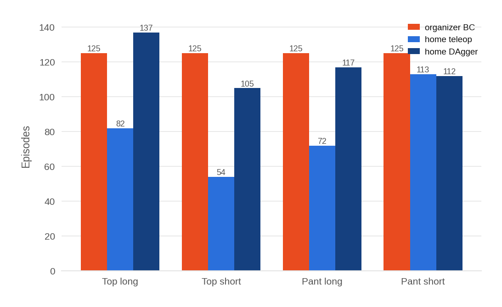

**图 10.** 按衣物类型和来源划分的真实机器人回合数，来源包括主办方 BC、家中遥操作和家中 DAgger。

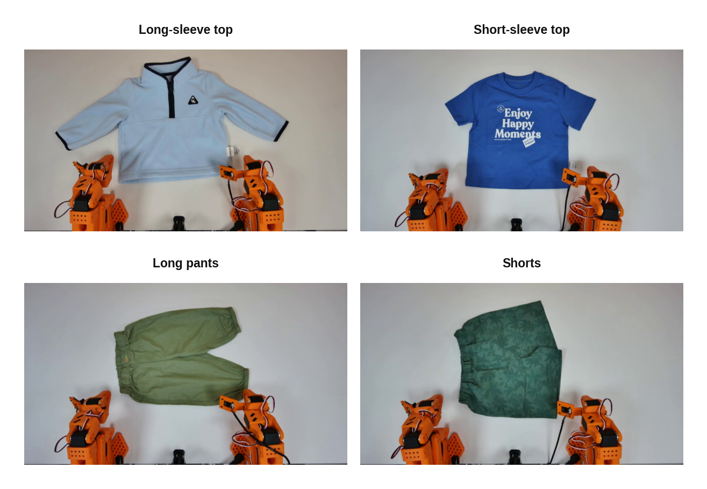

**图 11.** 主办方真实机器人 BC 数据集中，从俯视相机看到的四类衣物。这些是实际策略折叠的实体衣物，与 §1 中展示原始仿真形态的四类相同。

图 11 展示真实策略折叠的四类实体衣物。三个数据源的外观也明显不同，包括光照、衣物实例和相机取景，这正是需要处理的差异（图 12）。

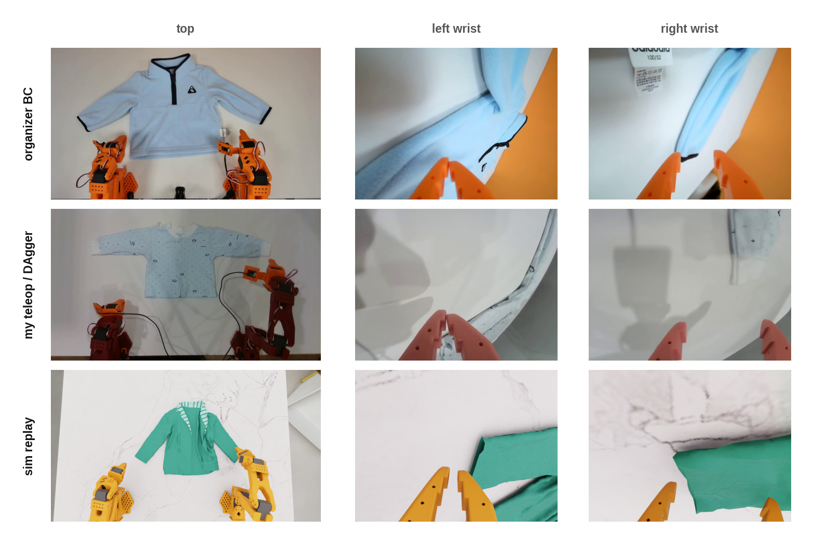

**图 12.** 各训练数据组的三台相机视图（上方、左腕、右腕）：主办方 BC 数据、我自己的遥操作／DAgger 记录，以及仿真成功回放。

### 9.7 对齐环境

§9.2 中的对齐工作大多是直接的工程操作：尽可能让相机、标定、单位和运动匹配目标。

其中最有用的工具是**相机叠加对齐**程序（图 13）。它从主办方 BC 数据集选取一帧，将实体机器人驱动到完全相同的关节状态，采集实时相机画面，再与数据集帧叠加。安装位置正确时，机器人位置会对齐。同样的方法也可以将仿真渲染与真实帧叠加（图 14）。这让实体装置与源数据集的匹配成为快速的可视化循环，而不是猜测。它的用途也不限于我的装置：我把工具分享给主办方和其他队伍，帮助大家对齐竞赛评测环境。

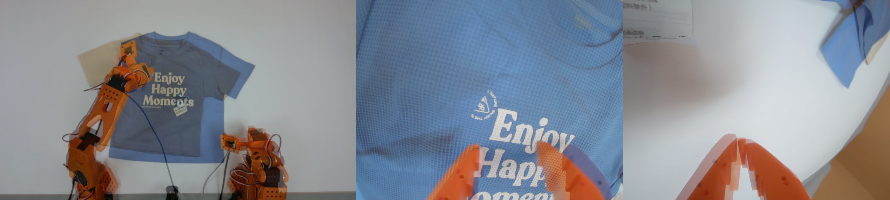

**图 13.** 将机械臂驱动到记录的关节状态后，把三台实时机器人相机的画面叠加到主办方 BC 数据集中对应的帧上。

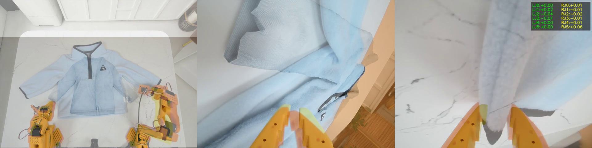

**图 14.** 将同样的方法用于仿真／现实之间：把相同动作序列的 Isaac Sim 渲染叠加到真实相机画面上，用于根据实体装置调节仿真相机偏移。

理想对齐很难。我使用不同相机，图像始终无法完美叠加。即使到了最终采集阶段，在相同硬件上似乎也无法精确复现评测设置。为了提高鲁棒性，我还刻意做了与对齐*相反*的事：**随时间随机改变自己的装置**，移动相机、多次重新标定机械臂、改变照明，让模型不对某一种配置过拟合。这是将多样性手段应用于采集装置本身。

### 9.8 强数据增强

在环境对齐之外，我施加了**非常激进**的训练增强，远强于仿真赛。包括：各相机独立的强颜色抖动（家中俯视相机明显比评测相机暗，仿真则过亮）、逐通道增益和 gamma、模糊、加性传感器噪声、每台相机独立的裁剪／旋转／缩放／平移（覆盖安装位置漂移）、局部遮挡、随机丢弃相机，以及**状态噪声／状态丢弃**。后者促使策略更相信图像，而不是可能标定不准的本体感知。仿真回放组还经过数据采集阶段的强环境增强引擎：图案替换、颜色重映射、根据实体装置标定的相机与机械臂基座抖动，以及桌面纹理和光照变化。图 15 展示同一帧在几次独立增强采样下的结果。

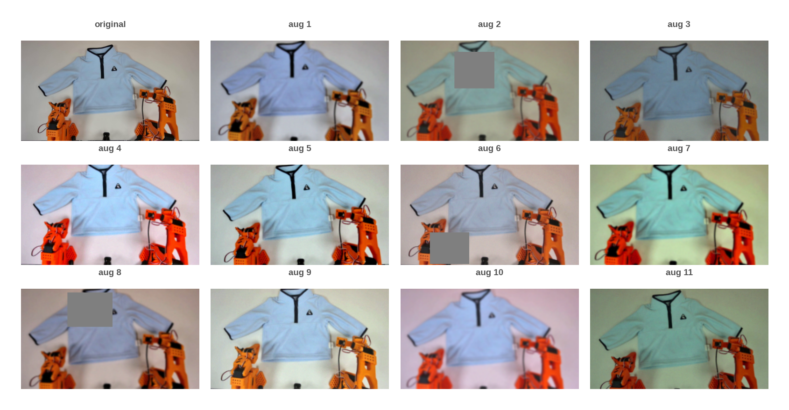

**图 15.** 同一真实相机帧经过独立采样的增强组合：颜色、增益、gamma、模糊、噪声、裁剪／旋转／缩放和局部遮挡。每个训练帧都受到这种扰动，使模型无法依赖固定外观。

### 9.9 对齐不同来源的运动强度

三组数据采集时的*速度*差别很大，这很重要，因为模型预测固定时域内的**增量**：机械臂运动慢的数据源产生较小逐步增量，快的数据源产生较大增量；直接混合会让模型学到互相矛盾的“每步应移动多远”。强化学习后，仿真策略运动很快，而我的手动遥操作，尤其早期 DAgger 纠正，都很慢。

因此，每个来源都带有一个**速度因子**，在切分动作块前对时间轴重采样，将运动强度重缩放到与 `primary_real` 基线一致（图 16）。大于 1 的因子将更多原始实际时间压进一个模型步，用于“加速”慢数据源；小于 1 则相反，用于“减慢”快速仿真：

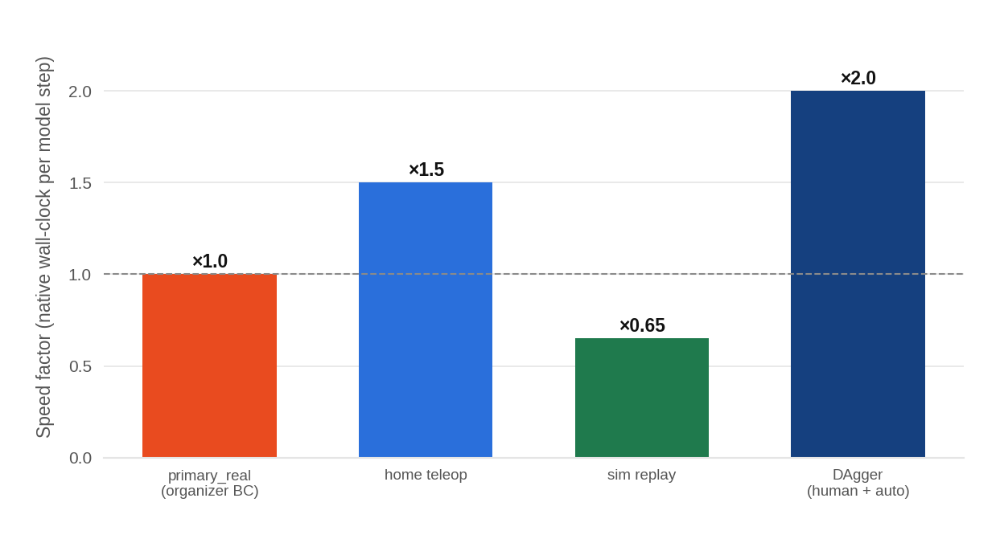

**图 16.** 各数据源的速度因子。

主办方 BC 是基线（$\times$ 1.0）。家庭遥操作更缓慢，每回合时长为基线的 $\sim$ 1.4$\times$，因此压缩（$\times$ 1.5）。仿真轨迹最激进，因此拉伸（$\times$ 0.65）。DAgger 纠正最慢，回合时长为 $\sim$ 2$\times$，因此使用最大因子（$\times$ 2.0）；同时根据锚定帧属于人工纠正还是自主片段，对 DAgger 动作块逐块重缩放。这一周里我的遥操作越来越快，合适的因子也随之漂移，所以按数据源设置，而非全局统一。

### 9.10 DAgger 采集与加权

恢复数据是主办方 BC 集无法提供的内容，因为它只展示规整、成功的折叠。为获得分布外恢复行为，我在真实机器人上运行 **DAgger**：策略自主折叠，一开始出错我就通过遥操作接管、纠正，然后交还控制权。每帧标注由谁控制，即策略还是人。

真实机器人上没有奖励或价值函数，因此无法像仿真流水线一样计算优势。但干预信号本身很有信息：人工接管标志着策略**刚刚失败**，而人工纠正在构造上就是**高优势**动作。我将其转为逐帧采样权重（图 17）：

- **人工纠正帧**获得**最高**权重，因为它们是我最希望模型学到的示范。

- 远离任何干预的**自主帧**获得**低**权重，因为通常只是策略自行正常运行，没有多少新信号。

- 接管**之前 5 秒窗口**内的自主帧权重**逐渐降至零**：我明确*不*希望强化那些使策略进入坏状态的具体动作。

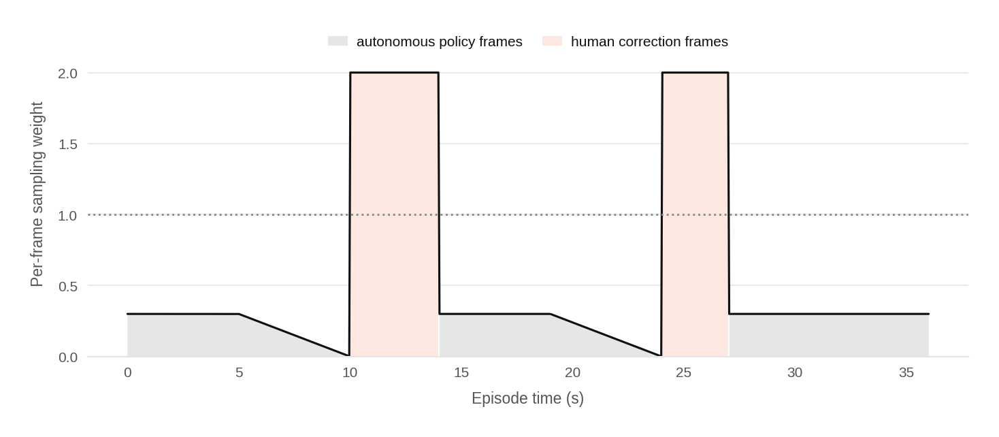

**图 17.** 一个包含两次人工干预并恢复自主控制的回合中的逐帧采样权重。人工纠正帧权重最高，远离干预的自主帧权重较低，每次接管前 5 秒窗口内的权重逐渐降至零。

这是对真正优势函数的一种刻意粗略的替代。若能在真实数据上学习合适的奖励／价值模型，几乎肯定会有帮助：既能更细致地为帧加权，也能支持在仿真中表现良好的优势条件化和 best-of-N 选择。但最后一周，我确实没有时间构建并验证这样的模型。

**采集装置。** 为使 DAgger 操作舒适，我搭建了**两条主控臂和两条从动臂**，配备**三踏板脚控器**快速切换控制模式，全部由一台配备 RTX PRO 6000 的工作站驱动。为方便交接，策略自主控制时主控臂也跟随从动臂，因此我可以在运动途中接管而不发生跳变。

我将 DAgger 采集集中于**最难的情况和异常样例**，即策略容易失败的最难初始状态，但不能过难，因为竞赛规则假设衣物初始平铺。事后看，这可能是个错误：决赛实际初始状态大多比我预期*更简单*，因此困难状态恢复上的努力部分浪费了。我怀疑，如果转而集中打磨简单初始状态的**干净完整执行**，得分会更高。

### 9.11 单位错误：一个教训

一个细微的数据错误浪费了我很多时间。在两个 LeRobot 0.4.x 版本之间，SO-101 从动臂的**默认状态表示**发生变化：五个机械臂关节从归一化的 $-100\ldots100$ 运动范围编码，变为以度为单位的关节角度；夹爪两种情况下都是 0—100。两种约定通过逐关节缩放关联，大多数关节的完整运动范围约 200 度，所以屏幕上几乎一样，肉眼很难发现不匹配，却会使每个关节产生约 10% 的偏差。直到**截止日期前两天**才最终定位问题，此前我的大部分真实数据和训练都使用了错误表示。我通过后处理修复，而不是重新采集全部数据，但这次中断几乎肯定损害了最终性能。（之后已清理代码，真实数据端到端统一为角度模式，训练和推理路径中不再有任何单位转换。）

### 9.12 决赛结果

我在最终仿真到现实赛中获得**第二名**。表 7 展示排行榜前列，列出完成真实机器人计分运行的队伍：

| 排名 | 队伍 | 分数 |
| --- | --- | --- |
| 1 | sZs | 895 |
| **2** | **ilya（本工作）** | **865** |
| 3 | Dum-E | 762.5 |
| 4 | SCUT-Unlimited | 635 |
| 5 | sisigakgak | 570 |
| 6 | Shubham @ Vorwerk | 470 |

**表 7.** 最终仿真到现实排行榜前列。分数是主办方的真实机器人综合指标，而非成功率百分比。评测同时考虑成功率和逐步质量，未见衣物有 50% 分数加成，最高总分为 1080 分。

产生该结果的真实机器人检查点已发布于 [huggingface.co/IliaLarchenko/lehome_real](https://huggingface.co/IliaLarchenko/lehome_real)。

## 10 讨论

这套赢得线上赛、并在仿真到现实阶段以微小差距获得第二的系统，并非源于一个简洁想法，而是时间压力下许多实用选择的集合，其中大多数从未严格消融。以下是我认为真正有效的部分、遇到的困难，以及下一步会做什么。

### 10.1 我会保留的做法

- **策略作为自身的价值函数（§5.1、§6.2）。** 成功预测头让 VLA 成为价值估计器，无需训练、同步或部署独立评论家；同一次前向传播还给出完成度、关键点和 $\Delta$success 信号，用于优势计算和 best-of-N。这些预测在稳定性和正则化方面仍有很大改进空间，该方法也可能有不足，因此应针对具体情况评估取舍。

- **奖励工程（§6）。** 为特定任务找到合适奖励仍是一门艺术。真实检查点、成功概率、完成度、相对成功，各有利弊，关键在于良好组合。我的具体组合肯定远非最优，但我认为这些基本构件选对了。

- **吞吐量工程（§3.1）。** 无论人工还是自动，数据采集都依赖数量，必须利用好每一秒。并行化、异步生成失败状态，以及任何能够节省操作者时间或产生更多轨迹的方法，都值得做。

- **推理时调优（§7）。** 同一检查点在训练后仍可通过执行长度、引导强度、候选数量等参数继续优化，并用低成本汤普森采样多臂老虎机在线寻找取值。这带来了很大收益，且无需额外训练。

- **DAgger 数据采集。** 虽然已是标准做法，仍值得重申：通过短暂人工干预采集数据，是提高策略鲁棒性的高效方式。尽可能采用 DAgger 式采集，而非全程人工遥操作，并保持干预简短。

- **未见衣物泛化几乎不是问题。** 我曾担心私有未见衣物，但它们的表现只比训练衣物略低，少量失败都来自与训练数据差异很大的衣物。最突出的是一条真实长裤，连我都觉得像短裤，但官方要求按长裤折叠；两次轨迹中有一次被策略识别为短裤并提前结束。这更像标签歧义，而非真正失败。

### 10.2 困难或效果不佳的部分

- **仿真中的恢复。** 通过缓慢仿真界面遥操作布料很难，等 DAgger 工具可用时，策略折叠已比我更好。回放和增强提高了*鲁棒性*，却没有改善从已破坏状态中*恢复*的能力，见 §10.4。

- **对渲染伪影过拟合。** 只在仿真中训练，模型会依赖无法迁移的细微渲染和编码特征。这在仿真赛不是问题，但在真实赛需要大量增强。除对齐采集环境和评测环境外，我始终没有找到简洁的解决办法；同样的过拟合也加大了仿真到现实的难度。

- **模型比任务所需更大。** 我使用了相当大的 $\pi_{0.5}$ 策略，但认为小得多的模型也能完成任务。参赛的主要目的是试验完整规模 VLA 的强化学习微调，这决定了模型选择；在更实际的场景中，我一定会从小得多的模型开始。

### 10.3 对环境变化的鲁棒性

一个出乎意料的结果是，策略能很好地适应物理装置变化。BC 策略通常很脆弱，尤其是在廉价硬件上：相机挪动一厘米、改变焦距或移动桌子，就可能让策略失效。我的策略却相对较好地应对了这类日常漂移。

我将其归功于有意的装置随机化（§9.7）和强增强（§9.8）。我刻意改变相机姿态、光照、颜色和机器人基座位置，使模型不依赖任何精确几何配置；相机叠加对齐则让这个多样分布始终以真实装置为中心。

更广泛地说，我认为机器人领域对低成本图像增强使用不足。它们在计算机视觉中已是标准做法，几乎可以直接用于机器人相机流；但该领域花费大量精力研究沉重的神经网络图像和视频增强，却常常不用毫秒级成本的经典方法。这让我困惑已久。

### 10.4 探索与恢复：开放问题

最难、尚未解决的部分是自动探索。本文的强化学习方法擅长复现和改进已见行为，却不会自然地通过探索摆脱训练分布之外的状态。我加入的每种推理技巧都朝已知好模态推进，而非创造新的恢复行为：优势条件化和 CFG 放大平均的好行为，best-of-N 从相同前缀的多个样本中选出最不差的，软修补让策略保持已选择的模态。它们都不能发明数据中原本没有的恢复动作。我试过若干探索机制，代码中还留有部分痕迹，但都效果不佳：在流匹配策略中，额外扰动大多只是把动作块推出动作流形（§2.2），降低表现，而没有发现有用的新恢复动作。

实践中，唯一可靠的恢复来源是人工干预，它在真实机器人上有效，在仿真中却不行。几秒钟真实遥操作纠正很容易，成为项目最有用的工具之一（§9.10）。于是两个阶段的恢复方法分离了：仿真依赖强化学习和回放获得鲁棒性，真实环境依赖 DAgger 获得恢复能力。让流匹配策略在无人参与的情况下生成有用恢复尝试，仍像是一个开放问题。

### 10.5 用一条流水线代替两条

我最大的遗憾是用两套基本独立的工具解决两个阶段。线上赛拥有完整强化学习机制：稠密奖励、价值函数、优势、CFG 和 best-of-N。仿真到现实赛拥有真实数据和能够真正产生恢复行为的人工干预，却因为缺少真实端奖励与价值，只能按普通 BC 运行（§9.5）。

这两部分互补。统一流水线可以由真实端奖励／价值函数驱动真实机器人的优势条件化和 best-of-N，对真实轨迹优先采样，再用相同价值信号给 DAgger 干预加权，而不是我使用的粗略手调方案（§9.10），从而结合第一轮的规整完成能力和第二轮的恢复能力。我还会加入更多简单初始状态下的干净完成示例，而不是像此前那样过分追逐困难案例（§9.10）。我没有时间构建它，但认为它能明显超过任何单独一轮的结果；我猜测，本任务达到 90% 以上是可行的。

### 10.6 代码与模型

完整训练、采集和推理代码已发布于 [github.com/IliaLarchenko/lehome_solution](https://github.com/IliaLarchenko/lehome_solution)。两个最终检查点位于 Hugging Face Hub：仿真赛策略见 [huggingface.co/IliaLarchenko/lehome_sim](https://huggingface.co/IliaLarchenko/lehome_sim)，真实世界决赛策略见 [huggingface.co/IliaLarchenko/lehome_real](https://huggingface.co/IliaLarchenko/lehome_real)。包含视频示例的配套博客见 [ilialarchenko.com/projects/lehome2026](https://ilialarchenko.com/projects/lehome2026)。

## 参考文献

[1] R. Wu, Y. Wang, Z. Li, Y. Chen, H. Liu, S. Xie, K. Xu, S. Liu, A. Longhini, H. Lu（LeHome Challenge 主办方）。*LeHome Challenge 2026——家庭场景中的衣物操作技能学习挑战赛*（“首届仿真驱动的可变形物体操作竞赛”；ICRA 2026 竞赛，维也纳，2026 年 6 月 1—5 日）。网站：<https://lehome-challenge.com/>；代码：<https://github.com/lehome-official/lehome-challenge>；ICRA 2026 竞赛：<https://2026.ieee-icra.org/program/competitions/>。

[2] Z. Li, Y. Yang, S. Xie, K. Xu, T. Chen, Y. Wang, Z. Shen, Y. Shen, Y. Chen, W. Li, Y. Zheng, C. Zhang, S. Lin, F. Teng, H. Yang, M. Chen, S. Xie, R. Wu。*LeHome：家庭场景中可变形物体操作的仿真环境。* arXiv:2604.22363, 2026。<https://arxiv.org/abs/2604.22363>

[3] R. Cadene, S. Alibert, A. Soare, Q. Gallouedec, A. Zouitine 等。*LeRobot：基于 PyTorch、面向真实世界机器人的先进机器学习。* 2024。<https://github.com/huggingface/lerobot>

[4] The Robot Studio，与 Hugging Face 合作。*SO-ARM100 / SO-ARM101：标准开放机械臂。* 2024。<https://github.com/TheRobotStudio/SO-ARM100>

[5] S. Gao, M. Pagnucco, T. Bednarz, Y. Song。*NVIDIA Isaac Sim：为机器人提供可扩展的 GPU 加速仿真。* arXiv:2606.03551, 2026。<https://arxiv.org/abs/2606.03551>

[6] X. B. Peng, A. Kumar, G. Zhang, S. Levine。*优势加权回归：简单且可扩展的离策略强化学习。* arXiv:1910.00177, 2019。<https://arxiv.org/abs/1910.00177>

[7] Physical Intelligence 等。*$\pi^{*}_{0.6}$：从经验中学习的 VLA。* arXiv:2511.14759, 2025。<https://arxiv.org/abs/2511.14759>

[8] I. Larchenko, G. Zarin, A. Karnatak。*视觉—语言—动作模型的任务适配：2025 BEHAVIOR 挑战赛第一名方案。* arXiv:2512.06951, 2025。<https://arxiv.org/abs/2512.06951>

[9] K. Black 等（Physical Intelligence）。*$\pi_{0.5}$：具有开放世界泛化能力的视觉—语言—动作模型。* arXiv:2504.16054, 2025。<https://arxiv.org/abs/2504.16054>

[10] A. Nair, A. Gupta, M. Dalal, S. Levine。*AWAC：利用离线数据集加速在线强化学习。* arXiv:2006.09359, 2020。<https://arxiv.org/abs/2006.09359>

[11] S. Ross, G. Gordon, D. Bagnell。*将模仿学习和结构化预测归约为无遗憾在线学习（DAgger）。* AISTATS 2011, PMLR 15，第 627—635 页。<https://arxiv.org/abs/1011.0686>

[12] J. Luo, C. Xu, J. Wu, S. Levine。*通过人在环强化学习实现精确灵巧的机器人操作（HIL-SERL）。* Science Robotics，第 10 卷，eads5033，2025。DOI:10.1126/scirobotics.ads5033。arXiv:2410.21845。<https://www.science.org/doi/10.1126/scirobotics.ads5033>

[13] J. Schulman, F. Wolski, P. Dhariwal, A. Radford, O. Klimov。*近端策略优化算法。* arXiv:1707.06347, 2017。<https://arxiv.org/abs/1707.06347>

[14] Z. Shao, P. Wang, Q. Zhu, R. Xu, J. Song 等。*DeepSeekMath：推动开放语言模型数学推理能力的极限。* arXiv:2402.03300, 2024。<https://arxiv.org/abs/2402.03300>

[15] Y. Sun, J. Shen, Y. Wang, T. Chen, Z. Wang, M. Zhou, H. Zhang。*通过面向难度的在线数据选择和轨迹回放，提高大语言模型强化微调的数据效率。* arXiv:2506.05316, 2025。<https://arxiv.org/abs/2506.05316>

[16] X. Zhai, B. Mustafa, A. Kolesnikov, L. Beyer。*用于语言—图像预训练的 Sigmoid 损失。* ICCV 2023。arXiv:2303.15343。<https://arxiv.org/abs/2303.15343>

[17] Gemma Team, Google DeepMind。*Gemma：基于 Gemini 研究与技术的开放模型。* arXiv:2403.08295, 2024。<https://arxiv.org/abs/2403.08295>

[18] Y. Lipman, R. T. Q. Chen, H. Ben-Hamu, M. Nickel, M. Le。*用于生成建模的流匹配。* ICLR 2023。arXiv:2210.02747。<https://arxiv.org/abs/2210.02747>

[19] K. Pertsch 等。*FAST：面向视觉—语言—动作模型的高效动作 token 化。* arXiv:2501.09747, 2025。<https://arxiv.org/abs/2501.09747>

[20] S. Zhai。*排他自注意力。* arXiv:2603.09078, 2026。<https://arxiv.org/abs/2603.09078>

[21] TRI LBM Team。*对用于多任务灵巧操作的大行为模型的细致研究。* arXiv:2507.05331, 2025。<https://arxiv.org/abs/2507.05331>

[22] J. Schulman, P. Moritz, S. Levine, M. I. Jordan, P. Abbeel。*利用广义优势估计进行高维连续控制。* ICLR 2016。arXiv:1506.02438。<https://arxiv.org/abs/1506.02438>

[23] A. Deng, Y. Xu, R. Kohavi, T. Walker。*利用实验前数据提高在线受控实验的灵敏度。* WSDM 2013，第 123—132 页。DOI:10.1145/2433396.2433413。<https://exp-platform.com/Documents/2013-02-CUPED-ImprovingSensitivityOfControlledExperiments.pdf>

[24] K. Black, M. Y. Galliker, S. Levine（Physical Intelligence）。*动作分块流策略的实时执行。* arXiv:2506.07339, 2025。<https://arxiv.org/abs/2506.07339>

[25] J. Ho, T. Salimans。*无分类器扩散引导。* NeurIPS 2021 深度生成模型及下游应用研讨会；arXiv:2207.12598, 2022。<https://arxiv.org/abs/2207.12598>

[26] W. R. Thompson。*基于两个样本的证据，一个未知概率超过另一个未知概率的可能性。* Biometrika，第 25 卷，第 3—4 期，第 285—294 页，1933。DOI:10.1093/biomet/25.3-4.285。<https://doi.org/10.1093/biomet/25.3-4.285>

[27] D. Russo, B. Van Roy, A. Kazerouni, I. Osband, Z. Wen。*汤普森采样教程。* Foundations and Trends in Machine Learning，第 11 卷，第 1 期，第 1—96 页，2018。DOI:10.1561/2200000070。<https://arxiv.org/abs/1707.02038>
