# 流匹配与扩散模型导论

Peter Holderrieth、Ezra Erives

课程网站： [https://diffusion.csail.mit.edu/](https://diffusion.csail.mit.edu/)

arXiv: [2506.02070v3](https://arxiv.org/abs/2506.02070v3), 2026 年 3 月 18 日。

源码：[LaTeX 源码](https://arxiv.org/src/2506.02070v3)。许可： [CC BY-NC-ND 4.0](https://creativecommons.org/licenses/by-nc-nd/4.0/)。

## 目录

- [1 引言](#contents-1)
  - [1.1 概述](#contents-2)
  - [1.2 课程结构](#contents-3)
  - [1.3 将生成式建模视为采样](#contents-4)
- [2 流模型与扩散模型](#contents-5)
  - [2.1 流模型](#contents-6)
  - [2.2 扩散模型](#contents-7)
- [3 流匹配](#contents-8)
  - [3.1 条件概率路径与边缘概率路径](#contents-9)
  - [3.2 条件向量场与边缘向量场](#contents-10)
  - [3.3 学习边缘向量场](#contents-11)
- [4 得分函数与得分匹配](#contents-12)
  - [4.1 条件得分函数与边缘得分函数](#contents-13)
  - [4.2 使用 SDE 采样](#contents-14)
  - [4.3 得分匹配](#contents-15)
- [5 引导：如何以提示词为条件](#contents-16)
  - [5.1 基础引导](#contents-17)
  - [5.2 无分类器引导](#contents-18)
- [6 构建大规模图像与视频生成器](#contents-19)
  - [6.1 神经网络架构](#contents-20)
    - [6.1.1 条件变量的嵌入](#contents-21)
    - [6.1.2 扩散 Transformer](#contents-22)
    - [6.1.3 U-Net](#contents-23)
  - [6.2 在潜空间中建模：（变分）自编码器](#contents-24)
    - [6.2.1 标准自编码器](#contents-25)
    - [6.2.2 变分自编码器](#contents-26)
  - [6.3 案例研究：Stable Diffusion 3 与 Meta Movie Gen](#contents-27)
    - [6.3.1 Stable Diffusion 3](#contents-28)
    - [6.3.2 Meta Movie Gen Video](#contents-29)
- [7 离散扩散模型：用扩散构建语言模型](#contents-30)
  - [7.1 连续时间马尔可夫链（CTMC）模型](#contents-31)
  - [7.2 CTMC 模型的训练](#contents-32)
    - [7.2.1 条件概率路径与边缘概率路径](#contents-33)
    - [7.2.2 条件速率矩阵与边缘速率矩阵](#contents-34)
    - [7.2.3 学习边缘速率矩阵](#contents-35)
- [参考文献](#contents-36)
- [附录 A 概率论回顾](#contents-37)
  - [A.1 随机向量](#contents-38)
  - [A.2 条件密度与条件期望](#contents-39)
- [附录 B Fokker–Planck 方程的证明](#contents-40)
- [附录 C 连续时间马尔可夫链的存在性与唯一性](#contents-41)
- [附录 D 理解 VAE 的更多视角](#contents-42)
- [附录 E 扩散模型文献导读](#contents-43)

## 1 引言

> 从数据中制造噪声很容易；从噪声中创造数据，就是生成式建模。
>
> Song 等 [[45](#bib.bib10)]

### 1.1 概述

近年来，我们共同见证了人工智能（AI）领域的一场巨大变革。Nano Banana、Stable Diffusion 3 等图像生成器能够生成风格多样、逼真或富有艺术感的图像；Meta 的 VEO-3 等视频模型能够生成极为逼真的电影片段；ChatGPT 等大语言模型则能针对文本提示给出看似达到人类水平的回答。这场变革的核心，是 AI 系统获得了一种新能力：**生成**对象。此前的 AI 系统主要用于**预测**，而新一代系统具有创造性：它们能够根据用户指定的输入展开想象，构造新的对象。这类**生成式 AI** 系统，正是近来这场 AI 变革的核心。

本课程旨在介绍两类应用最广泛的生成式 AI 算法：**去噪扩散模型** [[43](#bib.bib25)] 与**流匹配** [[25](#bib.bib26), [27](#bib.bib12), [1](#bib.bib23), [26](#bib.bib27)]。它们构成了当前最优秀的图像、音频和视频生成模型的基础，例如 Nano Banana、FLUX 和 VEO-3；近来，它们也在蛋白质结构等科学应用中取得了领先表现，例如 AlphaFold3 就是一种扩散模型。毫无疑问，理解这些模型是一项极为实用的能力。

这些生成模型都通过反复迭代，将**噪声**逐步转化为**数据**。这一从噪声到数据的演化过程，借助对**常微分方程或随机微分方程（ODE/SDE）**的模拟来实现。流匹配和去噪扩散模型是一系列技术，使我们能够利用深度神经网络，大规模地构造、训练并模拟这样的 ODE/SDE。这些模型的实现往往相当简单，但 SDE 所涉及的数学细节可能使其原理不易理解。本课程将自成体系地介绍微分方程所需的数学工具，帮助你系统理解这些模型，随后逐步讲解当前先进图像与视频生成器所采用的技术体系。除了应用广泛，我们也认为流模型与扩散模型背后的理论本身就十分优美。因此，我们尤其希望这门课程能让你乐在其中。

**注记 1（补充资源）**

尽管本讲义自成体系，我们仍建议你使用以下两类补充资源：

1. **课程录像：**以课堂讲授的形式，带你逐节学习。

2. **实验：**引导你从零实现自己的扩散模型。我们强烈建议你亲自动手编写代码。

这些资源均可在课程网站找到：[https://diffusion.csail.mit.edu/](https://diffusion.csail.mit.edu/)。

### 1.2 课程结构

下面简要介绍本文的组织结构。

- **第 [1](#S1) 节：将生成式建模视为采样。**我们将形式化“生成”图像、视频、蛋白质等对象的含义，把“如何生成一张狗的图像？”这类问题，转化为从概率分布中采样这一更精确的问题。

- **第 [2](#S2) 节：流模型与扩散模型。**我们解释生成过程的运作机制。正如课程名称所暗示的，这套机制就是模拟常微分方程和随机微分方程。我们将介绍微分方程，并说明如何用它们构造生成模型。

- **第 [3](#S3) 节：流匹配。**接下来，我们讲解并推导流匹配。这种算法简单、易于扩展，是前文提及的 Stable Diffusion、Nano Banana 和 SORA 等大规模生成模型的核心。

- **第 [4](#S4) 节：得分匹配。**我们研究得分函数，以及如何通过得分匹配学习它。得分匹配既是扩散模型的训练算法，也为 SDE 采样与引导提供了基础。

- **第 [5](#S5) 节：引导。**我们学习如何让生成样本以提示词为条件，例如“一张猫的图像”，以及如何通过无分类器引导来增强样本对提示词的遵循程度。

- **第 [6](#S6) 节：潜空间与神经网络架构。**我们讨论如何构建 Nano Banana 等大规模图像与视频生成器，包括常见神经网络架构、如何在潜空间中建模，并介绍当前先进模型。

- **第 [7](#S7) 节（选读）：离散扩散模型。**我们学习如何将扩散模型的原理从欧几里得空间推广到语言等离散数据，从而基于扩散模型的思想构建大语言模型。

##### 预备知识。

由于本主题具有一定的数学深度，我们建议读者具备基本的数学素养，尤其是对概率论有所了解。为此，我们在[附录 A](#A1) 中简要回顾了概率论知识。其中有些概念若尚不熟悉，也不必担心。

### 1.3 将生成式建模视为采样

首先，让我们考虑可能遇到的不同数据类型，也称**数据模态**，以及如何将它们表示为数值：

1. **图像：**考虑一幅包含 $H\times W$ 个像素的图像，其中 $H$ 表示高度，$W$ 表示宽度，每个像素有三个颜色通道（RGB）。每个像素的每个颜色通道，都对应一个取值于 $\mathbb{R}$ 的强度。因此，一幅图像可以表示为元素 $z\in\mathbb{R}^{H\times W\times 3}$。

2. **视频：**视频就是按时间排列的一系列图像。若有 $T$ 个时间点，即**帧**，则一段视频可表示为元素 $z\in\mathbb{R}^{T\times H\times W\times 3}$。

3. **分子结构：**一种朴素的表示方法是使用矩阵 $z=(z^{1},\dots,z^{N})\in\mathbb{R}^{3\times N}$，其中 $N$ 为分子的原子数，每个 $z^{i}\in\mathbb{R}^{3}$ 描述一个原子的位置。当然，分子结构还可以采用其他更精细的表示方式。

在以上所有例子中，待生成的对象都可以在数学上表示为向量，必要时先将其展平。因此，本文将采用以下约定：

**核心思想 1（将对象表示为向量）**

我们将待生成的对象视为向量 $z\in\mathbb{R}^{d}$。

一个值得注意的例外是文本数据：语言模型（如 ChatGPT）通常将其建模为离散对象。虽然本文主要讨论连续数据 $z\in\mathbb{R}^{d}$，我们也会在[第 7 节](#S7) 研究文本生成。

##### 将生成视为采样。

下面定义“生成”的含义。以生成一张狗的图像为例，显然，有许多不同的狗的图像都能令我们满意，并不存在唯一一张“最好”的图像。相反，各种图像对要求的符合程度有高有低。在机器学习中，通常用图像空间上的一个概率分布来刻画这种多样性。我们称其为**数据分布**，记作 $p_{\rm{data}}$。从数学上看，可以将 $p_{\rm{data}}$ 理解为**概率密度**，即函数 $p_{\rm{data}}:\mathbb{R}^{d}\to\mathbb{R}_{\geq 0}$，为每个可能的对象 $z\in\mathbb{R}^{d}$ 赋予一个似然值 $p_{\rm{data}}(z)\geq 0$。在狗的图像这个例子中，越像狗的图像 $z$，其似然值 $p_{\rm{data}}(z)$ 就越高。这样，图像、视频或分子有多“符合要求”这一较为主观的判断，就被转化为它在数据分布 $p_{\rm{data}}$ 下有多“可能”。据此，我们可以将生成任务在数学上表述为：从未知分布 $p_{\rm{data}}$ 中采样。

**核心思想 2（将生成视为采样）**

生成对象 $z$，被建模为从数据分布中采样，即 $z\sim p_{\rm{data}}$。

**生成模型**是一种能够让我们从 $p_{\rm{data}}$ 中生成样本的机器学习模型。在机器学习中，我们需要数据来训练模型。在生成式建模中，通常假设可以获取从 $p_{\rm{data}}$ 中独立采样的有限个样本，并用它们共同近似真实分布。

**核心思想 3（数据集）**

数据集由有限个样本 $z_{1},\dots,z_{N}\sim p_{\rm{data}}$ 构成。

对于图像，我们可以收集互联网上公开可用的图像来构建数据集；对于视频，也可以使用 YouTube 等来源；对于蛋白质结构，RCSB 蛋白质数据库（PDB）等资源提供了数十万个实验测定的结构。随着数据集规模不断增大，它对底层分布 $p_{\rm{data}}$ 的刻画也会越来越准确。

##### 引导生成与条件生成。

在许多情况下，我们希望**以**某些数据 $y$ **为条件**生成对象。例如，我们可能希望根据 $y=$“一只狗跑下白雪覆盖的山坡，背景是群山”生成图像。这可以重新表述为从一个**条件分布**中采样：

**核心思想 4（引导生成）**

引导生成是指采样 $z\sim p_{\rm{data}}(\cdot|y)$，其中 $y$ 为条件变量。

我们称 $p_{\rm{data}}(\cdot|y)$ 为**引导数据分布**。引导生成建模通常要求学会以任意选择的 $y$ 为条件，而不是只适用于某个固定条件。沿用前面的例子，我们也可能换用另一条文本提示，如 $y=$“一张猫吹灭生日蜡烛的逼真照片”。因此，我们希望用同一个模型来接受任意这样的条件 $y$。事实证明，无条件生成的方法很容易推广到条件生成。因此，前 3 节将几乎完全聚焦于无条件情形，但请记住，我们最终要实现的是条件生成。

##### 生成模型。

抽象地说，生成模型就是一种返回服从 $z\sim p_{\rm{data}}$ 的样本的算法，至少应近似做到这一点。如果 $p_{\rm{data}}$ 是狗的图像的分布，那么该算法就会返回随机的狗的图像。本课程将重点讨论如何用流模型或扩散模型构造生成模型，因为它们代表了当前的先进水平。不过，也请记住，已有许多其他生成模型被提出，未来还可能发现更多。

**小结 2（将生成视为采样）**

本节的要点如下：

1. 本文主要研究生成可表示为向量 $z\in\mathbb{R}^{d}$ 的对象，例如图像、视频和分子结构。

2. 生成的任务是从概率分布 $p_{\rm{data}}$ 中产生样本，而训练时可以获取样本数据集 $z_{1},\dots,z_{N}\sim p_{\rm{data}}$。

3. 引导生成假设分布以标签 $y$ 为条件；我们希望从 $p_{\rm{data}}(\cdot|y)$ 中采样，而训练时可以获取成对的数据集 $(z_{1},y)\dots,(z_{N},y)$。

4. 我们的目标是构造一个生成模型，即训练后能够返回服从 $p_{\rm{data}}$ 的样本的模型。

## 2 流模型与扩散模型

上一节中，我们将生成式建模形式化为从数据分布 $p_{\rm{data}}$ 中采样，并明确了目标：构造一个生成模型，即返回样本 $z\sim p_{\rm{data}}$ 的算法。本节将介绍如何通过模拟恰当构造的微分方程来建立生成模型。例如，流匹配与扩散模型分别涉及对**常微分方程**（ODE）和**随机微分方程**（SDE）的模拟。因此，本节旨在定义并构造后文将使用的这些生成模型。具体而言，我们首先定义 ODE 和 SDE，讨论如何模拟它们；随后说明如何用深度神经网络参数化 ODE/SDE。由此引出流模型、扩散模型，以及从这些模型中采样的基本算法。后续章节再探讨如何训练这些模型。

### 2.1 流模型

我们先定义**常微分方程（ODE）**。ODE 的解由一条**轨迹**给出，即如下形式的函数：

$$
X:[0,1]\to\mathbb{R}^{d},\quad t\mapsto X_{t},
$$

它将时间 $t$ 映射到空间 $\mathbb{R}^{d}$ 中的位置。每个 ODE 都由一个**向量场** $u$ 定义，即如下形式的函数：

$$
u:\mathbb{R}^{d}\times[0,1]\to\mathbb{R}^{d},\quad(x,t)\mapsto u_{t}(x),
$$

也就是说，对于每个时刻 $t$ 和位置 $x$，都有一个向量 $u_{t}(x)\in\mathbb{R}^{d}$ 指定该处的速度，见[图 1](#S2.F1)。ODE 对轨迹施加如下约束：我们希望轨迹 $X$ 从点 $x_{0}$ 出发，“沿着”向量场 $u_{t}$ 前进。可以将这样的轨迹形式化为下列方程的解：

$$
\begin{aligned}
\frac{\mathrm{d}}{\mathrm{d}t}X_{t} & =u_{t}(X_{t}) & \blacktriangleright\,\,\text{ODE} \qquad\text{(1a)} \\
X_{0} & =x_{0} & \blacktriangleright\,\,\text{初始条件} \qquad\text{(1b)}
\end{aligned}
$$

[式 1a](#S2.E1.1) 要求 $X_{t}$ 的导数由 $u_{t}$ 给定；[式 1b](#S2.E1.2) 要求在时刻 $t=0$ 从 $x_{0}$ 出发。现在可以问：若在 $t=0$ 从 $X_{0}=x_{0}$ 出发，到时刻 $t$ 会到达哪里，也就是 $X_{t}$ 是什么？一个称为**流**的函数回答了这个问题，它是下列 ODE 的解：

$$
\begin{aligned}
\psi:\mathbb{R}^{d}\times[0,1]\to & \mathbb{R}^{d},\quad(x_{0},t)\mapsto\psi_{t}(x_{0}) \qquad\text{(2a)} \\
\frac{\mathrm{d}}{\mathrm{d}t}\psi_{t}(x_{0}) & =u_{t}(\psi_{t}(x_{0})) & \blacktriangleright\,\,\text{流的 ODE} \qquad\text{(2b)} \\
\psi_{0}(x_{0}) & =x_{0} & \blacktriangleright\,\,\text{流的初始条件} \qquad\text{(2c)}
\end{aligned}
$$

对于给定初始条件 $X_{0}=x_{0}$，可以通过 $X_{t}=\psi_{t}(X_{0})$ 得到 ODE 的一条轨迹。因此，直观地说，向量场、ODE 和流是同一对象的三种描述：**向量场定义 ODE，而 ODE 的解就是流**。和研究任何方程一样，我们应当追问：ODE 的解是否存在？若存在，是否唯一？数学中的一个基本结论是，只需对 $u_{t}$ 施加较弱的假设，这两个问题的答案都是肯定的：

**定理 3（流的存在性与唯一性）**

若 $u:\mathbb{R}^{d}\times[0,1]\to\mathbb{R}^{d}$ 连续可微且导数有界，则[式 2](#S2.E2) 中的 ODE 有唯一解，由流 $\psi_{t}$ 给出。此时，对所有 $t$，$\psi_{t}$ 都是**微分同胚**，即 $\psi_{t}$ 连续可微，并具有连续可微的逆映射 $\psi_{t}^{-1}$。

在机器学习中，我们用神经网络参数化 $u_{t}(x)$，而其导数有界，因此流存在且唯一所需的假设几乎总能满足。因此，[定理 3](#Thmtheorem3) 带来的是好消息：**在我们关心的情形中，流存在，并且是 ODE 的唯一解。**证明可见 [[32](#bib.bib30), [9](#bib.bib31)]。

| 子图 1 | 子图 2 | 子图 3 |
| --- | --- | --- |
| 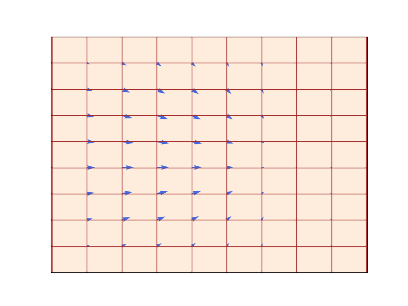 | 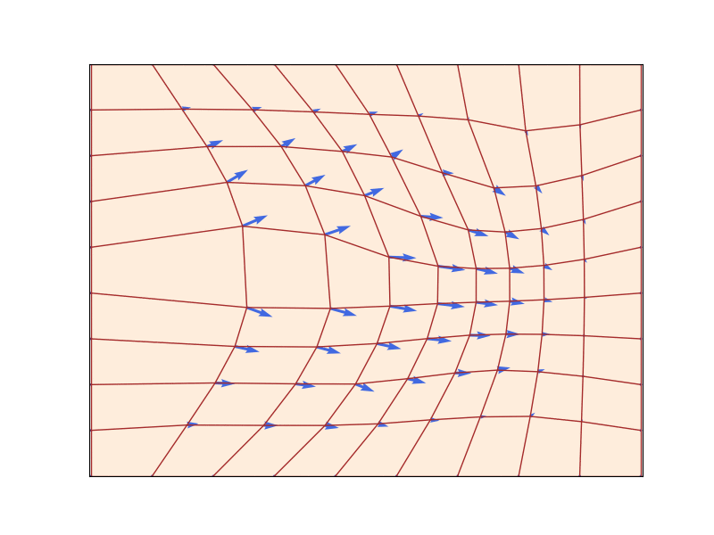 | 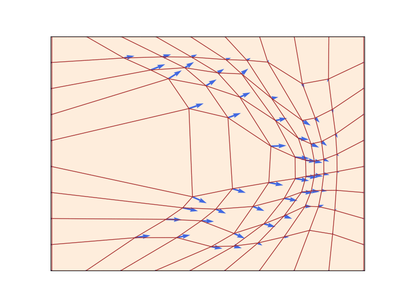 |

**图 1：流 $\psi_{t}:\mathbb{R}^{d}\rightarrow\mathbb{R}^{d}$（红色方格网）由速度场 $u_{t}:\mathbb{R}^{d}\rightarrow\mathbb{R}^{d}$（蓝色箭头）定义，该速度场规定了流在各处的瞬时运动方向，此处 $d=2$。图中展示了三个不同时刻 $t$。可以看到，流是一种“扭曲”空间的微分同胚。图片来自 [[26](#bib.bib27)]。**

**例 4（线性向量场）**

考虑一个简单的向量场 $u_{t}(x)$，它是 $x$ 的线性函数，即对 $\theta>0$，有 $u_{t}(x)=-\theta x$。那么，函数

$$
\psi_{t}(x_{0})=\exp\left(-\theta t\right)x_{0} \qquad\text{(3)}
$$

定义了求解[式 2](#S2.E2) 中 ODE 的流 $\psi$。你可以自行验证 $\psi_{0}(x_{0})=x_{0}$，并计算

$$
\frac{\mathrm{d}}{\mathrm{d}t}\psi_{t}(x_{0})\overset{3}{=}\frac{\mathrm{d}}{\mathrm{d}t}\left(\exp\left(-\theta t\right)x_{0}\right)\overset{(i)}{=}-\theta\exp\left(-\theta t\right)x_{0}\overset{3}{=}-\theta\psi_{t}(x_{0})=u_{t}(\psi_{t}(x_{0})),
$$

其中步骤 (i) 使用了链式法则。[图 3](#S2.F3) 展示了这种流以指数速度收敛到 $0$ 的情形。

##### ODE 的模拟。

一般来说，如果 $u_{t}$ 不像前例中那么简单，就无法显式计算流 $\psi_{t}$。此时需要用**数值方法**模拟 ODE。幸运的是，这是数值分析中一个经典且研究充分的问题，已有大量强大的方法 [[21](#bib.bib24)]。其中最简单、最直观的方法之一是**欧拉法**。使用欧拉法时，先初始化 $X_{0}=x_{0}$，再按下式更新：

$$
X_{t+h}=X_{t}+hu_{t}(X_{t})\quad(t=0,h,2h,3h,\dots,1-h) \qquad\text{(4)}
$$

其中 $h=n^{-1}>0$ 为**步长**，$n\in\mathbb{N}$ 为模拟步数。对本课程而言，欧拉法已足够。为了让你了解更复杂的方法，我们再考虑 **Heun 方法**，其更新规则为

$$
\begin{aligned}
X_{t+h}^{\prime} & =X_{t}+hu_{t}(X_{t})\quad & \blacktriangleright\,\,\text{新状态的初步预测（与欧拉步相同）} \\
X_{t+h} & =X_{t}+\frac{h}{2}(u_{t}(X_{t})+u_{t+h}(X_{t+h}^{\prime}))\quad & \blacktriangleright\,\,\text{利用当前与预测状态处的平均 }u\text{ 进行更新}
\end{aligned}
$$

直观地说，Heun 方法先对下一步位置作出初步预测 $X_{t+h}^{\prime}$，再根据更新后的预测修正最初采用的方向。

##### 流模型。

现在，我们可以将向量场设为**神经网络向量场** $u_{t}^{\theta}$，通过 ODE 构造生成模型。暂且只需将 $u_{t}^{\theta}$ 理解为具有参数 $\theta$ 的参数化函数 $u_{t}^{\theta}:\mathbb{R}^{d}\times[0,1]\to\mathbb{R}^{d}$，具体的神经网络架构将在后文讨论。回想一下，我们的目标是从分布 $p_{\rm{data}}$ 中生成样本 $z\sim p_{\rm{data}}$，因此这些样本必须具有随机性。然而，ODE 本身没有随机性，而是完全确定的。为了引入随机性，只需令初始条件 $X_{0}$ 随机。具体而言，我们选择一个**初始分布** $p_{\rm{init}}$，通常将 $p_{\rm{init}}=\mathcal{N}(0,I_{d})$ 设为简单的标准高斯分布。最关键的是，无论选择什么分布，推理时都必须能方便地从中采样。于是，**流模型**可由下列 ODE 描述：

$$
\begin{aligned}
X_{0} & \sim p_{\rm{init}} & \blacktriangleright\,\,\text{随机初始化} \\
\frac{\mathrm{d}}{\mathrm{d}t}X_{t} & =u_{t}^{\theta}(X_{t}) & \blacktriangleright\,\,\text{ODE}
\end{aligned}
$$

我们希望轨迹的终点 $X_{1}$ 服从分布 $p_{\rm{data}}$，即

$$
X_{1}\sim p_{\rm{data}}\quad\Leftrightarrow\quad\psi_{1}^{\theta}(X_{0})\sim p_{\rm{data}}
$$

其中 $\psi_{t}^{\theta}$ 表示由 $u_{t}^{\theta}$ 诱导的流。不过请注意，虽然它叫流模型，**神经网络参数化的是向量场，而不是流本身**。要计算流，需要模拟 ODE。[算法 1](#alg1) 总结了从流模型中采样的步骤。

**算法 1：用欧拉法从流模型中采样**

| 步骤 | 操作 |
| --- | --- |
| 0 | 神经网络向量场 $u_{t}^{\theta}$，步数 $n$ |
| 1 | 令 $t=0$ |
| 2 | 设置步长 $h=\frac{1}{n}$ |
| 3 | 采样 $X_{0}\sim p_{\rm{init}}$ |
| 4 | **对于** $i=1,\dots,n$，**执行** |
| 5 | $X_{t+h}=X_{t}+hu_{t}^{\theta}(X_{t})$ |
| 6 | 更新 $t\leftarrow t+h$ |
| 7 | **结束循环** |
| 8 | **返回** $X_{1}$ |

### 2.2 扩散模型

随机微分方程（SDE）通过引入**随机**轨迹，对 ODE 中的确定性轨迹作了推广。随机轨迹通常称为**随机过程** $(X_{t})_{0\leq t\leq 1}$，表示为

$$
\begin{aligned}
X_{t}\text{ 对每个以下时刻均为随机变量：}0\leq t\leq 1 \\
X:[0,1]\to\mathbb{R}^{d},\quad t\mapsto X_{t}\text{ 是每次抽取以下随机过程时得到的随机轨迹：}X
\end{aligned}
$$

特别地，同一随机过程模拟两次，可能得到不同结果，因为其动力学本身就是随机的。

##### 布朗运动。

SDE 通过**布朗运动**来构造。布朗运动是一种基本随机过程，源于对物理扩散过程的研究。你可以将其理解为连续的随机游走。

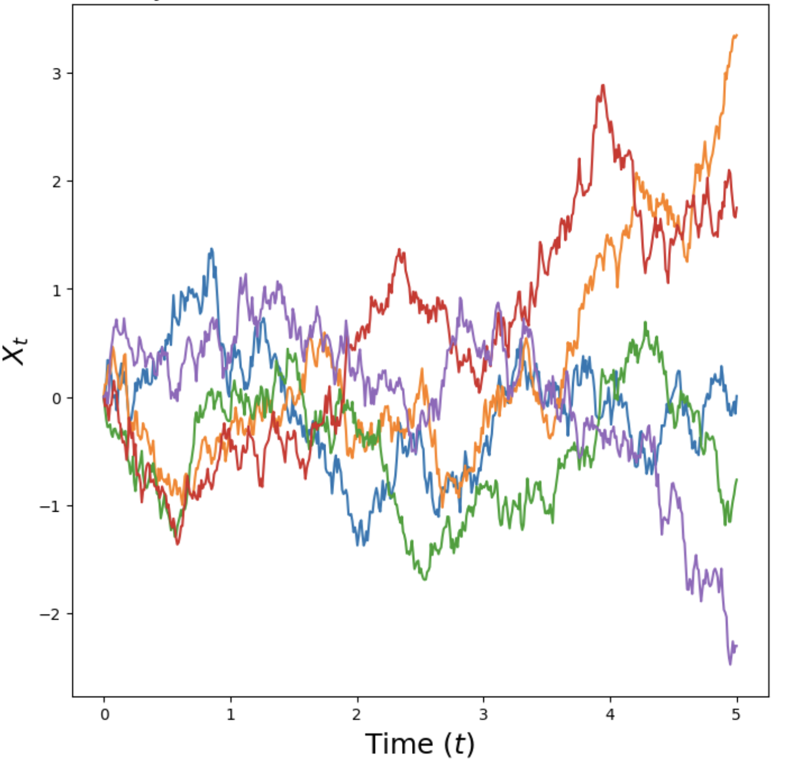 

**图 2：使用[式 5](#S2.E5) 模拟的 $d=1$ 维布朗运动 $W_{t}$ 的样本轨迹。**

定义如下：**布朗运动** $W=(W_{t})_{0\leq t\leq 1}$ 是满足 $W_{0}=0$、轨迹 $t\mapsto W_{t}$ 连续，并符合以下两个条件的随机过程：

1. **正态增量：**对所有 $0\leq s<t$，有 $W_{t}-W_{s}\sim\mathcal{N}(0,(t-s)I_{d})$。也就是说，增量服从高斯分布，其方差随时间线性增长，其中 $I_{d}$ 为单位矩阵。

2. **独立增量：**对于任意 $0\leq t_{0}<t_{1}<\dots<t_{n}=1$，增量 $W_{t_{1}}-W_{t_{0}},\dots,W_{t_{n}}-W_{t_{n-1}}$ 是相互独立的随机变量。

布朗运动也称为 **Wiener 过程**，因此用“$W$”表示。[^1] 我们可以方便地以步长 $h>0$ 近似模拟布朗运动：先令 $W_{0}=0$，再进行如下更新：

$$
\begin{aligned}
W_{t+h}= & W_{t}+\sqrt{h}\epsilon_{t},\quad\epsilon_{t}\sim\mathcal{N}(0,I_{d})\quad(t=0,h,2h,\dots,1-h) \qquad\text{(5)}
\end{aligned}
$$

[图 2](#S2.F2) 绘制了布朗运动的几条样本轨迹。布朗运动在随机过程研究中的地位，就如同高斯分布在概率分布研究中的地位。从金融到统计物理，再到流行病学，布朗运动的应用远远超出了机器学习。例如，在金融领域，它被用于为复杂金融工具的价格建模。即便仅从数学构造来看，布朗运动也十分迷人：它的路径是连续的，因此可以一笔画出；但路径的长度又是无穷的，因此你永远画不完。

| 子图 1 | 子图 2 |
| --- | --- |
| 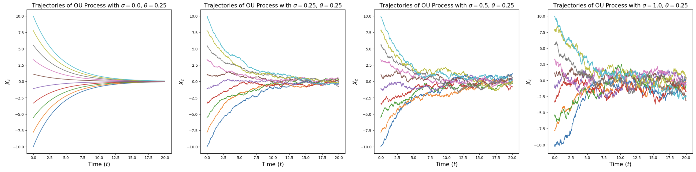 |  |

**图 3：$d=1$ 维 Ornstein–Uhlenbeck 过程（[式 8](#S2.E8)）示意图，其中 $\theta=0.25$，$\sigma$ 从左到右增大。当 $\sigma=0$ 时，过程退化为流，轨迹光滑且确定，并在 $t\to\infty$ 时收敛到原点。当 $\sigma>0$ 时，轨迹具有随机性，且其分布在 $t\to\infty$ 时趋于高斯分布 $\mathcal{N}(0,\frac{\sigma^{2}}{2\theta})$。**

##### 从 ODE 到 SDE。

SDE 的思想是在 ODE 的确定性动力学中，加入由布朗运动驱动的随机动力学。由于过程具有随机性，我们无法再像[式 1a](#S2.E1.1) 那样取导数。因此，需要寻找一种**不使用导数的 ODE 等价表述**。为此，将 ODE 的轨迹 $(X_{t})_{0\leq t\leq 1}$ 改写如下：

$$
\begin{aligned}
\frac{\mathrm{d}}{\mathrm{d}t}X_{t} & =u_{t}(X_{t})\quad & \blacktriangleright\,\,\text{用导数表示} \\
\overset{(i)}{\Leftrightarrow}\quad\frac{1}{h}\left(X_{t+h}-X_{t}\right) & =u_{t}(X_{t})+R_{t}(h) \\
\Leftrightarrow\quad X_{t+h} & =X_{t}+hu_{t}(X_{t})+hR_{t}(h)\quad & \blacktriangleright\,\,\text{用无穷小更新表示}
\end{aligned}
$$

其中 $R_{t}(h)$ 表示当 $h$ 很小时可忽略的函数，即满足 $\lim\limits_{h\to 0}R_{t}(h)=0$；步骤 $(i)$ 只使用了导数的定义。上述推导只是重述了已有认识：ODE 的轨迹 $(X_{t})_{0\leq t\leq 1}$ 在每个时间步，沿 $u_{t}(X_{t})$ 的方向前进一小步。现在，可以修改最后一个等式，使其具有随机性：SDE 的轨迹 $(X_{t})_{0\leq t\leq 1}$ 在每个时间步，既沿 $u_{t}(X_{t})$ 的方向前进一小步，又叠加布朗运动的贡献：

$$
X_{t+h}=X_{t}+\underbrace{hu_{t}(X_{t})}_{\text{确定性项}}+\sigma_{t}\underbrace{(W_{t+h}-W_{t})}_{\text{随机项}}+\underbrace{hR_{t}(h)}_{\text{误差项}} \qquad\text{(6)}
$$

其中 $\sigma_{t}\geq 0$ 为**扩散系数**，$R_{t}(h)$ 为随机误差项，其标准差 $\mathbb{E}[\|R_{t}(h)\|^{2}]^{1/2}\to 0$ 在 $h\to 0$ 时趋于零。以上描述的就是一个**随机微分方程（SDE）**，通常采用如下符号记法：

$$
\begin{aligned}
\mathrm{d}X_{t} & =u_{t}(X_{t})\mathrm{d}t+\sigma_{t}\mathrm{d}W_{t} & \blacktriangleright\,\,\text{SDE} \qquad\text{(7a)} \\
X_{0} & =x_{0} & \blacktriangleright\,\,\text{初始条件} \qquad\text{(7b)}
\end{aligned}
$$

但请始终记住，上面的“$\mathrm{d}X_{t}$”记法只是[式 6](#S2.E6) 的非正式表达。遗憾的是，SDE 不再具有流映射 $\phi_{t}$，因为演化过程本身是随机的，所以 $X_{0}\sim p_{\rm{init}}$ 不再能完全确定 $X_{t}$。不过，与 ODE 类似，我们仍有以下结论：

**定理 5（SDE 解的存在性与唯一性）**

若 $u:\mathbb{R}^{d}\times[0,1]\to\mathbb{R}^{d}$ 连续可微且导数有界，$\sigma_{t}$ 连续，则[式 7](#S2.E7) 中的 SDE 存在解，由满足[式 6](#S2.E6) 的唯一随机过程 $(X_{t})_{0\leq t\leq 1}$ 给出。

如果这是一门随机微积分课程，我们会用数节课来证明此定理，并以完全严谨的数学方式构造 SDE，也就是从基本原理构造布朗运动，再通过**随机积分**构造过程 $X_{t}$。本课程聚焦机器学习，更深入的数学处理可参阅 [[29](#bib.bib29)]。最后请注意，每个 ODE 也都是 SDE，只是其扩散系数 $\sigma_{t}=0$ 为零。因此，本课程后文中，**提到 SDE 时，也将 ODE 包含在内，视其为特殊情形**。

**例 6（Ornstein–Uhlenbeck 过程）**

考虑常数扩散系数 $\sigma_{t}=\sigma\geq 0$ 与线性漂移 $u_{t}(x)=-\theta x$，其中 $\theta>0$，得到 SDE：

$$
\mathrm{d}X_{t}=-\theta X_{t}\mathrm{d}t+\sigma\mathrm{d}W_{t}. \qquad\text{(8)}
$$

上述 SDE 的解 $(X_{t})_{0\leq t\leq 1}$ 称为 **Ornstein–Uhlenbeck（OU）过程**，见[图 3](#S2.F3)。向量场 $-\theta x$ 将过程拉回中心 $0$，因为漂移始终指向当前位置的反方向；而扩散系数 $\sigma$ 则不断引入噪声。若将其模拟至 $t\to\infty$，过程的分布会趋于高斯分布 $\mathcal{N}(0,\sigma^{2}/(2\theta))$。注意，当 $\sigma=0$ 时，我们又得到[式 3](#S2.E3) 中研究过的线性向量场所对应的流。

##### SDE 的模拟。

如果你暂时觉得 SDE 的抽象定义不易理解，不必担心。一个更直观的理解方式，是回答“如何模拟 SDE？”这个问题。最简单的方法称为 **Euler–Maruyama 方法**，它之于 SDE，基本上相当于欧拉法之于 ODE。使用 Euler–Maruyama 方法时，先初始化 $X_{0}=x_{0}$，再按下式迭代更新：

$$
X_{t+h}=X_{t}+hu_{t}(X_{t})+\sqrt{h}\sigma_{t}\epsilon_{t},\quad\quad\epsilon_{t}\sim\mathcal{N}(0,I_{d}) \qquad\text{(9)}
$$

其中 $h=n^{-1}>0$ 是步长超参数，满足 $n\in\mathbb{N}$。换言之，Euler–Maruyama 方法每次沿 $u_{t}(X_{t})$ 的方向前进一小步，同时加入少量按 $\sqrt{h}\sigma_{t}$ 缩放的高斯噪声。在本课程及配套实验中，模拟 SDE 时通常使用这一方法。

**算法 2：从扩散模型中采样（Euler–Maruyama 方法）**

| 步骤 | 操作 |
| --- | --- |
| 0 | 神经网络 $u_{t}^{\theta}$，步数 $n$，扩散系数 $\sigma_{t}$ |
| 1 | 令 $t=0$ |
| 2 | 设置步长 $h=\frac{1}{n}$ |
| 3 | 采样 $X_{0}\sim p_{\rm{init}}$ |
| 4 | **对于** $i=1,\dots,n$，**执行** |
| 5 | 采样 $\epsilon\sim\mathcal{N}(0,I_{d})$ |
| 6 | $X_{t+h}=X_{t}+hu_{t}^{\theta}(X_{t})+\sigma_{t}\sqrt{h}\epsilon$ |
| 7 | 更新 $t\leftarrow t+h$ |
| 8 | **结束循环** |
| 9 | **返回** $X_{1}$ |

##### 扩散模型。

现在可以像使用 ODE 一样，通过 SDE 构造生成模型。回想一下，我们的目标是将简单分布 $p_{\rm{init}}$ 转化为复杂分布 $p_{\rm{data}}$。与 ODE 类似，以 $X_{0}\sim p_{\rm{init}}$ 随机初始化并模拟 SDE，是实现这种变换的自然选择。要参数化这个 SDE，只需用神经网络 $u_{t}^{\theta}$ 来参数化它的核心组成部分，即向量场 $u_{t}$。因此，**扩散模型**可写为

$$
\begin{aligned}
X_{0} & \sim p_{\rm{init}} & \blacktriangleright\,\,\text{随机初始化} \\
\mathrm{d}X_{t} & =u_{t}^{\theta}(X_{t})\mathrm{d}t+\sigma_{t}\mathrm{d}W_{t} & \blacktriangleright\,\,\text{SDE}
\end{aligned}
$$

[算法 2](#alg2) 给出了用 Euler–Maruyama 方法从扩散模型中采样的步骤。本节结论总结如下。

**小结 7（SDE 生成模型）**

在本文中，**扩散模型**由具有参数 $\theta$ 的神经网络 $u_{t}^{\theta}$ 和固定扩散系数 $\sigma_{t}$ 构成，其中神经网络用于参数化向量场：

$$
\begin{aligned}
u^{\theta}:\mathbb{R}^{d}\times[0,1]\to\mathbb{R}^{d},\,\,(x,t)\mapsto u_{t}^{\theta}(x)\text{，其参数为 }\theta \\
\sigma_{t}:[0,1]\to[0,\infty),\,\,t\mapsto\sigma_{t}
\end{aligned}
$$

从 SDE 模型获得样本，也就是生成对象的步骤如下：

$$
\begin{aligned}
\textbf{初始化：}\quad X_{0} & \sim p_{\rm{init}}\quad & \blacktriangleright\,\,\text{用简单分布初始化，例如高斯分布} \\
\textbf{模拟：}\quad\mathrm{d}X_{t} & =u_{t}^{\theta}(X_{t})\mathrm{d}t+\sigma_{t}\mathrm{d}W_{t}\quad & \blacktriangleright\,\,\text{从 0 到 1 模拟 SDE} \\
\textbf{目标：}\quad X_{1} & \sim p_{\rm{data}}\quad & \blacktriangleright\,\,\text{目标是使 }X_{1}\text{ 服从分布 }p_{\rm{data}}\text{}
\end{aligned}
$$

当 $\sigma_{t}=0$ 时，扩散模型就是**流模型**。

## 3 流匹配

上一节中，我们构造了流模型和扩散模型，它们都是由神经网络向量场 $u_{t}^{\theta}$ 参数化的生成模型。但我们尚未讨论如何训练，即如何优化参数 $\theta$，使生成模型输出有意义的结果，例如漂亮的图像或精彩的视频。接下来介绍**流匹配** [[25](#bib.bib26), [1](#bib.bib23), [27](#bib.bib12)]：一种用于训练 $u_{t}^{\theta}$ 的算法，它简单、易于扩展，代表了当前的先进水平。

本节仅讨论流模型：给定神经网络 $u_{t}^{\theta}$，通过模拟以下 ODE 从生成模型中获取样本：

$$
\begin{aligned}
X_{0}\sim & p_{\rm{init}},\quad\mathrm{d}X_{t}=u_{t}^{\theta}(X_{t})\mathrm{d}t \qquad\text{(10)}
\end{aligned}
$$

并将 $t=1$ 对应的终点 $X_{1}$ 作为样本。此前说过，我们希望 $X_{1}$ 服从数据分布 $p_{\rm{data}}$，即 $X_{1}\sim p_{\rm{data}}$。因此，“如何训练”神经网络，实际上就是回答：**如何优化 $\theta$，使模拟[式 10](#S3.E10) 中的流模型得到服从数据分布 $X_{1}\sim p_{\rm{data}}$ 的样本？**

| 子图 1 | 子图 2 |
| --- | --- |
| 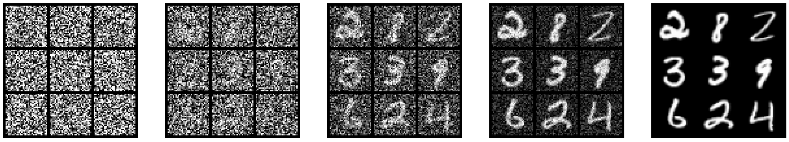 |  |

**图 4：一组图像沿高斯条件概率路径，从噪声逐渐插值到数据。每幅图像都是维数为 $d=32\times 32$ 的数据点，因此这里展示的是概率路径上的单个样本；[图 5](#S3.F5) 则以二维直方图展示分布。**

### 3.1 条件概率路径与边缘概率路径

流匹配的第一步是指定一条**概率路径**。直观地说，概率路径描述了从噪声 $p_{\rm{init}}$ 到数据 $p_{\rm{data}}$ 的渐进插值，见[图 4](#S3.F4)。为什么要这样做？回想一下，我们希望 ODE 轨迹在 $t=0$ 时满足 $X_{0}\sim p_{\rm{init}}$，在 $t=1$ 时满足 $X_{1}\sim p_{\rm{data}}$。那么起点与终点之间的时刻 $0<t<1$ 呢？实际上，我们可以在一定程度上自由选择中间的演化方式，概率路径正是对这种选择的数学形式化。

下文对数据点 $z\in\mathbb{R}^{d}$，用 $\delta_{z}$ 表示 **Dirac δ“分布”**。这是可以想象的最简单的分布：从 $\delta_{z}$ 采样，总会得到 $z$，即结果是确定的。**条件（插值）概率路径**是在 $\mathbb{R}^{d}$ 上的一族分布 $p_{t}(x|z)$，满足：

$$
p_{0}(\cdot|z)=p_{\rm{init}},\quad p_{1}(\cdot|z)=\delta_{z}\quad\text{，对所有 }z\in\mathbb{R}^{d}. \qquad\text{(11)}
$$

换言之，条件概率路径将初始分布 $p_{\rm{init}}$ 逐渐转化为一个数据点，例如[图 4](#S3.F4)。你可以将概率路径理解为分布空间中的一条轨迹。

每条条件概率路径 $p_{t}(x|z)$ 都会诱导一条**边缘概率路径** $p_{t}(x)$：先从数据分布中采样数据点 $z\sim p_{\rm{data}}$，再从 $p_{t}(\cdot|z)$ 中采样，由此得到的分布就是边缘概率路径：

$$
\begin{aligned}
z & \sim p_{\rm{data}},\quad x\sim p_{t}(\cdot|z)\quad\Rightarrow x\sim p_{t} & \blacktriangleright\,\,\text{从边缘路径采样} \qquad\text{(12)} \\
p_{t}(x) & =\int p_{t}(x|z)p_{\rm{data}}(z)\mathrm{d}z & \blacktriangleright\,\,\text{边缘路径的密度} \qquad\text{(13)}
\end{aligned}
$$

请注意，我们知道如何从 $p_{t}$ 采样，却不知道密度值 $p_{t}(x)$，因为其中的积分难以计算。也就是说，我们能实际执行[式 12](#S3.E12)，却不能计算[式 13](#S3.E13)。你可以自行检查：由于[式 11](#S3.E11) 对 $p_{t}(\cdot|z)$ 的约束，边缘概率路径 $p_{t}$ 会在 $p_{\rm{init}}$ 与 $p_{\rm{data}}$ 之间插值：

$$
p_{0}=p_{\rm{init}}\quad\text{且}\quad p_{1}=p_{\rm{data}}.\quad\quad\quad\quad\blacktriangleright\,\,\text{噪声到数据的插值} \qquad\text{(14)}
$$

高斯概率路径是最重要的概率路径例子，其重要性远超其他例子，因此强烈建议你仔细阅读下面的示例。

| 子图 1 | 子图 2 |
| --- | --- |
| 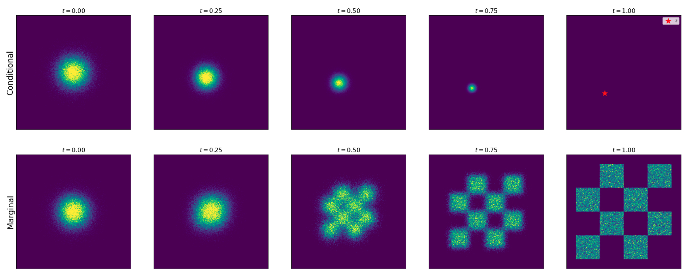 |  |

**图 5：条件概率路径（上）与边缘概率路径（下）示意图。这里绘制的是满足 $\alpha_{t}=t,\beta_{t}=1-t$ 的高斯概率路径。条件概率路径在高斯分布 $p_{\rm{init}}=\mathcal{N}(0,I_{d})$ 与单个数据点 $z$ 对应的 $p_{\rm{data}}=\delta_{z}$ 之间插值；边缘概率路径则在高斯分布与数据分布 $p_{\rm{data}}$ 之间插值。这里，$p_{\rm{data}}$ 是 $d=2$ 维的玩具分布，以棋盘格图案表示。**

**例 8（高斯条件概率路径）**

一种特别常用的概率路径是**高斯概率路径**，也是**大多数先进模型采用的概率路径**。设 $\alpha_{t},\beta_{t}$ 为**噪声调度函数**，即两个连续可微的单调函数，满足 $\alpha_{0}=\beta_{1}=0$ 和 $\alpha_{1}=\beta_{0}=1$。定义条件概率路径：

$$
\begin{aligned}
p_{t}(\cdot|z) & =\mathcal{N}(\alpha_{t}z,\beta_{t}^{2}I_{d}) & \blacktriangleright\,\,\text{高斯条件路径} \qquad\text{(15)}
\end{aligned}
$$

根据对 $\alpha_{t}$ 与 $\beta_{t}$ 的约束，它满足

$$
\begin{aligned}
p_{0}(\cdot|z) & =\mathcal{N}(\alpha_{0}z,\beta_{0}^{2}I_{d})=\mathcal{N}(0,I_{d}),\quad\text{且}\quad p_{1}(\cdot|z)=\mathcal{N}(\alpha_{1}z,\beta_{1}^{2}I_{d})=\delta_{z},
\end{aligned}
$$

这里用到的事实是：均值为 $z$、方差为零的正态分布，就是 $\delta_{z}$。因此，上述 $p_{t}(x|z)$ 在 $p_{\rm{init}}=\mathcal{N}(0,I_{d})$ 时满足[式 11](#S3.E11)，构成有效的条件插值路径。[图 4](#S3.F4) 展示了它在图像上的应用。从边缘路径 $p_{t}$ 采样可表述为：

$$
\begin{aligned}
z\sim & p_{\rm{data}},\,\epsilon\sim p_{\rm{init}}=\mathcal{N}(0,I_{d})\,\Rightarrow\,x=\alpha_{t}z+\beta_{t}\epsilon\sim p_{t}\quad & \blacktriangleright\,\,\text{从边缘高斯路径采样} \qquad\text{(16)}
\end{aligned}
$$

直观地说，上述过程在 $t$ 越小时加入越多噪声，直到时刻 $t=0$ 只剩噪声。[图 5](#S3.F5) 给出了一条这样的插值路径。

### 3.2 条件向量场与边缘向量场

概率路径 $(p_{t})_{0\leq t\leq 1}$ 指定了轨迹上各点 $X_{t}$ 应具有的分布 $X_{t}\sim p_{t}$。但目前，这还只是我们的期望。怎样找到一个向量场，使轨迹 $X_{t}$ 真正遵循该概率路径？流匹配会显式构造这样的向量场，即“边缘向量场”。本节将解释这一过程。

对每个数据点 $z\in\mathbb{R}^{d}$，用 $u^{\text{target}}_{t}(\cdot|z)$ 表示一个**条件向量场**。只要相应 ODE 产生条件概率路径 $p_{t}(\cdot|z)$，即满足下式，它就可以是任意向量场：

$$
\begin{aligned}
X_{0} & \sim p_{\rm{init}},\quad\frac{\mathrm{d}}{\mathrm{d}t}X_{t}=u^{\text{target}}_{t}(X_{t}|z)\quad\Rightarrow\quad X_{t}\sim p_{t}(\cdot|z)\quad(0\leq t\leq 1). \qquad\text{(17)}
\end{aligned}
$$

我们往往能够手工解析求出条件向量场 $u^{\text{target}}_{t}(\cdot|z)$，只需进行一些代数运算。[例 10](#Thmtheorem10) 将针对贯穿全文的高斯概率路径，推导条件向量场 $u_{t}(x|z)$。

乍看之下，条件向量场似乎没有用，因为 ODE 的所有终点 $X_{1}$ 都会坍缩到 $X_{1}=z$，也就是说，我们只是在重新生成已知数据点 $z$。然而，条件向量场可以作为基础，构造出真正能够从 $p_{\rm{data}}$ 生成样本的向量场：

**定理 9（边缘化技巧）**

设 $u^{\text{target}}_{t}(x|z)$ 是满足[式 17](#S3.E17) 的条件向量场。定义**边缘向量场** $u^{\text{target}}_{t}(x)$ 为

$$
u^{\text{target}}_{t}(x)=\int u^{\text{target}}_{t}(x|z)\frac{p_{t}(x|z)p_{\rm{data}}(z)}{p_{t}(x)}\mathrm{d}z, \qquad\text{(18)}
$$

则它遵循边缘概率路径，即

$$
\begin{aligned}
X_{0} & \sim p_{\rm{init}},\quad\frac{\mathrm{d}}{\mathrm{d}t}X_{t}=u^{\text{target}}_{t}(X_{t})\quad\Rightarrow\quad X_{t}\sim p_{t}\quad(0\leq t\leq 1). \qquad\text{(19)}
\end{aligned}
$$

**特别地，这个 ODE 满足 $X_{1}\sim p_{\rm{data}}$，因此可以说“$u^{\text{target}}_{t}$ 将噪声 $p_{\rm{init}}$ 转化为数据 $p_{\rm{data}}$”。**

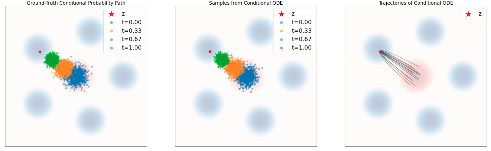 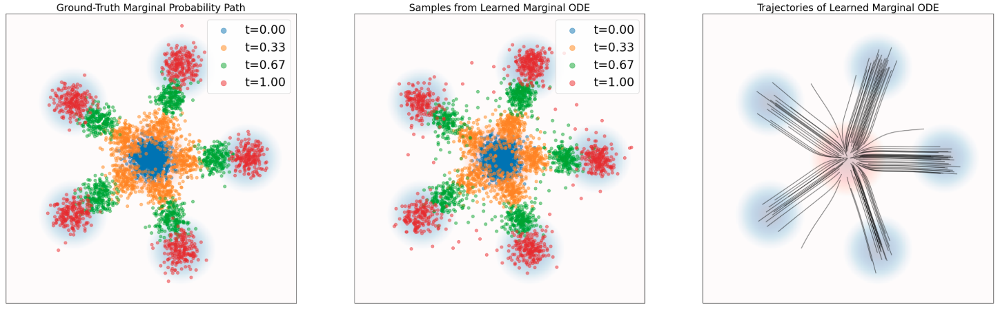

**图 6：[定理 9](#Thmtheorem9) 的图示：用 ODE 模拟概率路径。蓝色背景表示数据分布 $p_{\rm{data}}$，红色背景表示高斯分布 $p_{\rm{init}}$。上排为条件概率路径：左为从条件路径 $p_{t}(\cdot|z)$ 直接获得的真实样本；中为不同时刻的 ODE 样本；右为用[式 20](#S3.E20) 中的 $u^{\text{target}}_{t}(x|z)$ 模拟 ODE 得到的轨迹。下排为边缘概率路径的模拟：左为从 $p_{t}$ 直接获得的真实样本；中为不同时刻的 ODE 样本；右为用边缘向量场 $u^{\text{flow}}_{t}(x)$ 模拟 ODE 得到的轨迹。可以看到，条件向量场遵循条件概率路径，边缘向量场遵循边缘概率路径。**

**例 10（高斯概率路径的目标 ODE）**

与前文相同，设 $p_{t}(\cdot|z)=\mathcal{N}(\alpha_{t}z,\beta_{t}^{2}I_{d})$，其中 $\alpha_{t},\beta_{t}$ 为噪声调度函数，见[式 15](#S3.E15)。用 $\dot{\alpha}_{t}=\partial_{t}\alpha_{t}$ 和 $\dot{\beta}_{t}=\partial_{t}\beta_{t}$ 分别表示 $\alpha_{t}$ 和 $\beta_{t}$ 对时间的导数。这里要证明，下式给出的**条件高斯向量场**

$$
u^{\text{target}}_{t}(x|z)=\left(\dot{\alpha}_{t}-\frac{\dot{\beta}_{t}}{\beta_{t}}\alpha_{t}\right)z+\frac{\dot{\beta}_{t}}{\beta_{t}}x \qquad\text{(20)}
$$

是[定理 9](#Thmtheorem9) 意义下有效的条件向量场模型：当 $X_{0}\sim\mathcal{N}(0,I_{d})$ 时，其 ODE 轨迹 $X_{t}$ 满足 $X_{t}\sim p_{t}(\cdot|z)=\mathcal{N}(\alpha_{t}z,\beta_{t}^{2}I_{d})$。[图 6](#S3.F6) 通过比较条件概率路径中的真实样本与该流的 ODE 模拟样本，直观验证了这一点。可以看到，二者分布一致。下面给出证明。

**证明。**

首先定义如下条件流模型 $\psi^{\text{target}}_{t}(x|z)$：

$$
\psi^{\text{target}}_{t}(x|z)=\alpha_{t}z+\beta_{t}x. \qquad\text{(21)}
$$

若 $X_{t}$ 是 $\psi^{\text{target}}_{t}(\cdot|z)$ 的 ODE 轨迹，且 $X_{0}\sim p_{\rm{init}}=\mathcal{N}(0,I_{d})$，则根据定义，

$$
X_{t}=\psi^{\text{target}}_{t}(X_{0}|z)=\alpha_{t}z+\beta_{t}X_{0}\sim\mathcal{N}(\alpha_{t}z,\beta^{2}I_{d})=p_{t}(\cdot|z).
$$

因此，轨迹服从条件概率路径的分布，即满足[式 17](#S3.E17)。剩下只需从 $\psi^{\text{target}}_{t}(x|z)$ 中提取向量场 $u^{\text{target}}_{t}(x|z)$。根据流的定义（[式 2b](#S2.E2.2)），有

$$
\begin{aligned}
\frac{\mathrm{d}}{\mathrm{d}t}\psi^{\text{target}}_{t}(x|z) & =u^{\text{target}}_{t}(\psi^{\text{target}}_{t}(x|z)|z)\quad\text{，对所有 }x,z\in\mathbb{R}^{d} \\
\overset{(i)}{\Leftrightarrow}\quad\dot{\alpha}_{t}z+\dot{\beta}_{t}x & =u^{\text{target}}_{t}(\alpha_{t}z+\beta_{t}x|z)\quad\text{，对所有 }x,z\in\mathbb{R}^{d} \\
\overset{(ii)}{\Leftrightarrow}\quad\dot{\alpha}_{t}z+\dot{\beta}_{t}\left(\frac{x-\alpha_{t}z}{\beta_{t}}\right) & =u^{\text{target}}_{t}(x|z)\quad\text{，对所有 }x,z\in\mathbb{R}^{d} \\
\overset{(iii)}{\Leftrightarrow}\quad\left(\dot{\alpha}_{t}-\frac{\dot{\beta}_{t}}{\beta_{t}}\alpha_{t}\right)z+\frac{\dot{\beta}_{t}}{\beta_{t}}x & =u^{\text{target}}_{t}(x|z)\quad\text{，对所有 }x,z\in\mathbb{R}^{d}
\end{aligned}
$$

其中，步骤 $(i)$ 使用了 $\psi^{\text{target}}_{t}(x|z)$ 的定义（[式 21](#S3.E21)）；步骤 $(ii)$ 对 $x\rightarrow(x-\alpha_{t}z)/\beta_{t}$ 进行了重参数化；步骤 $(iii)$ 只涉及代数运算。最后一个等式正是[式 20](#S3.E20) 定义的条件高斯向量场，命题得证。[^2] ∎

[图 6](#S3.F6) 展示了[定理 9](#Thmtheorem9)。下面直观理解边缘向量场。统计学中的**贝叶斯法则**说明，下式给出一个后验分布：

$$
\frac{p_{t}(x|z)p_{\rm{data}}(z)}{p_{t}(x)}=\text{“数据点的后验分布 }z\text{，给定含噪数据 }x\text{"}
$$

其中 $p_{\rm{data}}(z)$ 为先验分布。边缘向量场其实就是一个平均：对每个可能的数据点 $z$，取速度 $u_{t}(x|z)$，也就是将我们带向 $z$ 的方向；再按“当前 $x$ 来自 $z$ 的可能性”对该速度加权。对所有数据点求平均，就得到了边缘向量场。

本节余下部分将把这种直觉严格化，并证明[定理 9](#Thmtheorem9)。主要数学工具是**连续性方程**，这是数学和物理学中的基本方程。定义**散度**算子 $\mathrm{div}$ 如下：

$$
\begin{aligned}
\mathrm{div}(v_{t})(x)= & \sum\limits_{i=1}^{d}\frac{\partial}{\partial x_{i}}v_{t}^{i}(x) \qquad\text{(22)}
\end{aligned}
$$

其中 $v_{t}^{i}$ 是 $v_{t}$ 的第 $i$ 个坐标。

**定理 11（连续性方程）**

考虑一个向量场为 $u^{\text{target}}_{t}$、初始条件为 $X_{0}\sim p_{\rm{init}}=p_{0}$ 的流模型。对所有 $0\leq t\leq 1$，均有 $X_{t}\sim p_{t}$，当且仅当

$$
\partial_{t}p_{t}(x)=-\mathrm{div}(p_{t}u^{\text{target}}_{t})(x)\quad\text{，对所有 }x\in\mathbb{R}^{d},0\leq t\leq 1, \qquad\text{(23)}
$$

其中 $\partial_{t}p_{t}(x)=\frac{\mathrm{d}}{\mathrm{d}t}p_{t}(x)$ 表示 $p_{t}(x)$ 对时间的导数。[式 23](#S3.E23) 称为**连续性方程**。

对偏重数学的读者，[附录 B](#A2) 给出了连续性方程的完整证明。继续之前，先直观理解它。左侧 $\partial_{t}p_{t}(x)$ 描述了 $x$ 处的概率 $p_{t}(x)$ 随时间的变化率。直观上，这种变化应当等于概率质量的净流入量。对于流模型，粒子 $X_{t}$ 沿向量场 $u^{\text{target}}_{t}$ 运动。回想物理学知识，散度衡量向量场某种意义上的净流出量，因此负散度衡量净流入量。结合当前位置 $x$ 处的概率质量，$-\mathrm{div}(p_{t}u_{t})$ 就衡量了概率质量的总净流入量。由于概率质量守恒，其积分始终为 1，方程左右两侧应当相等！下面证明[定理 9](#Thmtheorem9) 的边缘化技巧。

**[定理 9](#Thmtheorem9) 的证明。**

根据[定理 11](#Thmtheorem11)，只需证明[式 18](#S3.E18) 定义的边缘向量场 $u^{\text{target}}_{t}$ 满足连续性方程。直接计算得：

$$
\begin{aligned}
\partial_{t}p_{t}(x)\overset{(i)}{=}\partial_{t}\int p_{t}(x|z)p_{\rm{data}}(z)\mathrm{d}z & =\int\partial_{t}p_{t}(x|z)p_{\rm{data}}(z)\mathrm{d}z \\
\overset{(ii)}{=}\int-\mathrm{div}(p_{t}(\cdot|z)u^{\text{target}}_{t}(\cdot|z))(x)p_{\rm{data}}(z)\mathrm{d}z \\
\overset{(iii)}{=}-\mathrm{div}\left(\int p_{t}(x|z)u^{\text{target}}_{t}(x|z)p_{\rm{data}}(z)\mathrm{d}z\right) \\
\overset{(iv)}{=}-\mathrm{div}\left(p_{t}(x)\int u^{\text{target}}_{t}(x|z)\frac{p_{t}(x|z)p_{\rm{data}}(z)}{p_{t}(x)}\mathrm{d}z\right)(x) \\
\overset{(v)}{=}-\mathrm{div}\left(p_{t}u^{\text{target}}_{t}\right)(x),
\end{aligned}
$$

其中，步骤 $(i)$ 使用了[式 12](#S3.E12) 中 $p_{t}(x)$ 的定义；步骤 $(ii)$ 使用了条件概率路径 $p_{t}(\cdot|z)$ 的连续性方程；步骤 $(iii)$ 根据[式 22](#S3.E22) 交换了积分与散度算子；步骤 $(iv)$ 同时乘以并除以 $p_{t}(x)$；步骤 $(v)$ 使用了[式 18](#S3.E18)。上述等式链的首尾表明，$u^{\text{target}}_{t}$ 满足连续性方程。根据[定理 11](#Thmtheorem11)，这足以推出[式 19](#S3.E19)，证毕。∎

### 3.3 学习边缘向量场

现在可以介绍训练算法了。流匹配的目标是训练神经网络 $u_{t}^{\theta}$，使其等于边缘向量场 $u^{\text{target}}_{t}$。若这一条件成立，根据[定理 9](#Thmtheorem9)，终点 $X_{1}\sim p_{\rm{data}}$ 就具有所需分布。下文用 $\text{Unif}=\text{Unif}_{[0,1]}$ 表示区间 $[0,1]$ 上的均匀分布，用 $\mathbb{E}$ 表示随机变量的期望。令 $u_{t}^{\theta}\approx u^{\text{target}}_{t}$ 成立的一种直观方法，是使用均方误差，即定义**流匹配损失**：

$$
\begin{aligned}
\mathcal{L}_{\text{FM}}(\theta) & =\mathbb{E}_{t\sim\text{Unif},x\sim p_{t}}[\|u_{t}^{\theta}(x)-u^{\text{target}}_{t}(x)\|^{2}] \qquad\text{(24)} \\
\overset{(i)}{=}\mathbb{E}_{t\sim\text{Unif},z\sim p_{\rm{data}},x\sim p_{t}(\cdot|z)}[\|u_{t}^{\theta}(x)-u^{\text{target}}_{t}(x)\|^{2}], \qquad\text{(25)}
\end{aligned}
$$

其中 $p_{t}(x)=\int p_{t}(x|z)p_{\rm{data}}(z)\mathrm{d}z$ 是边缘概率路径，步骤 $(i)$ 使用了[式 12](#S3.E12) 的采样方法。直观地说，这个损失的计算过程是：先随机采样时刻 $t\in[0,1]$；再从数据集中随机采样数据点 $z$，并从 $p_{t}(\cdot|z)$ 中采样，例如加入一些噪声，然后计算 $u_{t}^{\theta}(x)$；最后，计算神经网络输出与边缘向量场 $u^{\text{target}}_{t}(x)$ 之间的均方误差。不过，问题尚未解决。虽然根据[定理 9](#Thmtheorem9) 已知 $u^{\text{target}}_{t}$ 的公式，但其中的积分难以计算，无法高效求值。因此，我们将利用**条件**速度场 $u^{\text{target}}_{t}(x|z)$ 可计算这一事实，定义**条件流匹配损失**：

$$
\mathcal{L}_{\text{CFM}}(\theta)=\mathbb{E}_{t\sim\text{Unif},z\sim p_{\rm{data}},x\sim p_{t}(\cdot|z)}[\|u_{t}^{\theta}(x)-u^{\text{target}}_{t}(x|z)\|^{2}]. \qquad\text{(26)}
$$

请注意它与[式 24](#S3.E24) 的区别：这里用条件向量场 $u^{\text{target}}_{t}(x|z)$ 代替边缘向量场 $u^{\text{target}}_{t}(x)$。由于 $u^{\text{target}}_{t}(x|z)$ 有解析公式，最小化上述损失很容易。但我们关心的是边缘向量场，为什么要拟合条件向量场？原来，显式拟合可计算的条件向量场，就隐式地拟合了难以计算的边缘向量场。下面的结论将严格表述这一点。

**定理 12**

边缘流匹配损失与条件流匹配损失仅相差一个常数，即

$$
\mathcal{L}_{\text{FM}}(\theta)=\mathcal{L}_{\text{CFM}}(\theta)+C,
$$

其中 $C$ 与 $\theta$ 无关，因此两者梯度相同：

$$
\nabla_{\theta}\mathcal{L}_{\text{FM}}(\theta)=\nabla_{\theta}\mathcal{L}_{\text{CFM}}(\theta).
$$

因而，例如使用随机梯度下降（SGD）最小化 $\mathcal{L}_{\text{CFM}}(\theta)$，等价于以相同方式最小化 $\mathcal{L}_{\text{FM}}(\theta)$。特别地，**对于 $\mathcal{L}_{\text{CFM}}(\theta)$ 的最小化解 $\theta^{*}$，有 $u_{t}^{\theta^{*}}=u^{\text{target}}_{t}$，即神经网络等于边缘向量场**，这里假设参数化模型具有无限表达能力。

**直接证明。**

证明思路是将均方误差展开为三项，并去除常数：

$$
\begin{aligned}
\mathcal{L}_{\text{FM}}(\theta) & \overset{(i)}{=}\mathbb{E}_{t\sim\text{Unif},x\sim p_{t}}[\|u_{t}^{\theta}(x)-u^{\text{target}}_{t}(x)\|^{2}] \\
\overset{(ii)}{=}\mathbb{E}_{t\sim\text{Unif},x\sim p_{t}}[\|u_{t}^{\theta}(x)\|^{2}-2u_{t}^{\theta}(x)^{T}u^{\text{target}}_{t}(x)+\|u^{\text{target}}_{t}(x)\|^{2}] \\
\overset{(iii)}{=}\mathbb{E}_{t\sim\text{Unif},x\sim p_{t}}\left[\|u_{t}^{\theta}(x)\|^{2}\right]-2\mathbb{E}_{t\sim\text{Unif},x\sim p_{t}}[u_{t}^{\theta}(x)^{T}u^{\text{target}}_{t}(x)]+\underbrace{\mathbb{E}_{t\sim\text{Unif}_{[0,1]},x\sim p_{t}}[\|u^{\text{target}}_{t}(x)\|^{2}]}_{=:C_{1}} \\
\overset{(iv)}{=}\mathbb{E}_{t\sim\text{Unif},z\sim p_{\rm{data}},x\sim p_{t}(\cdot|z)}[\|u_{t}^{\theta}(x)\|^{2}]-2\mathbb{E}_{t\sim\text{Unif},x\sim p_{t}}[u_{t}^{\theta}(x)^{T}u^{\text{target}}_{t}(x)]+C_{1}
\end{aligned}
$$

其中 $(i)$ 由定义成立；步骤 $(ii)$ 使用了公式 $\|a-b\|^{2}=\|a\|^{2}-2a^{T}b+\|b\|^{2}$；步骤 $(iii)$ 定义了常数 $C_{1}$；步骤 $(iv)$ 使用了[式 12](#S3.E12) 给出的 $p_{t}$ 的采样方法。将第二项改写为：

$$
\begin{aligned}
\mathbb{E}_{t\sim\text{Unif},x\sim p_{t}}[u_{t}^{\theta}(x)^{T}u^{\text{target}}_{t}(x)] & \overset{(i)}{=}\int\limits_{0}^{1}\int p_{t}(x)u_{t}^{\theta}(x)^{T}u^{\text{target}}_{t}(x)\,\mathrm{d}x\,\mathrm{d}t \\
\overset{(ii)}{=}\int\limits_{0}^{1}\int p_{t}(x)u_{t}^{\theta}(x)^{T}\left[\int u^{\text{target}}_{t}(x|z)\frac{p_{t}(x|z)p_{\rm{data}}(z)}{p_{t}(x)}\mathrm{d}z\right]\mathrm{d}x\,\mathrm{d}t \\
\overset{(iii)}{=}\int\limits_{0}^{1}\int\int u_{t}^{\theta}(x)^{T}u^{\text{target}}_{t}(x|z)p_{t}(x|z)p_{\rm{data}}(z)\,\mathrm{d}z\,\mathrm{d}x\,\mathrm{d}t \\
\overset{(iv)}{=}\mathbb{E}_{t\sim\text{Unif},z\sim p_{\rm{data}},x\sim p_{t}(\cdot|z)}[u_{t}^{\theta}(x)^{T}u^{\text{target}}_{t}(x|z)]
\end{aligned}
$$

其中，步骤 $(i)$ 将期望写成积分；步骤 $(ii)$ 使用[式 18](#S3.E18)；步骤 $(iii)$ 利用积分的线性性；步骤 $(iv)$ 将积分写回期望。这是证明的关键：等式链开头使用边缘向量场 $u^{\text{target}}_{t}(x)$，结尾则使用条件向量场 $u^{\text{target}}_{t}(x|z)$。将其代入 $\mathcal{L}_{\text{FM}}$ 的表达式，得：

$$
\begin{aligned}
\mathcal{L}_{\text{FM}}(\theta) & \overset{(i)}{=}\mathbb{E}_{t\sim\text{Unif},z\sim p_{\rm{data}},x\sim p_{t}(\cdot|z)}[\|u_{t}^{\theta}(x)\|^{2}]-2\mathbb{E}_{t\sim\text{Unif},z\sim p_{\rm{data}},x\sim p_{t}(\cdot|z)}[u_{t}^{\theta}(x)^{T}u^{\text{target}}_{t}(x|z)]+C_{1} \\
\overset{(ii)}{=}\mathbb{E}_{t\sim\text{Unif},z\sim p_{\rm{data}},x\sim p_{t}(\cdot|z)}[\|u_{t}^{\theta}(x)\|^{2}-2u_{t}^{\theta}(x)^{T}u^{\text{target}}_{t}(x|z)+\|u^{\text{target}}_{t}(x|z)\|^{2}-\|u^{\text{target}}_{t}(x|z)\|^{2}]+C_{1} \\
\overset{(iii)}{=}\mathbb{E}_{t\sim\text{Unif},z\sim p_{\rm{data}},x\sim p_{t}(\cdot|z)}[\|u_{t}^{\theta}(x)-u^{\text{target}}_{t}(x|z)\|^{2}]+\underbrace{\mathbb{E}_{t\sim\text{Unif},z\sim p_{\rm{data}},x\sim p_{t}(\cdot|z)}[-\|u^{\text{target}}_{t}(x|z)\|^{2}]}_{C_{2}}+C_{1} \\
\overset{(iv)}{=}\mathcal{L}_{\text{CFM}}(\theta)+\underbrace{C_{2}+C_{1}}_{=:C}
\end{aligned}
$$

其中，步骤 $(i)$ 代入刚推导的等式；步骤 $(ii)$ 加上并减去同一项；步骤 $(iii)$ 再次使用公式 $\|a-b\|^{2}=\|a\|^{2}-2a^{T}b+\|b\|^{2}$；步骤 $(iv)$ 定义了 $\theta$ 中的常数。证毕。∎

**算法 3：流匹配训练流程，采用高斯 CondOT 路径 $p_{t}(x|z)=\mathcal{N}(tz,(1-t)^{2})$**

| 步骤 | 操作 |
| --- | --- |
| 0 | 样本数据集 $z\sim p_{\rm{data}}$，神经网络 $u_{t}^{\theta}$ |
| 1 | **对于**每个数据小批量，**执行** |
| 2 | 从数据集中采样一个样本 $z$。 |
| 3 | 采样随机时刻 $t\sim\text{Unif}_{[0,1]}$。 |
| 4 | 采样噪声 $\epsilon\sim\mathcal{N}(0,I_{d})$。 |
| 5 | 令 [下方公式 1](#alg3-formula-1)。 |
| 6 | 计算损失 [下方公式 2](#alg3-formula-2)。 |
| 7 | 更新 $\theta\leftarrow\text{grad\_update}(\mathcal{L}(\theta))$。 |
| 8 | **结束循环** |

**算法 3，公式 1。**

$$
\begin{aligned}
x & =tz+(1-t)\epsilon\quad & (\text{一般情形：}x\sim p_{t}(\cdot\mid z))
\end{aligned}
$$

**算法 3，公式 2。**

$$
\begin{aligned}
\mathcal{L}(\theta)= & \|u_{t}^{\theta}(x)-(z-\epsilon)\|^{2}\quad & (\text{一般情形：}=\|u_{t}^{\theta}(x)-u^{\text{target}}_{t}(x|z)\|^{2})
\end{aligned}
$$

因此，**流匹配训练就是最小化条件流匹配损失。**[算法 3](#alg3) 总结了训练过程，[图 7](#S3.F7) 给出了图示。该算法有几个突出特点。首先，训练时完全不需要模拟 ODE，这称为**免模拟**。由于不必在训练中逐步展开 ODE 轨迹，而这种展开通常需要很多步，训练代价得以大幅降低。其次，训练目标只是简单的回归，即拟合 $u^{\text{target}}_{t}(x|z)$，因此它与监督学习并无太大区别。最后，算法极为简单，很难再想到更简单的训练目标了。这些特点使流匹配非常适合大规模机器学习模型。训练好 $u_{t}^{\theta}$ 后，即可模拟流模型

$$
\mathrm{d}X_{t}=u_{t}^{\theta}(X_{t})\,\mathrm{d}t,\quad\quad X_{0}\sim p_{\rm{init}} \qquad\text{(27)}
$$

例如使用[算法 1](#alg1)，获得样本 $X_{1}\sim p_{\rm{data}}$。文献将整套流程称为**流匹配** [[25](#bib.bib26), [27](#bib.bib12), [1](#bib.bib23), [26](#bib.bib27)]。下面将条件流匹配损失具体化到高斯概率路径：

**例 13（高斯条件概率路径上的流匹配）**

回到高斯概率路径 $p_{t}(\cdot|z)=\mathcal{N}(\alpha_{t}z;\beta_{t}^{2}I_{d})$，可以按下式从条件路径采样：

$$
\epsilon\sim\mathcal{N}(0,I_{d})\quad\Rightarrow\quad x_{t}=\alpha_{t}z+\beta_{t}\epsilon\sim\mathcal{N}(\alpha_{t}z,\beta_{t}^{2}I_{d})=p_{t}(\cdot|z). \qquad\text{(28)}
$$

根据[式 20](#S3.E20) 的推导，条件向量场 $u^{\text{target}}_{t}(x|z)$ 为

$$
\begin{aligned}
u^{\text{target}}_{t}(x|z)= & \left(\dot{\alpha}_{t}-\frac{\dot{\beta}_{t}}{\beta_{t}}\alpha_{t}\right)z+\frac{\dot{\beta}_{t}}{\beta_{t}}x, \qquad\text{(29)}
\end{aligned}
$$

其中 $\dot{\alpha}_{t}=\partial_{t}\alpha_{t}$ 和 $\dot{\beta}_{t}=\partial_{t}\beta_{t}$ 分别为相应的时间导数。代入后，条件流匹配损失为

$$
\begin{aligned}
\mathcal{L}_{\text{CFM}}(\theta) & =\mathbb{E}_{t\sim\text{Unif},z\sim p_{\rm{data}},x\sim\mathcal{N}(\alpha_{t}z,\beta_{t}^{2}I_{d})}[\lVert u_{t}^{\theta}(x)-\left(\dot{\alpha}_{t}-\frac{\dot{\beta}_{t}}{\beta_{t}}\alpha_{t}\right)z-\frac{\dot{\beta}_{t}}{\beta_{t}}x\rVert^{2}] \qquad\text{(30)} \\
\overset{(i)}{=}\mathbb{E}_{t\sim\text{Unif},z\sim p_{\rm{data}},\epsilon\sim\mathcal{N}(0,I_{d})}[\|u_{t}^{\theta}(\alpha_{t}z+\beta_{t}\epsilon)-(\dot{\alpha}_{t}z+\dot{\beta}_{t}\epsilon)\|^{2}] \qquad\text{(31)}
\end{aligned}
$$

其中步骤 $(i)$ 代入了[式 28](#S3.E28)，并将 $x$ 替换为 $\alpha_{t}z+\beta_{t}\epsilon$。注意 $\mathcal{L}_{\text{CFM}}$ 有多简单：采样数据点 $z$，采样噪声 $\epsilon$，然后计算均方误差。再考虑 $\alpha_{t}=t$、$\beta_{t}=1-t$ 这一特例，对应的概率路径 $p_{t}(x|z)=\mathcal{N}(tz,(1-t)^{2})$ 有时称为（高斯）**CondOT 概率路径**。此时 $\dot{\alpha}_{t}=1,\dot{\beta}_{t}=-1$，因此

$$
\begin{aligned}
\mathcal{L}_{\text{cfm}}(\theta)= & \mathbb{E}_{t\sim\text{Unif},z\sim p_{\rm{data}},\epsilon\sim\mathcal{N}(0,I_{d})}[\|u_{t}^{\theta}(tz+(1-t)\epsilon)-(z-\epsilon)\|^{2}]
\end{aligned}
$$

许多著名的先进模型都采用了这种简单而有效的训练方法，例如 Stable Diffusion 3、Meta 的 Movie Gen Video，以及很可能还有许多闭源模型。[图 7](#S3.F7) 用简单例子将其可视化，[算法 3](#alg3) 则总结了训练流程。

| 子图 1 | 子图 2 |
| --- | --- |
| 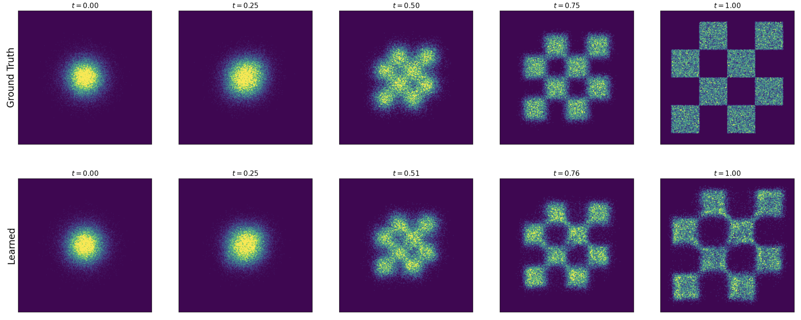 |  |

**图 7：以高斯 CondOT 概率路径说明[定理 12](#Thmtheorem12)：模拟训练后的流匹配模型的 ODE。数据分布为右上角的棋盘格图案。上排为真实边缘概率路径 $p_{t}(x)$ 的直方图，下排为流匹配模型样本的直方图。可以看到，训练后上下两排相符，差异来自训练误差。模型使用[算法 3](#alg3) 训练。**

下面总结本节结论。

**小结 14（流匹配）**

**流匹配训练的目标是学习边缘向量场 $u^{\text{target}}_{t}$。**构造时，先选择满足 $p_{0}(\cdot|z)=p_{\rm{init}}$、$p_{1}(\cdot|z)=\delta_{z}$ 的**条件概率路径** $p_{t}(x|z)$，再寻找**条件向量场** $u^{\text{target}}_{t}(x|z)$，使其对应的流 $\psi^{\text{target}}_{t}(x|z)$ 满足

$$
X_{0}\sim p_{\rm{init}}\quad\Rightarrow\quad X_{t}=\psi^{\text{target}}_{t}(X_{0}|z)\sim p_{t}(\cdot|z),
$$

或等价地，使 $u^{\text{target}}_{t}$ 满足连续性方程。此时，定义如下的**边缘向量场**

$$
u^{\text{target}}_{t}(x)=\int u^{\text{target}}_{t}(x|z)\frac{p_{t}(x|z)p_{\rm{data}}(z)}{p_{t}(x)}\mathrm{d}z, \qquad\text{(32)}
$$

遵循边缘概率路径，即

$$
\begin{aligned}
X_{0} & \sim p_{\rm{init}},\quad\mathrm{d}X_{t}=u^{\text{target}}_{t}(X_{t})\mathrm{d}t\Rightarrow X_{t}\sim p_{t}\quad(0\leq t\leq 1). \qquad\text{(33)}
\end{aligned}
$$

特别地，该 ODE 满足 $X_{1}\sim p_{\rm{data}}$，因此 $u^{\text{target}}_{t}$ 如我们所愿地“将噪声转化为数据”。为了学习它，我们最小化**条件流匹配损失**：

$$
\mathcal{L}_{\text{CFM}}(\theta)=\mathbb{E}_{t\sim\text{Unif},z\sim p_{\rm{data}},x\sim p_{t}(\cdot|z)}[\|u_{t}^{\theta}(x)-u^{\text{target}}_{t}(x|z)\|^{2}]. \qquad\text{(34)}
$$

最常用的例子是**高斯概率路径**。此时，相关公式为：

$$
\begin{aligned}
p_{t}(x|z)= & \mathcal{N}(x;\alpha_{t}z,\beta_{t}^{2}I_{d}) \qquad\text{(35)} \\
u^{\text{flow}}_{t}(x|z)= & \left(\dot{\alpha}_{t}-\frac{\dot{\beta}_{t}}{\beta_{t}}\alpha_{t}\right)z+\frac{\dot{\beta}_{t}}{\beta_{t}}x \qquad\text{(36)} \\
\mathcal{L}_{\text{CFM}}(\theta)= & \mathbb{E}_{t\sim\text{Unif},z\sim p_{\rm{data}},\epsilon\sim\mathcal{N}(0,I_{d})}[\|u_{t}^{\theta}(\alpha_{t}z+\beta_{t}\epsilon)-(\dot{\alpha}_{t}z+\dot{\beta}_{t}\epsilon)\|^{2}] \qquad\text{(37)}
\end{aligned}
$$

其中**噪声调度函数** $\alpha_{t},\beta_{t}\in\mathbb{R}$ 是由我们选定的连续可微单调函数，满足 $\alpha_{0}=\beta_{1}=0$、$\alpha_{1}=\beta_{0}=1$，例如 $\alpha_{t}=t,\beta_{t}=1-t$。

## 4 得分函数与得分匹配

上一节介绍了如何用流匹配训练流模型。本节讨论扩散模型，并展示如何用**得分匹配**训练它们。

### 4.1 条件得分函数与边缘得分函数

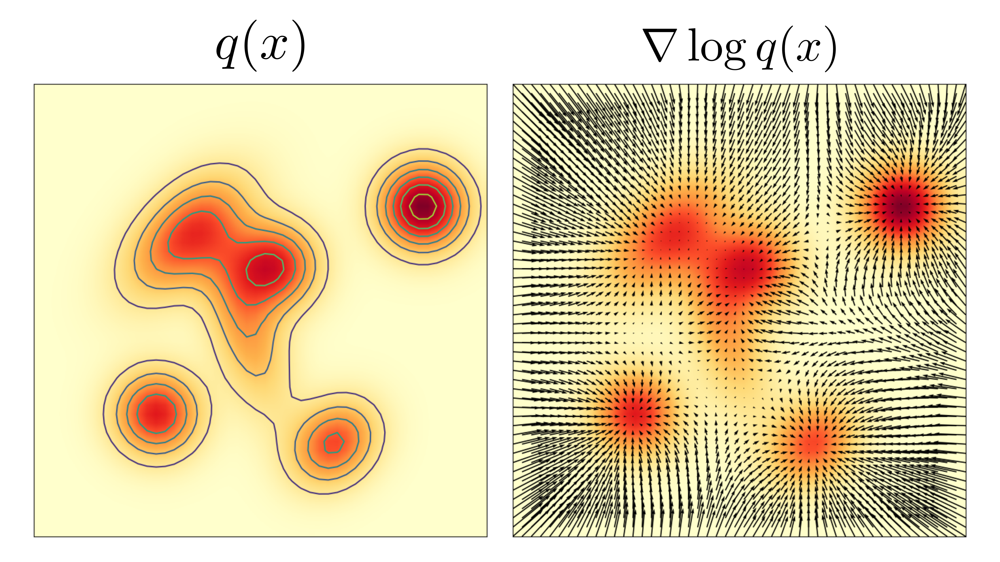 

**图 8：一般概率分布 $q(x)$（左）的得分函数 $\nabla\log q(x)$，以右侧黑色箭头表示。**

迄今，我们研究的核心对象是向量场 $u_{t}(x)$。扩散模型 [[43](#bib.bib25), [44](#bib.bib19)] 则采用另一种视角，重点研究**得分函数**。因此，本节将用得分函数的语言重新表述已有结论，提供新的视角。设 $q(x)$ 为任意概率分布，$q$ 的**得分函数**定义为 $\nabla\log q(x)$，即 $q$ 的对数似然关于 $x$ 的梯度。得分具有直观含义：$\nabla\log q(x)$ 是使对数似然上升最快的方向，见[图 8](#S4.F8)。

回到[第 3 节](#S3) 中的条件概率路径 $p_{t}(x|z)$ 与边缘概率路径 $p_{t}(x)$。可以相应定义**条件得分函数** $\nabla\log p_{t}(x|z)$ 和**边缘得分函数** $\nabla\log p_{t}(x)$。类似于[式 18](#S3.E18)，边缘得分可用条件得分函数 $\nabla\log p_{t}(x|z)$ 表示为

$$
\nabla\log p_{t}(x)=\int\nabla\log p_{t}(x|z)\frac{p_{t}(x|z)p_{\rm{data}}(z)}{p_{t}(x)}\mathrm{d}z. \qquad\text{(38)}
$$

因此，**条件得分与边缘得分之间的关系，类似于条件向量场与边缘向量场之间的关系**。[式 38](#S4.E38) 可证明如下：

$$
\nabla\log p_{t}(x)=\frac{\nabla p_{t}(x)}{p_{t}(x)}=\frac{\nabla\int p_{t}(x|z)p_{\rm{data}}(z)\mathrm{d}z}{p_{t}(x)}=\frac{\int\nabla p_{t}(x|z)p_{\rm{data}}(z)\mathrm{d}z}{p_{t}(x)}=\int\nabla\log p_{t}(x|z)\frac{p_{t}(x|z)p_{\rm{data}}(z)}{p_{t}(x)}\mathrm{d}z, \qquad\text{(39)}
$$

其中两次结合使用了规则 $\partial_{y}\log y=1/y$ 与链式法则。

**例 15（高斯概率路径的得分函数）**

对于高斯路径 $p_{t}(x|z)=\mathcal{N}(x;\alpha_{t}z,\beta_{t}^{2}I_{d})$，利用高斯概率密度的形式，见[式 97](#A1.E97)，可得

$$
\nabla\log p_{t}(x|z)=\nabla\log\mathcal{N}(x;\alpha_{t}z,\beta_{t}^{2}I_{d})=-\frac{x-\alpha_{t}z}{\beta_{t}^{2}}. \qquad\text{(40)}
$$

高斯概率路径的得分函数是 $x$ 和 z 的线性函数，条件向量场 $u_{t}(x|z)$ 也是如此，见[式 20](#S3.E20)。因此，两者可以相互转换，下面的命题说明了这一点。

**命题 1（高斯概率路径的转换公式）**

对于高斯概率路径 $p_{t}(x|z)=\mathcal{N}(\alpha_{t}z,\beta_{t}^{2}I_{d})$，条件向量场与条件得分之间，以及边缘向量场与边缘得分之间，分别满足以下恒等式：

$$
\begin{aligned}
u^{\text{target}}_{t}(x|z)= & a_{t}\nabla\log p_{t}(x|z)+b_{t}x,\quad a_{t}=\left(\beta_{t}^{2}\frac{\dot{\alpha}_{t}}{\alpha_{t}}-\dot{\beta}_{t}\beta_{t}\right),\quad b_{t}=\frac{\dot{\alpha}_{t}}{\alpha_{t}} \qquad\text{(41)} \\
u^{\text{target}}_{t}(x)= & a_{t}\nabla\log p_{t}(x)+b_{t}x. \qquad\text{(42)}
\end{aligned}
$$

特别地，条件向量场可以由条件得分恢复，边缘向量场可以由边缘得分恢复，反之亦然。

**证明。**

对于条件向量场和条件得分，可推导如下：

$$
\begin{aligned}
u^{\text{target}}_{t}(x|z)= & \left(\dot{\alpha}_{t}-\frac{\dot{\beta}_{t}}{\beta_{t}}\alpha_{t}\right)z+\frac{\dot{\beta}_{t}}{\beta_{t}}x\overset{(i)}{=}\left(\beta_{t}^{2}\frac{\dot{\alpha}_{t}}{\alpha_{t}}-\dot{\beta}_{t}\beta_{t}\right)\left(\frac{\alpha_{t}z-x}{\beta_{t}^{2}}\right)+\frac{\dot{\alpha}_{t}}{\alpha_{t}}x=\left(\beta_{t}^{2}\frac{\dot{\alpha}_{t}}{\alpha_{t}}-\dot{\beta}_{t}\beta_{t}\right)\nabla\log p_{t}(x|z)+\frac{\dot{\alpha}_{t}}{\alpha_{t}}x
\end{aligned}
$$

其中步骤 $(i)$ 仅进行了代数运算。对两侧积分，同一恒等式也适用于边缘流向量场与边缘得分函数：

$$
\begin{aligned}
u^{\text{target}}(x)=\int u^{\text{target}}_{t}(x|z)\frac{p_{t}(x|z)p_{\rm{data}}(z)}{p_{t}(x)}\mathrm{d}z= & \int\left[a_{t}\nabla\log p_{t}(x|z)+b_{t}x\right]\frac{p_{t}(x|z)p_{\rm{data}}(z)}{p_{t}(x)}\mathrm{d}z \\
\overset{(i)}{=} & a_{t}\nabla\log p_{t}(x)+b_{t}x
\end{aligned}
$$

其中步骤 $(i)$ 使用了[式 38](#S4.E38)，以及后验密度的积分为 $1$ 这一事实。∎

[命题 1](#Thmproposition1) 的结论很有意义：一旦学会了 $u^{\text{target}}_{t}$，也就学会了得分函数 $\nabla\log p_{t}(x)$，反之亦然。因此，许多扩散模型选择用神经网络学习得分函数 $\nabla\log p_{t}(x)$。我们将在[第 4.3 节](#S4.SS3) 讨论这一点。

**注记 16（得分的重参数化）**

[式 41](#S4.E41) 中高斯概率路径的重参数化公式之所以成立，是因为两侧的条件向量场与条件得分都是 $x$ 和 $z$ 的线性函数。边缘化后，边缘向量场与边缘得分都只是后验均值 $\mathbb{E}_{z|x}\left[z\right]$ 的线性重参数化。因此，任何能恢复 $\mathbb{E}_{z|x}\left[z\right]$ 的量，都可以进一步用于恢复无条件向量场与得分。从数值稳定性或训练稳定性来看，选择其他参数化方式甚至可能更好。常见选择之一是后验均值本身，通常称为去噪器。形式上，定义**条件去噪器与边缘去噪器**如下：

$$
D_{t}(x|z)=z,\quad D_{t}(x)=\int z\,\frac{p_{t}(x|z)p_{\rm{data}}(z)}{p_{t}(x)}\mathrm{d}z\overset{(i)}{=}\frac{1}{\dot{\alpha}_{t}\beta_{t}-\alpha_{t}\dot{\beta}_{t}}(\beta_{t}u^{\text{target}}_{t}(x_{t})-\dot{\beta}_{t}x_{t}). \qquad\text{(43)}
$$

其中 $(i)$ 可通过与[命题 1](#Thmproposition1) 类似的推导得到。去噪器的含义十分直观：它是在给定含噪数据 $x$ 时，干净数据 $z$ 的条件期望。[^3] 由于学习 $D_{t}$ 与学习 $u^{\text{target}}_{t}$ 在理论上等价，人们通常将这类模型称为**去噪扩散模型**。

### 4.2 使用 SDE 采样

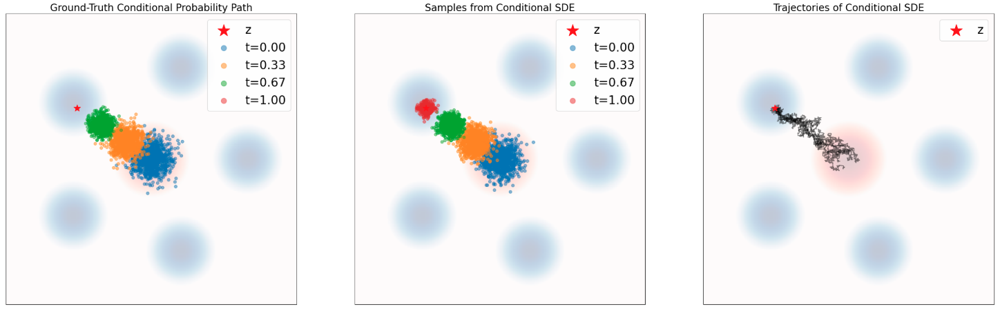 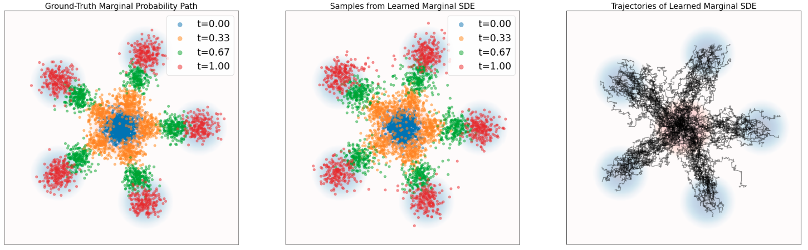

**图 9：[定理 17](#Thmtheorem17) 的图示：用 SDE 模拟概率路径。这与[图 6](#S3.F6) 的绘图相同，只是改用[式 44](#S4.E44) 进行 SDE 采样。蓝色背景表示数据分布 $p_{\rm{data}}$，红色背景表示高斯分布 $p_{\rm{init}}$。上排为条件路径，下排为边缘概率路径。可以看到，SDE 将服从 $p_{\rm{init}}$ 的样本，分别输运为服从 $\delta_{z}$ 的样本（条件路径）和服从 $p_{\rm{data}}$ 的样本（边缘路径）。**

目前，我们已说明如何通过边缘向量场 $u^{\text{target}}_{t}$，构造遵循所需概率路径 $p_{t}$ 的 ODE 轨迹 $X_{t}$。但这一方法仅适用于流模型，扩散模型又该怎么办？现在利用得分函数，将这一结论推广到 SDE。

**定理 17（SDE 扩展技巧）**

按前文定义条件向量场 $u^{\text{target}}_{t}(x|z)$ 和边缘向量场 $u^{\text{target}}_{t}(x)$。那么，对于任意扩散系数 $\sigma_{t}\geq 0$，都可以在原 ODE 的动力学上加入如下随机动力学，构造 SDE：

$$
\begin{aligned}
X_{0} & \sim p_{\rm{init}},\qquad & \mathrm{d}X_{t} & ={\color{#4169E1}u^{\text{target}}_{t}(X_{t})\mathrm{d}t}+{\color{#228B22}\frac{\sigma_{t}^{2}}{2}\nabla\log p_{t}(X_{t})\mathrm{d}t+\sigma_{t}\mathrm{d}W_{t}} \qquad\text{(44)} \\
=\Big[{\color{#4169E1}u^{\text{target}}_{t}(X_{t})}+{\color{#228B22}\frac{\sigma_{t}^{2}}{2}\nabla\log p_{t}(X_{t})}\Big]\mathrm{d}t+{\color{#228B22}\sigma_{t}}\mathrm{d}W_{t} \\
\Rightarrow\quad X_{t} & \sim p_{t}\quad(0\leq t\leq 1). \qquad\text{(45)}
\end{aligned}
$$

特别地，该 SDE 满足 $X_{1}\sim p_{\rm{data}}$。这里的随机动力学与 **Langevin 动力学**密切相关，可以理解为：在保持边缘分布 $p_{t}$ 的同时注入噪声。[注记 20](#Thmtheorem20) 将简要介绍 Langevin 动力学。

[图 9](#S4.F9) 展示了[定理 17](#Thmtheorem17) 描述的动力学。可以看到，轨迹变得曲折，体现了 SDE 演化的随机性；但根据[定理 17](#Thmtheorem17)，边缘分布 $p_{t}$ 保持不变。这个结论的特别之处在于，即使网络已经训练完成，我们仍可任意选择扩散系数 $\sigma_{t}\geq 0$。理论上，[定理 17](#Thmtheorem17) 对任意 $\sigma_{t}$ 都成立。但实践中既有训练误差，即神经网络不能完美逼近边缘向量场与得分，也有模拟误差。例如，若 $\sigma_{t}\gg 0$，[算法 2](#alg2) 就需要小到难以承受的步长。因此，对于固定的已训练模型，实际存在一个可通过实验确定的最优 $\sigma_{t}\geq 0$ [[23](#bib.bib18), [1](#bib.bib23), [28](#bib.bib11)]。[^4]

对于高斯概率路径，只要学会边缘向量场，就能直接得到得分函数，无需额外训练。

**例 18（高斯情形的 SDE 扩展技巧）**

根据[命题 1](#Thmproposition1)，对于高斯概率路径，可以仅用得分函数表示[定理 17](#Thmtheorem17) 中的 SDE：

$$
\begin{aligned}
X_{0}\sim & \,p_{\rm{init}},\quad\mathrm{d}X_{t}=\left[\left(a_{t}+\frac{\sigma_{t}^{2}}{2}\right)\nabla\log p_{t}(X_{t})+b_{t}X_{t}\right]\mathrm{d}t+\sigma_{t}\mathrm{d}W_{t} \qquad\text{(46)} \\
\Rightarrow X_{t}\sim & \,p_{t}\quad(0\leq t\leq 1) \qquad\text{(47)}
\end{aligned}
$$

其中 $a_{t},b_{t}$ 的定义同[命题 1](#Thmproposition1)。

本节余下部分将利用 **Fokker–Planck 方程**证明[定理 17](#Thmtheorem17)。这一方程将 ODE 的连续性方程推广到了 SDE。首先，对**拉普拉斯算子** $\Delta$ 作如下定义：

$$
\begin{aligned}
\Delta w_{t}(x)= & \sum\limits_{i=1}^{d}\frac{\partial^{2}}{\partial x_{i}^{2}}w_{t}(x)=\mathrm{div}(\nabla w_{t})(x), \qquad\text{(48)}
\end{aligned}
$$

其中 $w_{t}:\mathbb{R}^{d}\to\mathbb{R}$ 为标量场。

**定理 19（Fokker–Planck 方程）**

设 $p_{t}$ 为概率路径，并考虑如下 SDE：

$$
X_{0}\sim p_{\rm{init}},\quad\mathrm{d}X_{t}=u_{t}(X_{t})\mathrm{d}t+\sigma_{t}\mathrm{d}W_{t}.
$$

对所有 $0\leq t\leq 1$，$X_{t}$ 服从分布 $p_{t}$，当且仅当 **Fokker–Planck 方程**成立：

$$
\partial_{t}p_{t}(x)=-\mathrm{div}(p_{t}u_{t})(x)+\frac{\sigma_{t}^{2}}{2}\Delta p_{t}(x)\quad\text{，对所有 }x\in\mathbb{R}^{d},0\leq t\leq 1, \qquad\text{(49)}
$$

Fokker–Planck 方程的完整证明见[附录 B](#A2)。当 $\sigma_{t}=0$ 时，该方程退化为[定理 11](#Thmtheorem11) 的结论。额外的拉普拉斯项 $\Delta p_{t}$ 起初可能不易理解。熟悉物理学的读者会发现，热方程中也出现了同一项，而热方程实际上正是 Fokker–Planck 方程的特例。热量会在介质中扩散；这里也加入了扩散过程，尽管它是数学上的而非物理上的，因此多出这个拉普拉斯项。下面用 Fokker–Planck 方程证明[定理 17](#Thmtheorem17)。

**[定理 17](#Thmtheorem17) 的证明。**

根据[定理 19](#Thmtheorem19)，只需证明[式 44](#S4.E44) 定义的 SDE 对 $p_{t}$ 满足 Fokker–Planck 方程。直接计算得：

$$
\begin{aligned}
\partial_{t}p_{t}(x)\overset{(i)}{=} & -\mathrm{div}(p_{t}u^{\text{target}}_{t})(x) \\
\overset{(ii)}{=} & -\mathrm{div}(p_{t}u^{\text{target}}_{t})(x)-\frac{\sigma_{t}^{2}}{2}\Delta p_{t}(x)+\frac{\sigma_{t}^{2}}{2}\Delta p_{t}(x) \\
\overset{(iii)}{=} & -\mathrm{div}(p_{t}u^{\text{target}}_{t})(x)-\mathrm{div}(\frac{\sigma_{t}^{2}}{2}\nabla p_{t})(x)+\frac{\sigma_{t}^{2}}{2}\Delta p_{t}(x) \\
\overset{(iv)}{=} & -\mathrm{div}(p_{t}u^{\text{target}}_{t})(x)-\mathrm{div}(p_{t}\left[\frac{\sigma_{t}^{2}}{2}\nabla\log p_{t}\right])(x)+\frac{\sigma_{t}^{2}}{2}\Delta p_{t}(x) \\
\overset{(v)}{=} & -\mathrm{div}\left(p_{t}\left[u^{\text{target}}_{t}+\frac{\sigma_{t}^{2}}{2}\nabla\log p_{t}\right]\right)(x)+\frac{\sigma_{t}^{2}}{2}\Delta p_{t}(x),
\end{aligned}
$$

其中，步骤 $(i)$ 使用了[定理 11](#Thmtheorem11)；步骤 $(ii)$ 加上并减去同一项；步骤 $(iii)$ 使用了拉普拉斯算子的定义（[式 48](#S4.E48)）；步骤 $(iv)$ 使用 $\nabla\log p_{t}=\frac{\nabla p_{t}}{p_{t}}$；步骤 $(v)$ 使用散度算子的线性性。上述推导说明，[式 44](#S4.E44) 定义的 SDE 对 $p_{t}$ 满足 Fokker–Planck 方程。根据[定理 19](#Thmtheorem19)，可推出在 $0\leq t\leq 1$ 时有 $X_{t}\sim p_{t}$，正是所需结论。∎

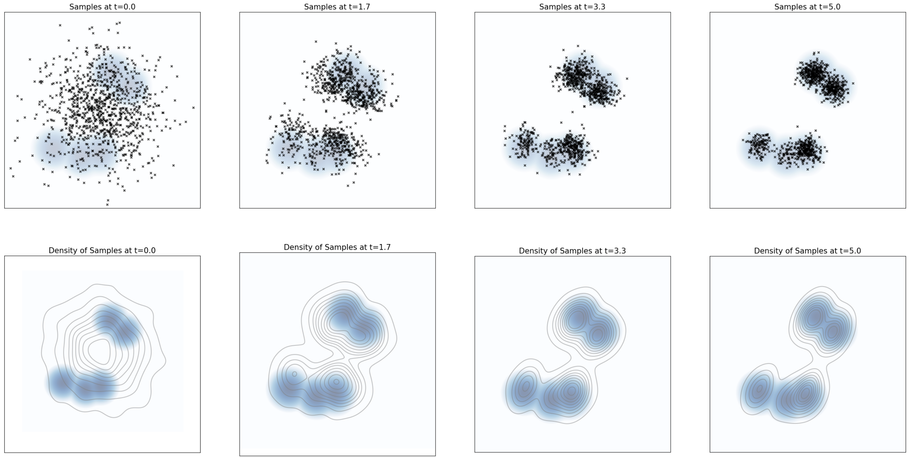

**图 10：上排为按[式 50](#S4.E50) 的 Langevin 动力学演化的粒子，其中 $p(x)$ 取为含 5 个模态的高斯混合分布。下排为上排同一批样本的核密度估计。可以看到，样本分布逐渐收敛到平衡分布 $p$，即蓝色背景。**

**注记 20（选读：Langevin 动力学）**

上述构造有一个著名特例：概率路径不随时间变化，即对于固定分布 $p$，有 $p_{t}=p$。此时令 $u^{\text{target}}_{t}=0$，得到 SDE：

$$
\mathrm{d}X_{t}=\frac{\sigma_{t}^{2}}{2}\nabla\log p(X_{t})\mathrm{d}t+\sigma_{t}dW_{t}, \qquad\text{(50)}
$$

这通常称为 **Langevin 动力学**。由于 $p_{t}$ 是常数，有 $\partial_{t}p_{t}(x)=0$。根据[定理 17](#Thmtheorem17)，这些动力学对静态路径 $p_{t}=p$ 满足 Fokker–Planck 方程，见[定理 17](#Thmtheorem17)。因此，$p$ 是 Langevin 动力学的平稳分布：

$$
X_{0}\sim p\quad\Rightarrow\quad X_{t}\sim p\quad(t\geq 0).
$$

与许多马尔可夫过程一样，这种动力学在相当一般的条件下会收敛到平稳分布 $p$。也就是说，若改取 $X_{0}\sim p^{\prime}\neq p$，使 $X_{t}\sim p_{t}^{\prime}$，则在温和条件下有 $p_{t}\to p$。这使得 Langevin 动力学极为实用，并成为**分子动力学**模拟，以及贝叶斯统计和自然科学中许多马尔可夫链蒙特卡洛（MCMC）方法的基础。特别地，当 $p$ 为高斯分布时，Langevin 动力学就退化为 Ornstein–Uhlenbeck 过程，后者也是早期扩散模型表述的基础。

**注记 21（选读：GLASS Flows——通过 ODE 实现随机演化）**

与 ODE 相比，SDE 采样的突出特点是演化具有随机性，即初始点 $X_{0}$ 并不能完全确定 $t>0$ 时的 $X_{t}$。或许令人意外的是，只需采用称为 GLASS Flows 的简单采样技巧 [[20](#bib.bib3)]，纯粹通过 ODE 也能得到相同的随机转移。这样既可以利用 SDE 的随机性，例如结合搜索算法，又能保持 ODE 的效率。

### 4.3 得分匹配

还需说明如何学习边缘得分函数 $\nabla\log p_{t}(x)$。当然，对于高斯概率路径，可以根据[命题 1](#Thmproposition1)，直接对 $u^{\text{target}}_{t}(x)$ 作变换。但一般情形呢？事实上，也可以直接学习边缘得分函数。为逼近边缘得分 $\nabla\log p_{t}$，我们使用一个称为**得分网络**的神经网络 $s_{t}^{\theta}:\mathbb{R}^{d}\times[0,1]\to\mathbb{R}^{d}$。与前文类似，可以设计**得分匹配损失**和**去噪得分匹配损失**：

$$
\begin{aligned}
\mathcal{L}_{\text{SM}}(\theta) & =\mathbb{E}_{t\sim\text{Unif},\,z\sim p_{\rm{data}},\,x\sim p_{t}(\cdot|z)}\left[\left\|s_{t}^{\theta}(x)-\nabla\log p_{t}(x)\right\|^{2}\right] & \blacktriangleright\,\,\text{得分匹配损失} \\
\mathcal{L}_{\text{CSM}}(\theta) & =\mathbb{E}_{t\sim\text{Unif},\,z\sim p_{\rm{data}},\,x\sim p_{t}(\cdot|z)}\left[\left\|s_{t}^{\theta}(x)-\nabla\log p_{t}(x|z)\right\|^{2}\right] & \blacktriangleright\,\,\text{条件得分匹配损失}
\end{aligned}
$$

两者的区别仍在于使用边缘得分 $\nabla\log p_{t}(x)$，还是条件得分 $\nabla\log p_{t}(x|z)$。理想情况下，我们希望最小化得分匹配损失，但由于不知道 $\nabla\log p_{t}(x)$，无法直接实现。不过，与前文类似，去噪得分匹配损失提供了可计算的替代方案：

**定理 22**

得分匹配损失与去噪得分匹配损失仅相差一个常数：

$$
\mathcal{L}_{\text{SM}}(\theta)=\mathcal{L}_{\text{CSM}}(\theta)+C,
$$

其中 $C$ 与参数 $\theta$ 无关，因此两者的梯度相同：

$$
\nabla_{\theta}\mathcal{L}_{\text{SM}}(\theta)=\nabla_{\theta}\mathcal{L}_{\text{CSM}}(\theta).
$$

特别地，对于最小化解 $\theta^{*}$，有 $s_{t}^{\theta^{*}}=\nabla\log p_{t}$。

**证明。**

$\nabla\log p_{t}$ 的公式（[式 38](#S4.E38)）与 $u^{\text{target}}_{t}$ 的公式（[式 18](#S3.E18)）具有相同形式。因此，只需将[定理 12](#Thmtheorem12) 证明中的 $u^{\text{target}}_{t}$ 替换为 $\nabla\log p_{t}$，即可得到完全相同的证明。∎

**例 23（去噪扩散模型：高斯概率路径上的得分匹配）**

将去噪得分匹配损失具体化到 $p_{t}(x|z)=\mathcal{N}(\alpha_{t}z,\beta_{t}^{2}I_{d})$ 的情形。根据[式 40](#S4.E40)，条件得分 $\nabla\log p_{t}(x|z)$ 的公式为

$$
\nabla\log p_{t}(x|z)=-\frac{x-\alpha_{t}z}{\beta_{t}^{2}}. \qquad\text{(51)}
$$

代入后，条件得分匹配损失变为：

$$
\begin{aligned}
\mathcal{L}_{\text{CSM}}(\theta) & =\mathbb{E}_{t\sim\text{Unif},\,z\sim p_{\rm{data}},\,x\sim p_{t}(\cdot|z)}\left[\left\|s_{t}^{\theta}(x)+\frac{x-\alpha_{t}z}{\beta_{t}^{2}}\right\|^{2}\right] \\
\overset{(i)}{=}\mathbb{E}_{t\sim\text{Unif},\,z\sim p_{\rm{data}},\,\epsilon\sim\mathcal{N}(0,I_{d})}\left[\left\|s_{t}^{\theta}(\alpha_{t}z+\beta_{t}\epsilon)+\frac{\epsilon}{\beta_{t}}\right\|^{2}\right] \\
=\mathbb{E}_{t\sim\text{Unif},\,z\sim p_{\rm{data}},\,\epsilon\sim\mathcal{N}(0,I_{d})}\left[\frac{1}{\beta_{t}^{2}}\left\|\beta_{t}s_{t}^{\theta}(\alpha_{t}z+\beta_{t}\epsilon)+\epsilon\right\|^{2}\right]
\end{aligned}
$$

其中步骤 $(i)$ 代入了[式 28](#S3.E28)，并将 $x$ 替换为 $\alpha_{t}z+\beta_{t}\epsilon$。网络 $s_{t}^{\theta}$ 本质上是在学习预测用于扰动数据样本 $z$ 的噪声，这也解释了为什么上述训练损失称为**去噪得分匹配**。人们很快发现，当 $\beta_{t}\approx 0$ 接近零时，这个损失在数值上不稳定，也就是说，必须加入足量噪声，去噪得分匹配才能有效工作。因此，在一些早期去噪扩散模型研究中，例如《Denoising Diffusion Probabilistic Models》[[17](#bib.bib21)]，研究者提出去掉损失中的常数 $\frac{1}{\beta_{t}^{2}}$，并将 $s_{t}^{\theta}$ 按下式重参数化为**噪声预测网络** $\epsilon_{t}^{\theta}:\mathbb{R}^{d}\times[0,1]\to\mathbb{R}^{d}$：

$$
\begin{aligned}
-\beta_{t}s_{t}^{\theta}(x)=\epsilon_{t}^{\theta}(x)\quad\Rightarrow\quad\mathcal{L}_{\text{DDPM}}(\theta)= & \mathbb{E}_{t\sim\text{Unif},z\sim p_{\rm{data}},\epsilon\sim\mathcal{N}(0,I_{d})}\left[\|\epsilon_{t}^{\theta}(\alpha_{t}z+\beta_{t}\epsilon)-\epsilon\|^{2}\right]
\end{aligned}
$$

与前文一样，网络 $\epsilon_{t}^{\theta}$ 本质上是在学习预测用于扰动数据样本 $z$ 的噪声。[算法 4](#alg4) 总结了训练流程。

**算法 4：高斯概率路径上的得分匹配训练流程**

| 步骤 | 操作 |
| --- | --- |
| 0 | 样本数据集 $z\sim p_{\rm{data}}$，得分网络 $s_{t}^{\theta}$ 或噪声预测器 $\epsilon_{t}^{\theta}$ |
| 1 | **对于**每个数据小批量，**执行** |
| 2 | 从数据集中采样一个数据样本 $z$。 |
| 3 | 采样随机时刻 $t\sim\text{Unif}_{[0,1]}$。 |
| 4 | 采样噪声 $\epsilon\sim\mathcal{N}(0,I_{d})$。 |
| 5 | 令 $x_{t}=\alpha_{t}z+\beta_{t}\epsilon$（一般情形：$x_{t}\sim p_{t}(\cdot\vert z)$）。 |
| 6 | 计算损失 [下方公式 1](#alg4-formula-1)。 |
| 7 | 对 $\mathcal{L}(\theta)$ 进行梯度下降，更新模型参数 $\theta$。 |
| 8 | **结束循环** |

**算法 4，公式 1。**

$$
\begin{aligned}
\mathcal{L}(\theta)= & \|s_{t}^{\theta}(x_{t})+\frac{\epsilon}{\beta_{t}}\|^{2}\quad & (\text{一般情形：}=\|s_{t}^{\theta}(x_{t})-\nabla\log p_{t}(x_{t}|z)\|^{2}) \\
\text{或者：}\mathcal{L}(\theta)= & \|\epsilon_{t}^{\theta}(x_{t})-\epsilon\|^{2}
\end{aligned}
$$

本节结论总结如下：

**小结 24（得分函数、得分匹配与随机采样）**

设 $p_{t}(x|z),p_{t}(x)$ 为条件概率路径与边缘概率路径。**条件得分函数**为 $\nabla\log p_{t}(x|z)$，**边缘得分函数**为 $\nabla\log p_{t}(x)$。对于任意扩散系数 $\sigma_{t}\geq 0$，以下 SDE 的轨迹均遵循该概率路径：

$$
\begin{aligned}
X_{0}\sim & p_{\rm{init}},\quad\mathrm{d}X_{t}=\left[u^{\text{target}}_{t}(X_{t})+\frac{\sigma_{t}^{2}}{2}\nabla\log p_{t}(X_{t})\right]\mathrm{d}t+\sigma_{t}\mathrm{d}W_{t} \qquad\text{(52)} \\
\Rightarrow X_{t}\sim & p_{t}\quad(0\leq t\leq 1), \qquad\text{(53)}
\end{aligned}
$$

其中 $u^{\text{target}}_{t}(x)$ 为前文定义的边缘向量场，见[式 18](#S3.E18)。

##### 得分匹配。

为学习边缘得分函数 $\nabla\log p_{t}(x)$，可以使用**得分网络** $s_{t}^{\theta}$，并通过**去噪得分匹配**训练：

$$
\begin{aligned}
\mathcal{L}_{\text{CSM}}(\theta) & =\mathbb{E}_{z\sim p_{\rm{data}},\,t\sim\text{Unif},\,x\sim p_{t}(\cdot|z)}[\|s_{t}^{\theta}(x)-\nabla\log p_{t}(x|z)\|^{2}]\quad & (\text{去噪得分匹配损失}) \qquad\text{(54)}
\end{aligned}
$$

##### 高斯概率路径。

对于最重要的高斯概率路径 $p_{t}(x|z)=\mathcal{N}(x;\alpha_{t}z,\beta_{t}^{2}I_{d})$，无需分别训练 $s_{t}^{\theta}$ 和 $u_{t}^{\theta}$，因为可以通过下式相互转换：

$$
\begin{aligned}
u_{t}^{\theta}(x)= & a_{t}s_{t}^{\theta}(x)+b_{t}x,\quad a_{t}=\left(\beta_{t}^{2}\frac{\dot{\alpha}_{t}}{\alpha_{t}}-\dot{\beta}_{t}\beta_{t}\right),b_{t}=\frac{\dot{\alpha}_{t}}{\alpha_{t}}
\end{aligned}
$$

训练后，可以模拟以下 SDE：

$$
\begin{aligned}
X_{0}\sim p_{\rm{init}},\quad\mathrm{d}X_{t}= & \left[\left(1+\frac{\sigma_{t}^{2}}{2a_{t}}\right)u_{t}^{\theta}(X_{t})-\frac{\sigma_{t}^{2}b_{t}}{2a_{t}}X_{t}\right]\mathrm{d}t+\sigma_{t}\mathrm{d}W_{t} \qquad\text{(55)} \\
= & \left[\left(a_{t}+\frac{\sigma_{t}^{2}}{2}\right)s_{t}^{\theta}(X_{t})+b_{t}X_{t}\right]\mathrm{d}t+\sigma_{t}\mathrm{d}W_{t} \qquad\text{(56)}
\end{aligned}
$$

其中扩散系数 $\sigma_{t}\geq 0$ 可任意选择，从而获得近似样本 $X_{1}\sim p_{\rm{data}}$。最优 $\sigma_{t}\geq 0$ 可以通过实验确定。

## 5 引导：如何以提示词为条件

到目前为止，我们考虑的生成模型都是**无引导的**：例如，图像模型只是生成某张图像。数学上，这意味着模型从无条件数据分布 $p_{\rm{data}}(z)$ 返回样本。但在多数情况下，我们希望的不只是生成任意对象，而是**以某些附加信息为条件**生成对象。换言之，我们希望**引导**模型生成特定类型的对象。例如，图像生成模型可以接收文本提示 $y$，再生成符合文本提示 $y$ 的图像 $x$。如[第 1 节](#S1) 所述，这意味着要从 $p_{\rm{data}}(z|y)$ 中采样，即从**以 $y$ 为条件的引导数据分布**中采样。本节将讨论这一问题。

**注记 25（术语）**

前文已使用“条件”一词表示以 $z\sim p_{\rm{data}}$ 为条件，例如条件概率路径与条件向量场。为避免记号与术语混淆，我们将专门用**引导**表示以文本提示等 $y$ 为条件。

### 5.1 基础引导

首先讨论构造引导生成模型的“标准”方式。简言之：训练和推理时都将提示词 $y$ 输入网络，其余步骤与前文相同。下面将其形式化。设条件变量或提示词 $y$ 属于空间 $\mathcal{Y}$。例如，若 $y$ 是文本提示，$\mathcal{Y}$ 就是所有文本构成的空间；若 $y$ 是离散类别标签，$\mathcal{Y}$ 就是离散空间。我们不对 $\mathcal{Y}$ 施加限制。

定义**引导扩散模型**：它由神经网络参数化的**引导向量场** $u_{t}^{\theta}(\cdot|y)$，与随时间变化的扩散系数 $\sigma_{t}$ 共同构成：

$$
\begin{aligned}
\,u^{\theta}:\mathbb{R}^{d}\times\mathcal{Y}\times[0,1]\to\mathbb{R}^{d},\,\,(x,y,t)\mapsto u_{t}^{\theta}(x|y) \\
\,\sigma_{t}:[0,1]\to[0,\infty),\,\,t\mapsto\sigma_{t}
\end{aligned}
$$

与[小结 7](#Thmtheorem7) 不同，这里额外使用输入 $y\in\mathcal{Y}$ 来引导 $u_{t}^{\theta}$。对于任意这样的 $y\in\mathcal{Y}$，可以按下列步骤从模型生成样本：

$$
\begin{aligned}
\textbf{初始化：}\quad X_{0} & \sim p_{\rm{init}}\quad & \blacktriangleright\,\,\text{用简单分布初始化，例如高斯分布} \\
\textbf{模拟：}\quad\mathrm{d}X_{t} & =u_{t}^{\theta}(X_{t}|y)\mathrm{d}t+\sigma_{t}\mathrm{d}W_{t}\quad & \blacktriangleright\,\,\text{模拟 SDE，从 }t=0\text{ 到 }t=1\text{.} \\
\textbf{目标：}\quad X_{1} & \sim p_{\rm{data}}(\cdot|y)\quad & \blacktriangleright\,\,\text{目标是使 }X_{1}\text{ 服从分布 }p_{\rm{data}}(\cdot|y)\text{.}
\end{aligned}
$$

当 $\sigma_{t}=0$ 时，称其为**引导流模型**。为简洁起见，下面仅讨论流匹配与流模型，但相关结论同样适用于一般情形。

接下来讨论如何训练引导流模型 $u_{t}^{\theta}(x|y)$。一个简单技巧是固定 $y$，并令数据分布为 $p_{\text{data}}(x|y)$。这样就回到了前文的无引导生成问题，可以相应使用条件流匹配目标来构造生成模型，即

$$
\mathbb{E}_{z\sim p_{\text{data}}(\cdot|y),x\sim p_{t}(\cdot|z)}\lVert u_{t}^{\theta}(x|y)-u^{\text{target}}_{t}(x|z)\rVert^{2}. \qquad\text{(57)}
$$

标签 $y$ 不影响条件概率路径 $p_{t}(\cdot|z)$ 或条件向量场 $u^{\text{target}}_{t}(x|z)$，尽管理论上也可以让它们依赖标签。进一步对所有 $y$ 的选择取期望，就得到**引导条件流匹配目标**：

$$
\mathcal{L}_{\text{CFM}}^{\text{guided}}(\theta)=\mathbb{E}_{(z,y)\sim p_{\text{data}}(z,y),\,t\sim\text{Unif}[0,1],\,x\sim p_{t}(\cdot|z)}\lVert u_{t}^{\theta}(x|y)-u^{\text{target}}_{t}(x|z)\rVert^{2}. \qquad\text{(58)}
$$

[式 58](#S5.E58) 的引导目标与[式 26](#S3.E26) 的无引导目标的主要区别之一，是这里采样 $(z,y)\sim p_{\rm{data}}$，而不只是 $z\sim p_{\rm{data}}$。原因在于，此时数据分布原则上是图像 $z$ 与文本提示 $y$ 等变量的联合分布。实践中，这意味着用 PyTorch 实现[式 58](#S5.E58) 时，数据加载器要返回**同时包含 $z$ 和 $y$** 的批量数据。

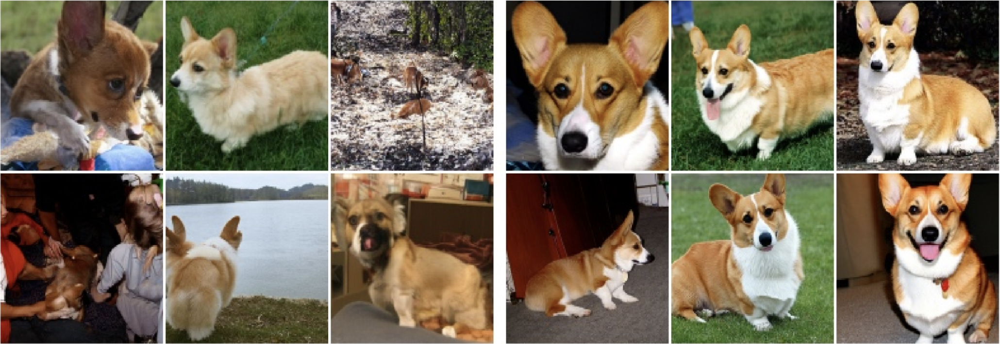 

**图 11：以提示词或类别 $y=$“柯基犬”生成图像。左：基础引导生成的样本，图像与提示词的符合程度不够高。右：采用分类器引导、$w=4$ 时生成的样本。如图所示，无分类器引导可以增强对提示词的遵循程度。图片来自 [[18](#bib.bib46)]。**

**图 12：分类器引导与无分类器引导示意图。分类器引导将引导向量场 $u^{\text{target}}_{t}(x|y)$ 分解，并利用引导强度 $w>1$ 放大分类器 $\log p_{t}(y|x)$ 的梯度贡献。无分类器引导则放大两个向量场之间的差值，从而无需单独训练分类器，就能获得相同效果。**

### 5.2 无分类器引导

理论上，基础引导应能准确地从 $p_{\rm{data}}(\cdot|y)$ 生成样本。但实验很快发现，这种方法生成的图像不够符合所需标签 $y$，见[图 11](#S5.F11)。原因可能有多种：模型可能欠拟合，即没有真正学到正确的边缘向量场；数据也可能不完善，例如互联网上的图文配对存在大量错误。因此，要让生成样本更符合提示词，需要人为增强提示变量 $y$ 的作用。实现这一点的主要技术称为**无分类器引导**，它广泛用于先进扩散模型，下面将予以介绍。

##### 分类器引导。

为简单起见，这里只讨论高斯概率路径。回顾[式 15](#S3.E15)，高斯条件概率路径为 $p_{t}(\cdot|z)=\mathcal{N}(\alpha_{t}z,\beta_{t}^{2}I_{d})$，其中噪声调度函数 $\alpha_{t}$ 与 $\beta_{t}$ 连续可微、单调，并满足 $\alpha_{0}=\beta_{1}=0$ 和 $\alpha_{1}=\beta_{0}=1$。再根据[命题 1](#Thmproposition1)，可以利用引导得分函数 $\nabla\log p_{t}(x|y)$，将引导向量场 $u^{\text{target}}_{t}(x|y)$ 改写为

$$
u^{\text{target}}_{t}(x|y)=a_{t}\nabla\log p_{t}(x|y)+b_{t}x, \qquad\text{(59)}
$$

接下来注意，$p_{t}(x|y)$ 是一个条件密度，因此可用贝叶斯法则将引导得分改写为

$$
\begin{aligned}
p_{t}(x|y)= & \frac{p_{t}(x)p_{t}(y|x)}{p_{t}(y)} \qquad\text{(60)} \\
\nabla\log p_{t}(x|y)= & \nabla\log\left(\frac{p_{t}(x)p_{t}(y|x)}{p_{t}(y)}\right)=\nabla\log p_{t}(x)+\nabla\log p_{t}(y|x), \qquad\text{(61)}
\end{aligned}
$$

这里用到梯度 $\nabla$ 是对变量 $x$ 求取的，所以 $\nabla\log p_{t}(y)=0$。因此可改写为

$$
u^{\text{target}}_{t}(x|y)=b_{t}x+a_{t}(\nabla\log p_{t}(x)+\nabla\log p_{t}(y|x))=u^{\text{target}}_{t}(x)+a_{t}\nabla\log p_{t}(y|x).
$$

观察上述等式的形式：引导向量场 $u^{\text{target}}_{t}(x|y)$ 等于无引导向量场 $u^{\text{target}}_{t}(x)$，加上引导变量 $y$ 的似然 $p_{t}(y|x)$ 的梯度。当人们发现图像 $x$ 不够符合提示词 $y$ 时，一个自然的想法就是放大 $\nabla\log p_{t}(y|x)$ 项的贡献，得到

$$
\begin{aligned}
\tilde{u}_{t}(x|y)=u^{\text{target}}_{t}(x)+wa_{t}\nabla\log p_{t}(y|x),\quad & (\text{分类器引导}) \qquad\text{(62)}
\end{aligned}
$$

其中 $w>1$ 称为**引导强度**。如何学习 $\log p_{t}(y|x)$？可以将其视为含噪数据上的某种分类器，即在给定 $x$ 时给出 $y$ 的对数似然，因此只需通过监督学习训练即可。这就得到**分类器引导** [[11](#bib.bib32), [45](#bib.bib10)]，见[图 12](#S5.F12)。分类器引导如今在很大程度上已被无分类器引导取代，故此处不再展开。不过，它为下面的无分类器引导奠定了基础。最后请注意，这是一种启发式方法：当 $w\neq 1$ 时，有 $\tilde{u}_{t}(x|y)\neq u^{\text{target}}_{t}(x|y)$，因此它不再是“真正的”引导向量场。

##### 无分类器引导。

尽管分类器引导原则上可行，但有若干困难。首先，要在流模型或扩散模型之外再训练一个分类器，这样需要两个网络。其次，若 $y$ 是文本提示等高维变量，而不仅仅是类别，$p_{t}(y|x)$ 可能很难学习，梯度 $\nabla\log p_{t}(y|x)$ 也难以获取。为此，研究者提出了**无分类器引导** [[18](#bib.bib46)]。它在理论上能实现与分类器引导等价的效果，却无需单独训练分类器。

为此，再次利用恒等式

$$
\nabla\log p_{t}(x|y)=\nabla\log p_{t}(x)+\nabla\log p_{t}(y|x)
$$

可得

$$
\begin{aligned}
\tilde{u}_{t}(x|y) & =u^{\text{target}}_{t}(x)+wa_{t}\nabla\log p_{t}(y|x) \\
=u^{\text{target}}_{t}(x)+wa_{t}(\nabla\log p_{t}(x|y)-\nabla\log p_{t}(x)) \\
=u^{\text{target}}_{t}(x)-(wb_{t}x+wa_{t}\nabla\log p_{t}(x))+(wb_{t}x+wa_{t}\nabla\log p_{t}(x|y)) \\
=(1-w)u^{\text{target}}_{t}(x)+wu^{\text{target}}_{t}(x|y).
\end{aligned}
$$

因而，经过缩放的引导向量场 $\tilde{u}_{t}(x|y)$，可表示为无引导向量场 $u^{\text{target}}_{t}(x)$ 与引导向量场 $u^{\text{target}}_{t}(x|y)$ 的线性组合。一个想法是：分别训练无引导的 $u^{\text{target}}_{t}(x)$，例如使用[式 26](#S3.E26)，以及有引导的 $u^{\text{target}}_{t}(x|y)$，例如使用[式 58](#S5.E58)，然后在推理时组合得到 $\tilde{u}_{t}(x|y)$。你可能会问：“这样不还是要训练两个模型吗？”其实可以在一个模型里同时学到两者：在标签集合中增加一个新标签 $\varnothing$，表示**不提供条件**，然后令 $u^{\text{target}}_{t}(x)=u^{\text{target}}_{t}(x|\varnothing)$。这样，就无需另训模型来增强假想分类器的作用。在同一个模型中同时训练条件模型和无条件模型，并随后增强条件作用的方法，就称为**无分类器引导**（CFG）[[18](#bib.bib46)]，见[图 12](#S5.F12)。

**注记 26（一般概率路径下的推导）**

注意，构造

$$
\tilde{u}_{t}(x|y)=(1-w)u^{\text{target}}_{t}(x)+wu^{\text{target}}_{t}(x|y),
$$

同样适用于任意概率路径，而不限于高斯路径。当 $w=1$ 时，容易验证 $\tilde{u}_{t}(x|y)=u^{\text{target}}_{t}(x|y)$。我们使用高斯路径推导，只是为了说明其直觉，特别是放大假想“分类器”$\nabla\log p_{t}(y|x)$ 的贡献这一思路。

##### 训练与无分类器引导。

现在需要修改[式 58](#S5.E58) 的引导条件流匹配目标，使其涵盖 $y=\varnothing$ 的可能性。困难在于，采样 $(z,y)\sim p_{\rm{data}}$ 时永远不会得到 $y=\varnothing$，因此必须人为引入 $y=\varnothing$ 的可能性。为此，定义超参数 $\eta$，表示丢弃原标签 $y$ 并替换为 $\varnothing$ 的概率。于是得到 **CFG 条件流匹配训练目标**：

$$
\begin{aligned}
\mathcal{L}_{\text{CFM}}^{\text{CFG}}(\theta) & =\,\,\mathbb{E}_{\square}\lVert u_{t}^{\theta}(x|y)-u^{\text{target}}_{t}(x|z)\rVert^{2} \qquad\text{(63)} \\
\square & =(z,y)\sim p_{\text{data}}(z,y),\,t\sim\text{Unif}[0,1],\,x\sim p_{t}(\cdot|z),\text{替换 }y=\varnothing\text{，概率为 }\eta \qquad\text{(64)}
\end{aligned}
$$

**算法 5：高斯概率路径 $p_{t}(x|z)=\mathcal{N}(x;\alpha_{t}z,\beta_{t}^{2}I_{d})$ 上的无分类器引导训练**

| 步骤 | 操作 |
| --- | --- |
| 0 | 成对数据集 $(z,y)\sim p_{\rm{data}}$，神经网络 $u_{t}^{\theta}$ |
| 1 | **对于**每个数据小批量，**执行** |
| 2 | 从数据集中采样一个样本 $(z,y)$。 |
| 3 | 采样随机时刻 $t\sim\text{Unif}_{[0,1]}$。 |
| 4 | 采样噪声 $\epsilon\sim\mathcal{N}(0,I_{d})$。 |
| 5 | 令 $x=\alpha_{t}z+\beta_{t}\epsilon$。 |
| 6 | 以概率 $p$ 丢弃标签：$y\leftarrow\varnothing$。 |
| 7 | 计算损失 [下方公式 1](#alg4-formula-1)。 |
| 8 | 对 $\mathcal{L}(\theta)$ 进行梯度下降，更新模型参数 $\theta$。 |
| 9 | **结束循环** |

**算法 4，公式 1。**

$$
\begin{aligned}
\mathcal{L}(\theta)= & \|u_{t}^{\theta}(x|y)-(\dot{\alpha}_{t}z+\dot{\beta}_{t}\epsilon)\|^{2}
\end{aligned}
$$

结论总结如下。

**小结 27（流模型的无分类器引导）**

给定无引导边缘向量场 $u^{\text{target}}_{t}(x|\varnothing)$、引导边缘向量场 $u^{\text{target}}_{t}(x|y)$，以及**引导强度** $w>1$，定义**无分类器引导向量场** $\tilde{u}_{t}(x|y)$ 为

$$
\tilde{u}_{t}(x|y)=(1-w)u^{\text{target}}_{t}(x|\varnothing)+wu^{\text{target}}_{t}(x|y). \qquad\text{(65)}
$$

用同一个神经网络逼近 $u^{\text{target}}_{t}(x|\varnothing)$ 和 $u^{\text{target}}_{t}(x|y)$，可以使用以下**无分类器引导条件流匹配**（CFG-CFM）目标：

$$
\begin{aligned}
\mathcal{L}_{\text{CFM}}^{\text{CFG}}(\theta) & =\,\,\mathbb{E}_{\square}\lVert u_{t}^{\theta}(x|y)-u^{\text{target}}_{t}(x|z)\rVert^{2} \qquad\text{(66)} \\
\square & =(z,y)\sim p_{\text{data}}(z,y),\,t\sim\text{Unif}[0,1],\,x\sim p_{t}(\cdot|z),\text{替换 }y=\varnothing\text{，概率为 }\eta \qquad\text{(67)}
\end{aligned}
$$

通俗地说，$\mathcal{L}_{\text{CFM}}^{\text{CFG}}$ 可按下式近似：

$$
\begin{aligned}
(z,y) & \sim p_{\rm{data}}(z,y)\quad\quad\quad\quad & \blacktriangleright\quad\text{采样 }(z,y)\text{，从数据分布中采样。} \\
t & \sim\text{Unif}[0,1)\quad\quad\quad\quad & \blacktriangleright\quad\text{采样 }t\text{，均匀采样于 }[0,1)\text{.} \\
x & \sim p_{t}(x|z)\quad\quad\quad\quad & \blacktriangleright\quad\text{采样 }x\text{，从以下条件概率路径中采样：}p_{t}(x|z)\text{.} \\
\,\eta,\,y\leftarrow\varnothing\quad\quad\quad\quad & \blacktriangleright\quad\text{将 }y\text{ 替换为 }\varnothing\text{，概率为 }\eta\text{.} \\
\widehat{\mathcal{L}_{\text{CFM}}^{\text{CFG}}(\theta)} & =\lVert u_{t}^{\theta}(x|y)-u^{\text{target}}_{t}(x|z)\rVert^{2}\quad\quad\quad\quad & \blacktriangleright\quad\text{使模型拟合条件向量场。}
\end{aligned}
$$

推理时，固定选择 $y$，即可通过下式采样：

$$
\begin{aligned}
\textbf{初始化：}\quad X_{0} & \sim p_{\rm{init}}(x)\quad & \blacktriangleright\,\,\text{用简单分布初始化，例如高斯分布} \\
\textbf{模拟：}\quad\mathrm{d}X_{t} & =\tilde{u}_{t}^{\theta}(X_{t}|y)\mathrm{d}t\quad & \blacktriangleright\,\,\text{模拟 ODE，从 }t=0\text{ 到 }t=1\text{.} \\
\textbf{样本：}\quad X_{1} & \blacktriangleright\,\,\text{目标是使 }X_{1}\text{ 符合引导变量 }y\text{.}
\end{aligned}
$$

若使用权重 $w>1$，$X_{1}$ 的分布就不一定仍与 $X_{1}\sim p_{\rm{data}}(\cdot|y)$ 一致。但实验表明，这样生成的样本更符合给定条件。因此，无分类器引导是一种**启发式方法**，其主要依据是出色的实证效果。事实上，你看到的几乎所有 AI 生成图像与视频，都高度依赖于无分类器引导 $w\geq 4$。[图 11](#S5.F11) 按照 [[18](#bib.bib46)]，展示了在 128×128 ImageNet 上基于类别的无分类器引导；[图 13](#S5.F13) 则展示了在 MNIST 手写数字数据集上采样时，不同引导强度 $w$ 的效果。

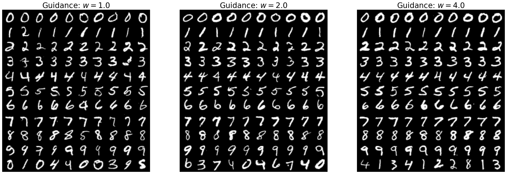 

**图 13：在 MNIST 手写数字数据集上，不同引导强度的无分类器引导效果。左：引导强度为 $w=1.0$。中：引导强度为 $w=2.0$。右：引导强度为 $w=4.0$。你将在实验三中亲自生成类似图像！**

**注记 28（扩散模型的引导）**

将上述讨论从流模型推广到扩散模型很直接：只需将 $u_{t}^{\theta}(x|y)$ 换为 $\tilde{u}_{t}^{\theta}(x|y)$，再按[第 4 节](#S4) 的方法使用 SDE 采样。

## 6 构建大规模图像与视频生成器

前面几节介绍了如何训练流匹配模型或扩散模型，从分布 $p_{\rm{data}}(x|y)$ 中采样。这套方法具有通用性，适用于多种数据类型和应用。本节深入考察大规模图像与视频生成，包括 FLUX 2.0、Stable Diffusion 3、Nano Banana、VEO-3 和 Meta Movie Gen Video 等知名模型。最后，我们将在实验中运用所学知识，从零构建自己的这类模型！本节主要内容如下：

- **神经网络架构：**首先讨论如何将原始条件输入，包括时间 $t$ 和引导变量 $y_{\text{raw}}$，即离散类别标签或原始文本，转换或**嵌入**为模型 $u_{t}^{\theta}(x|y)$ 能处理的向量形式。随后讨论 $u_{t}^{\theta}(x|y)$ 的常见架构选择，包括 **U-Net** 与**扩散 Transformer**。

- **潜空间：**介绍**变分自编码器**。它使我们能够在较低维的**潜空间**中进行生成式建模，从而实现超高分辨率图像生成。

- **案例研究：**最后，深入考察前述两个先进的图像与视频模型——Stable Diffusion 和 Meta Movie Gen，帮助你了解大规模系统的实现方式。

### 6.1 神经网络架构

首先讨论面向图像类模态，例如图像和视频的流模型与扩散模型，如何设计可扩展的神经网络架构。具体来说，我们将考察具有参数 $\theta$ 的（引导）向量场 $u_{t}^{\theta}(x|y)$ 如何在实践中实现。网络必须有三个输入：向量 $x\in\mathbb{R}^{d}$、条件变量 $y\in\mathcal{Y}$ 和时间值 $t\in[0,1]$，以及一个向量输出 $u_{t}^{\theta}(x|y)\in\mathbb{R}^{d}$。对于低维分布，例如前文的玩具分布，用多层感知机（MLP），也称全连接神经网络，参数化 $u_{t}^{\theta}(x|y)$ 就足够了。在这种简单情形中，$u_{t}^{\theta}(x|y)$ 的前向传播只需将输入 $x$、$y$ 和 $t$ 拼接后送入 MLP。但对于图像、视频、蛋白质等复杂高维分布，MLP 通常不够，需要采用针对具体应用设计的架构。本小节余下部分讨论**图像**，并可进一步推广到视频。首先考察如何将时间 $t$ 和条件变量 $y$ 等原始条件信息，**嵌入**为模型能够处理的向量形式；随后介绍两种常见架构：**U-Net** [[38](#bib.bib16), [17](#bib.bib21), [22](#bib.bib47), [11](#bib.bib32)] 与**扩散 Transformer**（DiT）[[13](#bib.bib48), [30](#bib.bib33), [28](#bib.bib11)]。

#### 6.1.1 条件变量的嵌入

##### 时间嵌入。

对于简单的玩具模型，将 $t$ 的原始值直接拼接到输入，已能训练出表现尚可的网络。实践中，常用**傅里叶特征**将标量时间嵌入到更高维空间，使模型更准确地捕捉随时间变化的高频成分 [[46](#bib.bib49)]。具体特征映射为

$$
\begin{aligned}
\text{TimeEmb}(t)=\sqrt{\frac{2}{d}}\begin{bmatrix}\cos(2\pi w_{1}t)&\cdots&\cos(2\pi w_{d/2}t)&\sin(2\pi w_{1}t)&\cdots&\sin(2\pi w_{d/2}t)\end{bmatrix}^{T}, \qquad\text{(68)}
\end{aligned}
$$

其中频率 $w_{i}$ 按下式设置：

$$
w_{i}\;=\;w_{\min}\left(\frac{w_{\max}}{w_{\min}}\right)^{\frac{i-1}{d/2-1}},\qquad i=1,\ldots,d/2. \qquad\text{(69)}
$$

这种 TimeEmb 是常见选择，但不必严格采用这一具体形式。它只是得到 $d$ 维、范数固定的嵌入的一种方便方式，即 $\|\text{TimeEmb}(t)\|=1$，因为 $\sin^{2}+\cos^{2}=1$。

##### 类别标签嵌入。

当 $y_{\text{raw}}\in\mathcal{Y}\triangleq\{0,\dots,N\}$ 只是类别标签时，最简单的做法通常是：为 $y_{\text{raw}}$ 的 $N+1$ 种可能取值分别学习一个嵌入向量，并将 $y$ 设为相应向量。这些嵌入的参数被视为 $u_{t}^{\theta}(x|y)$ 参数的一部分，在训练中共同学习。

##### 文本输入嵌入

当 $y_{\text{raw}}$ 是文本提示时，情况更复杂，通常依赖冻结的预训练模型。这类模型将离散文本输入嵌入为连续向量，以捕捉相关信息。一个例子是 **CLIP**（对比式语言—图像预训练）。CLIP 学习图像与文本提示共享的嵌入空间，其训练损失鼓励图像嵌入靠近对应文本提示的嵌入，同时远离其他图像与文本的嵌入 [[34](#bib.bib37)]。因此，可以将 $y=\text{CLIP}(y_{\text{raw}})\in\mathbb{R}^{d_{\text{CLIP}}}$ 设为冻结的预训练 CLIP 模型输出的嵌入。有时，将整段序列压缩成单一表示并不理想，此时可以额外用预训练 Transformer 对提示词编码，得到嵌入序列。实践中也常结合多个预训练模型的嵌入，以同时发挥各自优势 [[14](#bib.bib35), [33](#bib.bib39)]。对于本节，只需假设经过模型处理后的提示词嵌入具有如下形状：

$$
\text{PromptEmbed}(y_{\text{raw}})\in\mathbb{R}^{S\times k}
$$

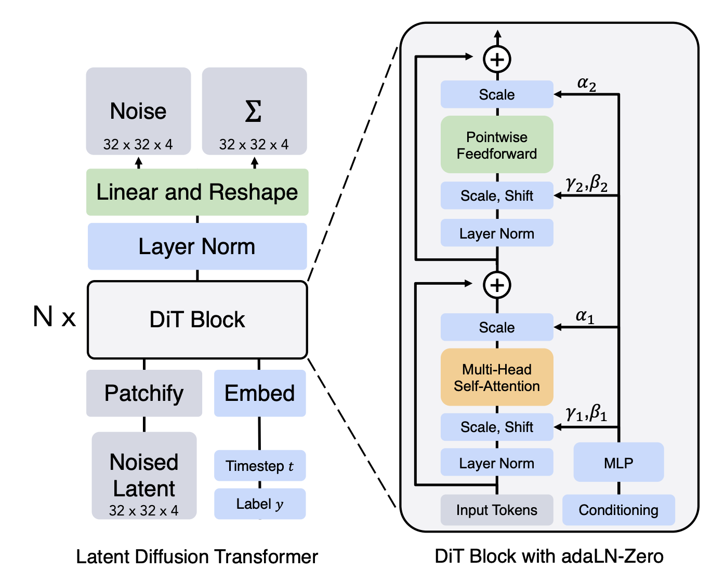 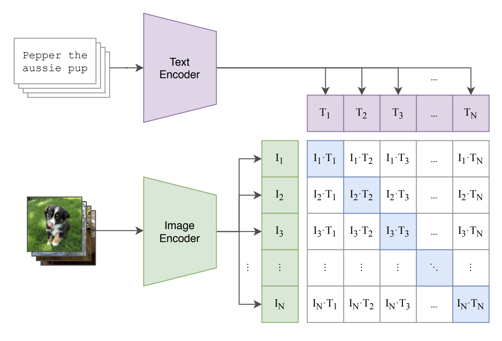

**图 14：左：扩散 Transformer 架构概览，来自 [[30](#bib.bib33)]。右：CLIP 对比损失示意图，用于学习图像与文本共享的嵌入空间，来自 [[34](#bib.bib37)]。**

#### 6.1.2 扩散 Transformer

在介绍具体架构之前，回顾引言中的图像表示：图像就是向量 $x\in\mathbb{R}^{C_{\text{image}}\times H\times W}$。其中 $C_{\text{image}}$ 为**通道数**，RGB 图像通常有 $C_{\text{input}}=3$ 个颜色通道；$H$ 和 $W$ 分别为以像素计的图像**高度**与**宽度**。一个特别重要的架构类别是**扩散 Transformer**（DiT）及其变体，它们用**注意力机制**构建网络 [[49](#bib.bib45), [30](#bib.bib33), [28](#bib.bib11)]。DiT 有不同版本，这里讲解一种通用设计；具体实现可能随模型和应用而异。本节后文用 $d$ 表示隐藏维度，$L$ 表示 Transformer 层数，$h$ 表示每层注意力头数。DiT 基于**视觉 Transformer**（ViT）：其核心思想是将图像切成图像块，将这些块嵌入为一列 token，再用标准注意力处理这些 token [[12](#bib.bib34)]。最后通过逆分块操作恢复正确形状的图像。最初的分块操作只是重排图像张量 $x\in\mathbb{R}^{C\times H\times W}$：

$$
\text{Patchify}(x)\in\mathbb{R}^{N\times C^{\prime}}
$$

其中 $C^{\prime}=CP^{2},N=(H/P)\cdot(W/P)$，$P$ 为图像块大小。随后对输出作线性变换，得到最终的图像块嵌入：

$$
\text{PatchEmb}(x)=\text{Patchify}(x)W\in\mathbb{R}^{N\times d}
$$

其中 $W\in\mathbb{R}^{C^{\prime}\times d}$ 为可学习的权重矩阵。扩散 Transformer 的输入为时间嵌入、提示词嵌入，以及分块后的图像张量，见[第 6.1.1 节](#S6.SS1.SSS1)：

$$
\begin{aligned}
\tilde{t} & =\text{TimeEmb}(t)\in\mathbb{R}^{d} \\
\tilde{y} & =\text{PromptEmb}(y)\in\mathbb{R}^{S\times d} \\
\tilde{x}_{0} & =\text{PatchEmb}(x)\in\mathbb{R}^{N\times d}
\end{aligned}
$$

此时，所有元素都具有 Transformer 所需的隐藏维度。接下来，扩散 Transformer 对 $i=0,\cdots,L-1$，使用 **DiTBlock** 中的 Transformer 层迭代更新 $\tilde{z}_{i}$，详见[注记 29](#Thmtheorem29)：

$$
\tilde{x}_{i+1}=\text{DiTBlock}(\tilde{x}_{i},\tilde{t},\tilde{y})\in\mathbb{R}^{N\times d}\quad(i=0,\dots,L-1). \qquad\text{(70)}
$$

其中 $N$ 为层数。最后通过逆分块操作，将 DiT 输出映射回所需的输出形状：

$$
u=\text{Depatchify}(\tilde{x}_{N}\tilde{W})\in\mathbb{R}^{C\times H\times W},
$$

其中 $\tilde{W}\in\mathbb{R}^{d\times C^{\prime}}$。最终张量 $u$ 即模型输出，也就是预测速度 $u_{t}^{\theta}(x|y)$。

**注记 29（DiT 模块）**

为完整起见，下面简要给出单个 DiT 层的数学描述。我们希望提供足够细节，让读者理解 DiT 模型家族的基本原理，但本讲义侧重算法中的关键选择，而非架构细节。设 $x\in\mathbb{R}^{N\times d}$ 为当前图像块 token 序列，此处 $x=\tilde{x}_{i}$；$y\in\mathbb{R}^{S\times d}$ 为嵌入后的引导变量，此处 $y=\tilde{y}$。典型的 DiT 模块通过以下三部分更新 $x$：(i) 图像块之间的自注意力；(ii) 对提示词的交叉注意力；(iii) 通过自适应归一化（AdaLN）引入时间条件。

##### 缩放点积注意力。

给定查询 $Q\in\mathbb{R}^{N\times d_{h}}$、键 $K\in\mathbb{R}^{M\times d_{h}}$ 和值 $V\in\mathbb{R}^{M\times d_{h}}$，

$$
\mathrm{Attn}(Q,K,V)\;=\;\mathrm{softmax}\!\left(\frac{QK^{\top}}{\sqrt{d_{h}}}\right)V\;\in\;\mathbb{R}^{N\times d_{h}},
$$

其中 softmax 逐行计算。

##### 多头注意力。

设 $h$ 为注意力头数，$d_{h}=\frac{d}{h}$ 为每个头的维度。对于每个头 $h\in\{1,\dots,n_{\text{heads}}\}$，学习投影矩阵 $W_{Q}^{(h)},W_{K}^{(h)},W_{V}^{(h)}\in\mathbb{R}^{k\times d_{h}}$，定义

$$
\text{head}_{h}(x,z)\;=\;\mathrm{Attn}\!\big(xW_{Q}^{(h)},\,zW_{K}^{(h)},\,zW_{V}^{(h)}\big),
$$

其中源序列 $z$ 可取以下两种形式之一：

$$
z=x\quad\text{（图像块间的自注意力）},\qquad z=y\quad\text{（对提示词的交叉注意力）}.
$$

将各个头拼接，再施加输出投影 $W_{O}\in\mathbb{R}^{d\times d}$：

$$
\mathrm{MultiHeadattention}(x,z)\;=\;\mathrm{Concat}\big(\text{head}_{1}(x,z),\dots,\text{head}_{h}(x,z)\big)\,W_{O}\;\in\;\mathbb{R}^{N\times d}.
$$

##### 通过自适应归一化引入时间条件。

设 $\tilde{t}\in\mathbb{R}^{d}$ 为时间步嵌入。DiT 的常见做法是用 $\tilde{t}$ 生成逐通道的缩放与平移参数，以调制归一化后的激活 [[31](#bib.bib51)]。具体地，设 $g:\mathbb{R}^{d}\to\mathbb{R}^{2d}$ 为 MLP，令

$$
(\gamma,\beta)=g(\tilde{t}),
$$

其中 $\gamma,\beta\in\mathbb{R}^{d}$；根据实现，也可为注意力、MLP 等不同子层分别使用 $(\gamma,\beta)$ 参数对。给定 token 矩阵 $x\in\mathbb{R}^{N\times d}$ 和归一化算子 $\mathrm{Norm}(\cdot)$，例如 LayerNorm，定义调制归一化为

$$
\mathrm{AdaNorm}_{\tilde{t}}(x)\;=\;\bigl(1+\gamma\bigr)\odot\mathrm{Norm}(H)\;+\;\beta,
$$

其中 $\odot$ 表示逐元素乘法，并沿 token 维度广播。

##### 组合各部分。

将上述操作组合起来，就得到 DiTBlock：

$$
\begin{aligned}
x & \leftarrow x+g_{\text{self}}(\tilde{t})\odot\mathrm{MultiHeadattention}\!\big(\mathrm{AdaNorm}_{\tilde{t}}(x),\,\mathrm{AdaNorm}_{\tilde{t}}(x)\big) \\
x & \leftarrow x+g_{\text{cross}}(\tilde{t})\mathrm{MultiHeadattention}\!\big(\mathrm{AdaNorm}_{\tilde{t}}(x),\,y\big) \\
x & \leftarrow x+g_{\text{MLP}}(\tilde{t})\mathrm{MLP}\!\big(\mathrm{AdaNorm}_{\tilde{t}}(x)\big),
\end{aligned}
$$

其中 MLP 是逐位置的前馈网络，$g_{\cdots}$ 是可学习的门控参数。输出 $x\in\mathbb{R}^{N\times d}$ 成为下一层的图像块 token 序列，即本文记号中的 $\tilde{x}_{i+1}$。最后，基于类别条件的 DiT，例如实验中实现的版本，通常更简单：它们省去交叉注意力层，改用基于时间与类别的 AdaNorm 条件调制。

#### 6.1.3 U-Net

**U-Net** 架构 [[38](#bib.bib16)] 是 DiT 之外的另一种选择，属于特定类型的卷积神经网络。它最初用于图像分割，关键特点是输入与输出均具有图像的形状，通道数可以不同。因此，它非常适合参数化向量场 $x\mapsto u_{t}^{\theta}(x|y)$：固定 $y,t$ 后，向量场的输入与输出都具有图像形状。U-Net 因而广泛用于早期扩散模型文献 [[17](#bib.bib21), [22](#bib.bib47), [11](#bib.bib32)]。U-Net 包括一系列**编码器** $\mathcal{E}_{i}$、相应的一系列**解码器** $\mathcal{D}_{i}$，以及位于中间的潜表示处理模块，这里称为**中间编码器**（midcoder）。[^5] 以图像 $x_{t}\in\mathbb{R}^{3\times 256\times 256}$ 为例，此处取 $(C_{\text{input}},H,W)=(3,256,256)$，考察其在 U-Net 中的处理过程：

$$
\begin{aligned}
x^{\text{input}}_{t} & \in\mathbb{R}^{3\times 256\times 256}\quad & \blacktriangleright\,\,\text{U-Net 的输入。} \\
x^{\text{latent}}_{t}=\mathcal{E}(x^{\text{input}}_{t}) & \in\mathbb{R}^{512\times 32\times 32}\quad & \blacktriangleright\,\,\text{经编码器得到潜表示。} \\
x^{\text{latent}}_{t}=\mathcal{M}(x^{\text{latent}}_{t}) & \in\mathbb{R}^{512\times 32\times 32}\quad & \blacktriangleright\,\,\text{潜表示通过中间编码器。} \\
x^{\text{output}}_{t}=\mathcal{D}(x^{\text{latent}}_{t}) & \in\mathbb{R}^{3\times 256\times 256}\quad & \blacktriangleright\,\,\text{经解码器得到输出。}
\end{aligned}
$$

随着输入依次通过编码器，表示的通道数增加，而图像的高度与宽度减小。编码器与解码器通常都由若干卷积层组成，层间穿插激活函数、池化等操作。上图省略了两点：首先，输入 $x^{\text{input}}_{t}\in\mathbb{R}^{3\times 256\times 256}$ 通常先经过预编码模块，增加通道数后，再送入第一个编码器；其次，编码器与解码器之间往往有**残差连接**。完整结构见[图 15](#S6.F15)。

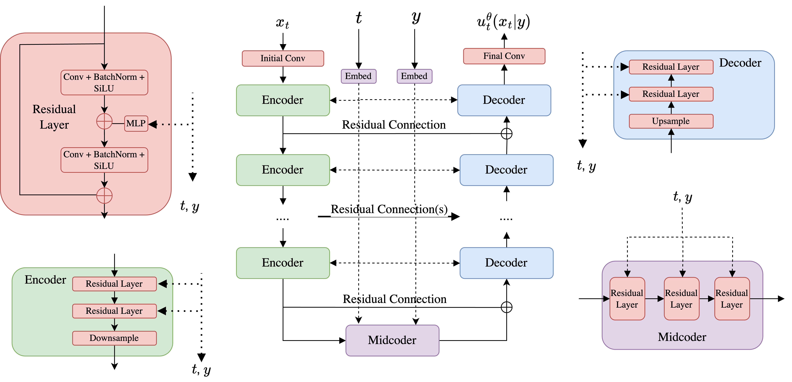 

**图 15：简化的 U-Net 架构。2025 年版课程的实验 03 使用了类似架构。**

从整体上看，大多数 U-Net 都是上述结构的变体，但实际实现中的设计选择可能有所不同。特别是，这里采用的是纯卷积架构，而实践中通常也会在编码器与解码器中加入注意力层。U-Net 的名称来自编码器与解码器共同构成的“U”形结构，见[图 15](#S6.F15)。

### 6.2 在潜空间中建模：（变分）自编码器

迄今，我们都在数据空间 $\mathbb{R}^{d}$ 中进行操作。但随着图像分辨率不断提高，直接在该空间中建模的代价很快会高到难以承受。例如，一张具有 RGB 三个颜色通道的 $1024\times 1024$ 图像，总维数为 $d=H\cdot W\cdot 3\approx 3*10^{6}$！对于视频，所有维度还要乘以帧数 $T$，因此维数会进一步增大。不难想象，在这样的空间中训练很快就变得不可行。图像分类的输出维数较低，卷积网络可以逐步收窄；但流建模要求输出 $u_{t}^{\theta}(x)\in\mathbb{R}^{d}$ 与输入同样大。因此，关键问题是：**如何在合理的内存与计算预算下，对高维图像进行建模？**

#### 6.2.1 标准自编码器

一个自然的答案是**压缩**：例如，真实图像可能位于高维图像空间中某个低得多维的流形附近。具体而言，可以考虑**编码器** $\mu_{\phi}:\mathbb{R}^{d}\to\mathbb{R}^{k}$ 与**解码器** $\mu_{\theta}:\mathbb{R}^{k}\to\mathbb{R}^{d}$，分别将原始图像 $x\in\mathbb{R}^{d}$ 映射为潜变量 $z\in\mathbb{R}^{k}$，并将潜变量映射回图像。通常选择维度 $k$ 远小于 $d$。对于图像，例如 $d=3\times 1024\times 1024$，常通过下采样得到 $k=3\times\tfrac{1024}{16}\times\tfrac{1024}{16}$。$\mu_{\phi}$ 与 $\mu_{\theta}$ 合称**自编码器**。理想情况下，应选择 $\mu_{\phi}$ 与 $\mu_{\theta}$，使重建质量尽可能高，也就是说，$\mu_{\theta}(\mu_{\phi}(x))$ 在平均意义上接近 $x$。因此，自编码器通常使用**重建损失**训练：

$$
\begin{aligned}
\mathcal{L}_{\text{Recon}}(\phi,\theta)= & \mathbb{E}_{x\sim p_{\rm{data}}}\left[\|\mu_{\theta}(\mu_{\phi}(x))-x\|^{2}\right].
\end{aligned}
$$

该损失衡量原始数据点 $x$ 与重建数据点 $\mu_{\theta}(\mu_{\phi}(x))$ 之间的平方误差。

##### 是否适合生成式建模。

遗憾的是，仅有上述重建损失，还不足以训练出“好”的自编码器。回想最终目标：我们希望在潜空间中训练生成模型，目标潜分布 $p_{\text{latent}}(z)$ 由 $z=\mu_{\phi}(x),x\sim p_{\rm{data}}$ 给出。将潜空间生成模型的输出送入解码器 $\mu_{\theta}$，就能得到 $p_{\rm{data}}(x)$ 的生成模型。但当前自编码器表述中有个微妙问题：我们几乎无法控制 $p_{\text{latent}}(z)$，因此也无法保证 $p_{\text{latent}}(z)$ 足够规整，适合训练生成模型，例如简单、平滑、近似高斯。虽然潜空间变换压缩了数据，却也可能将数据分布 $p_{\rm{data}}$ 变成非常难学的分布 $p_{\text{latent}}$。因此，如何保证潜分布 $p_{\text{latent}}$ 仍然规整、易学？为更显式地正则化潜分布，下面将自编码器置于更一般的概率框架中，由此引出变分自编码器。

#### 6.2.2 变分自编码器

将标准自编码器中“编码器与解码器必须是确定性函数”的限制放宽，就得到**变分自编码器**（VAE）。具体地，考虑参数为 $\phi$ 的编码器 $q_{\phi}(z|x)$，以及参数为 $\theta$ 的解码器 $p_{\theta}(x|z)$。最常见的选择是

$$
q_{\phi}(z|x)=\mathcal{N}(z;\mu_{\phi}(x),\textrm{diag}(\sigma_{\phi}^{2}(x))),\quad p_{\theta}(x|z)=\mathcal{N}(x;\mu_{\theta}(z),\sigma_{\theta}^{2}(z)I_{d}) \qquad\text{(71)}
$$

其中 $\mu_{\phi}(x)\in\mathbb{R}^{k}$、$\sigma_{\phi}^{2}(x)\in\mathbb{R}_{\geq 0}^{k}$、$\mu_{\theta}(z)\in\mathbb{R}^{d}$ 和 $\sigma_{\theta}^{2}(z)\in\mathbb{R}_{\geq 0}$ 由神经网络参数化，diag 表示对角矩阵。对变量编码或解码时，进行如下采样：

$$
\begin{aligned}
z & \sim q_{\phi}(\cdot|x) & (\text{encode}) \\
x & \sim p_{\theta}(\cdot|z) & (\text{decode})
\end{aligned}
$$

当始终有 $\sigma_{\phi}(x)=0$ 和 $\sigma_{\theta}(x)=0$ 时，就恢复为标准自编码器。下面考察重建损失，一个自然的目标为：

$$
\begin{aligned}
\mathcal{L}_{\text{VAE-Recon}}(\phi,\theta)= & -\mathbb{E}_{x\sim p_{\rm{data}}(x),z\sim q_{\phi}(\cdot|x)}\left[\log p_{\theta}(x|z)\right] \qquad\text{(72)}
\end{aligned}
$$

这里有两处变化：首先，编码不再确定，而是采样 $z\sim q_{\phi}(z|x)$；其次，采用 $x$ 在解码分布下的负对数似然。也就是说，损失实际上在问：原始数据点 $x$ 经过编码再解码后，有多大可能被恢复出来？由于编码与解码如今都具有随机性，需要将所有可能结果考虑在内。对于高斯情形，重建损失变为：

$$
\begin{aligned}
\mathcal{L}_{\text{VAE-Recon}}(\phi,\theta)= & \mathbb{E}_{x\sim p_{\rm{data}}(x),z\sim q_{\phi}(z|x)}\left[\frac{1}{2\sigma^{2}_{\theta}(z)}\|x-\mu_{\theta}(z)\|^{2}+\frac{d}{2}\log\sigma_{\theta}^{2}(z)\right]+\text{const} \qquad\text{(73)}
\end{aligned}
$$

这里使用了正态分布的密度，见[式 97](#A1.E97)。因此，VAE 的重建损失与标准自编码器相差不大，只需将所有可能的编码 $z\sim q_{\phi}(\cdot|x)$ 考虑在内。依赖解码器方差的第二项，控制了重建精度与预测不确定性之间的权衡。许多实现，包括实验中的实现，将 $\sigma_{\phi}(x)$ 和 $\sigma_{\theta}(z)$ 设为可学习的标量常数，即分别不依赖 $x$ 和 $z$，以避免学习方差时的病态行为与数值不稳定。因此，除去编码中的随机性和常数项，此时 VAE 的重建损失基本就是标准自编码器的重建损失：

$$
\begin{aligned}
\mathcal{L}_{\text{VAE-Recon}}(\phi,\theta)= & \mathbb{E}_{x\sim p_{\rm{data}}(x),z\sim q_{\phi}(z|x)}\left[\frac{1}{2\sigma_{\theta}^{2}}\|x-\mu_{\theta}(z)\|^{2}\right]+\text{const} \qquad\text{(74)}
\end{aligned}
$$

再回顾目标：我们希望为数据分布 $p_{\rm{data}}(x)$ 构造编码，使其映射到潜空间后成为规整、易学的分布。为此，在潜变量 $z$ 上引入**先验分布** $p_{\text{prior}}(z)$，这里取 $p_{\text{prior}}=\mathcal{N}(0,I_{k})$ 为各向同性高斯分布。先验 $p_{\text{prior}}$ 实际上代表了潜分布的“理想形态”。正态分布很容易学习，符合获得“可训练”潜分布的目标。因此，核心思想是正则化编码器，让编码后的数据分布尽可能接近 $p_{\text{prior}}$。为此使用辅助损失：

$$
\begin{aligned}
\mathcal{L}_{\text{VAE-Prior}}(\phi)= & \mathbb{E}_{x\sim p_{\rm{data}}(x)}\left[D_{\text{KL}}(q_{\phi}(\cdot|x)\;\|\;p_{\text{prior}})\right], \qquad\text{(75)}
\end{aligned}
$$

其中 $D_{KL}$ 是 **Kullback–Leibler（KL）散度**。KL 散度是衡量两个概率分布差异的基本方法。详细介绍超出了本文范围，[注记 30](#Thmtheorem30) 会简要回顾。这里定义的损失 $\mathcal{L}_{\text{VAE-Prior}}$ 很直观：希望任意数据点 $x$ 的编码分布都近似高斯。若所有 $x$ 都如此，自然可以期待总体潜分布也近似高斯。

**注记 30（KL 散度背景知识）**

对两个概率密度 $q,p$，**Kullback–Leibler 散度**（KL 散度）定义为

$$
D_{\text{KL}}(q(x)\;\|\;p(x))=\int q(x)\log\frac{q(x)}{p(x)}=\mathbb{E}_{X\sim q}\left[\log\frac{q(X)}{p(X)}\right].
$$

KL 散度是衡量分布差异的标准指标，特别地，它具有以下有用性质：

$$
\begin{aligned}
D_{\text{KL}}(q(x)\;\|\;p(x)) & \geq 0, \qquad\text{(76)} \\
D_{\text{KL}}(q(x)\;\|\;p(x)) & =0\quad\Leftrightarrow\quad q=p. \qquad\text{(77)}
\end{aligned}
$$

即始终非负，且当且仅当两个概率分布相同时为零。

现在，将重建损失与先验损失通过权重参数 $\beta\geq 0$ 组合，得到**VAE 训练目标**：

$$
\begin{aligned}
\mathcal{L}_{\text{VAE}}(\phi,\theta) & =\mathcal{L}_{\text{VAE-Recon}}(\phi,\theta)+\beta\mathcal{L}_{\text{VAE-Prior}}(\phi) \qquad\text{(78)} \\
=-\mathbb{E}_{x\sim p_{\rm{data}}(x),z\sim q_{\phi}(z|x)}\left[\log p_{\theta}(x\mid z)\right]+\beta\mathbb{E}_{x\sim p_{\rm{data}}(x)}\left[D_{KL}(q_{\phi}(\cdot|x)||p_{\text{prior}})\right] \qquad\text{(79)}
\end{aligned}
$$

第一项要求潜变量能够被有效解码回数据，第二项要求潜分布接近高斯分布，参数 $\beta$ 控制两者的相对强度。为了使损失更具体，下面推导高斯情形下的 KL 散度：

**例 31（各向同性高斯分布之间的 KL 散度）**

设 $q(x)=\mathcal{N}(x;\mu_{q},\textrm{diag}(\sigma_{q}^{2}))$ 和 $p(x)=\mathcal{N}(x;\mu_{p},\textrm{diag}(\sigma_{p}^{2}))$ 为协方差矩阵为对角矩阵的高斯分布，满足 $\sigma_{q},\sigma_{p}\in\mathbb{R}_{\geq 0}^{d}$，其中 $x\in\mathbb{R}^{d}$。则

$$
D_{\text{KL}}(q\;\|\;p)=\frac{1}{2}\left(\mathcal{K}\left(\frac{\sigma_{q}^{2}}{\sigma_{p}^{2}}\right)+\frac{\|\mu_{q}-\mu_{p}\|^{2}}{\sigma_{p}^{2}}\right),\quad\text{其中 }\mathcal{K}(\alpha)=\sum\limits_{i=1}^{d}\alpha_{i}-\log\alpha_{i}-1. \qquad\text{(80)}
$$

上式的含义很直观：均值和方差均相同时，$D_{\text{KL}}(q\;\|\;p)=0$；散度随均值向量间的平方误差 $\|\mu_{q}-\mu_{p}\|^{2}$ 增大；此外，函数 $\mathcal{K}(\alpha)$ 在 $\alpha=1$ 处有唯一最小值，因此当 $\sigma_{q}=\sigma_{p}$ 时，$D_{\text{KL}}(q\;\|\;p)$ 最小。

**证明。**

先证明 $d=1$ 的情形；对于 $d>1$，只需对各维求和，证明类似。根据正态分布的密度，见[式 97](#A1.E97)，有

$$
\log q(x)=-\frac{1}{2}\log(2\pi\sigma_{q}^{2})-\frac{1}{2\sigma_{q}^{2}}\|x-\mu_{q}\|^{2},\qquad\log p(x)=-\frac{1}{2}\log(2\pi\sigma_{p}^{2})-\frac{1}{2\sigma_{p}^{2}}\|x-\mu_{p}\|^{2}
$$

因此

$$
\begin{aligned}
D_{\mathrm{KL}}(q\|p) & =\mathbb{E}_{x\sim q}\big[\log q(x)-\log p(x)\big]=\frac{1}{2}\log\frac{\sigma_{p}^{2}}{\sigma_{q}^{2}}+\frac{1}{2\sigma_{p}^{2}}\mathbb{E}_{q}\!\left[\|x-\mu_{p}\|^{2}\right]-\frac{1}{2\sigma_{q}^{2}}\mathbb{E}_{q}\!\left[\|x-\mu_{q}\|^{2}\right]. \qquad\text{(81)}
\end{aligned}
$$

对于 $x\sim\mathcal{N}(\mu_{q},\sigma_{q}^{2}I)$，有

$$
\mathbb{E}_{q}\!\left[\|x-\mu_{q}\|^{2}\right]=\mathrm{tr}(\sigma_{q}^{2}I)=\sigma_{q}^{2}.
$$

结合 $x-\mu_{p}=(x-\mu_{q})+(\mu_{q}-\mu_{p})$ 与 $\mathbb{E}_{q}[x-\mu_{q}]=0$，得到

$$
\mathbb{E}_{q}\!\left[\|x-\mu_{p}\|^{2}\right]=\mathbb{E}_{q}\!\left[\|x-\mu_{q}\|^{2}\right]+\|\mu_{q}-\mu_{p}\|^{2}=\sigma_{q}^{2}+\|\mu_{q}-\mu_{p}\|^{2}.
$$

将这些代入[式 81](#S6.E81)，即得[式 80](#S6.E80)。∎

现在假设编码器为高斯形式，可得：

$$
\begin{aligned}
\mathcal{L}_{\text{VAE-Prior}}(\phi)= & \mathbb{E}_{x\sim p_{\rm{data}}(x)}\left[D_{\text{KL}}(q_{\phi}(\cdot|x)\;\|\;\mathcal{N}(0,I_{k}))\right]=\mathbb{E}\left[\frac{1}{2}\mathcal{K}\left(\sigma_{\phi}^{2}(x)\right)+\frac{1}{2}\|\mu_{\phi}(x)\|^{2}\right] \qquad\text{(82)}
\end{aligned}
$$

这个损失很直观：均值 $\mu_{\phi}(x)$ 偏离零会受到惩罚，方差偏离 $1$ 也会受到惩罚。VAE 的总损失为

$$
\begin{aligned}
\mathcal{L}_{\text{VAE}}(\phi,\theta) \\
=\mathcal{L}_{\text{VAE-Recon}}(\phi,\theta)+\beta\mathcal{L}_{\text{VAE-Prior}}(\phi) \\
=\mathbb{E}_{x\sim p_{\rm{data}}(x),z\sim q_{\phi}(z|x)}\left[\underbrace{\frac{1}{2\sigma^{2}_{\theta}(z)}\|x-\mu_{\theta}(z)\|^{2}}_{\text{重建误差}}+\underbrace{\frac{d}{2}\log\sigma_{\theta}^{2}(z)}_{\text{解码器置信度}}+\underbrace{\frac{\beta}{2}\mathcal{K}\left(\sigma_{\phi}^{2}(x)\right)}_{\text{使潜变量方差为}=1}+\underbrace{\frac{\beta}{2}\|\mu_{\phi}(x)\|^{2}}_{\text{使潜变量均值为}=0}\right]
\end{aligned}
$$

上述损失的四项含义都很直观：第一项就是重建误差；第二项反映解码器的不确定性，方差越小，解码器越“自信”，但对重建误差的惩罚也越强；此外，我们希望潜变量方差为 $1$、均值为 $0$，以促使潜空间中的分布接近高斯。

##### VAE 的训练。

剩下的问题是如何最小化 VAE 损失 $\mathcal{L}_{\text{VAE}}(\phi,\theta)$。目前的问题在于，取期望所依据的分布 $q_{\phi}(z|x)$ 仍依赖参数 $\phi$。不过，可以用**重参数化技巧**将其改写。具体地，对于

$$
q_{\phi}(z|x)=\mathcal{N}(z;\mu_{\phi}(x),\sigma_{\phi}^{2}(x)I_{k})
$$

可以通过下式采样：

$$
\epsilon\sim\mathcal{N}(0,I_{k}),\quad z=\mu_{\phi}(x)+\sigma_{\phi}(x)\epsilon\quad\Rightarrow\quad z\sim q_{\phi}(\cdot|x)
$$

此式中，唯一的噪声或随机性来源是 $\epsilon$，而其分布与 $\phi$ 无关。因此，可以将损失改写为：

$$
\begin{aligned}
\mathcal{L}_{\text{VAE}}(\phi,\theta)= & \mathbb{E}_{x\sim p_{\rm{data}}(x),\epsilon\sim\mathcal{N}(0,I_{k})}\left[\frac{1}{2\sigma^{2}_{\theta}(z)}\|x-\mu_{\theta}(\mu_{\phi}(x)+\sigma_{\phi}(x)\epsilon)\|^{2}+\frac{d}{2}\log\sigma_{\theta}^{2}(z)+\frac{\beta}{2}\mathcal{K}\left(\sigma_{\phi}^{2}(x)\right)+\frac{\beta}{2}\|\mu_{\phi}(x)\|^{2}\right]
\end{aligned}
$$

重参数化之后，随机性只来自 $\epsilon\sim\mathcal{N}(0,I_{k})$，其分布不依赖 $\phi$，因此可以用深度学习中的标准工具最小化该损失。若进一步简化，再次将 $\sigma_{\theta}^{2}(z)=\sigma^{2}$ 处处设为常数，可得：

$$
\begin{aligned}
\mathcal{L}_{\text{VAE}}(\phi,\theta)= & \mathbb{E}_{x\sim p_{\rm{data}}(x),\epsilon\sim\mathcal{N}(0,I_{k})}\left[\frac{1}{2\sigma^{2}}\|x-\mu_{\theta}(\mu_{\phi}(x)+\sigma_{\phi}(x)\epsilon)\|^{2}+\frac{\beta}{2}\mathcal{K}\left(\sigma_{\phi}^{2}(x)\right)+\frac{\beta}{2}\|\mu_{\phi}(x)\|^{2}\right]
\end{aligned}
$$

[算法 6](#alg6) 总结了 VAE 的训练流程。

**算法 6：$\beta$-VAE 训练流程，高斯解码器采用固定方差 $p_{\theta}(x|z)=\mathcal{N}(x;\mu_{\theta}(z),\tilde{\sigma}^{2}I_{d})$**

| 步骤 | 操作 |
| --- | --- |
| 0 | 样本数据集 $x\sim p_{\rm{data}}$，编码器网络 $(\mu_{\phi}(x),\log\sigma_{\phi}^{2}(x))$，解码器网络 $\mu_{\theta}(z)$，潜维数 $k$，常数 $\beta\geq 0$、$\sigma^{2}>0$ |
| 1 | **对于**每个小批量 $\{x_{i}\}_{i=1}^{B}$，**执行** |
| 2 | 编码每个 $x_{i}$：$\mu_{i}\leftarrow\mu_{\phi}(x_{i})$、$\log\sigma_{i}^{2}\leftarrow\log\sigma_{\phi}^{2}(x_{i})$。 |
| 3 | 采样噪声 $\epsilon_{i}\sim\mathcal{N}(0,I_{k})$。 |
| 4 | 重参数化：$z_{i}\leftarrow\mu_{i}+\sigma_{i}\odot\epsilon_{i}$，其中 $\sigma_{i}=\exp(\tfrac{1}{2}\log\sigma_{i}^{2})$。 |
| 5 | 解码均值：$\hat{x}_{i}\leftarrow\mu_{\theta}(z_{i})$。 |
| 6 | 重建损失：[下方公式 1](#alg6-formula-1)。 |
| 7 | 相对于先验 $p_{\text{prior}}(z)=\mathcal{N}(0,I_{k})$ 的 KL 损失：[下方公式 2](#alg6-formula-2)。 |
| 8 | 总损失：$\mathcal{L}\leftarrow\mathcal{L}_{\text{recon}}+\beta\,\mathcal{L}_{\text{KL}}$。 |
| 9 | 更新 $(\phi,\theta)\leftarrow\text{grad\_update}(\mathcal{L})$。 |
| 10 | **结束循环** |

**算法 6，公式 1。**

$$
\mathcal{L}_{\text{recon}}\leftarrow\frac{1}{B}\sum_{i=1}^{B}\frac{1}{2\tilde{\sigma}^{2}}\,\|x_{i}-\hat{x}_{i}\|^{2}
$$

**算法 6，公式 2。**

$$
\mathcal{L}_{\text{KL}}\leftarrow\frac{1}{B}\sum_{i=1}^{B}\frac{1}{2}\sum_{j=1}^{k}\left(\mu_{i,j}^{2}+\sigma_{i,j}^{2}-\log\sigma_{i,j}^{2}-1\right)
$$

##### 实践说明。

上述构造展示了自编码器设计的基本原理。实践中，人们可能加入更多损失项或其他约束。因此，最后补充几点实践说明：

1. **$\beta$ 的选择与 KL 预热。**较大的 $\beta$ 会迫使潜变量更接近先验，但可能损害重建质量，并导致后验坍缩，即编码器忽略 $x$，直接输出 $q_{\phi}(z|x)\approx\mathcal{N}(0,I_{k})$。一种常见的稳定训练方法是 KL 预热：从 $\beta=0$ 开始，在最初若干训练轮次中逐渐升至目标值。不过，现代自编码器中的 $\beta$ 通常非常小，即 $\beta<<1$。

2. **解码器方差。**学习高斯解码器方差 $\sigma_{\theta}^{2}$ 在数值上可能较为棘手，若不正则化，可能产生退化解。为保证稳定，许多实现固定 $p_{\theta}(x|z)=\mathcal{N}(x;\mu_{\theta}(z),\sigma^{2}I_{d})$，其中 $\sigma^{2}$ 为常数；这样，除常数项外，重建项就与均方误差成正比。

3. **超越像素均方误差的重建损失。**对于图像，逐像素高斯似然，即均方误差，往往导致重建结果过于平滑。实践中常加入感知损失，即使用预训练网络定义的特征空间损失，以改善清晰度与语义保真度。

4. **对抗目标与混合目标。**为了进一步提升视觉真实感，可以在解码样本上使用判别器，将 VAE 目标与对抗损失结合，形成 VAE-GAN 风格的目标。这通常会让输出更清晰，但也会带来额外的优化不稳定性与超参数。

**注记 32（在潜空间中建模）**

训练潜空间生成模型时，只需沿用已有训练方法，但直接在**潜空间**中操作。训练时，通过 $x\sim p_{\rm{data}}$ 从 $q_{\phi}(z|x)$ 中采样；推理时，从潜空间扩散模型或流模型采样 $z$，再用 $x=\mu_{\text{mean}}(z)$ 解码。注意，这里取均值而非随机样本，以避免噪声引起的伪影。直观地说，一个训练良好的自编码器会滤去高频或其他不具语义意义的细节，让生成模型“专注”于重要、与感知相关的特征 [[36](#bib.bib36)]。在本文撰写时，几乎所有先进图像与视频生成方法都采用所谓的**潜扩散**范式，即在自编码器的潜空间中训练流模型或扩散模型 [[36](#bib.bib36), [48](#bib.bib14)]。但要注意，训练扩散模型之前，还必须先训练自编码器。此时，系统性能也取决于自编码器能否有效地将图像压缩到潜空间，并恢复出视觉上令人满意的图像。

关于 VAE 的更多讨论见[附录 D](#A4)。

### 6.3 案例研究：Stable Diffusion 3 与 Meta Movie Gen

本节最后简要考察两个大规模生成模型：用于图像生成的 Stable Diffusion 3，以及用于视频生成的 Meta Movie Gen Video [[14](#bib.bib35), [33](#bib.bib39)]。你会看到，它们采用了本文介绍的技术，并加入额外的架构改进，以扩大规模，并容纳文本等结构丰富的条件模态。

#### 6.3.1 Stable Diffusion 3

Stable Diffusion 是一系列先进图像生成模型，也是最早将大规模潜扩散模型用于图像生成的模型之一。如果尚未体验，强烈建议你在线试用：[https://stability.ai/news/stable-diffusion-3](https://stability.ai/news/stable-diffusion-3)。

Stable Diffusion 3 使用了本文研究的同一种条件流匹配目标，见[算法 4](#alg4)。[^6] 其论文指出，作者广泛测试了不同的流模型与扩散模型方案，发现流匹配表现最佳。训练时，它使用前文介绍的无分类器引导训练方法，即随机丢弃类别标签。此外，Stable Diffusion 3 按照[第 6.1 节](#S6.SS1) 的思路，在预训练自编码器的潜空间中训练。训练一个优良的自编码器，是最早几篇 Stable Diffusion 论文的重要贡献。

为增强文本条件，Stable Diffusion 3 使用了 3 种不同的文本嵌入，包括 CLIP 嵌入，以及 Google T5-XXL 预训练编码器产生的序列输出 [[35](#bib.bib38)]，与 [[3](#bib.bib40), [39](#bib.bib41)] 的做法类似。CLIP 嵌入提供输入文本较粗粒度的整体表示，T5 嵌入则提供更细致的上下文，让模型可以关注条件文本中的特定元素。为容纳这些序列上下文嵌入，作者进一步扩展扩散 Transformer，使其不仅关注图像块，也关注文本嵌入，从而将最初 DiT 的类别条件机制推广到序列上下文条件。这种改进的 DiT 称为**多模态 DiT**（MM-DiT），见[图 16](#S6.F16)。其最终最大模型具有 **80 亿参数**。采样时采用欧拉模拟方法，使用 $50$ 步，即需要执行 $50$ 次网络求值，无分类器引导权重介于 $2.0$–$5.0$ 之间。

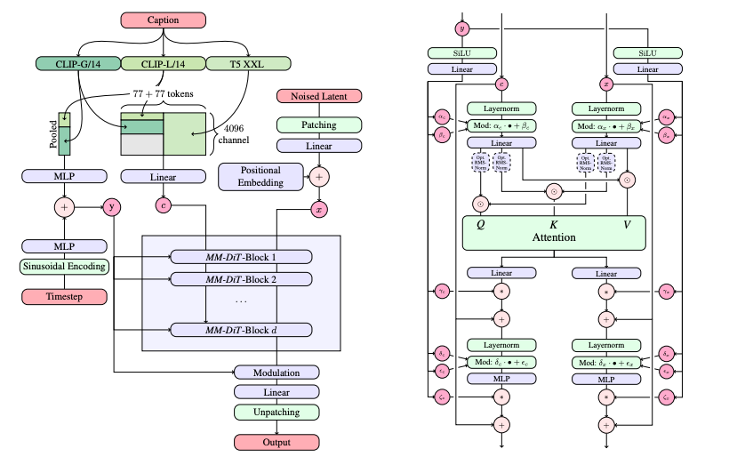 

**图 16：[[14](#bib.bib35)] 提出的多模态扩散 Transformer（MM-DiT）架构，图片亦来自 [[14](#bib.bib35)]。**

#### 6.3.2 Meta Movie Gen Video

接下来介绍 Meta 的视频生成器 Movie Gen Video：[https://ai.meta.com/research/movie-gen/](https://ai.meta.com/research/movie-gen/)。由于数据是视频而不是图像，数据 $x$ 位于空间 $\mathbb{R}^{T\times C\times H\times W}$，其中 $T$ 表示新增的**时间维度**，也就是帧数。你会看到，视频场景中的许多设计，实际上都是将图像场景中已有的自编码器、扩散 Transformer 等技术，调整为能够处理这一额外时间维度的形式。

Movie Gen Video 使用条件流匹配目标，并采用相同的直线调度函数 $\alpha_{t}=t,\sigma_{t}=1-t$。与 Stable Diffusion 3 一样，它也在冻结的预训练自编码器潜空间中建模。对于视频，自编码器节省内存的作用比图像更重要，这也是当前多数视频生成器生成时长仍受到较大限制的原因。具体地，作者引入**时间自编码器**（TAE）处理新增的时间维度，将原始视频 $x_{t}^{\prime}\in\mathbb{R}^{T^{\prime}\times 3\times H\times W}$ 映射为潜表示 $x_{t}\in\mathbb{R}^{T\times C\times H\times W}$，其中 $\tfrac{T^{\prime}}{T}=\tfrac{H^{\prime}}{H}=\tfrac{W^{\prime}}{W}=8$ [[33](#bib.bib39)]。为支持长视频，作者提出时间分块方法：将视频切成若干片段，各自编码，再拼接潜表示 [[33](#bib.bib39)]。模型本身，即 $u_{t}^{\theta}(x_{t})$，采用类似 DiT 的骨干，对 $x_{t}$ 沿时间与空间维度分块，再将图像块送入 Transformer，同时进行图像块之间的自注意力，以及与语言模型嵌入之间的交叉注意力，类似于 Stable Diffusion 3 的 MM-DiT。文本条件方面，Movie Gen Video 使用三类文本嵌入：UL2 嵌入，用于细粒度的文本推理 [[47](#bib.bib42)]；ByT5 嵌入，用于关注字符级细节，例如明确要求画面中出现特定文字的提示 [[50](#bib.bib43)]；以及在图文共享嵌入空间中训练的 MetaCLIP 嵌入 [[24](#bib.bib44), [33](#bib.bib39)]。其最终最大模型具有 **300 亿参数**。更全面、深入的介绍可参阅 Movie Gen 技术报告 [[33](#bib.bib39)]。

## 7 离散扩散模型：用扩散构建语言模型

前面几节中，我们将流模型与扩散模型作为欧几里得空间 $\mathbb{R}^{d}$ 上的生成模型，生成可表示为向量 $z\in\mathbb{R}^{d}$ 的数据点。但并非所有数据都适合自然地建模为欧几里得空间 $\mathbb{R}^{d}$ 中的点。文本、DNA 等许多数据类型，更适合视为离散状态空间 $S$ 中的元素。尤其是语言，它由需要建模的离散 token 序列构成。如何将流模型与扩散模型用于这类数据？事实证明，前几节学到的原理同样适用。机器学习文献将得到的模型称为**离散扩散模型** [[5](#bib.bib4), [16](#bib.bib1)]。但要注意，这里并不存在数学意义上的扩散过程，因为离散状态空间中没有 SDE。我们改用**连续时间马尔可夫链（CTMC）**，替代 ODE/SDE。下面将介绍 CTMC 模型，见[第 7.1 节](#S7.SS1)，以及如何学习它们，见[第 7.2 节](#S7.SS2)，从而利用流模型与扩散模型的原理构建大语言模型（LLM）。

### 7.1 连续时间马尔可夫链（CTMC）模型

本节介绍连续时间马尔可夫链。你可以将 CTMC 理解为 SDE 的离散对应物，借助它构建能生成离散状态的神经网络模型。我们还将介绍 CTMC 模型，即利用 CTMC 生成文本等离散序列的神经网络模型。

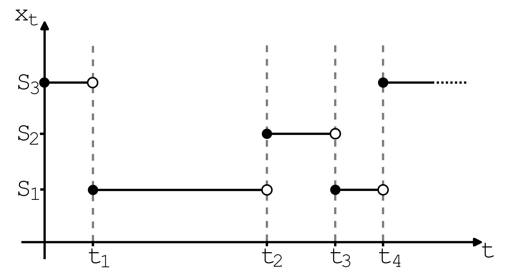 

**图 17：状态空间为 $S=\{S_{1},S_{2},S_{3}\}$、序列长度为 $d=1$ 的 CTMC 轨迹示意图。改编自 [[5](#bib.bib4)]。**

首先描述**状态空间** $S$。设词表为 $\mathcal{V}=\{v_{1},\cdots,v_{V}\}$，则状态空间为 $S=\mathcal{V}^{d}$，其中 $d\in\mathbb{N}$ 是序列长度，$V\in\mathbb{N}$ 是词表大小。对于语言，$\{v_{1},\cdots,v_{V}\}$ 可以枚举字母表或一组离散 token，$S$ 就表示长度为 $d$ 的序列或句子集合。对于 DNA，$\{v_{1},\cdots,v_{V}\}$ 可以是 4 种碱基，$S$ 则是长度为 $d$ 的所有 DNA 序列。

接下来，设 $X_{t}$ 为 $S$ 上的随机过程，即 $S$ 中的随机轨迹 $X:[0,1]\to S,t\mapsto X_{t}$。要求 $X_{t}$ 是**马尔可夫过程**，即无记忆的过程。具体而言，满足

$$
\underbrace{p(X_{t+h}|X_{t},X_{t_{1}},\cdots,X_{t_{k}})}_{\text{给定现在与过去时，未来的概率}}=\underbrace{p(X_{t+h}|X_{t})}_{\text{给定现在时，未来的概率}}\quad(\text{对所有 }0<h,0\leq t_{1}<t_{2}<\cdots<t_{k}<t)
$$

换言之，未来事件的概率只依赖现在，过去不再提供额外信息。虽然 ODE/SDE 不处于离散状态空间中，它们也是马尔可夫过程。这里，$X_{t}$ 位于离散空间，因此称为马尔可夫链，更具体地说，是**连续时间马尔可夫链（CTMC）**。$p_{t+h|t}(X_{t+h}|X_{t})$ 称为**转移概率**，它与链的初始分布 $X_{0}\sim p_{0}$ 一起完全确定 CTMC。因此，提到 CTMC 时，也可以直接想到转移概率 $p_{t+h|t}(X_{t+h}|X_{t})$。

下面推导离散情形中与向量场对应的对象。在离散空间中，我们只能在状态之间跳跃或切换，不能像指定 ODE 那样沿某个方向前进。因此，定义**速率矩阵** $Q_{t}(y|x)$，概括从状态 $x\in S$ 跳到状态 $y\in S$ 的速率。形式上，速率矩阵 $Q_{t}$ 由关于时间连续的有界函数给出：

$$
Q:S\times S\times[0,1]\to\mathbb{R},\quad(x,y,t)\mapsto Q_{t}(y|x) \qquad\text{(84)}
$$

其中 $Q_{t}(y|x)$ 描述从 $x$ 切换到 $y$ 的速率，并满足

$$
\begin{aligned}
\text{（1）离开当前状态的速率非负：}Q_{t}(y|x)\geq & 0\quad\text{只要 }x\neq y \qquad\text{(85)} \\
\text{（2）留在当前状态的速率等于总离开速率的相反数：}Q_{t}(x|x)= & -\sum\limits_{y\neq x}Q_{t}(y|x)\quad\text{，对所有 }x \qquad\text{(86)}
\end{aligned}
$$

这两个条件很直观。第一个条件说明，从 $x$ 切换到另一状态 $y\neq x$ 的速率只能非负；不切换对应 $0$，因此速率小于 $0$ 没有意义。第二个条件说明，留在 $x$ 的速率 $Q_{t}(x|x)$ 应抵消离开 $x$ 的速率。这本质上是一致性条件：要么留在 $x$，要么离开，没有第三种选择。这些条件特别蕴含 $Q_{t}(x|x)\leq 0$。因此，矩阵 $Q_{t}(y|x)$ 的对角元均非正，非对角元均非负。

现在可以定义与微分方程对应的条件，要求 CTMC“遵循”速率矩阵。基本思想是：$X$ 的分布或演化应遵循速率矩阵 $Q_{t}$。换言之，要求转移概率满足

$$
\frac{\mathrm{d}}{\mathrm{d}h}p_{t+h|t}(X_{t+h}=y|X_{t}=x)_{|h=0}=Q_{t}(y|x)\quad\text{对所有 }x,y\in S,0\leq t \qquad\text{(87)}
$$

左侧是从 $x$ 切换到 $y$ 的概率的无穷小变化率。我们要求这些概率按速率矩阵指定的方式变化。先简单检查这一要求是否合理：若按[式 87](#S7.E87) 直接设置 $Q_{t}(y|x)$，会得到有效的速率矩阵吗？当 $h=0$ 时，从 $x$ 切换到 $y\neq x$ 的概率为零，因为尚未经过任何时间，即对所有 $y\neq x$，有 $p_{t|t}(y|x)=0$。因此，该概率的导数必须非负，也就是说当 $y\neq x$ 时，$Q_{t}(y|x)\geq 0$。这验证了[式 85](#S7.E85) 的第一个条件。此外，

$$
\begin{aligned}
\sum\limits_{y\neq x}Q_{t}(y|x)=\sum\limits_{y\neq x}\frac{\mathrm{d}}{\mathrm{d}h}p(X_{t+h}=y|X_{t}=x)_{|h=0}=\frac{\mathrm{d}}{\mathrm{d}h}\sum\limits_{y\neq x}p(X_{t+h}=y|X_{t}=x)_{|h=0}= & \frac{\mathrm{d}}{\mathrm{d}h}(1-p(X_{t+h}=x|X_{t}=x)) \\
= & -Q_{t}(x|x)
\end{aligned}
$$

这里用到了所有概率之和为 $1$，从而证明了[式 86](#S7.E86)。因此，每个 CTMC 至少有一个满足[式 87](#S7.E87) 的速率矩阵。反过来，若指定 $Q_{t}$，是否存在对应的 CTMC？若存在，是否唯一？答案是肯定的。

**定理 33（CTMC 的存在性与唯一性）**

对任意速率矩阵 $Q_{t}$，若其有界且关于时间 $t$ 连续，则存在唯一的马尔可夫链 $X_{t}$，也就是唯一的一组转移概率 $p_{t+h|t}(y|x)$，使[式 87](#S7.E87) 成立。

[附录 C](#A3) 为感兴趣的读者提供了完整证明。这个定理的要点是：在机器学习中，可以先构造速率矩阵 $Q_{t}$，例如用神经网络构造，再直接假定存在唯一的马尔可夫链与 $Q_{t}$ 对应。

**例 34（等跳跃速率的双状态 CTMC）**

设 $S=\{a,b\}$，考虑时间齐次 CTMC $(X_{t})_{t\geq 0}$，以固定速率 $\lambda>0$ 在两个状态间切换：

$$
\begin{aligned}
Q=\begin{array}{c|cc}&a&b\\
\hline  a&-\lambda&\lambda\\
b&\lambda&-\lambda\end{array}.
\end{aligned}
$$

经过时间增量 $h\geq 0$ 的转移概率也不依赖时刻 $t$，具体为

$$
\begin{aligned}
\begin{pmatrix}p(X_{t+h}=a|X_{t}=a)&p(X_{t+h}=a|X_{t}=b)\\
p(X_{t+h}=b|X_{t}=a)&p(X_{t+h}=b|X_{t}=b)\end{pmatrix}=\frac{1}{2}\begin{pmatrix}1+e^{-2\lambda h}&1-e^{-2\lambda h}\\
1-e^{-2\lambda h}&1+e^{-2\lambda h}\end{pmatrix}.
\end{aligned}
$$

可以手工验证[式 87](#S7.E87)，即这些转移概率确实与该速率矩阵对应。实际上，这些速率很直观：链以瞬时速率 $\lambda$ 不断翻转，指数项 $e^{-2\lambda h}$ 描述初始状态的记忆如何衰减。当经过无穷长时间，即 $h\to\infty$ 时，有

$$
\begin{aligned}
P(h)\to\begin{pmatrix}\frac{1}{2}&\frac{1}{2}\\
\frac{1}{2}&\frac{1}{2}\end{pmatrix},
\end{aligned}
$$

因而链忘记了起点，以概率 $1/2$ 分别处于 $a$ 或 $b$。切换速率 $\lambda>0$ 越大，收敛越快。

**CTMC 的模拟。**下面考虑如何模拟 CTMC 轨迹。设 $h>0$ 为步长，$p_{\rm{init}}$ 为 $S$ 上的初始分布，例如 $p_{\rm{init}}=\text{Unif}_{S}$ 是 $S$ 上的均匀分布。先令 $X_{0}\sim p_{\rm{init}}$，再迭代设置

$$
\begin{aligned}
X_{t+h}\sim & p_{t+h|t}(\cdot|X_{t})
\end{aligned}
$$

若已知 $p_{t+h|t}(\cdot|X_{t})$，这一方法即可使用。但除最简单的 CTMC 外，我们通常不知道转移核的闭式表达，只能访问速率矩阵 $Q_{t}$。不过，根据[式 87](#S7.E87)，有

$$
p_{t+h|t}(X_{t+h}=y|X_{t}=x)=p_{t|t}(X_{t}=y|X_{t}=x)+hQ_{t}(y|x)+R_{t}(h)=1_{y=x}+hQ_{t}(y|x)+R_{t}(h)
$$

其中 $R_{t}(h)$ 是当 $h$ 很小时可忽略的误差项。因此，当 $h$ 足够小时，可以令

$$
p_{t+h|t}(X_{t+h}=y|X_{t}=x)\approx 1_{y=x}+hQ_{t}(y|x)=:\tilde{p}_{t+h|t}(y|x)
$$

根据速率矩阵的约束，可以验证：当 $h$ 很小时，$\tilde{p}_{t+h|t}(y|x)$ 确实是有效的概率分布。因此，可近似按下式采样下一个点：

$$
X_{t+h}\sim\tilde{p}_{t+h|t}(\cdot|x)=(1_{y=x}+hQ_{t}(y|x))_{y\in S} \qquad\text{(88)}
$$

由于这只是离散分布，使用标准方法就能方便地采样。这便是一种简单的 CTMC 模拟方法。

##### CTMC 模型。

接下来说明如何用神经网络参数化 CTMC。**CTMC 模型**，也称**离散扩散模型**，由 $S$ 上的初始分布 $p_{\rm{init}}$，以及具有参数 $\theta$ 的神经网络 $Q_{t}^{\theta}$ 构成。对每个输入 $x\in S$，模型返回速率矩阵的一整列：

$$
x\mapsto\{Q_{t}^{\theta}(y|x)\}_{y\in S}
$$

要求模型返回一整列，是因为模拟 CTMC、也就是采样下一状态时，需要这一列，见[式 88](#S7.E88)。

上述模型的一个难点是空间 $S$ 可能非常大。具体而言，$|S|=V^{d}$，其中 $V$ 为词表大小，$d$ 为序列长度。这样的指数增长使得在内存中存储速率矩阵的一整列基本不可行，$\{Q_{t}^{\theta}(y|x)\}_{y\in S}$ 根本无法在计算机中表示。因此必须约束模型。几乎所有 CTMC 模型都采用因子化形式，见[图 18](#S7.F18)，这实际上是一种稀疏性约束。具体地，**因子化 CTMC 模型**是满足以下条件的 CTMC 模型 $Q_{t}^{\theta}$：对于所有 $y=(y_{1},\cdots,y_{d}),x=(x_{1},\cdots,x_{d})\in S=\mathcal{V}^{d}$，均有

$$
Q_{t}^{\theta}(y|x)=0\quad\text{只要 }y_{i}\neq x_{i}\text{ 在超过一个位置上满足 }i
$$

将与 $x$ 至多相差一个 token 的所有 $y$，称为 $x$ 的**邻居** $N(x)$。这样的因子化 CTMC 模型可写为

$$
\begin{aligned}
x\mapsto\{Q_{t}^{\theta}(y|x)\}_{y\in N(x)}= & \begin{pmatrix}Q_{t}^{\theta}(v_{1},1|x)&\cdots Q_{t}^{\theta}(v_{V},1|x)\\
\cdots\\
Q_{t}^{\theta}(v_{1},d|x)&\cdots Q_{t}^{\theta}(v_{V},d|x)\\
\end{pmatrix}
\end{aligned}
$$

此时，$Q_{t}(y|x)=Q_{t}^{\theta}(v_{i},j|x)$ 给出从 $x=(x_{1},\cdots,x_{d})$ 跳到 $x$ 的某个邻居的速率，该邻居通过将第 $j$ 个元素替换为 $v_{i}$ 得到，即 $y=(x_{1},\cdots,x_{j-1},v_{i},x_{j+1},\cdots,x_{d})$。每一行对应位置 $i=1,\cdots,d$ 上的一个速率矩阵，因此要求

$$
Q_{t}^{\theta}(v,i|x)\geq 0\text{，若 }v\neq x_{i},\quad Q_{t}(x_{i},i|x)=-\sum\limits_{v\neq x_{i}}Q_{t}^{\theta}(v,i|x)
$$

这些条件很容易施加到神经网络输出上，例如可使用序列长度为 $d$、输出维度为 $V$ 的 Transformer。因子化速率矩阵将输出形状变为 $d\times V$，其大小随维数线性增长，而不再是指数增长。

**图 18：因子化 CTMC 模型示意图。只有起点与终点相差一个维度时，此处 $d=2$，因子化 CTMC 才允许非零速率 $Q_{t}(y|x)\neq 0$。图片来自 [[26](#bib.bib27)]。**

##### CTMC 模型的模拟。

从 CTMC 模型采样时，先采样 $X_{0}\sim p_{\rm{init}}$，再迭代按[式 88](#S7.E88) 采样下一状态。[算法 7](#alg7) 给出了具体方法。对于因子化 CTMC 模型，可以使用逐 token 并行的欧拉近似：在小时间步 $h>0$ 内，每个 token 独立更新。该近似在 $h$ 的一阶上与完整 CTMC 的欧拉步一致，但允许多个 token 以 $O(h^{2})$ 的概率同时更新。

**算法 7：从因子化 CTMC 模型中采样**

| 步骤 | 操作 |
| --- | --- |
| 0 | 因子化速率网络 $Q_{t}^{\theta}$，初始分布 $p_{\rm{init}}$，步数 $n$ |
| 1 | 令 $t\leftarrow 0$，步长 $h\leftarrow\frac{1}{n}$。 |
| 2 | 采样 $X_{0}\sim p_{\rm{init}}$，其中 $X_{0}=(X_{0}^{(1)},\dots,X_{0}^{(d)})\in\mathcal{V}^{d}$。 |
| 3 | **对于** $i=1,\dots,n$，**执行** |
| 4 | 计算因子化跳跃速率 $\{q_{j}(v)\}_{j=1..d,\ v\in\mathcal{V}}\leftarrow Q_{t}^{\theta}(\cdot\mid X_{t})$。 |
| 5 | **对于** $j=1,\dots,d$，**并行执行** |
| 6 | $x\leftarrow X_{t}^{(j)}$，位置 $j$ 处的当前 token。 |
| 7 | 按 [下方公式 1](#alg7-formula-1) 定义逐位置欧拉转移概率 $\tilde{p}_{j,t}(\cdot\mid X_{t}^{(j)}=x)$。 |
| 8 | 采样 $X_{t+h}^{(j)}\sim\mathrm{Categorical}\!\left(\{\tilde{p}_{j,t}(v\mid x)\}_{v\in\mathcal{V}}\right)$。 |
| 9 | **结束循环** |
| 10 | 令 $t\leftarrow t+h$。 |
| 11 | **结束循环** |
| 12 | **返回** $X_{1}$。 |

**算法 7，公式 1。**

$$
\begin{aligned}
\tilde{p}_{j,t}(v\mid x)\;=\;\begin{cases}h\,q_{j}(v),&v\neq x,\\[4.0pt]
1-h\sum\limits_{v^{\prime}\in\mathcal{V}\setminus\{x\}}q_{j}(v^{\prime}),&v=x.\end{cases}
\end{aligned}
$$

### 7.2 CTMC 模型的训练

下面讨论如何学习 CTMC 模型，其原理与流匹配相同：(1) 构造一条在噪声与数据之间插值的概率路径；(2) 推导条件速率矩阵与边缘速率矩阵；(3) 以免模拟方式学习边缘速率矩阵。下面逐步介绍。

本节的**数据分布** $p_{\rm{data}}$ 是 $S$ 上的分布，由概率质量函数刻画，即 $p_{\rm{data}}:S\to\mathbb{R}_{\geq 0},z\mapsto p_{\rm{data}}(z)$，满足 $\sum_{z\in S}p_{\rm{data}}(z)=1$。虽然不知道 $p_{\rm{data}}$，但训练时可以通过数据集获取样本 $z\sim p_{\rm{data}}$，例如互联网上的所有文本。目标是学会生成样本 $z\sim p_{\rm{data}}$，因此需要训练 CTMC 模型 $Q_{t}^{\theta}$，使

$$
X_{0}\sim p_{\rm{init}},\quad X_{t}\text{，其速率矩阵为 }Q_{t}^{\theta}\quad\Rightarrow\quad X_{1}\sim p_{\rm{data}}
$$

你可能已经发现，这与欧几里得空间 $\mathbb{R}^{d}$ 中的情形没有不同，见[第 2 节](#S2) 和[第 3 节](#S3)，只是用 CTMC 模型替代了流模型或扩散模型。

#### 7.2.1 条件概率路径与边缘概率路径

定义函数 $\delta_{z}(x)$：当 $x\neq z$ 时，$\delta_{z}(x)=0$；当 $x=z$ 时，$\delta_{z}(x)=1$。（离散）**条件概率路径**是对 $x,z\in S$ 和 $0\leq t\leq 1$ 定义的一族分布 $p_{t}(x|z)$，满足

$$
p_{0}(\cdot|z)=p_{\rm{init}},\quad p_{1}(\cdot|z)=\delta_{z}
$$

与欧几里得空间的情形类似，离散条件概率路径在一个不依赖 $z$ 的分布，与一个将全部概率质量集中于 $z$ 的分布之间插值。相应的（离散）**边缘概率路径**定义为

$$
p_{t}(x)=\sum\limits_{z\in S}p_{t}(x|z)p_{\rm{data}}(z)
$$

容易验证，边缘概率路径在“噪声”与数据之间插值：

$$
p_{0}=p_{\rm{init}},\quad p_{1}=p_{\rm{data}} \qquad\text{(89)}
$$

**例 35（因子化混合路径：逐 token 独立加噪）**

设 $S=\mathcal{V}^{d}$，$p_{\rm{init}}(x)=\prod_{j=1}^{d}p_{\rm{init}}^{(j)}(x_{j})$ 为因子化初始分布。固定**调度函数** $0\leq\kappa_{t}\leq 1$，使 $\kappa_{0}=0,\kappa_{1}=1$ 且 $\frac{\mathrm{d}}{\mathrm{d}t}\dot{\kappa}_{t}\geq 0$。定义条件路径为

$$
\begin{aligned}
p_{t}(x|z) & =\prod_{j=1}^{d}\Big[(1-\kappa_{t})\,p_{\rm{init}}^{(j)}(x_{j})+\kappa_{t}\,\delta_{z_{j}}(x_{j})\Big].
\end{aligned}
$$

等价地，可以先采样独立同分布的掩码 $m_{j}=0,1$ 与噪声 $\xi_{j}\sim p_{\rm{init}}^{(j)}$，再按下式设置，从而采样 $x\sim p_{t}(\cdot\mid z)$：

$$
\begin{aligned}
m_{j} & \sim\mathrm{Bernoulli}(\kappa_{t}),\quad\xi_{j}\sim p_{\rm{init}}^{(j)} \\
x_{j} & =m_{j}\,z_{j}+(1-m_{j})\,\xi_{j},\qquad j=1,\dots,d \\
x & =(x_{1},\cdots,x_{d})
\end{aligned}
$$

上述路径称为**因子化混合路径**。该过程对序列中每个位置独立地以概率 $1-\kappa_{t}$“破坏”第 $j$ 个 token：当 $t=0$ 时，$1-\kappa_{t}=1$，所有信息都被破坏；当 $t=1$ 时，$1-\kappa_{t}=0$，不破坏任何信息。它与[例 8](#Thmtheorem8) 的高斯概率路径相似，都是按调度函数 $\kappa_{t}$ 决定的速度逐渐破坏信息。但它也有所不同：因子化混合路径并不移动或输运概率质量，因为离散空间中没有方向；它只是让一种分布逐渐淡入，另一种分布逐渐淡出。

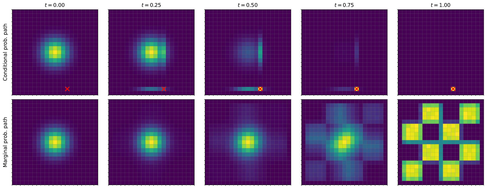

**图 19：$d=2$ 时的离散概率路径示意图。上排：在初始分布与 Dirac 分布之间插值的条件概率路径。下排：在初始分布与数据分布之间插值，这里的数据分布是棋盘格图案。注意与[图 5](#S3.F5) 的异同：这里的概率路径相当于“瞬移”，即降低初始分布的权重，同时提高终点分布的权重。**

#### 7.2.2 条件速率矩阵与边缘速率矩阵

下一步构造离散流匹配的训练目标。首先构造条件速率矩阵，它对应于连续流匹配中的条件向量场。对每个数据点 $z\in S$，设 $Q_{t}^{z}(y|x)$ 为速率矩阵。若满足下式，就称其为**条件速率矩阵**：

$$
X_{0}\sim p_{\rm{init}},\quad X_{t}\text{，其速率矩阵为 }Q_{t}^{z}\quad\Rightarrow\quad X_{t}\sim p_{t}(\cdot|z)
$$

换言之，条件速率矩阵要求其 CTMC“遵循”条件概率路径。它是构造边缘速率矩阵的基础，后者将遵循边缘概率路径：

**定理 36（离散边缘化技巧）**

定义如下的**边缘速率矩阵**

$$
Q_{t}(y|x)=\sum\limits_{z\in S}Q_{t}^{z}(y|x)\frac{p_{t}(x|z)p_{\rm{data}}(z)}{p_{t}(x)}=\sum\limits_{z\in S}Q_{t}^{z}(y|x)p_{1|t}(z|x)\quad\text{其中 }p_{1|t}(z|x):=\frac{p_{t}(x|z)p_{\rm{data}}(z)}{p_{t}(x)} \qquad\text{(90)}
$$

是有效的速率矩阵，并满足：

$$
X_{0}\sim p_{\rm{init}},\quad X_{t}\text{，其速率矩阵为 }Q_{t}\quad\Rightarrow\quad X_{t}\sim p_{t}
$$

特别地，由[式 89](#S7.E89) 可得 $X_{1}\sim p_{\rm{data}}$，即边缘速率矩阵对应的 CTMC 将噪声转化为数据。

为证明这一结论，需要 CTMC 的一个基本方程，即 Kolmogorov 前向方程：

**命题 2（Kolmogorov 前向方程）**

设对每个 $0\leq t\leq 1$，$p_{t}$ 是 $S$ 上的一族分布。另设 $X_{t}$ 为速率矩阵为 $Q_{t}$、初始分布为 $p_{0}$ 的 CTMC。对于所有 $0\leq t\leq 1$，均有 $X_{t}\sim p_{t}$，当且仅当 **Kolmogorov 前向方程（KFE）**成立：

$$
\frac{\mathrm{d}}{\mathrm{d}t}p_{t}(x)=\sum\limits_{y\in S}Q_{t}(x|y)p_{t}(y)
$$

**KFE 的证明。**

先证明必要性。假设 $p_{t}(x)$ 是 CTMC 的真实边缘分布，即对每个 $0\leq t\leq 1$，均有 $X_{t}\sim p_{t}$。则

$$
\begin{aligned}
\frac{\mathrm{d}}{\mathrm{d}t}p_{t}(x) & \overset{(i)}{=}\frac{\mathrm{d}}{\mathrm{d}h}_{|h=0}p_{t+h}(x) \\
\overset{(ii)}{=}\frac{\mathrm{d}}{\mathrm{d}h}_{|h=0}\sum\limits_{y}p_{t+h|t}(x|y)p_{t}(y) \\
\overset{(iii)}{=}\sum\limits_{y}\frac{\mathrm{d}}{\mathrm{d}h}_{|h=0}p_{t+h|t}(x|y)p_{t}(y) \\
\overset{(iv)}{=}\sum\limits_{y}Q_{t}(x|y)p_{t}(y)
\end{aligned}
$$

其中，步骤 $(i)$ 仅使用时间平移；步骤 $(ii)$ 使用转移概率的定义；步骤 $(iii)$ 交换求和与求导；步骤 $(iv)$ 使用速率矩阵的定义，见[式 87](#S7.E87)。

接下来证明充分性，将 KFE 写为矩阵形式：

$$
\frac{\mathrm{d}}{\mathrm{d}t}p_{t}=Q_{t}p_{t}
$$

此式中，将 $p_{t}=(p_{t}(x))_{x\in S}$ 视为向量，$Q_{t}=(Q_{t}(y|x))_{x,y\in S}$ 视为矩阵。这是向量空间 $\mathbb{R}^{S}$ 上的线性 ODE，初始条件由命题中的 $p_{0}$ 固定。因此，若另一组边缘分布 $q_{t}$ 也满足此方程，根据 ODE 的唯一性，见[定理 3](#Thmtheorem3)，可得 $q_{t}=p_{t}$。这就证明了 KFE 的充分性。∎

**[定理 36](#Thmtheorem36) 的证明。**

利用 KFE，只需证明定理中定义的边缘速率矩阵，见[式 90](#S7.E90)，满足 KFE：

$$
\begin{aligned}
\frac{\mathrm{d}}{\mathrm{d}t}p_{t}(x)\overset{(i)}{=} & \frac{\mathrm{d}}{\mathrm{d}t}\sum\limits_{z\in S}p_{t}(x|z)p_{\rm{data}}(z) \\
\overset{(ii)}{=} & \sum\limits_{z\in S}\frac{\mathrm{d}}{\mathrm{d}t}p_{t}(x|z)p_{\rm{data}}(z) \\
\overset{(iii)}{=} & \sum\limits_{z\in S}\left[\sum\limits_{y\in S}Q_{t}^{z}(x|y)p_{t}(y|z)\right]p_{\rm{data}}(z) \\
\overset{(iv)}{=} & \sum\limits_{y\in S}p_{t}(y)\left[\sum\limits_{z\in S}Q_{t}^{z}(x|y)\frac{p_{t}(y|z)p_{\rm{data}}(z)}{p_{t}(y)}\right] \\
\overset{(v)}{=} & \sum\limits_{y\in S}p_{t}(y)Q_{t}(x|y)
\end{aligned}
$$

其中 $(i)$ 来自边缘概率路径的定义；步骤 $(ii)$ 交换求和与求导；步骤 $(iii)$ 对条件速率矩阵使用 KFE；步骤 $(iv)$ 同时乘以并除以 $p_{t}(y)$；步骤 $(v)$ 使用边缘速率矩阵 $Q_{t}(y|x)$ 的定义。这说明 KFE 成立，再由[命题 2](#Thmproposition2) 即得结论。∎

下面为因子化混合路径推导一个具体的条件速率矩阵。

**例 37（因子化混合路径的条件速率矩阵）**

令 $\frac{\mathrm{d}}{\mathrm{d}t}\kappa_{t}=\dot{\kappa}_{t}$。因子化混合路径具有如下因子化条件速率矩阵：

$$
\begin{aligned}
Q_{t}^{z}(y|x) & =(Q_{t}^{z}(v_{i},j|x_{j}))_{v_{i},j} \\
Q_{t}^{z}(v_{i},j|x_{j}) & =\frac{\dot{\kappa}_{t}}{1-\kappa_{t}}(\delta_{z_{j}}(v_{i})-\delta_{x_{j}}(v_{i})) \\
= & \frac{\dot{\kappa}_{t}}{1-\kappa_{t}}\begin{cases}0&\text{若 }x_{j}=z_{j}\\
1&\text{，若 }v_{i}=z_{j},x_{j}\neq z_{j}\\
0&\text{，若 }v_{i}\neq z_{j},x_{j}\neq z_{j}\\
-1&\text{，若 }v_{i}=x_{j},x_{j}\neq z_{j}\end{cases}
\end{aligned}
$$

这个速率矩阵十分简单：它只允许跳向 $z^{j}$。也就是说，若任一 token $j$ 被更新，就必须跳到终点数据 $z=(z_{1},\cdots,z_{d})$ 对应的 token 值；而且只有尚未到达 $z^{j}$ 时，才会进行该跳跃。

**证明。**

因子化混合路径可完全分解为独立分量，所提出的条件速率矩阵也一样。因此，不失一般性，可以假设 $d=1$，只对单个维度计算。于是

$$
\begin{aligned}
\frac{\mathrm{d}}{\mathrm{d}t}p_{t}(x|z)\overset{(i)}{=} & \frac{\mathrm{d}}{\mathrm{d}t}\left[(1-\kappa_{t})p_{\rm{init}}(x)+\kappa_{t}\delta_{z}(x)\right] \\
\overset{(ii)}{=} & \dot{\kappa}_{t}\delta_{z}(x)-\dot{\kappa}_{t}p_{\rm{init}}(x) \\
\overset{(iii)}{=} & \frac{\dot{\kappa}_{t}}{1-\kappa_{t}}(\delta_{z}(x)-[(1-\kappa_{t})p_{\rm{init}}(x)+\kappa_{t}\delta_{z}(x)]) \\
\overset{(iv)}{=} & \frac{\dot{\kappa}_{t}}{1-\kappa_{t}}(\delta_{z}(x)-p_{t}(x|z)) \\
\overset{(v)}{=} & \frac{\dot{\kappa}_{t}}{1-\kappa_{t}}\delta_{z}(x)\left(1-p_{t}(x|z)\right)+\frac{\dot{\kappa}_{t}}{1-\kappa_{t}}(\delta_{z}(x)-1)p_{t}(x|z) \\
\overset{(vi)}{=} & \sum\limits_{y\neq x}\frac{\dot{\kappa}_{t}}{1-\kappa_{t}}\delta_{z}(x)p_{t}(y|z)+\frac{\dot{\kappa}_{t}}{1-\kappa_{t}}(\delta_{z}(x)-1)p_{t}(x|z) \\
\overset{(vii)}{=} & \sum\limits_{y\neq x}Q_{t}^{z}(x|y)p_{t}(y|z)+Q_{t}^{z}(x|x)p_{t}(x|z) \\
\overset{(viii)}{=} & \sum\limits_{y\in S}Q_{t}^{z}(x|y)p_{t}(y|z)
\end{aligned}
$$

其中 $(i)$ 使用了 $d=1$ 时因子化混合路径的定义；$(ii)$ 通过求导并令 $\frac{\mathrm{d}}{\mathrm{d}t}\kappa_{t}=\dot{\kappa}_{t}$ 得到；$(iii)$ 来自简单代数运算；$(iv)$ 来自因子化混合路径的定义；$(v)$ 来自代数运算；$(vi)$ 使用了 $\sum_{y\in S}p_{t}(y|z)=1$；$(vii)$ 来自速率矩阵的定义；$(viii)$ 来自代数运算。上述计算说明 KFE 成立，因此结论成立。∎

#### 7.2.3 学习边缘速率矩阵

本节推导训练 CTMC 模型的基本算法。根据[定理 36](#Thmtheorem36)，可以通过学习边缘速率矩阵来训练 CTMC 模型 $Q_{t}^{\theta}(y|x)$。

下面仅考虑因子化混合路径，见[例 35](#Thmtheorem35)，因为目前大多数离散扩散模型与离散流匹配模型都使用这条路径。此时，边缘速率矩阵具有十分直观的形式：

**定理 38（因子化混合路径的边缘化技巧）**

因子化混合路径的边缘速率矩阵也是因子化的，形式为

$$
\begin{aligned}
Q_{t}(v_{i},j|x) & =\frac{\dot{\kappa}_{t}}{1-\kappa_{t}}(p_{1|t}(z_{j}=v_{i}|x)-\delta_{x_{j}}(v_{i}))
\end{aligned}
$$

其中 $p_{1|t}(z_{j}=v_{i}|x)$ 是给定完整含噪序列 $x$ 时，第 $j$ 个位置，即序列中的第 $j$ 个 token，等于 $v_{i}$ 的条件概率。

**证明。**

边缘速率矩阵为

$$
\begin{aligned}
Q_{t}(y|x) & =\sum\limits_{z\in S}Q_{t}^{z}(y|x)p_{1|t}(z|x) \qquad\text{(91)}
\end{aligned}
$$

当 $y$ 与 $x$ 不是邻居，即相差超过一个 token 时，对任意 $z$，均有 $Q_{t}^{z}(y|x)=0$，因此此时也有 $Q_{t}(y|x)=0$。这说明边缘速率矩阵也具有因子化形式。进而有

$$
\begin{aligned}
Q_{t}(v_{i},j|x) & =\sum\limits_{z\in S}Q_{t}^{z}(v_{i},j|x)p_{1|t}(z|x) \qquad\text{(92)} \\
\overset{(i)}{=}\sum\limits_{z\in S}\frac{\dot{\kappa}_{t}}{1-\kappa_{t}}(\delta_{z_{j}}(v_{i})-\delta_{x_{j}}(v_{i}))p_{1|t}(z|x) \qquad\text{(93)} \\
\overset{(ii)}{=}\frac{\dot{\kappa}_{t}}{1-\kappa_{t}}\left(\sum\limits_{z\in S}\delta_{z_{j}}(v_{i})p_{1|t}(z|x)-\delta_{x_{j}}(v_{i})\right) \qquad\text{(94)} \\
\overset{(iii)}{=}\frac{\dot{\kappa}_{t}}{1-\kappa_{t}}\left(p_{1|t}(z_{j}=v_{i}|x)-\delta_{x_{j}}(v_{i})\right) \qquad\text{(95)}
\end{aligned}
$$

其中 $(i)$ 来自条件速率矩阵的公式，见[例 37](#Thmtheorem37)；$(ii)$ 使用了 $\sum_{z\in S}p_{1|t}(z|x)=1$；$(iii)$ 来自边缘化。证毕。∎

上一定理的结论很有意义：边缘速率矩阵本质上是概率 $p_{1|t}(z_{j}=v_{i}|x)$ 的重参数化，而学习这些概率，无非就是为每个 token 位置 $j=1,\dots,d$ 学习一个分类器。换言之，可以直接定义**去噪概率网络**：

$$
p_{1|t}^{\theta}:\underbrace{x}_{\text{网络输入}}\mapsto\underbrace{(p_{1|t}^{\theta}(z_{j}=v_{i}|x))_{j=1,\cdots,d,v_{i}\in\mathcal{V}}}_{\text{网络输出}}
$$

网络输出的形状为 $d\times V$，通过简单的 softmax 层即可得到每个 token 位置上的概率。网络本身可以是标准的序列到序列网络，例如 Transformer，见[第 6.1.2 节](#S6.SS1.SSS2)。

由于这只是每个位置 $j$ 上的分类器，可以对每个 $j=1,\cdots,d$ 使用交叉熵损失训练。由此得到**离散流匹配损失**：

$$
\mathcal{L}_{\text{DFM}}(\theta)=\mathbb{E}_{z\sim p_{\rm{data}},t\sim\text{Unif}_{[0,1]},x\sim p_{t}(\cdot|z)}\left[\sum\limits_{j=1}^{d}-\log p_{1|t}^{\theta}(z_{j}|x)\right]
$$

这一点非常漂亮：训练生成模型，只需训练每个位置 $j$ 上的分类器。正如连续流匹配可化为简单回归，见[第 3 节](#S3)，离散流匹配与离散扩散模型也可化为简单分类训练。[算法 8](#alg8) 总结了训练算法；训练后，可以用[算法 7](#alg7) 采样。

**例 39（掩码扩散语言模型）**

上述方法的一个特例是**掩码扩散语言模型（MDLM）**。其思想是在 token 词表 $\mathcal{V}=\{v_{1},\cdots,v_{V}\}$ 中增加一个新 token [mask]，表示该位置的 token 缺失或被遮蔽。具体地，令 $\mathcal{V}=\{v_{1},\cdots,v_{V},\text{[mask]}\}$，初始点设为 $\text{[mask]}^{d}$，也就是全部被掩码覆盖的序列。形式上，这相当于在上述框架中设置 $p_{\rm{init}}=\delta_{\text{[mask]}^{d}}$。采样流程见[图 20](#S7.F20)。

**算法 8：因子化 CTMC 模型的训练（离散扩散）**

| 步骤 | 操作 |
| --- | --- |
| 0 | 序列数据集 $z\sim p_{\rm{data}}$，其中 $z=(z_{1},\dots,z_{d})\in\mathcal{V}^{d}$；$\mathcal{V}$ 上的初始噪声 token 边缘分布 $p_{\rm{init}}^{(j)}$；调度函数 $\kappa_{t}\in[0,1]$；后验网络 $f_{\theta}$，返回各位置上关于 $\mathcal{V}$ 的 logits；优化器 Opt |
| 1 | **对于**每次训练迭代，**执行** |
| 2 | 采样数据点 $z\sim p_{\rm{data}}$。 |
| 3 | 采样时间 $t\sim\mathrm{Unif}[0,1]$，并计算 $\kappa\leftarrow\kappa_{t}$。 |
| 4 | 采样含噪状态 $x\sim p_{t}(\cdot\mid z)$，使用因子化混合路径： |
| 5 | **对于** $j=1,\dots,d$，**并行执行** |
| 6 | 采样掩码 $m_{j}\sim\mathrm{Bernoulli}(\kappa)$。 |
| 7 | 采样噪声 token $\xi_{j}\sim p_{\rm{init}}^{(j)}$。 |
| 8 | 令 $x_{j}\leftarrow m_{j}\,z_{j}+(1-m_{j})\,\xi_{j}$。 |
| 9 | **结束循环** |
| 10 | $x\leftarrow(x_{1},\dots,x_{d})$。 |
| 11 | 通过网络输出的 logits 预测终点 token 的后验：[下方公式 1](#alg8-formula-1)。 |
| 12 | 离散流匹配损失，即 $z$ 的逐 token 负对数似然：[下方公式 2](#alg8-formula-2)。 |
| 13 | 更新参数：$\theta\leftarrow\mathrm{Opt.step}\big(\nabla_{\theta}\mathcal{L}_{\text{DFM}}(\theta)\big)$。 |
| 14 | **结束循环** |

**算法 8，公式 1。**

$$
\ell_{j}(\cdot)\ \leftarrow\ f_{\theta}(x,t)_{j}\qquad\Rightarrow\qquad p^{\theta}_{1|t}(v\mid x)_{j}\;=\;\mathrm{Softmax}\!\big(\ell_{j}\big)(v)
$$

**算法 8，公式 2。**

$$
\mathcal{L}_{\text{DFM}}(\theta)\;\leftarrow\;\sum_{j=1}^{d}\Big[-\log p^{\theta}_{1|t}(z_{j}\mid x)_{j}\Big]
$$

**图 20：掩码扩散语言模型的轨迹示意图。**

至此，我们已完成 CTMC 模型训练与采样的完整流程，能够生成文本等离散序列。当前先进的离散扩散模型 [[4](#bib.bib2)] 采用本文描述的方法，使用神经网络，通常是 Transformer，在互联网规模的数据上训练。

**注记 40（生成元匹配）**

你也许会问，为什么流模型与扩散模型的原理能如此自然地推广到离散状态空间？事实上，流匹配的原理并不专属于流，甚至也不专属于 CTMC；它们是利用马尔可夫过程构造生成模型的一般学习原理。这一思想引出了**生成元匹配**（Generator Matching）框架 [[19](#bib.bib9)]，将离散和连续的流模型与扩散模型统一并推广到同一框架中。生成元是向量场 $u_{t}$ 与速率矩阵 $Q_{t}$ 的推广。任意数据模态与状态空间都可以构造相应的马尔可夫过程与生成元，例如光滑流形上的模型 [[8](#bib.bib8), [10](#bib.bib7)]，可用于几何数据；混合状态空间上的模型 [[7](#bib.bib6)]，例如文本与图像联合生成；以及跳跃过程等其他马尔可夫过程 [[19](#bib.bib9), [6](#bib.bib5)]。

## 参考文献

[1] M. S. Albergo, N. M. Boffi, and E. Vanden-Eijnden (2023) Stochastic interpolants: a unifying framework for flows and diffusions. arXiv preprint arXiv:2303.08797.

[2] B. D. Anderson (1982) Reverse-time diffusion equation models. Stochastic Processes and their Applications 12 (3), pp. 313–326.

[3] Y. Balaji, S. Nah, X. Huang, A. Vahdat, J. Song, Q. Zhang, K. Kreis, M. Aittala, T. Aila, S. Laine, B. Catanzaro, T. Karras, and M. Liu (2023) EDiff-i: text-to-image diffusion models with an ensemble of expert denoisers. External Links: 2211.01324, [Link](https://arxiv.org/abs/2211.01324)

[4] T. Bie, M. Cao, K. Chen, L. Du, M. Gong, Z. Gong, Y. Gu, J. Hu, Z. Huang, Z. Lan, et al. (2025) Llada2. 0: scaling up diffusion language models to 100b. arXiv preprint arXiv:2512.15745.

[5] A. Campbell, J. Benton, V. De Bortoli, T. Rainforth, G. Deligiannidis, and A. Doucet (2022) A continuous time framework for discrete denoising models. Advances in Neural Information Processing Systems 35, pp. 28266–28279.

[6] A. Campbell, W. Harvey, C. Weilbach, V. De Bortoli, T. Rainforth, and A. Doucet (2023) Trans-dimensional generative modeling via jump diffusion models. Advances in Neural Information Processing Systems 36, pp. 42217–42257.

[7] A. Campbell, J. Yim, R. Barzilay, T. Rainforth, and T. Jaakkola (2024) Generative flows on discrete state-spaces: enabling multimodal flows with applications to protein co-design. arXiv preprint arXiv:2402.04997.

[8] R. T. Chen and Y. Lipman (2023) Flow matching on general geometries. arXiv preprint arXiv:2302.03660.

[9] E. A. Coddington, N. Levinson, and T. Teichmann (1956) Theory of ordinary differential equations. American Institute of Physics.

[10] V. De Bortoli, E. Mathieu, M. Hutchinson, J. Thornton, Y. W. Teh, and A. Doucet (2022) Riemannian score-based generative modelling. Advances in neural information processing systems 35, pp. 2406–2422.

[11] P. Dhariwal and A. Nichol (2021) Diffusion models beat gans on image synthesis. External Links: 2105.05233, [Link](https://arxiv.org/abs/2105.05233)

[12] A. Dosovitskiy, L. Beyer, A. Kolesnikov, D. Weissenborn, X. Zhai, T. Unterthiner, M. Dehghani, M. Minderer, G. Heigold, S. Gelly, J. Uszkoreit, and N. Houlsby (2021) An image is worth 16x16 words: transformers for image recognition at scale. External Links: 2010.11929, [Link](https://arxiv.org/abs/2010.11929)

[13] A. Dosovitskiy (2020) An image is worth 16x16 words: transformers for image recognition at scale. arXiv preprint arXiv:2010.11929.

[14] P. Esser, S. Kulal, A. Blattmann, R. Entezari, J. Müller, H. Saini, Y. Levi, D. Lorenz, A. Sauer, F. Boesel, D. Podell, T. Dockhorn, Z. English, K. Lacey, A. Goodwin, Y. Marek, and R. Rombach (2024) Scaling rectified flow transformers for high-resolution image synthesis. External Links: 2403.03206, [Link](https://arxiv.org/abs/2403.03206)

[15] L. C. Evans (2022) Partial differential equations. Vol. 19, American Mathematical Society.

[16] I. Gat, T. Remez, N. Shaul, F. Kreuk, R. T. Chen, G. Synnaeve, Y. Adi, and Y. Lipman (2024) Discrete flow matching. Advances in Neural Information Processing Systems 37, pp. 133345–133385.

[17] J. Ho, A. Jain, and P. Abbeel (2020) Denoising diffusion probabilistic models. Advances in neural information processing systems 33, pp. 6840–6851.

[18] J. Ho and T. Salimans (2022) Classifier-free diffusion guidance. External Links: 2207.12598, [Link](https://arxiv.org/abs/2207.12598)

[19] P. Holderrieth, M. Havasi, J. Yim, N. Shaul, I. Gat, T. Jaakkola, B. Karrer, R. T. Chen, and Y. Lipman (2024) Generator matching: generative modeling with arbitrary markov processes. arXiv preprint arXiv:2410.20587.

[20] P. Holderrieth, U. Singer, T. Jaakkola, R. T. Chen, Y. Lipman, and B. Karrer (2025) GLASS flows: transition sampling for alignment of flow and diffusion models. arXiv preprint arXiv:2509.25170.

[21] A. Iserles (2009) A first course in the numerical analysis of differential equations. Cambridge university press.

[22] A. Jolicoeur-Martineau, R. Piché-Taillefer, R. T. d. Combes, and I. Mitliagkas (2020) Adversarial score matching and improved sampling for image generation. arXiv preprint arXiv:2009.05475.

[23] T. Karras, M. Aittala, T. Aila, and S. Laine (2022) Elucidating the design space of diffusion-based generative models. Advances in Neural Information Processing Systems 35, pp. 26565–26577.

[24] S. Lavoie, P. Kirichenko, M. Ibrahim, M. Assran, A. G. Wilson, A. Courville, and N. Ballas (2024) Modeling caption diversity in contrastive vision-language pretraining. External Links: 2405.00740, [Link](https://arxiv.org/abs/2405.00740)

[25] Y. Lipman, R. T. Chen, H. Ben-Hamu, M. Nickel, and M. Le (2022) Flow matching for generative modeling. arXiv preprint arXiv:2210.02747.

[26] Y. Lipman, M. Havasi, P. Holderrieth, N. Shaul, M. Le, B. Karrer, R. T. Chen, D. Lopez-Paz, H. Ben-Hamu, and I. Gat (2024) Flow matching guide and code. arXiv preprint arXiv:2412.06264.

[27] X. Liu, C. Gong, and Q. Liu (2022) Flow straight and fast: learning to generate and transfer data with rectified flow. arXiv preprint arXiv:2209.03003.

[28] N. Ma, M. Goldstein, M. S. Albergo, N. M. Boffi, E. Vanden-Eijnden, and S. Xie (2024) Sit: exploring flow and diffusion-based generative models with scalable interpolant transformers. arXiv preprint arXiv:2401.08740.

[29] X. Mao (2007) Stochastic differential equations and applications. Elsevier.

[30] W. Peebles and S. Xie (2023) Scalable diffusion models with transformers. External Links: 2212.09748, [Link](https://arxiv.org/abs/2212.09748)

[31] E. Perez, F. Strub, H. De Vries, V. Dumoulin, and A. Courville (2018) Film: visual reasoning with a general conditioning layer. In Proceedings of the AAAI conference on artificial intelligence, Vol. 32.

[32] L. Perko (2013) Differential equations and dynamical systems. Vol. 7, Springer Science & Business Media.

[33] A. Polyak, A. Zohar, A. Brown, A. Tjandra, A. Sinha, A. Lee, A. Vyas, B. Shi, C. Ma, C. Chuang, D. Yan, D. Choudhary, D. Wang, G. Sethi, G. Pang, H. Ma, I. Misra, J. Hou, J. Wang, K. Jagadeesh, K. Li, L. Zhang, M. Singh, M. Williamson, M. Le, M. Yu, M. K. Singh, P. Zhang, P. Vajda, Q. Duval, R. Girdhar, R. Sumbaly, S. S. Rambhatla, S. Tsai, S. Azadi, S. Datta, S. Chen, S. Bell, S. Ramaswamy, S. Sheynin, S. Bhattacharya, S. Motwani, T. Xu, T. Li, T. Hou, W. Hsu, X. Yin, X. Dai, Y. Taigman, Y. Luo, Y. Liu, Y. Wu, Y. Zhao, Y. Kirstain, Z. He, Z. He, A. Pumarola, A. Thabet, A. Sanakoyeu, A. Mallya, B. Guo, B. Araya, B. Kerr, C. Wood, C. Liu, C. Peng, D. Vengertsev, E. Schonfeld, E. Blanchard, F. Juefei-Xu, F. Nord, J. Liang, J. Hoffman, J. Kohler, K. Fire, K. Sivakumar, L. Chen, L. Yu, L. Gao, M. Georgopoulos, R. Moritz, S. K. Sampson, S. Li, S. Parmeggiani, S. Fine, T. Fowler, V. Petrovic, and Y. Du (2024) Movie gen: a cast of media foundation models. External Links: 2410.13720, [Link](https://arxiv.org/abs/2410.13720)

[34] A. Radford, J. W. Kim, C. Hallacy, A. Ramesh, G. Goh, S. Agarwal, G. Sastry, A. Askell, P. Mishkin, J. Clark, G. Krueger, and I. Sutskever (2021) Learning transferable visual models from natural language supervision. External Links: 2103.00020, [Link](https://arxiv.org/abs/2103.00020)

[35] C. Raffel, N. Shazeer, A. Roberts, K. Lee, S. Narang, M. Matena, Y. Zhou, W. Li, and P. J. Liu (2023) Exploring the limits of transfer learning with a unified text-to-text transformer. External Links: 1910.10683, [Link](https://arxiv.org/abs/1910.10683)

[36] R. Rombach, A. Blattmann, D. Lorenz, P. Esser, and B. Ommer (2022) High-resolution image synthesis with latent diffusion models. External Links: 2112.10752, [Link](https://arxiv.org/abs/2112.10752)

[37] R. Rombach, A. Blattmann, D. Lorenz, P. Esser, and B. Ommer (2022) High-resolution image synthesis with latent diffusion models. In Proceedings of the IEEE/CVF conference on computer vision and pattern recognition, pp. 10684–10695.

[38] O. Ronneberger, P. Fischer, and T. Brox (2015) U-net: convolutional networks for biomedical image segmentation. In Medical image computing and computer-assisted intervention–MICCAI 2015: 18th international conference, Munich, Germany, October 5-9, 2015, proceedings, part III 18, pp. 234–241.

[39] C. Saharia, W. Chan, S. Saxena, L. Li, J. Whang, E. Denton, S. K. S. Ghasemipour, B. K. Ayan, S. S. Mahdavi, R. G. Lopes, T. Salimans, J. Ho, D. J. Fleet, and M. Norouzi (2022) Photorealistic text-to-image diffusion models with deep language understanding. External Links: 2205.11487, [Link](https://arxiv.org/abs/2205.11487)

[40] S. Särkkä and A. Solin (2019) Applied stochastic differential equations. Vol. 10, Cambridge University Press.

[41] J. Sohl-Dickstein, E. Weiss, N. Maheswaranathan, and S. Ganguli (2015) Deep unsupervised learning using nonequilibrium thermodynamics. In International conference on machine learning, pp. 2256–2265.

[42] Y. Song and S. Ermon (2019) Generative modeling by estimating gradients of the data distribution. Advances in neural information processing systems 32.

[43] Y. Song, J. Sohl-Dickstein, D. P. Kingma, A. Kumar, S. Ermon, and B. Poole (2020) Score-based generative modeling through stochastic differential equations. arXiv preprint arXiv:2011.13456.

[44] Y. Song, J. Sohl-Dickstein, D. P. Kingma, A. Kumar, S. Ermon, and B. Poole (2021) Score-based generative modeling through stochastic differential equations. In International Conference on Learning Representations (ICLR),

[45] Y. Song, J. Sohl-Dickstein, D. P. Kingma, A. Kumar, S. Ermon, and B. Poole (2021) Score-based generative modeling through stochastic differential equations. External Links: 2011.13456, [Link](https://arxiv.org/abs/2011.13456)

[46] M. Tancik, P. P. Srinivasan, B. Mildenhall, S. Fridovich-Keil, N. Raghavan, U. Singhal, R. Ramamoorthi, J. T. Barron, and R. Ng (2020) Fourier features let networks learn high frequency functions in low dimensional domains. External Links: 2006.10739, [Link](https://arxiv.org/abs/2006.10739)

[47] Y. Tay, M. Dehghani, V. Q. Tran, X. Garcia, J. Wei, X. Wang, H. W. Chung, S. Shakeri, D. Bahri, T. Schuster, H. S. Zheng, D. Zhou, N. Houlsby, and D. Metzler (2023) UL2: unifying language learning paradigms. External Links: 2205.05131, [Link](https://arxiv.org/abs/2205.05131)

[48] A. Vahdat, K. Kreis, and J. Kautz (2021) Score-based generative modeling in latent space. Advances in neural information processing systems 34, pp. 11287–11302.

[49] A. Vaswani, N. Shazeer, N. Parmar, J. Uszkoreit, L. Jones, A. N. Gomez, L. Kaiser, and I. Polosukhin (2023) Attention is all you need. External Links: 1706.03762, [Link](https://arxiv.org/abs/1706.03762)

[50] L. Xue, A. Barua, N. Constant, R. Al-Rfou, S. Narang, M. Kale, A. Roberts, and C. Raffel (2022) ByT5: towards a token-free future with pre-trained byte-to-byte models. External Links: 2105.13626, [Link](https://arxiv.org/abs/2105.13626)

[51] J. Yao, B. Yang, and X. Wang (2025) Reconstruction vs. generation: taming optimization dilemma in latent diffusion models. In Proceedings of the Computer Vision and Pattern Recognition Conference, pp. 15703–15712.

## 附录 A 概率论回顾

本附录简要回顾概率论的基本概念，部分内容取自 [[26](#bib.bib27)]。

### A.1 随机向量

考虑 $d$ 维欧几里得空间 $x=(x^{1},\ldots,x^{d})\in\mathbb{R}^{d}$ 中的数据，使用标准欧几里得内积 $\left\langle x,y\right\rangle=\sum_{i=1}^{d}x^{i}y^{i}$ 与范数 $\left\|x\right\|=\sqrt{\left\langle x,x\right\rangle}$。我们考虑具有连续概率密度函数（PDF）的随机变量（RV）$X\in\mathbb{R}^{d}$。该密度是连续函数 $p_{X}:\mathbb{R}^{d}\rightarrow\mathbb{R}_{\geq 0}$，为事件 $A$ 赋予概率

$$
{\mathbb{P}}(X\in A)=\int_{A}p_{X}(x)\mathrm{d}x, \qquad\text{(96)}
$$

其中 $\int p_{X}(x)\mathrm{d}x=1$。按惯例，在整个空间 $\int\equiv\int_{\mathbb{R}^{d}}$ 上积分时省略积分区域。为简化记号，将随机变量 $X_{t}$ 的 PDF $p_{X_{t}}$ 简记为 $p_{t}$，用 $X\sim p$ 或 $X\sim p(X)$ 表示 $X$ 服从分布 $p$。生成式建模中常用的一种密度是 $d$ 维各向同性高斯密度：

$$
{\mathcal{N}}(x;\mu,\sigma^{2}I)=(2\pi\sigma^{2})^{-\frac{d}{2}}\exp\left(-\frac{\left\|x-\mu\right\|_{2}^{2}}{2\sigma^{2}}\right), \qquad\text{(97)}
$$

其中 $\mu\in\mathbb{R}^{d}$ 和 $\sigma\in\mathbb{R}_{>0}$ 分别表示分布的均值与标准差。

随机变量的期望，是最小二乘意义下最接近 $X$ 的常向量：

$$
\mathbb{E}\left[X\right]=\argmin_{z\in\mathbb{R}^{d}}\int\left\|x-z\right\|^{2}p_{X}(x)\mathrm{d}x=\int xp_{X}(x)\mathrm{d}x. \qquad\text{(98)}
$$

计算随机变量的函数的期望时，一个实用工具是无意识统计学家定律：

$$
\mathbb{E}\left[f(X)\right]=\int f(x)p_{X}(x)\mathrm{d}x. \qquad\text{(99)}
$$

必要时，用 $\mathbb{E}_{X}f(X)$ 标明期望所针对的随机变量。

### A.2 条件密度与条件期望

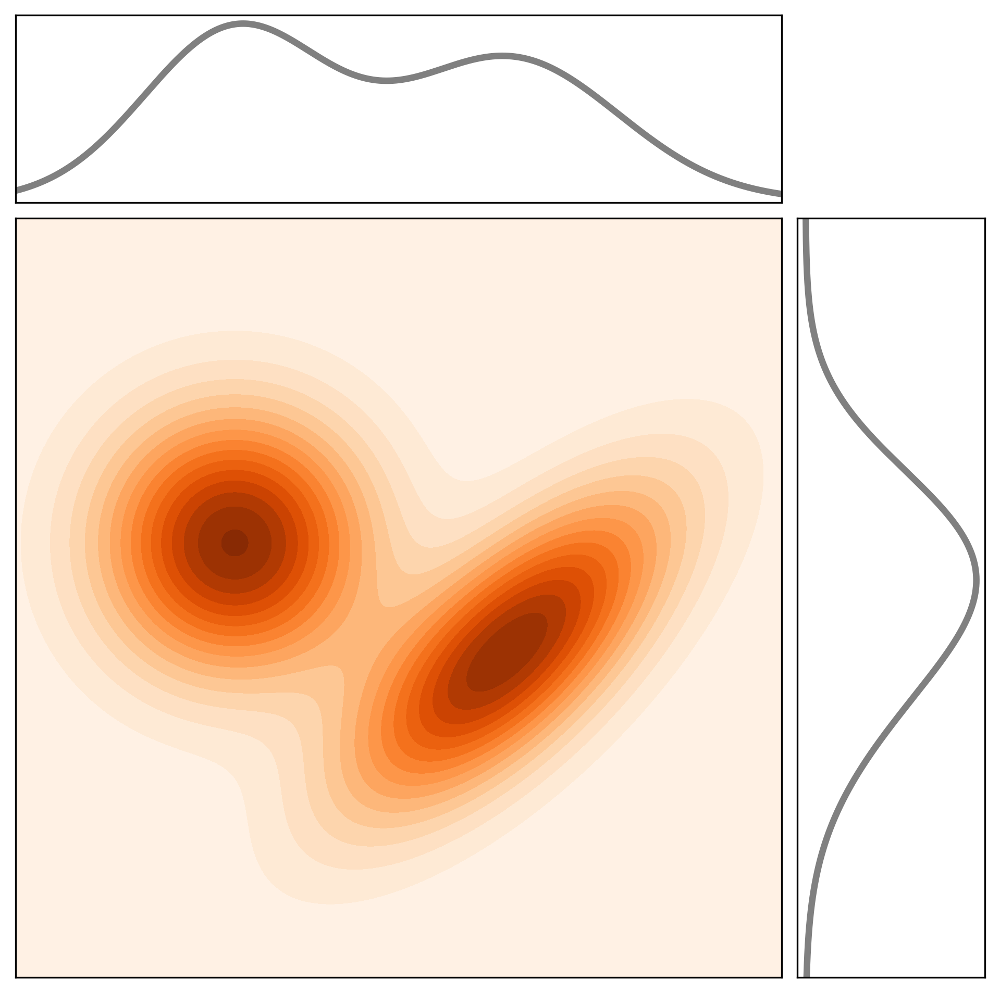

**图 21：联合 PDF $p_{X,Y}$，以阴影表示；其边缘密度 $p_{X}$ 和 $p_{Y}$，以黑线表示。图片来自 [[26](#bib.bib27)]。**

给定两个随机变量 $X,Y\in\mathbb{R}^{d}$，其联合 PDF $p_{X,Y}(x,y)$ 具有如下边缘密度：

$$
\int p_{X,Y}(x,y)\mathrm{d}y=p_{X}(x)\text{ 且 }\int p_{X,Y}(x,y)\mathrm{d}x=p_{Y}(y). \qquad\text{(100)}
$$

[图 21](#A1.F21) 展示了两个取值于 $\mathbb{R}$ 的随机变量的联合 PDF，其中 $d=1$。条件 PDF $p_{X|Y}$ 描述了在给定密度 $p_{Y}(y)>0$ 对应事件 $Y=y$ 时，随机变量 $X$ 的概率密度：

$$
p_{X|Y}(x|y)\coloneqq\frac{p_{X,Y}(x,y)}{p_{Y}(y)}, \qquad\text{(101)}
$$

条件 PDF $p_{Y|X}$ 的定义类似。贝叶斯法则将条件 PDF $p_{Y|X}$ 用 $p_{X|Y}$ 表示为

$$
p_{Y|X}(y|x)=\frac{p_{X|Y}(x|y)p_{Y}(y)}{p_{X}(x)}, \qquad\text{(102)}
$$

其中 $p_{X}(x)>0$。

条件期望 $\mathbb{E}\left[X|Y\right]$ 是最小二乘意义下，对 $X$ 的最佳逼近函数 $g_{\star}(Y)$：

$$
\begin{aligned}
g_{\star} & \coloneqq\argmin_{g:\mathbb{R}^{d}\rightarrow\mathbb{R}^{d}}\mathbb{E}\left[\left\|X-g(Y)\right\|^{2}\right]=\argmin_{g:\mathbb{R}^{d}\rightarrow\mathbb{R}^{d}}\int\left\|x-g(y)\right\|^{2}p_{X,Y}(x,y)\mathrm{d}x\mathrm{d}y \\
=\argmin_{g:\mathbb{R}^{d}\rightarrow\mathbb{R}^{d}}\int\left[{\color{#000000}\int\left\|x-g(y)\right\|^{2}p_{X|Y}(x|y)\mathrm{d}x}\right]p_{Y}(y)\mathrm{d}y. \qquad\text{(103)}
\end{aligned}
$$

因此，对于满足 $p_{Y}(y)>0$ 的 $y\in\mathbb{R}^{d}$，条件期望函数为

$$
\mathbb{E}\left[X|Y=y\right]\coloneqq g_{\star}(y)=\int xp_{X|Y}(x|y)\mathrm{d}x, \qquad\text{(104)}
$$

第二个等式是对[式 103](#A1.E103) 中 $Y=y$ 对应的内层括号求最小化解得到的，类似于[式 98](#A1.E98)。将 $g_{\star}$ 与随机变量 $Y$ 复合，得到

$$
\mathbb{E}\left[X|Y\right]\coloneqq g_{\star}(Y), \qquad\text{(105)}
$$

它是取值于 $\mathbb{R}^{d}$ 的随机变量。容易混淆的是，$\mathbb{E}\left[X|Y=y\right]$ 与 $\mathbb{E}\left[X|Y\right]$ 都常被称为条件期望，但它们是不同对象：$\mathbb{E}\left[X|Y=y\right]$ 是函数 $\mathbb{R}^{d}\rightarrow\mathbb{R}^{d}$，而 $\mathbb{E}\left[X|Y\right]$ 是取值于 $\mathbb{R}^{d}$ 的随机变量。为区分两者，本文采用此处引入的记号。

塔式法则是一个实用性质，可简化涉及两个随机变量 $X$ 与 $Y$ 的条件期望推导：

$$
\mathbb{E}\left[\mathbb{E}\left[X|Y\right]\right]=\mathbb{E}\left[X\right] \qquad\text{(106)}
$$

由于 $\mathbb{E}\left[X|Y\right]$ 本身是随机变量，而且是随机变量 $Y$ 的函数，外层期望就是在计算 $\mathbb{E}\left[X|Y\right]$ 的期望。塔式法则可利用前述定义验证：

$$
\begin{aligned}
\mathbb{E}\left[\mathbb{E}\left[X|Y\right]\right] & =\int\left(\int xp_{X|Y}(x|y)\mathrm{d}x\right)p_{Y}(y)\mathrm{d}y \\
\overset{101}{=}\int\int xp_{X,Y}(x,y)\mathrm{d}x\mathrm{d}y \\
\overset{100}{=}\int xp_{X}(x)\mathrm{d}x=\mathbb{E}\left[X\right].
\end{aligned}
$$

最后考虑一个有用性质，涉及随机变量 $f(X,Y)$ 和 $Y$，其中 $X$ 与 $Y$ 是任意两个随机变量。结合无意识统计学家定律与[式 104](#A1.E104)，可得恒等式

$$
\mathbb{E}\left[f(X,Y)|Y=y\right]=\int f(x,y)p_{X|Y}(x|y)\mathrm{d}x. \qquad\text{(107)}
$$

## 附录 B Fokker–Planck 方程的证明

本附录给出 Fokker–Planck 方程的完整证明，其中连续性方程是其特例，见[定理 11](#Thmtheorem11)。需要强调，**理解本文其他内容并不需要阅读本附录**，这里的数学要求也更高。如果你想了解 Fokker–Planck 方程的由来，可以阅读本附录。

**定理 41（Fokker–Planck 方程）**

设 $p_{t}$ 为满足 $p_{0}=p_{\rm{init}}$ 的概率路径，考虑 SDE：

$$
X_{0}\sim p_{\rm{init}},\quad\mathrm{d}X_{t}=u_{t}(X_{t})\mathrm{d}t+\sigma_{t}\mathrm{d}W_{t}.
$$

对于所有 $0\leq t\leq 1$，$X_{t}$ 服从分布 $p_{t}$，当且仅当 **Fokker–Planck 方程**成立：

$$
\partial_{t}p_{t}(x)=-\mathrm{div}(p_{t}u_{t})(x)+\frac{\sigma_{t}^{2}}{2}\Delta p_{t}(x)\quad\text{，对所有 }x\in\mathbb{R}^{d},0\leq t\leq 1, \qquad\text{(108)}
$$

首先证明 Fokker–Planck 方程的必要性，即若 $X_{t}\sim p_{t}$，则该方程成立。证明技巧是使用**检验函数** $f$，即无穷次可微的光滑函数 $f:\mathbb{R}^{d}\to\mathbb{R}$，且仅在有界区域内非零，也就是具有紧支撑。我们利用如下事实：对任意可积函数 $g_{1},g_{2}:\mathbb{R}^{d}\to\mathbb{R}$，有

$$
g_{1}(x)=g_{2}(x)\text{，对所有 }x\in\mathbb{R}^{d}\quad\Leftrightarrow\quad\int f(x)g_{1}(x)\mathrm{d}x=\int f(x)g_{2}(x)\mathrm{d}x\text{，对所有检验函数 }f \qquad\text{(109)}
$$

换言之，可以将逐点相等转化为积分相等。检验函数的用处在于其光滑性，使我们可以求梯度及高阶导数。特别地，对任意检验函数 $f_{1},f_{2}$，可使用**分部积分**：

$$
\int f_{1}(x)\frac{\partial}{\partial x_{i}}f_{2}(x)\mathrm{d}x=-\int f_{2}(x)\frac{\partial}{\partial x_{i}}f_{1}(x)\mathrm{d}x \qquad\text{(110)}
$$

条件是 $f_{1},f_{2}$ 及其乘积 $f_{1}\cdot f_{2}$ 可积。结合散度与拉普拉斯算子的定义，见[式 22](#S3.E22)，可得恒等式：

$$
\begin{aligned}
\int\nabla f_{1}^{T}(x)f_{2}(x)\mathrm{d}x= & -\int f_{1}(x)\mathrm{div}(f_{2})(x)\mathrm{d}x\quad(f_{1}:\mathbb{R}^{d}\to\mathbb{R},f_{2}:\mathbb{R}^{d}\to\mathbb{R}^{d}) \qquad\text{(111)} \\
\int f_{1}(x)\Delta f_{2}(x)\mathrm{d}x= & \int f_{2}(x)\Delta f_{1}(x)\mathrm{d}x\quad(f_{1}:\mathbb{R}^{d}\to\mathbb{R},f_{2}:\mathbb{R}^{d}\to\mathbb{R}) \qquad\text{(112)}
\end{aligned}
$$

下面进入证明。使用[式 6](#S2.E6) 中 SDE 轨迹的随机更新形式：

$$
\begin{aligned}
X_{t+h}= & X_{t}+hu_{t}(X_{t})+\sigma_{t}(W_{t+h}-W_{t})+hR_{t}(h) \qquad\text{(113)} \\
\approx & X_{t}+hu_{t}(X_{t})+\sigma_{t}(W_{t+h}-W_{t}) \qquad\text{(114)}
\end{aligned}
$$

为便于阅读，暂时忽略误差项 $R_{t}(h)$，因为最终本就要令 $h\to 0$。于是可计算：

$$
\begin{aligned}
f(X_{t+h})-f(X_{t})\overset{114}{=} & f(X_{t}+hu_{t}(X_{t})+\sigma_{t}(W_{t+h}-W_{t}))-f(X_{t}) \\
\overset{(i)}{=} & \nabla f(X_{t})^{T}\left(hu_{t}(X_{t})+\sigma_{t}(W_{t+h}-W_{t}))\right) \\
+\frac{1}{2}\left(hu_{t}(X_{t})+\sigma_{t}(W_{t+h}-W_{t}))\right)^{T}\nabla^{2}f(X_{t})\left(hu_{t}(X_{t})+\sigma_{t}(W_{t+h}-W_{t}))\right) \\
\overset{(ii)}{=} & h\nabla f(X_{t})^{T}u_{t}(X_{t})+\sigma_{t}\nabla f(X_{t})^{T}(W_{t+h}-W_{t}) \\
+\frac{1}{2}h^{2}u_{t}(X_{t})^{T}\nabla^{2}f(X_{t})u_{t}(X_{t})+h\sigma_{t}u_{t}(X_{t})^{T}\nabla^{2}f(X_{t})(W_{t+h}-W_{t})+ \\
+\frac{1}{2}\sigma_{t}^{2}(W_{t+h}-W_{t})^{T}\nabla^{2}f(X_{t})(W_{t+h}-W_{t})
\end{aligned}
$$

其中步骤 (i) 对 $f$ 在 $X_{t}$ 附近作二阶 Taylor 展开，步骤 (ii) 利用 Hessian 矩阵 $\nabla^{2}f$ 的对称性。注意 $\mathbb{E}[W_{t+h}-W_{t}|X_{t}]=0$ 与 $W_{t+h}-W_{t}|X_{t}\sim\mathcal{N}(0,hI_{d})$，因此

$$
\begin{aligned}
\mathbb{E}[f(X_{t+h})-f(X_{t})|X_{t}] \\
= & h\nabla f(X_{t})^{T}u_{t}(X_{t})+\frac{1}{2}h^{2}u_{t}(X_{t})^{T}\nabla^{2}f(X_{t})u_{t}(X_{t})+\frac{h}{2}\sigma_{t}^{2}\mathbb{E}_{\epsilon_{t}\sim\mathcal{N}(0,I_{d})}[\epsilon_{t}^{T}\nabla^{2}f(X_{t})\epsilon_{t}] \\
\overset{(i)}{=} & h\nabla f(X_{t})^{T}u_{t}(X_{t})+\frac{1}{2}h^{2}u_{t}(X_{t})^{T}\nabla^{2}f(X_{t})u_{t}(X_{t})+\frac{h}{2}\sigma_{t}^{2}\text{trace}(\nabla^{2}f(X_{t})) \\
\overset{(ii)}{=} & h\nabla f(X_{t})^{T}u_{t}(X_{t})+\frac{1}{2}h^{2}u_{t}(X_{t})^{T}\nabla^{2}f(X_{t})u_{t}(X_{t})+\frac{h}{2}\sigma_{t}^{2}\Delta f(X_{t})
\end{aligned}
$$

其中步骤 $(i)$ 使用 $\mathbb{E}_{\epsilon_{t}\sim\mathcal{N}(0,I_{d})}[\epsilon_{t}^{T}A\epsilon_{t}]=\text{trace}(A)$，步骤 $(ii)$ 使用拉普拉斯算子与 Hessian 矩阵的定义。由此得到

$$
\begin{aligned}
\partial_{t}\mathbb{E}[f(X_{t})] \\
= & \lim\limits_{h\to 0}\frac{1}{h}\mathbb{E}[f(X_{t+h})-f(X_{t})] \\
= & \lim\limits_{h\to 0}\frac{1}{h}\mathbb{E}[\mathbb{E}[f(X_{t+h})-f(X_{t})|X_{t}]] \\
= & \mathbb{E}[\lim\limits_{h\to 0}\frac{1}{h}\left(h\nabla f(X_{t})^{T}u_{t}(X_{t})+\frac{1}{2}h^{2}u_{t}(X_{t})^{T}\nabla^{2}f(X_{t})u_{t}(X_{t})+\frac{h}{2}\sigma_{t}^{2}\Delta f(X_{t})\right)] \\
= & \mathbb{E}[\nabla f(X_{t})^{T}u_{t}(X_{t})+\frac{1}{2}\sigma_{t}^{2}\Delta f(X_{t})] \\
\overset{(i)}{=} & \int\nabla f(x)^{T}u_{t}(x)p_{t}(x)\mathrm{d}x+\int\frac{1}{2}\sigma_{t}^{2}\Delta f(x)p_{t}(x)\mathrm{d}x \\
\overset{(ii)}{=} & -\int f(x)\mathrm{div}(u_{t}p_{t})(x)\mathrm{d}x+\int\frac{1}{2}\sigma_{t}^{2}f(x)\Delta p_{t}(x)\mathrm{d}x \\
= & \int f(x)\left(-\mathrm{div}(u_{t}p_{t})(x)+\frac{1}{2}\sigma_{t}^{2}\Delta p_{t}(x)\right)\mathrm{d}x
\end{aligned}
$$

其中步骤 (i) 使用 $p_{t}$ 是 $X_{t}$ 的分布这一假设，步骤 (ii) 使用[式 111](#A2.E111) 与[式 112](#A2.E112)。使用这些等式需要乘积 $p_{t}(x)u_{t}(x)$ 可积，即

$$
\int p_{t}(x)\|u_{t}(x)\|\mathrm{d}x<\infty
$$

在机器学习中，由于数值精度有限，数据与函数通常有界，这一条件几乎总是满足。因此，

$$
\begin{aligned}
\partial_{t}\mathbb{E}[f(X_{t})]= & \int f(x)\left(-\mathrm{div}(p_{t}u_{t})(x)+\frac{\sigma_{t}^{2}}{2}\Delta p_{t}(x)\right)\mathrm{d}x\quad(\text{对所有 }f\text{ 且 }0\leq t\leq 1) \qquad\text{(115)} \\
\overset{(i)}{\Leftrightarrow}\quad\partial_{t}\int f(x)p_{t}(x)\mathrm{d}x= & \int f(x)\left(-\mathrm{div}(p_{t}u_{t})(x)+\frac{\sigma_{t}^{2}}{2}\Delta p_{t}(x)\right)\mathrm{d}x\quad(\text{对所有 }f\text{ 且 }0\leq t\leq 1) \qquad\text{(116)} \\
\overset{(ii)}{\Leftrightarrow}\quad\int f(x)\partial_{t}p_{t}(x)\mathrm{d}x= & \int f(x)\left(-\mathrm{div}(p_{t}u_{t})(x)+\frac{\sigma_{t}^{2}}{2}\Delta p_{t}(x)\right)\mathrm{d}x\quad(\text{对所有 }f\text{ 且 }0\leq t\leq 1) \qquad\text{(117)} \\
\overset{(iii)}{\Leftrightarrow}\quad\partial_{t}p_{t}(x)= & -\mathrm{div}(p_{t}u_{t})(x)+\frac{\sigma_{t}^{2}}{2}\Delta p_{t}(x)\quad(\text{对所有 }x\in\mathbb{R}^{d},0\leq t\leq 1) \qquad\text{(118)}
\end{aligned}
$$

其中步骤 (i) 使用假设 $X_{t}\sim p_{t}$；步骤 (ii) 交换求导与积分；步骤 (iii) 使用[式 109](#A2.E109)。至此，Fokker–Planck 方程的必要性得证。

最后说明充分性。Fokker–Planck 方程是偏微分方程（PDE），更具体地说，是抛物型偏微分方程。类似于[定理 3](#Thmtheorem3)，给定固定初始条件时，这类方程有唯一解，例如见 [[15](#bib.bib28)，第 7 章]。如果 $p_{t}$ 满足[式 108](#A2.E108)，那么根据刚才的必要性证明，$X_{t}$ 的真实分布 $q_{t}$，即 $X_{t}\sim q_{t}$，也必须满足该方程。换言之，$p_{t}$ 和 $q_{t}$ 都是同一抛物型 PDE 的解。又由于插值概率路径的构造保证初始条件相同，即 $p_{0}=q_{0}=p_{\rm{init}}$，根据微分方程解的唯一性，对所有 $0\leq t\leq 1$ 均有 $p_{t}=q_{t}$，也就是 $X_{t}\sim q_{t}=p_{t}$，正是所需结论。

## 附录 C 连续时间马尔可夫链的存在性与唯一性

本附录证明[定理 33](#Thmtheorem33)。

**证明。**

**唯一性：**需要证明，满足[式 87](#S7.E87) 的转移核 $p_{t^{\prime}|t}(X_{t^{\prime}}=y|X_{t}=x)$ 至多只有一个。首先注意，[式 87](#S7.E87) 蕴含

$$
\begin{aligned}
\frac{\mathrm{d}}{\mathrm{d}t^{\prime}}p_{t^{\prime}|t}(X_{t^{\prime}}=y|X_{t}=x) \qquad\text{(119)} \\
= & \frac{\mathrm{d}}{\mathrm{d}h}p_{t^{\prime}+h|t}(X_{t^{\prime}+h}=y|X_{t}=x)_{|h=0} \qquad\text{(120)} \\
= & \frac{\mathrm{d}}{\mathrm{d}h}\left[\sum\limits_{z\in S}p_{t^{\prime}+h|t^{\prime}}(X_{t^{\prime}+h}=y|X_{t^{\prime}}=z)p_{t^{\prime}|t}(X_{t^{\prime}}=z|X_{t}=x)\right]_{|h=0} \qquad\text{(121)} \\
= & \sum\limits_{z\in S}Q_{t^{\prime}}(y|z)p_{t^{\prime}|t}(X_{t^{\prime}}=z|X_{t}=x) \qquad\text{(122)}
\end{aligned}
$$

固定 $x,t$ 后，可将 $t^{\prime}\mapsto p_{t^{\prime}|t}(X_{t^{\prime}}=y|X_{t}=x)$ 视为向量值函数。上述方程就是该函数的线性 ODE，实际上是 Kolmogorov 前向方程，见[命题 2](#Thmproposition2)，其初始条件 $p_{t|t}(X_{t}=y|X_{t}=x)=\delta_{y}(x)$ 已知。每个线性 ODE 都有唯一解，见[定理 3](#Thmtheorem3)，因此 $p_{t^{\prime}|t}(X_{t^{\prime}}=y|X_{t}=x)$ 也必然唯一。

**存在性：**反过来，任意线性 ODE 都有解。因此，对每个 $x,t$，存在 $p_{t^{\prime}|t}(X_{t^{\prime}}=y|X_{t}=x)$，使

$$
\begin{aligned}
p_{t|t}(X_{t}=y|X_{t}=x) & =\delta_{y}(x) \qquad\text{(123)} \\
\frac{\mathrm{d}}{\mathrm{d}t^{\prime}}p_{t^{\prime}|t}(X_{t^{\prime}}=y|X_{t}=x) & =\sum\limits_{z\in S}Q_{t^{\prime}}(y|z)p_{t^{\prime}|t}(X_{t^{\prime}}=z|X_{t}=x) \qquad\text{(124)}
\end{aligned}
$$

特别地，当 $t^{\prime}=t$ 时，这就蕴含[式 87](#S7.E87)。剩下只需证明，此时 $p_{t^{\prime}|t}(X_{t^{\prime}}=y|X_{t}=x)$ 是有效转移核，即满足以下三个性质：

$$
\begin{aligned}
\sum\limits_{y\in S}p_{t^{\prime}|t}(X_{t^{\prime}}=y|X_{t}=x)= & 1 \qquad\text{(125)} \\
p_{t^{\prime}|t}(X_{t^{\prime}}=y|X_{t}=x)\geq & 0 \qquad\text{(126)} \\
\sum\limits_{z\in S}p_{t_{2}|t_{1}}(X_{t_{2}}=y|X_{t_{1}}=z)p_{t_{1}|t_{0}}(X_{t_{1}}=z|X_{t_{0}}=x)= & p_{t_{2}|t_{0}}(y|x) \qquad\text{(127)}
\end{aligned}
$$

对于第一个性质，根据[式 123](#A3.E123)，它在 $t^{\prime}=t$ 时成立，并且

$$
\begin{aligned}
\frac{\mathrm{d}}{\mathrm{d}t^{\prime}}\sum\limits_{y\in S}p_{t^{\prime}|t}(X_{t^{\prime}}=y|X_{t}=x) \qquad\text{(128)} \\
= & \sum\limits_{y\in S}\frac{\mathrm{d}}{\mathrm{d}t^{\prime}}p_{t^{\prime}|t}(X_{t^{\prime}}=y|X_{t}=x) \qquad\text{(129)} \\
= & \sum\limits_{z\in S}\left[\sum\limits_{y\in S}Q_{t^{\prime}}(y|z)\right]p_{t^{\prime}|t}(X_{t^{\prime}}=z|X_{t}=x) \qquad\text{(130)} \\
= & 0 \qquad\text{(131)}
\end{aligned}
$$

这里用到了速率矩阵每列元素之和为 $0$。对于第二个性质，先注意它在时刻 $t^{\prime}=t$ 成立。此外，只要 $p_{t^{\prime}|t}(X_{t^{\prime}}=y|X_{t}=x)=0$，就必有

$$
\begin{aligned}
\frac{\mathrm{d}}{\mathrm{d}t^{\prime}}p_{t^{\prime}|t}(X_{t^{\prime}}=y|X_{t}=x) & =\sum\limits_{z\neq y}\underbrace{Q_{t^{\prime}}(y|z)}_{\geq 0}p_{t^{\prime}|t}(X_{t^{\prime}}=z|X_{t}=x) \\
\geq 0
\end{aligned}
$$

因此，只要 $p_{t^{\prime}|t}(X_{t^{\prime}}=y|X_{t}=x)=0$，它就只能增加，从而 $p_{t^{\prime}|t}(X_{t^{\prime}}=y|X_{t}=x)$ 永远不会为负。

为证明第三个性质，定义 $q_{t_{2}|t_{0}}(y|x)$ 为

$$
\begin{aligned}
q_{t_{2}|t_{0}}(y|x)= & \sum\limits_{z\in S}p_{t_{2}|t_{1}}(X_{t_{2}}=y|X_{t_{1}}=z)p_{t_{1}|t_{0}}(X_{t_{1}}=z|X_{t_{0}}=x)
\end{aligned}
$$

则

$$
\begin{aligned}
q_{t_{2}=t_{1}|t_{0}}(y|x)= & \sum\limits_{z\in S}\delta_{y}(z)p_{t_{1}|t_{0}}(X_{t_{1}}=z|X_{t_{0}}=x)=p_{t_{1}|t_{0}}(X_{t_{1}}=y|X_{t_{0}}=x)
\end{aligned}
$$

并且

$$
\begin{aligned}
\frac{\mathrm{d}}{\mathrm{d}t_{2}}q_{t_{2}|t_{0}}(y|x)= & \sum\limits_{z\in S}\frac{\mathrm{d}}{\mathrm{d}t_{2}}p_{t_{2}|t_{1}}(X_{t_{2}}=y|X_{t_{1}}=z)p_{t_{1}|t_{0}}(X_{t_{1}}=z|X_{t_{0}}=x) \\
= & \sum\limits_{z\in S}\sum\limits_{\tilde{z}\in S}Q_{t_{2}}(y|\tilde{z})p_{t_{2}|t_{1}}(X_{t_{2}}=\tilde{z}|X_{t_{1}}=z)p_{t_{1}|t_{0}}(X_{t_{1}}=z|X_{t_{0}}=x) \\
= & \sum\limits_{\tilde{z}\in S}Q_{t_{2}}(y|\tilde{z})\left[\sum\limits_{z\in S}p_{t_{2}|t_{1}}(X_{t_{2}}=\tilde{z}|X_{t_{1}}=z)p_{t_{1}|t_{0}}(X_{t_{1}}=z|X_{t_{0}}=x)\right] \\
= & \sum\limits_{\tilde{z}\in S}Q_{t_{2}}(y|\tilde{z})q_{t_{2}|t_{0}}(\tilde{z}|x)
\end{aligned}
$$

这说明 $p_{t_{2}|t_{0}}(z|x)$ 和 $q_{t_{2}|t_{0}}(z|x)$ 满足相同的 ODE，因此必有

$$
\begin{aligned}
\sum\limits_{z\in S}p_{t_{2}|t_{1}}(X_{t_{2}}=y|X_{t_{1}}=z)p_{t_{1}|t_{0}}(X_{t_{1}}=z|X_{t_{0}}=x)= & q_{t_{2}|t_{0}}(y|x)=p_{t_{2}|t_{0}}(y|x)
\end{aligned}
$$

于是第三个性质成立。故 $p_{t^{\prime}|t}(y|x)$ 确实是满足[式 87](#S7.E87) 的转移核。证毕。∎

## 附录 D 理解 VAE 的更多视角

本附录扩展正文中对 VAE 的讨论，并从变分角度推导[式 83](#S6.E83) 的 VAE 总损失。首先注意，编码器与解码器都会在数据 $x$ 和潜变量 $z$ 上诱导联合分布，即

$$
\begin{aligned}
q_{\phi}(x,z) & =p_{\rm{data}}(x)q_{\phi}(\cdot|x)\quad & (\text{编码器联合分布}) \\
p_{\theta}(x,z) & =p_{\theta}(x|z)p_{\text{prior}}(z)\quad & (\text{解码器联合分布})
\end{aligned}
$$

因此，可以将 VAE 训练理解为：学习 $\phi$ 和 $\theta$，使编码器与解码器的联合分布尽可能相近。为此，可使用数据与潜变量联合分布之间的 KL 散度：

$$
\begin{aligned}
D_{\text{KL}}(q_{\phi}(x,z)\;\|\;p_{\theta}(x,z)) & =D_{\text{KL}}(p_{\rm{data}}(x)q_{\phi}(z\mid x)\;\|\;p_{\theta}(x\mid z)p_{\text{prior}}(z)) \\
=\mathbb{E}_{\blacksquare}\left[\log\left(\frac{p_{\rm{data}}(x)q_{\phi}(z\mid x)}{p_{\theta}(x\mid z)p_{\text{prior}}(z)}\right)\right] \\
={\color{#B80000}\mathbb{E}_{\blacksquare}\left[\log p_{\rm{data}}(x)\right]}+{\color{#4169E1}\mathbb{E}_{\blacksquare}\left[\log\left(\frac{q_{\phi}(z\mid x)}{p_{\text{prior}}(z)}\right)\right]}-{\color{#228B22}\mathbb{E}_{\blacksquare}\left[\log p_{\theta}(x\mid z)\right]} \\
\blacksquare & =x\sim p_{\rm{data}}(x)\,z\sim q_{\phi}(z|x).
\end{aligned}
$$

下面依次考察余下的三项。首先，

$$
{\color{#B80000}\mathbb{E}_{\blacksquare}\left[\log p_{\rm{data}}(x)\right]={\color{#B80000}\mathbb{E}_{x\sim p_{\rm{data}}(x)}\left[\log p_{\rm{data}}(x)\right]}=C}, \qquad\text{(133)}
$$

其中 $C$ 是与 $\phi$ 和 $\theta$ 无关的常数。其次，

$$
{\color{#4169E1}\mathbb{E}_{\blacksquare}\left[\log\left(\frac{q_{\phi}(z\mid x)}{p_{\text{prior}}(z)}\right)\right]=\mathbb{E}_{x\sim p_{\rm{data}}(x)}\left[D_{\text{KL}}(q_{\phi}(z\mid x)\;\|\;p_{\text{prior}}(z))\right]} \qquad\text{(134)}
$$

该项鼓励 $q_{\phi}(z\mid x)$ 接近先验 $p_{\text{prior}}(z)$。最后，

$$
-{\color{#228B22}\mathbb{E}_{x\sim p_{\rm{data}}(x)\,z\sim q_{\phi}(z|x)}\left[\log p_{\theta}(x\mid z)\right]} \qquad\text{(135)}
$$

该项对应平均负对数似然，因此用于最小化重建损失。忽略常数项，将先验惩罚与重建项组合起来，可以看出 VAE 损失实际上就是数据与潜变量联合空间中的 KL 散度：

$$
\begin{aligned}
\mathcal{L}_{\text{VAE}}(\phi,\theta) & =\underbrace{{\color{#4169E1}\mathbb{E}_{x\sim p_{\rm{data}}(x)}\left[D_{\text{KL}}(q_{\phi}(z\mid x)\;\|\;p_{\text{prior}}(z))\right]}}_{\text{先验约束损失}}-\underbrace{{\color{#228B22}\mathbb{E}_{x\sim p_{\rm{data}}(x)\,z\sim q_{\phi}(z|x)}\left[\log p_{\theta}(x\mid z)\right]}}_{\text{重建损失}} \qquad\text{(136)} \\
=D_{\text{KL}}(q_{\phi}(x,z)\;\|\;p_{\theta}(x,z))+\text{const} \qquad\text{(137)}
\end{aligned}
$$

因此，可以从潜变量与图像联合空间中的 KL 散度这一角度理解 VAE。

##### 将 VAE 视为生成模型。

下面解释如何将 VAE 视为生成模型。可以先令 $z\sim p_{\text{prior}}=\mathcal{N}(0,I_{k})$，再从解码器采样 $x\sim p_{\theta}(\cdot|z)$，以此生成样本。得到的分布为：

$$
p_{\theta}(x)=\int_{z}p_{\theta}(x|z)p_{\text{prior}}(z)\mathrm{d}z
$$

现在希望说明，VAE 能够学会近似从 $p_{\theta}$ 中采样。为此，需要以下结论：

**命题 3（链式法则）**

设 $q(x,z),p(x,z)$ 是两个变量 $x\in\mathbb{R}^{l_{1}},z\in\mathbb{R}^{l_{2}}$ 上的分布，则

$$
D_{\text{KL}}(q(z,x)\;\|\;p(z,x))=D_{\text{KL}}(q(x)\;\|\;p(x))+\mathbb{E}_{x\sim q}\left[D_{\text{KL}}(q(z|x)\;\|\;p(z|x))\right].
$$

特别地，根据[式 76](#S6.E76)，第二项非负，因此得到数据处理不等式：

$$
D_{\text{KL}}(q(x)\;\|\;p(x))\leq D_{\text{KL}}(q(z,x)\;\|\;p(z,x)). \qquad\text{(138)}
$$

**证明。**

$$
\begin{aligned}
D_{\text{KL}}(q(z,x)\;\|\;p(z,x)) & =\mathbb{E}_{q}\left[\log\frac{q(z,x)}{p(z,x)}\right] \\
=\mathbb{E}_{(x,z)\sim q}\left[\log\frac{q(z|x)}{p(z|x)}\frac{q(x)}{p(x)}\right] \\
=\mathbb{E}_{(x,z)\sim q}\left[\log\frac{q(z|x)}{p(z|x)}\right]+\mathbb{E}_{x\sim q}\left[\log\frac{q(x)}{p(x)}\right] \\
=D_{\text{KL}}(q(x)\;\|\;p(x))+\mathbb{E}_{x\sim q}\left[D_{\text{KL}}(q(z|x)\;\|\;p(z|x))\right]
\end{aligned}
$$

这里反复使用了 KL 散度的定义。∎

根据[命题 3](#A4.EGx178)，可证明

$$
\mathcal{L}_{\text{VAE}}(\phi,\theta)=D_{\text{KL}}(q_{\phi}(x,z)\;\|\;p_{\theta}(x,z))+\text{const}\geq D_{\text{KL}}(p_{\rm{data}}(x)\;\|\;p_{\theta}(x))+\text{const} \qquad\text{(139)}
$$

这里使用了 $q_{\phi}(x,z)$ 的 $x$ 边缘分布为 $p_{\rm{data}}$。换言之，VAE 损失最小化的是数据分布 $p_{\rm{data}}$ 与 VAE 生成分布之间 KL 散度的一个上界。因此，VAE 本身就可以看作生成模型。同理，可证明

$$
\mathcal{L}_{\text{VAE}}(\phi,\theta)=D_{\text{KL}}(q_{\phi}(x,z)\;\|\;p_{\theta}(x,z))+\text{const}\geq D_{\text{KL}}(q_{\phi}(z)\;\|\;p_{\text{prior}}(z))+\text{const} \qquad\text{(140)}
$$

即 VAE 目标最小化了潜分布与先验分布之间 KL 散度的一个上界。

##### 为什么不只使用 VAE？

根据上述讨论，VAE 本身即可作为生成模型，编码器只是为了辅助训练与之配合的解码器，后者将高斯分布变换为所需数据分布。采样时可以先采样 $z\sim p_{\text{prior}}$，再采样 $x\sim p_{\theta}(x|z)$。那么，为何还要在学到的潜空间中单独训练生成模型？答案涉及[式 139](#A4.E139) 与[式 140](#A4.E140) 左右两侧之间所谓的**摊销间隙**，它正对应于信息处理不等式中的间隙。该间隙为零，当且仅当 $q_{\phi}(z|x)=p_{\theta}(z|x)$，此时编码器表示真实后验。因此，尽管例如将 $D_{\text{KL}}(q_{\phi}(x,z)\;\|\;p_{\theta}(x,z))$ 最小化意味着 $D_{\text{KL}}(q_{\phi}(z)\;\|\;p_{\text{prior}}(z))$ 也被最小化，见[式 140](#A4.E140)，前者的下降并不一定意味着后者也同幅度下降。训练结束时，$D_{\text{KL}}(q_{\phi}(x,z)\;\|\;p_{\theta}(x,z))$ 与摊销间隙

$$
D_{\text{KL}}(q_{\phi}(x,z)\;\|\;p_{\theta}(x,z))-D_{\text{KL}}(q_{\phi}(z)\;\|\;p_{\text{prior}}(z)) \qquad\text{(141)}
$$

可能都没有完全最小化，因此 $q_{\phi}(z)\neq p_{\text{prior}}(z)$。最后注意，训练时解码器学习的是从 $q_{\phi}(z)$ 重建，而不是从 $p_{\text{prior}}(z)$ 重建；推理时改为从 $p_{\text{prior}}(z)$ 重建，相当于偏离了训练分布。但实践中，这种不匹配有其价值。经验表明，流模型与扩散模型总体上比实现 VAE 解码器的卷积网络具有更强的建模能力，因此将一部分生成复杂度交给潜空间生成模型是合理的。后文还会继续讨论这一点。此外，尽管超出了本讲义范围，扩散模型与流模型的变分表述也可以将这些模型家族本身视为 VAE。

##### 证据下界。

对[式 132](#A4.E132) 中各项作适当重排，可以得到多种互补视角。其中之一是**证据下界**，推导如下。对固定 $x$，注意

$$
\begin{aligned}
\mathbb{E}_{z\sim q_{\phi}(z|x)}\left[\log\left(\frac{q_{\phi}(z\mid x)}{p_{\theta}(x\mid z)p_{\text{prior}}(z)}\right)\right] & =\mathbb{E}_{z\sim q_{\phi}(z|x)}\left[\log\left(\frac{q_{\phi}(z\mid x)}{p_{\theta}(z\mid x)}\right)\right]-\log p_{\theta}(x) \\
=D_{\text{KL}}(q_{\phi}(z\mid x)\;\|\;p_{\theta}(z\mid x))-\log p_{\theta}(x)
\end{aligned}
$$

第一个等式来自

$$
p_{\theta}(z\mid x)=\frac{p_{\theta}(x\mid z)p_{\text{prior}}(z)}{p_{\theta}(x)}.
$$

因而可以将[式 142](#A4.E142) 重排为

$$
\mathbb{E}_{z\sim q_{\phi}(z|x)}\left[\log\left(\frac{p_{\theta}(x\mid z)p_{\text{prior}}(z)}{q_{\phi}(z\mid x)}\right)\right]+D_{\text{KL}}(q_{\phi}(z\mid x)\;\|\;p_{\theta}(z\mid x))=\log p_{\theta}(x), \qquad\text{(143)}
$$

由此得到

$$
\underbrace{\mathbb{E}_{z\sim q_{\phi}(z|x)}\left[\log\left(\frac{p_{\theta}(x\mid z)p_{\text{prior}}(z)}{q_{\phi}(z\mid x)}\right)\right]}_{\triangleq\,\text{ELBO}(x;\phi,\theta)}\leq\underbrace{\log p_{\theta}(x)}_{\text{evidence}}. \qquad\text{(144)}
$$

因此，左侧通常称为证据下界，即 ELBO。现在可以用 ELBO 改写[式 136](#A4.E136) 中的 $\mathcal{L}_{\text{VAE}}$：

$$
\begin{aligned}
\mathcal{L}_{\text{VAE}} & =D_{\text{KL}}(q_{\phi}(x,z)\;\|\;p_{\theta}(x,z))+\text{const} \\
=\mathbb{E}_{x\sim p_{\rm{data}}}\mathbb{E}_{z\sim q_{\phi}(z|x)}\left[\log\left(\frac{p_{\rm{data}}(x)q_{\phi}(z\mid x)}{p_{\theta}(x\mid z)p_{\text{prior}}(z)}\right)\right]+\text{const} \\
=\mathbb{E}_{x\sim p_{\rm{data}}}\left[\log p_{\rm{data}}(x)-\text{ELBO}(x;\phi,\theta)\right]+\text{const} \\
=-\mathbb{E}_{x\sim p_{\rm{data}}}\left[\text{ELBO}(x;\phi,\theta)\right]\underbrace{-H(p_{\rm{data}})+\text{const}}_{\text{const}} \\
=-\mathbb{E}_{x\sim p_{\rm{data}}}\left[\text{ELBO}(x;\phi,\theta)\right]+\text{const}
\end{aligned}
$$

因而，原始 VAE 目标可以理解为最大化 ELBO 的期望。最后，考虑 VAE 被完美训练这一极限情形。

**注记 42（当 $q_{\phi}(x,z)\approx p_{\theta}(x,z)$ 时会怎样？）**

首先，训练潜空间生成模型时使用的采样分布，是如下边缘分布：

$$
q_{\phi}(z)=\int_{x}q_{\phi}(z|x)p_{\rm{data}}(x)\,\mathop{}\!\mathrm{d}x.
$$

若 $q_{\phi}(x,z)=p_{\theta}(x,z)$，则特别有

$$
q_{\phi}(z)=p_{\theta}(z)=p_{\text{prior}}(z).
$$

因而，$q_{\phi}(x,z)\approx p_{\theta}(x,z)$ **意味着潜空间采样分布得到正则化**。其次，$q_{\phi}(x,z)\approx p_{\theta}(x,z)$ 意味着变分近似 $p_{\theta}(x\mid z)\approx q_{\phi}(x\mid z)$ 足够好，进而**意味着重建误差较低**。

**注记 43（VAE 的“变分”体现在哪里？）**

为什么不能直接令 $q_{\phi}(\cdot\mid x)=p_{\theta}(\cdot\mid x)$，从而保证 $q_{\phi}(x,z)=p_{\theta}(x,z)=0$？原因是：虽然知道**似然** $p_{\theta}(x\mid z)$，但**后验**

$$
p_{\theta}(z\mid x)=\tfrac{p_{\theta}(x\mid z)p_{\text{prior}}(z)}{p_{\theta}(x)}
$$

通常难以计算，因为我们无法获得似然 $p_{\theta}(x)$。因此，VAE 名称中的“变分”，源于 $q_{\phi}(\cdot\mid x)$ 充当难以计算的后验 $p_{\theta}(\cdot\mid x)$ 的替代，也就是**变分近似**。

##### 重建与生成。

给定编码器 $q_{\phi}(z|x)$、解码器 $p_{\theta}(x|z)$，以及训练为从 $q_{\phi}(z)$ 中采样的潜空间生成模型 $r_{\psi}$，可以考虑以下两种生成模型：

$$
\begin{aligned}
r_{\psi,\theta}^{\text{recon}}(x_{\text{out}}) & =\int_{z,x_{\text{in}}}p_{\theta}(x_{\text{out}}\mid z)\,q_{\phi}(z\mid x_{\text{data}})\,p_{\rm{data}}(x_{\text{data}})\mathop{}\!\mathrm{d}z\mathop{}\!\mathrm{d}x_{\text{in}} & (\text{重建采样器}) \\
r_{\psi,\phi}^{\text{gen}}(x_{\text{out}}) & =\int_{z_{\text{gen}}}p_{\theta}(x_{\text{out}}|z_{\text{gen}})r_{\psi}(z_{\text{gen}})\,\mathop{}\!\mathrm{d}z_{\text{gen}}\quad & (\text{生成采样器})
\end{aligned}
$$

换言之，重建采样器从 $x_{\text{data}}\in p_{\rm{data}}$ 出发，编码为 $z$，再解码为 $x_{\text{out}}$；生成采样器则从生成模型产生的 $z_{\text{gen}}\in r_{\psi}$ 出发，再经过解码器。分别计算这两种采样器的分布与 $p_{\rm{data}}$ 之间的 Fréchet Inception 距离，就得到**重建 FID**（rFID）和**生成 FID**（gFID）。也可以用平均**失真**，即重建的均方根误差，衡量重建采样器的质量，但这一指标不适用于生成采样器。事实表明，重建质量与生成质量之间存在天然张力。较低的 rFID，即较高的重建质量，通常意味着潜表示的信息损失较少，潜分布 $q_{\phi}(z)$ 仍很像 $p_{\rm{data}}$，因此潜空间生成模型更难学习，gFID 可能升高。反之，较高的 rFID 通常意味着信息损失更多，潜分布 $q_{\phi}(z)$ 更易学习，从而降低 gFID。[图 22](#A4.F22) 展示了这一现象。

##### 分工。

重建采样器与生成采样器之间的权衡，迫使我们考虑：应如何在自编码器和潜空间生成模型 $r_{\psi}$ 之间分配信息损失？直观地说，$r_{\psi}$ 通过学到的向量场 $u_{t}^{\psi}(z_{t})$，将标准高斯分布输运到 $q_{\phi}(z)\approx p_{\text{prior}}$，随后解码器 $p_{\theta}(x|z)$ 将 $q_{\phi}(z)$ 输运到 $p_{\rm{data}}$。下面非严格地将**码率**定义为潜分布 $q_{\phi}(z)$ 与 $p_{\text{prior}}(z)$ 的接近程度，并进一步理解为生成任务交由潜空间生成模型承担的程度。[^7] 可以通过绘制码率与失真之间的 Pareto 前沿来展示这种分工，见[图 22](#A4.F22)。特别地，码率高时失真低，反之亦然。这为前文对重建与生成质量的讨论提供了另一视角。由此得到以下认识。

**直觉 44（分工）**

[图 22](#A4.F22) 的关键启示是，最优分工位于 Pareto 前沿的“拐点”：此处能以较低码率，也就是较高压缩程度，避免过大的失真。换言之，这种压缩水平既降低了底层生成模型的训练难度，又保持了合理的重建质量。

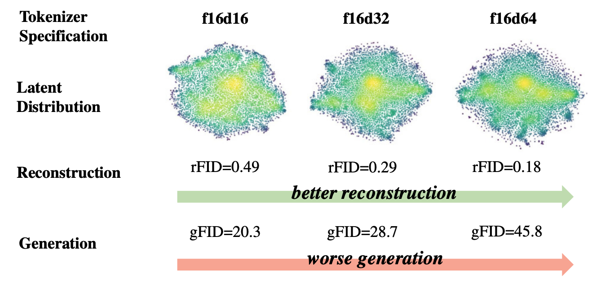 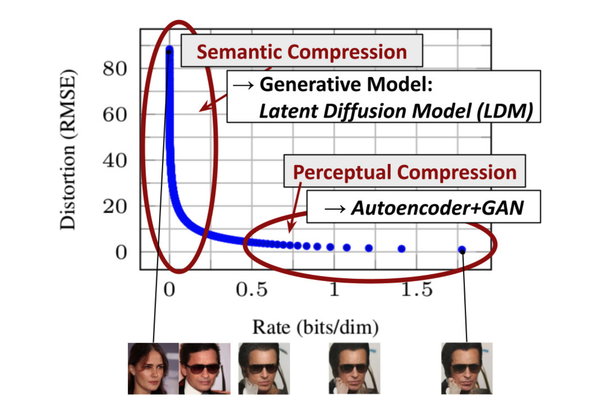

**图 22：右：gFID 与 rFID 之间的权衡，图片来自 [[51](#bib.bib50)]。其中 $f$ 表示下采样倍数，$d$ 表示潜空间通道维度。右：失真，即重建质量，与码率之间的关系，来自 [[17](#bib.bib21), [37](#bib.bib15)]。这条特定曲线由 DDPM 生成，而 DDPM 本身也是一种 VAE。尽管失真与码率计算中的一些技术细节，可能与本文的非严格定义不同，但整体直觉相同。**

## 附录 E 扩散模型文献导读

围绕扩散模型与流匹配，文献中已经形成了一个庞大的模型家族。阅读这些论文时，你可能会看到与本课程不同但等价的表述方式，这有时会令人困惑。因此，这里简要概述不同框架及其差异，并介绍相应的历史背景。**理解本文其他内容并不需要阅读本附录**；它主要用于辅助你阅读相关文献。

##### 离散时间与连续时间。

最早的去噪扩散模型论文 [[41](#bib.bib20), [42](#bib.bib17), [17](#bib.bib21)] 没有使用 SDE，而是在**离散时间**中构造马尔可夫链，时间步为 $t=0,1,2,3,\dots$。直到今天，仍有大量文献使用离散时间表述。这种构造简单直观，但缺点是必须在训练前确定时间离散化方式。此外，损失需要通过**证据下界（ELBO）**近似；顾名思义，它只是我们真正希望最小化的损失的一个下界。后来，[[43](#bib.bib25)] 说明，这些构造本质上是连续时间 SDE 的近似。而在连续时间情形中，ELBO 变得紧致，不再只是严格偏小的下界。例如，[定理 12](#Thmtheorem12) 与[定理 22](#Thmtheorem22) 给出的是等式，而不是下界，离散时间情形则不同。由此，SDE 构造日益流行，因为它在数学上更“干净”，并且可以在训练后通过 ODE/SDE 采样器控制模拟误差。不过，两类模型采用相同的损失，并无根本差异。

##### “前向过程”与概率路径。

最早一批去噪扩散模型 [[41](#bib.bib20), [42](#bib.bib17), [17](#bib.bib21), [43](#bib.bib25)] 没有使用**概率路径**这一术语，而是通过所谓的**前向过程**为数据点 $z\in\mathbb{R}^{d}$ 加噪。它是如下形式的 SDE：

$$
\bar{X}_{0}=z,\quad\mathrm{d}\bar{X}_{t}=u^{\text{forw}}_{t}(\bar{X}_{t})\mathrm{d}t+\sigma^{\text{forw}}_{t}\mathrm{d}\bar{W}_{t} \qquad\text{(146)}
$$

基本思路是：采样数据点 $z\sim p_{\rm{data}}$ 后，模拟前向过程，从而扰动数据或为其“加噪”。前向过程被设计为在 $t\to\infty$ 时，其分布收敛到高斯分布 $\mathcal{N}(0,I_{d})$。换言之，当 $T\gg 0$ 时，近似有 $\bar{X}_{T}\sim\mathcal{N}(0,I_{d})$。这本质上对应一条概率路径：给定 $\bar{X}_{0}=z$ 时 $\bar{X}_{t}$ 的条件分布，就是条件概率路径 $\bar{p}_{t}(\cdot|z)$；对 $z\sim p_{\rm{data}}$ 边缘化后，$\bar{X}_{t}$ 的分布就是边缘概率路径 $\bar{p}_{t}$。[^8] 但为了训练时避免模拟 SDE，必须已知 $X_{t}|X_{0}=z$ 分布的闭式表达。这实际上将向量场 $u^{\text{forw}}_{t}$ 限制为能够显式写出 $\bar{X}_{t}|\bar{X}_{0}=z$ 分布的形式。因此，扩散模型文献中的前向向量场始终采用仿射形式，即对某个连续函数 $a_{t}$，有 $u^{\text{forw}}_{t}(x)=a_{t}x$。采用这种选择后，可以使用已知的条件分布公式 [[40](#bib.bib13), [44](#bib.bib19), [23](#bib.bib18)]：

$$
\bar{X}_{t}|\bar{X}_{0}=z\sim\mathcal{N}\left(\alpha_{t}z,\beta_{t}^{2}I\right),\quad\alpha_{t}=\exp\left(\int\limits_{0}^{t}a_{r}\mathrm{d}r\right),\quad\beta_{t}^{2}=\alpha_{t}^{2}\int\limits_{0}^{t}\frac{(\sigma^{\text{forw}}_{r})^{2}}{\alpha^{2}_{r}}dr
$$

这些其实就是高斯概率路径。因此可以说，**前向过程是构造（高斯）概率路径的一种特定方式。**流匹配 [[25](#bib.bib26)] 引入“概率路径”这一术语，是为了在简化构造的同时扩大其一般性：首先，扩散模型的“前向过程”实际上从未被模拟，训练时只是从 $\bar{p}_{t}(\cdot|z)$ 中直接采样；其次，前向过程只有在 $t\to\infty$ 时才收敛，也就是说，有限时间内永远无法真正到达 $p_{\rm{init}}$。因此，本文选择使用概率路径的表述。

##### 时间反演与求解 Fokker–Planck 方程。

扩散模型最初并非通过 Fokker–Planck 方程或连续性方程构造训练目标 $u^{\text{target}}_{t}$、$\nabla\log p_{t}$，而是通过前向过程的**时间反演** [[2](#bib.bib22)]。时间反演 $(X_{t})_{0\leq t\leq T}$ 是这样一种 SDE：其轨迹分布与原过程在时间上倒转后的轨迹分布相同，即

$$
\begin{aligned}
\mathbb{P}[\bar{X}_{t_{1}}\in A_{1},\dots,\bar{X}_{t_{n}}\in A_{n}]=\mathbb{P}[X_{T-t_{1}}\in A_{1},\dots,X_{T-t_{n}}\in A_{n}] \qquad\text{(147)} \\
\text{，对所有 }0\leq t_{1},\dots,t_{n}\leq T,\text{ 且 }A_{1},\dots,A_{n}\subset S \qquad\text{(148)}
\end{aligned}
$$

根据 [[2](#bib.bib22)]，以下 SDE 给出满足上述条件的时间反演：

$$
\begin{aligned}
\mathrm{d}X_{t}= & \left[-u_{t}(X_{t})+\sigma_{t}^{2}\nabla\log p_{t}(X_{t})\right]\mathrm{d}t+\sigma_{t}\mathrm{d}W_{t},\quad u_{t}(x)=u^{\text{forw}}_{T-t}(x),\sigma_{t}=\bar{\sigma}_{T-t}
\end{aligned}
$$

由于 $u_{t}(X_{t})=a_{t}X_{t}$，上式对应[命题 1](#Thmproposition1) 所推导训练目标的一个特例。不同表述采用了不同时间约定，因此这一点并非显而易见，推导可见 [[26](#bib.bib27)]。但在生成式建模中，通常只使用马尔可夫过程的终点 $X_{1}$，例如作为生成图像，而舍弃此前各时刻。因此，对于许多应用，过程究竟是“真正的”时间反演，还是只遵循同一概率路径，并不重要。时间反演并非必需，而且结果往往并非最优，例如概率流 ODE 经常表现更好 [[23](#bib.bib18), [28](#bib.bib11)]。所有不同于时间反演的扩散模型采样方式，仍需借助 Fokker–Planck 方程。希望这些讨论能解释：为什么如今许多人直接通过 Fokker–Planck 方程构造训练目标，正如 [[25](#bib.bib26), [27](#bib.bib12), [1](#bib.bib23)] 所开创、本课程所采用的做法。

##### 流匹配 [[25](#bib.bib26)] 与随机插值 [[1](#bib.bib23)]。

本文框架与流匹配及**随机插值（SI）**框架最为接近。正如前文所述，流匹配仅讨论流。它的一项关键创新就是说明：无需借助前向过程与 SDE，仅使用流模型也能实现可扩展的训练。由于这一限制，从流匹配模型采样时，演化是确定的，只有初始 $X_{0}\sim p_{\rm{init}}$ 是随机的。随机插值则同时包含纯流，以及本文通过“Langevin 动力学”采用的 SDE 扩展，见[定理 17](#Thmtheorem17)。随机插值的名称来自**插值函数** $I(t,x,z)$，它用于在两个分布之间插值。用本文术语来说，这是构造条件概率路径与边缘概率路径的另一种方式，形式不同，但主要内容等价。流匹配与随机插值相对扩散模型的优势，在于简单且通用：训练框架非常简单，同时允许从任意分布 $p_{\rm{init}}$ 变换到任意分布 $p_{\rm{data}}$；而去噪扩散模型只适用于高斯初始分布与高斯概率路径。这为生成式建模带来了新的可能，我们将在课程后续内容中略作讨论。

**小结 45（扩散模型的其他表述）**

文献中常见的其他扩散模型表述，往往组合使用以下若干要素：

1. **离散时间：**常使用离散时间马尔可夫链近似 SDE。

2. **反向时间约定：**常采用与本文相反的时间约定，令 $t=0$ 对应 $p_{\rm{data}}$，而本文令 $t=0$ 对应 $p_{\rm{init}}$。

3. **前向过程：**前向过程，也称加噪过程，是构造（高斯）概率路径的一种方式。

4. **通过时间反演构造训练目标：**也可以通过 SDE 的时间反演构造训练目标。采用相反时间约定后，这只是本文构造的一个特例。

[^1]: Norbert Wiener 是一位曾在 MIT 任教的著名数学家。如今，MIT 数学系仍悬挂着他的画像。

[^2]: 也可以将结果代入本节稍后介绍的连续性方程，再次核验。

[^3]: 思考：去噪器一定会输出“干净”的数据点吗？为什么？答案可能取决于哪些因素？

[^4]: 再次强调，“最优 $\sigma_{t}$”的存在，是模型训练不完美与计算预算有限造成的现象，而不是对连续极限下动力学的理论结论。

[^5]: Midcoder 完全不是标准术语。本文仿照 encoder 与 decoder 的命名，用它指代 U-Net 结构最底部的模块。

[^6]: 该工作在噪声条件上使用了不同约定，但差异仅在记号，算法相同。

[^7]: 关于码率更深入的技术讨论留待下一小节。

[^8]: 不过请注意，它们采用了**反向时间约定**：对应到本文为 $\bar{p}_{0}(\cdot|z)=p_{\rm{data}}$。
