# ODE 策略：让机器人学习动作如何演化

[Jindou Jia](https://jiajindou.github.io/) ‡*, [Jingliang Li](https://jingliangli.com/) *, [Kuangji Zuo](https://kuangjizuo.com/) *, [Tuo An](https://morpheus-an.github.io/) *, Yuxuan Hu, Mengfei Zhao, Bofan Lyu, Jiaqi Bai, Daoyuan Zhu, Hengyu Dai, Junpeng Zhang, [Jianfei Yang](https://marsyang.site/) †

南洋理工大学 MARS 实验室

‡ 项目负责人 · * 同等贡献 · † 通讯作者

联系方式 [jindou.jia@ntu.edu.sg](mailto:jindou.jia@ntu.edu.sg)、[jianfei.yang@ntu.edu.sg](mailto:jianfei.yang@ntu.edu.sg)

[项目主页](https://ntumars.github.io/ODE/) · [代码](https://github.com/NTUMARS/ODE-POLICY)

[arXiv:2611.01729v1](https://arxiv.org/abs/2611.01729v1) · 2026 年 11 月 1 日 · [LaTeX 源码](https://arxiv.org/src/2611.01729v1) · [PDF](https://arxiv.org/pdf/2611.01729v1)

## 摘要

大多数机器人策略，无论通过模仿学习（IL）还是强化学习（RL）训练，都在离散控制步上将观测映射为动作值，物理运动的连续性则由模型隐式学习。本文提出 ODE 策略，将动作动力学作为学习对象。我们用神经常微分方程（ODE）学习动作的向量场。在 IL 中，在短动作分块内将积分得到的动作与目标匹配，在 RL 中则以单个控制步为单位。轻量的多样性头通过随机调整向量场的方向来刻画多模态行为。部署时，每个动作都由前一个动作积分得到，从而在构造上保证执行轨迹的连续性。我们将 ODE 策略用作视觉运动策略、视觉-语言-动作（VLA）模型和世界动作模型（WAM）的动作头，以及基于模型的 RL 的行动器，并在单臂操控、双臂操控、灵巧操控、移动和移动操控任务上与 14 种基线比较。在 IL 中，训练一轮后，其成功率、泛化表现和模态均衡度分别达到流匹配的 5.9 $\times$、5.4 $\times$ 和 3.9 $\times$，动作生成速度为后者的 10.8 $\times$。多数情况下，机器人的动作比人类示范更平滑。在涵盖单臂、双臂、灵巧手和人形机器人的 14 项真实任务上，该方法均取得最高成功率。在 RL 中，它进一步加快了 SuperMimic 学习人形机器人动作跟踪的速度，也使动作更平滑。ODE 策略在学习、数据利用、参数和执行方面均具有效率优势，为扩大机器人学习规模提供了一条有前景的路径。

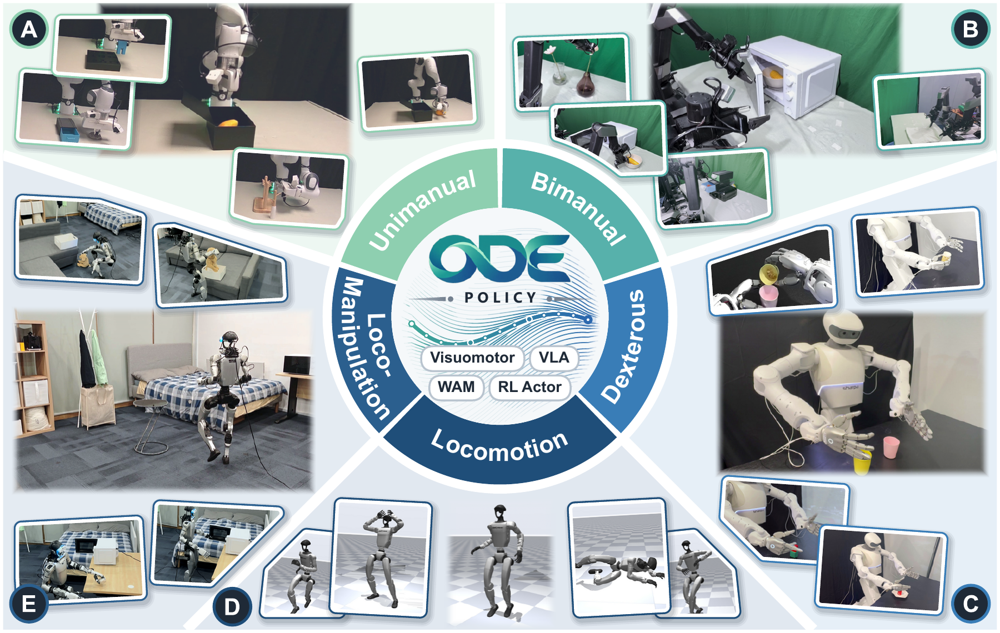

**图 1。** ODE 策略在不同机器人本体和模型中的应用。同一套方法可用作视觉运动策略、VLA 和 WAM 的动作头，以及 RL 的行动器。（A）单臂机器人执行单臂操控。（B）双臂机器人执行双臂操控。（C）五指手执行灵巧操控。（D）通过 RL 训练的仿真人形机器人移动并跟踪人类动作。（E）人形机器人执行移动操控任务。

## 1 引言

> *Natura non facit saltus.*
>
> （自然无跃变。）——戈特弗里德·威廉·莱布尼茨，1704 年

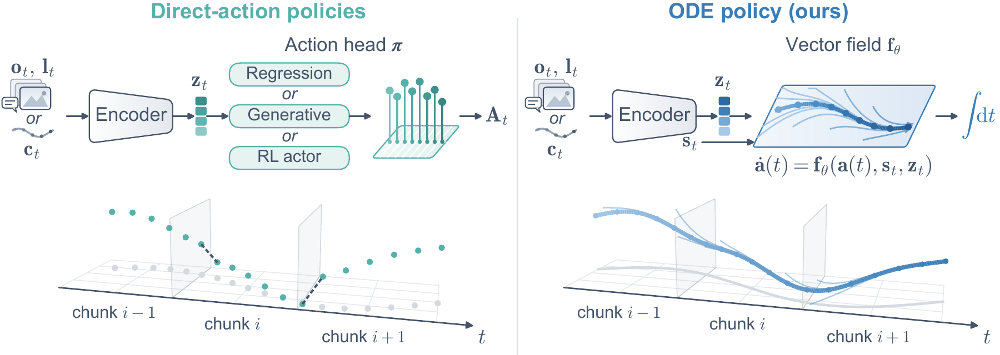

**图 2。** 直接动作策略与 ODE 策略。两类策略都对图像历史和指令（IL）或参考动作（RL）进行编码。左图中的直接动作策略将嵌入映射为离散控制步的动作值，无论采用的是回归头、生成头还是 RL 行动器。右图中的 ODE 策略学习动作动力学，将其表示为向量场 $\mathbf{f}_{\theta}$，并在物理时间上积分，使每个动作都从上一个动作演化而来。在 RL 中，每个分块只含一个动作。

过去几年，机器人学习进展迅速。在模仿学习（IL）中，视觉运动策略 （[Chi et al., 2025](#bib.bib14)；[Zhao et al., 2023](#bib.bib79)）、视觉-语言-动作（VLA）模型 （[Zitkovich et al., 2023](#bib.bib81)；[Kim et al., 2025](#bib.bib41)；[Black et al., 2024](#bib.bib8)；[Physical Intelligence et al., 2025](#bib.bib60)；[Bjorck et al., 2025](#bib.bib7)） 和世界动作模型（WAM）（[Zhang et al., 2026](#bib.bib77)；[An et al., 2026](#bib.bib1)；[Hou et al., 2026](#bib.bib28)） 已能完成多种操控任务。在强化学习（RL）中，借助大规模并行仿真训练的行动器已能让足式机器人和人形机器人行走并跟踪人类动作 （[Rudin et al., 2022](#bib.bib64)；[Mittal et al., 2023](#bib.bib53)；[Liao et al., 2026b](#bib.bib46)）。这些策略虽有差异，大多仍遵循同一种范式，即对观测历史和本体感知状态编码，并直接将其映射为未来各离散时间步的动作。

这一范式在两种学习场景中都有局限。IL 依赖大规模数据和算力实现泛化，但机器人数据在本体、质量和控制接口上存在差异，采集规模难以达到互联网数据的量级。训练大型基础策略的成本也很高。生成式策略 （[Chi et al., 2025](#bib.bib14)；[Black et al., 2024](#bib.bib8)） 还需要为每个分块多次运行网络，只有生成完整个分块后才能响应新的观测，限制了实时执行能力 （[Black et al., 2025](#bib.bib9)；[Bai et al., 2026](#bib.bib3)；[Jia et al., 2026c](#bib.bib34)）。在 RL 中，策略必须通过大量交互积累经验 （[Rudin et al., 2022](#bib.bib64)）。缺少显式正则化时，动作往往出现高频振荡，浪费控制力、加剧执行器磨损，也妨碍从仿真迁移到现实 （[Mysore et al., 2021](#bib.bib54)；[Raffin et al., 2022](#bib.bib63)；[Peng et al., 2020](#bib.bib58)）。因此，需要一种**在学习、数据利用、参数和执行上都更高效，尤其适于规模化**的机器人策略范式。

机器人是一个在时间上连续运动的宏观经典系统。驱动它的动作指令，例如人通过遥操作发出的指令，也大体连续。一段示范因此大致相当于按控制频率对连续动作轨迹采样。直接动作策略必须从数据中隐式学习这种连续性。在分块边界，连续性甚至没有保证，指令可能发生跳变 （[Black et al., 2025](#bib.bib9)）。常微分方程（ODE）（[Chen et al., 2018](#bib.bib10)） 天然适合描述这种连续变化。用它对动作建模，可得到各时间步共享的演化规律。对该方程积分，所得动作轨迹在构造上就是连续的。值得注意的是，动物的运动皮层被认为也是借助这种动力学机制产生运动的，运动目标本身不足以解释运动的生成 （[Churchland et al., 2012](#bib.bib15)；[Shenoy et al., 2013](#bib.bib68)）。机器人领域早已用 ODE 描述运动 （[Ijspeert et al., 2013](#bib.bib29)；[Bahl et al., 2020](#bib.bib2)），但以往方法会固定向量场的形式，或强制它收敛到某个吸引子，因而每个模型只能表示少数几种运动。

本文提出 **ODE 策略**，直接用 ODE 对策略建模，学习动作的动力学（图 [2](#S1.F2)）。具体而言，神经 ODE （[Chen et al., 2018](#bib.bib10)） 在给定观测的条件下学习动作向量场，再沿机器人的物理时间积分得到动作。对整段示范积分会累积漂移，并需要开销较大的*伴随法*。因此在 IL 中，我们沿用当今直接动作策略所依赖的动作分块 （[Chi et al., 2025](#bib.bib14)；[Zhao et al., 2023](#bib.bib79)） （[Pan et al., 2026](#bib.bib55)；[Lazzati et al., 2026](#bib.bib42)），在每个分块内积分，监督积分路径，无需动作的任何导数。收缩扰动会偏移各训练分块的起点，使向量场学会将路径拉回示范轨迹，从而提升鲁棒性。在 RL 中，我们在单个控制步内积分。推理时，每个动作从上一个动作积分得到，在 IL 中跨越分块边界，在 RL 中则跨越控制步。相比之下，直接动作策略在 IL 中常在分块边界跳变或停顿，在 RL 中则容易在相邻步之间振荡。最后，轻量的多样性头为向量场加上采样得到的偏移，以保留多模态行为 （[Chi et al., 2025](#bib.bib14)；[Jia et al., 2026a](#bib.bib32)）。

我们在主流 IL 模型和 RL 中验证 ODE 策略（图 [1](#S0.F1)），分别将其用作视觉运动策略、$\pi_{0.5}$ VLA 的动作专家 （[Physical Intelligence et al., 2025](#bib.bib60)）、世界动作模型 ImageWAM 的动作头 （[Zhang et al., 2026](#bib.bib77)），以及 SuperMimic 的行动器，用于人形机器人的全身动作跟踪 （[Liao et al., 2026a](#bib.bib45)）。我们还将它部署到真实的单臂、双臂、灵巧手和人形机器人上，其中在人形机器人上替换了 GR00T N1.7 的动作头 （[Bjorck et al., 2025](#bib.bib7)）。真机实验包含高精度、长时程、可变形物体、多模态、灵巧操控及移动操控任务。我们与 14 种先进基线比较，其中包括基于生成和回归的 IL 方法。每组实验中，各方法共用骨干网络、数据和训练日程。

实验表明，ODE 策略**学习速度很快**。训练一轮后，它在 LIBERO 上的成功率为 79.2%，基线最高只有 43.2%。作为 $\pi_{0.5}$ 的动作头，其成功率为 96.0%，原流匹配专家为 75.5%。作为 ImageWAM 的动作头，它达到 82.6%，原动作头为 24.6%。所用示范不足一半时，它即可达到流匹配的表现。作为 SuperMimic 的行动器，它在训练早期就获得了更高的回报。在涵盖单臂、双臂、灵巧手和人形机器人的 14 项任务上，它在每项任务中都取得最高成功率。它还**能快速生成平滑动作**。在仿真中，每个分块的生成速度是流匹配的 10.8 倍，在真机上是扩散和流匹配基线的 3.5 至 27 倍。多数情况下，真机运动比人类示范更平滑。它还能**稳健地泛化**到仿真中未见过的扰动，并将从其他实验室公开数据学到的灵巧技能迁移到我们的真机上。策略也**保留了多模态行为**，既能在导航任务中采用不同路线，也能在真实双臂任务中采用两种手臂分工。最后，学得的向量场支持无动作标签的数据和任意控制频率。

## 2 相关工作

### 2.1 机器人策略中的 ODE

**用 ODE 描述动作动力学。** 将机器人运动表示为动力系统由来已久，相关方法从动力学运动基元 （[Ijspeert et al., 2013](#bib.bib29)） 和稳定动力系统 （[Khansari-Zadeh and Billard, 2011](#bib.bib38)），到带有收缩性或稳定性保证的神经向量场 （[Beik-Mohammadi et al., 2024](#bib.bib4)；[Sochopoulos et al., 2024](#bib.bib69)）。神经动力学策略进一步从图像预测此类系统的参数 （[Bahl et al., 2020](#bib.bib2)；[Totsila et al., 2023](#bib.bib72)）。但固定的形式或稳定性约束使每个系统只能表示少数趋向吸引子的运动，且多用于单一任务。ODE 策略允许向量场采用任意结构，为大规模任务学习一个共享的向量场。

**用 ODE 描述状态动力学。** 机器人学习的一种常见范式是先学习机器人或环境的状态动力学，再在此基础上设计策略或解析控制器。学得的动力学模型通常采用神经 ODE，可用于基于模型的强化学习 （[Yildiz et al., 2021](#bib.bib75)），也可用于补偿模型不确定性的反馈控制器 （[Jia et al., 2025b](#bib.bib31)；[Jia et al., 2025a](#bib.bib30)；[Jia et al., 2026b](#bib.bib33)）。连续时间网络同样使用 ODE 来演化策略的隐状态 （[Hasani et al., 2022](#bib.bib24)）。这些研究中的 ODE 描述的是系统或网络的状态，动作仍由单独的控制器或输出层生成。ODE 策略直接学习动作本身的 ODE。

**用 ODE 描述生成过程。** 扩散策略和流匹配策略 （[Chi et al., 2025](#bib.bib14)；[Black et al., 2024](#bib.bib8)） 在不具物理含义的生成时间上积分。Streaming Flow 策略 （[Jiang et al., 2025](#bib.bib36)） 将流的时间与执行时间对齐，但仍靠回归从示范推导出的速度进行训练，并在重新缩放的时间区间内重新生成每个动作分块。Chronos 策略 （[Wang et al., 2026](#bib.bib73)） 在扩散 Transformer 中编码观测与动作的物理时间，但时间仍是输入，生成动作仍遵循固定频率。ODE 策略直接在物理时间上积分，以积分路径作为训练依据，无需速度标签，而且每个分块都接续前一分块。

### 2.2 动作分块

对每次观测预测一个动作分块的做法，经动作分块 Transformer（ACT）（[Zhao et al., 2023](#bib.bib79)） 和扩散策略 （[Chi et al., 2025](#bib.bib14)） 得到推广，如今已成为大型基础模型的标准做法 （[Black et al., 2024](#bib.bib8)；[Physical Intelligence et al., 2025](#bib.bib60)；[Bjorck et al., 2025](#bib.bib7)）。近期分析表明，分块是当前 IL 策略表现出色的关键因素 （[Lazzati et al., 2026](#bib.bib42)；[Pan et al., 2026](#bib.bib55)）。开环执行一整个分块，往往优于每次获得观测就更新动作 （[Park, 2026](#bib.bib56)），这与经典控制中提高闭环频率通常更有利的经验有所出入。不过，独立预测的分块在交界处可能不一致。时序集成 （[Zhao et al., 2023](#bib.bib79)），或把上一分块中已确定要执行的动作作为下一分块的条件 （[Black et al., 2025](#bib.bib9)），都可以缓解这一问题。

ODE 策略在 IL 中也采用分块，并以分块为积分单位。训练时，在一个分块内对向量场积分，直接通过少量求解步反向传播梯度，无需*伴随法*。推理时，每个动作从上一个动作积分得到，动作在分块之间保持连续，且无需等整个分块生成后才执行。某些策略预测相对于当前位姿的动作 （[Chi et al., 2024](#bib.bib13)），但仍将分块中的每个动作作为独立值输出。ODE 策略的分块中，所有动作都来自沿路径评估的同一个向量场。

### 2.3 高效策略

**高效 IL 策略。** 生成式策略每个分块需要多次运行网络。一致性模型 （[Song et al., 2023](#bib.bib71)；[Zhang et al., 2025](#bib.bib76)）、自蒸馏 （[Li et al., 2026](#bib.bib44)） 和平均流 （[Geng et al., 2025](#bib.bib21)；[Fang et al., 2025](#bib.bib17)） 将采样减少到一步或少数几步，而有信息的源分布可以缩短传输路径 （[Scholz and Turner, 2025](#bib.bib65)；[Dai et al., 2026](#bib.bib16)）。VITA （[Gao et al., 2026](#bib.bib20)）、动作到动作流匹配（A2A）（[Jia et al., 2026c](#bib.bib34)；[Zuo et al., 2026](#bib.bib82)） 和 FLASH （[Bai et al., 2026](#bib.bib3)） 进一步改用图像观测或历史动作作为流的起点，同时提升学习效率和推理速度。这些方法沿用传统的直接动作范式来提高 IL 的效率。ODE 策略采用 ODE 范式，利用物理运动本身的连续性来提高效率。

**高效 RL 策略。** 在 RL 中，提升样本效率的工作主要集中在评价器和更新方法上，例如使用集成或正则化的评价器以提高更新次数与数据量之比 （[Chen et al., 2021b](#bib.bib12)；[Hiraoka et al., 2022](#bib.bib26)；[Bhatt et al., 2024](#bib.bib5)）、扩大网络规模 （[Lee et al., 2025](#bib.bib43)；[Kim et al., 2026](#bib.bib40)），或学习世界模型 （[Hansen et al., 2024](#bib.bib22)）。SuperMimic （[Liao et al., 2026a](#bib.bib45)） 学习一个可微世界模型，并通过短程想象轨迹反向传播解析梯度来训练行动器。它在单张 GPU 上训练 3 小时后就超越了一种先进的运动跟踪器，所费 GPU 小时不到后者的千分之一。这些方法的行动器仍然直接将状态映射为动作。ODE 策略可直接替换 SuperMimic 的行动器，进一步加快其学习。

## 3 预备知识

本节先形式化描述 ODE 策略在 IL 和 RL 中所替代的直接动作策略，再介绍 ODE 策略所依据的神经 ODE。

### 3.1 直接动作策略

设 $\mathbf{o}_{t}\in\mathcal{O}$ 为图像空间 $\mathcal{O}$ 中的视觉观测，$\mathbf{s}_{t}\in\mathbb{R}^{d_{s}}$ 为本体感知状态，$\mathbf{a}_{t}\in\mathbb{R}^{d_{a}}$ 为控制步 $t\in\mathbb{N}$ 时发给底层控制器的动作，其中 $d_{s},d_{a}\in\mathbb{N}$ 分别是状态与动作的维数。用 $\mathbf{c}_{t}=(\mathbf{o}_{t},\,\mathbf{l}_{t})$ 表示条件，所含语言指令 $\mathbf{l}_{t}\in\mathcal{T}$ 属于指令文本空间 $\mathcal{T}$。观测和状态通常还包含一小段历史。传统策略在每个控制步将条件和状态映射为动作值：

$$
\mathbf{a}_t\sim\boldsymbol{\pi}(\cdot\mid\mathbf{c}_t,\mathbf{s}_t),
\tag{1}
$$

每个动作都作为独立的值进行预测。模型未规定相邻动作之间的关系，运动连续性等关系须由数据隐式学得。由于网络直接输出动作值，我们把这类策略称为*直接动作策略*。

**IL 策略。** IL 利用数据集 $\mathcal{D}$ 中的 $N\in\mathbb{N}$ 条示范轨迹 $\{(\mathbf{o}_{t},\mathbf{s}_{t},\mathbf{l}_{t},\mathbf{a}_{t})\}$ 拟合 $\boldsymbol{\pi}$。大多数 IL 策略采用动作分块 （[Zhao et al., 2023](#bib.bib79)；[Chi et al., 2025](#bib.bib14)），一次预测包含 $H\in\mathbb{N}$ 个未来动作的分块：

$$
\mathbf{A}_t=[\mathbf{a}_{t},\dots,\mathbf{a}_{t+H-1}]\sim\boldsymbol{\pi}(\cdot\mid\mathbf{c}_t,\mathbf{s}_t),
\tag{2}
$$

其中 $\mathbf{A}_{t}\in\mathbb{R}^{H\times d_{a}}$，当前分块执行完后才处理下一次观测。无论在分块内部还是跨分块，每个动作 $\mathbf{a}_{t+k}$（$k\in\{0,\dots,H-1\}$）仍是一个独立值。$H=1$ 时即为式（[1](#S3.E1)）。显式回归在 $\ell_{1}$ 或 $\ell_{2}$ 损失下直接将 $(\mathbf{c}_{t},\mathbf{s}_{t})$ 映射为 $\mathbf{A}_{t}$ （[Pomerleau, 1989](#bib.bib61)；[Zhao et al., 2023](#bib.bib79)），实现简单，但会对多模态示范取平均。生成式策略则从学得的分布中采样 $\mathbf{A}_{t}$。扩散策略 （[Chi et al., 2025](#bib.bib14)；[Ho et al., 2020](#bib.bib27)） 从*高斯*噪声抽取一个分块并迭代去噪。流匹配策略 （[Lipman et al., 2023](#bib.bib47)；[Liu et al., 2023b](#bib.bib49)；[Black et al., 2024](#bib.bib8)；[Jia et al., 2026c](#bib.bib34)） 则对确定性向量场积分，在一段时间 $\tau\in[0,1]$ 内将源样本传输至 $\mathbf{A}_{t}$。

尽管扩散和流匹配在推理时都求解微分方程，$\tau$ 仍是不具物理含义的*生成时间*。中间样本并非机器人能够实际到达的状态。每个分块独立生成，起点与上一分块的终点无关。

**RL 策略。** RL 通过交互训练 $\boldsymbol{\pi}$，以最大化期望折扣回报。无图像输入时，$\mathbf{s}_{t}$ 包含状态历史。在动作跟踪任务中，条件 $\mathbf{c}_{t}$ 包含参考动作。行动器通常在每个控制步输出单个动作，如式（[1](#S3.E1)）。SuperMimic 等基于模型的方法 （[Liao et al., 2026a](#bib.bib45)） 在可微世界模型中生成想象轨迹，再对其回报进行反向传播来更新行动器。

### 3.2 神经 ODE

神经 ODE （[Chen et al., 2018](#bib.bib10)；[Jia et al., 2025b](#bib.bib31)） 用参数为 $\phi$ 的神经网络 $\mathbf{g}_{\phi}:\mathbb{R}^{n}\times\mathbb{R}\to\mathbb{R}^{n}$ 表示连续状态 $\mathbf{x}(t)\in\mathbb{R}^{n}$（$n\in\mathbb{N}$）在时刻 $t\in\mathbb{R}$ 的时间导数，并通过积分得到从 $t_{0}$ 到 $t_{1}$（$t_{0},t_{1}\in\mathbb{R}$，$t_{0}<t_{1}$）的轨迹：

$$
\begin{aligned}
&\dot{\mathbf{x}}(t)=\mathbf{g}_\phi\big(\mathbf{x}(t),t\big), \\
&\mathbf{x}(t_1)=\mathbf{x}(t_0)+\int_{t_0}^{t_1}\mathbf{g}_\phi\big(\mathbf{x}(t),t\big)\,\mathrm{d}t ,
\end{aligned}
\tag{3}
$$

积分用数值求解器计算，例如*欧拉法*或 RK2、RK4 等*龙格–库塔法*。网络通过对积分所得状态的损失进行反向传播来训练。梯度可以直接沿求解步计算，也可以用*伴随法* （[Chen et al., 2018](#bib.bib10)）。后者通过对增广 ODE 进行逆时间积分，将内存开销保持为常数，代价是额外的积分计算。网络只定义局部变化率，轨迹的连续性和平滑性由积分带来。运动基元 （[Ijspeert et al., 2013](#bib.bib29)）、稳定动力系统 （[Khansari-Zadeh and Billard, 2011](#bib.bib38)） 和神经动力学策略 （[Bahl et al., 2020](#bib.bib2)） 等早期方法预先固定向量场形式，只学习其参数。本文直接以神经网络作为动作向量场，沿机器人的物理时间积分。

## 4 方法

本节提出 ODE 策略，用 ODE 描述动作如何随机器人的物理时间演化（图 [2](#S1.F2)）。我们主要以 IL 为例，先将策略表示为动作的向量场（第 [4.1](#S4.SS1) 节），再说明如何用示范训练（第 [4.2](#S4.SS2) 节）并在推理时执行（第 [4.3](#S4.SS3) 节）。第 [4.4](#S4.SS4) 节介绍用于多模态行为的可选多样性头。最后，第 [4.5](#S4.SS5) 节说明同一向量场如何用作 RL 的行动器。

### 4.1 向量场表述

**向量场。** 我们将图像历史和指令编码为嵌入 $\mathbf{z}_{t}\in\mathbb{R}^{d_{z}}$（$d_{z}\in\mathbb{N}$），并用神经网络参数化动作速度 （[Chen et al., 2018](#bib.bib10)）：

$$
\dot{\mathbf{a}}(t)=\mathbf{f}_\theta\big(\mathbf{a}(t),\mathbf{s}_t,\mathbf{z}_t\big),
\tag{4}
$$

其中 $\mathbf{f}_{\theta}:\mathbb{R}^{d_{a}}\times\mathbb{R}^{d_{s}}\times\mathbb{R}^{d_{z}}\to\mathbb{R}^{d_{a}}$，$t\in\mathbb{R}_{\geq 0}$ 为以控制步为单位的机器人的物理时间，$\mathbf{a}(t)\in\mathbb{R}^{d_{a}}$ 为期望机器人达到的动作目标，$\dot{\mathbf{a}}$ 为其速度。本体感知 $\mathbf{s}_{t}$ 直接输入向量场。传统策略则将其与 $\mathbf{c}_{t}$ 一同编码到 $\mathbf{z}_{t}$ 中（消融实验见第 [8](#S8) 节）。

**分块积分。** 在决策步 $t$，策略只计算一次 $\mathbf{z}_{t}$，并在整个分块内固定 $\mathbf{z}_{t}$ 和 $\mathbf{s}_{t}$。以最后一个动作 $\hat{\mathbf{a}}_{t-1}\in\mathbb{R}^{d_{a}}$ 为起点，用数值求解器对式（[4](#S4.E4)）积分：

$$
\begin{aligned}
\hat{\mathbf{a}}_{t+k} &=\hat{\mathbf{a}}_{t+k-1} +\int_{t+k-1}^{t+k}\mathbf{f}_\theta\big(\mathbf{a}(t'),\mathbf{s}_t,\mathbf{z}_t\big)\,\mathrm{d}t',  \\
&\quad k=0,\dots,H-1,
\end{aligned}
\tag{5}
$$

其中 $t^{\prime}\in\mathbb{R}$ 为积分变量。我们在与式（[2](#S3.E2)）中 $\mathbf{A}_{t}$ 相同的时间步上取得分块 $\hat{\mathbf{A}}_{t}=[\hat{\mathbf{a}}_{t},\dots,\hat{\mathbf{a}}_{t+H-1}]\in\mathbb{R}^{H\times d_{a}}$。不同于式（[1](#S3.E1)）和（[2](#S3.E2)），这里每个动作都通过从上一个动作积分其变化率得到，因此相邻动作天然相关。向量场以当前动作 $\mathbf{a}(t)$ 为输入，所以每一步的变化取决于动作已到达的位置。传统策略则将一个分块的动作或增量作为 $H$ 个值分别输出，各值间的关系须从数据中学得。保持条件固定与动作分块 （[Zhao et al., 2023](#bib.bib79)；[Chi et al., 2025](#bib.bib14)） 的做法一致，即每个分块只处理一次观测 （[Lazzati et al., 2026](#bib.bib42)）。

积分的状态是期望动作，即发送给底层控制器的目标。底层控制器（如比例-微分（PD）控制器或操作空间控制器 （[Khatib, 1987](#bib.bib39)））无法完全跟上目标，因此机器人的实测状态总是滞后于目标 （[Zhao et al., 2026](#bib.bib78)）。对于增量控制器 （[Zhu et al., 2020](#bib.bib80)），期望动作等于当前位姿加上按比例缩放的指令，执行时可由期望动作精确还原指令。只有实测状态可用时，例如用 UMI 采集的数据 （[Chi et al., 2024](#bib.bib13)） 或人类视频 （[Kareer et al., 2026](#bib.bib37)），第 [9](#S9) 节讨论向量场的速度如何自然补偿这类滞后。

### 4.2 训练

**路径损失。** 给定一段示范，以示范动作 $\mathbf{a}_{t-1}$ 为起点，将式（[5](#S4.E5)）积分 $H$ 步，使所得路径与示范匹配：

$$
\mathcal{L}_{\text{path}}=\frac{1}{H}\sum_{k=0}^{H-1} \big\Vert \hat{\mathbf{a}}_{t+k}-\mathbf{a}_{t+k}\big\Vert _2^2 .
\tag{6}
$$

分块通常很短，因此梯度直接通过求解步反向传播，无需*伴随法* （[Chen et al., 2018](#bib.bib10)）。向量场仅由积分路径监督。[Jiang et al. (2025)](#bib.bib36) 所采用的速度标签回归可能放大带噪示范中的抖动，因此这里不采用这种监督方式。

**收缩扰动。** 路径损失仅沿示范轨迹监督向量场。但在执行时，策略从自身的上一个输出继续积分，误差会传递到后续控制步和分块，状态也会渐渐偏离示范。为提高鲁棒性，我们在训练时扰动每一段的起点，并要求积分路径回到示范轨迹：

$$
\begin{aligned}
\mathcal{L}_{\text{path}}^{\boldsymbol{\delta}} &=\frac{1}{H}\sum_{k=0}^{H-1} \big\Vert \hat{\mathbf{a}}_{t+k}(\mathbf{a}_{t-1}+\boldsymbol{\delta}) -(\mathbf{a}_{t+k}+\rho^{k+1}\boldsymbol{\delta})\big\Vert _2^2,  \\
&\quad \boldsymbol{\delta}\sim\mathcal{N}\big(\mathbf{0},\mathrm{diag}(\boldsymbol{\sigma}_\delta^2)\big),
\end{aligned}
\tag{7}
$$

其中 $\hat{\mathbf{a}}_{t+k}(\cdot)$ 为按式（[5](#S4.E5)）从指定起点积分得到的路径，$\boldsymbol{\delta}\in\mathbb{R}^{d_{a}}$ 为尺度为 $\boldsymbol{\sigma}_{\delta}\in\mathbb{R}^{d_{a}}_{>0}$ 的扰动，$\rho\in(0,1)$ 为衰减率。每个片段以概率 $p\in[0,1]$ 受到扰动，其余情况下 $\boldsymbol{\delta}=\mathbf{0}$，此时退化为式（[6](#S4.E6)）。目标偏差 $\rho^{k+1}\boldsymbol{\delta}$ 按几何级数缩小，因此向量场学会以 $\rho$ 决定的速率将邻近状态拉回示范轨迹，即在示范附近形成局部收缩 （[Beik-Mohammadi et al., 2024](#bib.bib4)）。我们称之为*收缩扰动*。这种做法依赖于向量场将动作作为输入。标准直接动作策略没有指令动作输入，因此无法采用这种扰动。它无需额外数据，也不增加推理计算量（消融实验见图 [17](#S8.F17)（A））。

上述损失定义在单个示范片段 $\xi_{t}=(\mathbf{c}_{t},\mathbf{s}_{t},\mathbf{a}_{t-1:t+H-1})$ 上。总体目标对 $\mathcal{D}$ 中的片段及扰动取平均：

$$
\mathcal{L}(\theta,\psi)=\mathbb{E}_{\xi_t\sim\mathcal{D},\,\boldsymbol{\delta}} \big[\mathcal{L}_{\text{path}}^{\boldsymbol{\delta}}(\xi_t)+\underbrace{\mathcal{L}_{\text{div}}(\xi_t)}_{\text{optional}}\big],
\tag{8}
$$

我们按小批量示范片段最小化这一目标。第 [4.4](#S4.SS4) 节介绍*可选的*多样性损失 $\mathcal{L}_{\text{div}}$。算法 [1](#alg1) 将该训练过程与直接动作策略的训练过程作比较。

**算法 1。** **IL 训练伪代码。**

**直接动作策略**

1. **遍历** $\mathcal{D}$ 中的每个片段 $(\mathbf{c}_{t},\mathbf{s}_{t},\mathbf{A}_{t})$
2. &emsp; 更新 $\theta$ 以拟合 $\mathbf{A}_{t}$ ▷ 由回归或生成得到
3. **结束循环**

**ODE 策略**

1. **遍历** $\mathcal{D}$ 中的每个片段 $(\mathbf{c}_{t},\mathbf{s}_{t},\mathbf{a}_{t-1:t+H-1})$
2. &emsp; $\hat{\mathbf{a}}_{t-1}\leftarrow\mathbf{a}_{t-1}+\boldsymbol{\delta}$ ▷ 收缩扰动
3. &emsp; 从 $\hat{\mathbf{a}}_{t-1}$ 出发，对 $\mathbf{f}_{\theta}$ 积分 $H$ 步
4. &emsp; 通过求解器用 $\mathcal{L}_{\text{path}}^{\boldsymbol{\delta}}$ 更新 $\theta$
5. **结束循环**

### 4.3 推理

推理时，分块内的每个动作由前一个动作通过单次积分步得到（算法 [2](#alg2)）。在分块之间，我们采用*无缝分块*，按式（[5](#S4.E5)）从上一分块的最后一个动作 $\hat{\mathbf{a}}_{t-1}$ 开始积分，以此代替从实测状态起步（消融实验见图 [17](#S8.F17)（B、C））。这种推理方式相较直接动作策略有三项优势。**（i）执行平滑。** 独立生成分块 （[Zhao et al., 2023](#bib.bib79)；[Black et al., 2025](#bib.bib9)） 会导致边界不连续。这里相邻分块无跳变地衔接，整个执行轨迹是一条积分曲线，每隔 $H$ 步更新一次条件。**（ii）流式执行。** 每个动作一经积分得到，就可发送给控制器。直接动作策略需要先生成整个分块，才能执行第一个动作。**（iii）可自由选择积分步长。** 向量场定义在连续时间上，部署时可选择积分步长，例如匹配更高的控制频率。直接动作策略则按训练数据的固定步长输出动作（图 [19](#S9.F19)（C））。

**算法 2。** **IL 推理伪代码。**

**直接动作策略**

1. **遍历**每个决策步 $t=0,H,2H,\dots$
2. &emsp; $\hat{\mathbf{A}}_{t}\sim\boldsymbol{\pi}(\cdot\mid\mathbf{c}_{t},\mathbf{s}_{t})$ ▷ 新分块
3. &emsp; 执行 $\hat{\mathbf{A}}_{t}$ ▷ 整个分块生成后执行
4. **结束循环**

**ODE 策略**

1. **遍历**每个决策步 $t=0,H,2H,\dots$
2. &emsp; **遍历** $k=0,\dots,H-1$
3. &emsp;&emsp; $\hat{\mathbf{a}}\leftarrow\mathrm{Step}(\mathbf{f}_{\theta},\hat{\mathbf{a}},\mathbf{s}_{t},\mathbf{z}_{t})$，发送 $\hat{\mathbf{a}}$ ▷ 流式执行
4. &emsp; **结束循环**
5. **结束循环** ▷ 下一分块从 $\hat{\mathbf{a}}$ 开始

### 4.4 用于多模态行为的多样性头

多模态行为指在同一情境下存在多种不同而有效的动作，例如从障碍物左侧或右侧绕行 （[Chi et al., 2025](#bib.bib14)；[Jia et al., 2026a](#bib.bib32)；[Ma et al., 2026](#bib.bib52)）。确定性向量场 $\mathbf{f}_{\theta}$ 拟合示范的平均速度，因而会把这些模态平均掉，例如径直撞上障碍物（图 [3](#S4.F3)（A））。

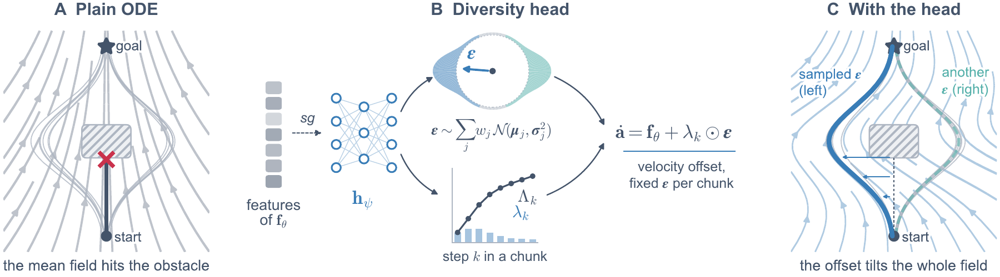

**图 3。** 用于多模态行为的多样性头。示范轨迹（灰色）从障碍物左侧或右侧通过。（A）原始向量场对两者取平均，导致碰撞。（B）多样性头采样方向 $\boldsymbol{\epsilon}$，每条路线对应一个模态，并为每步给出变化率 $\boldsymbol{\lambda}_{k}$，将 $\boldsymbol{\lambda}_{k}\odot\boldsymbol{\epsilon}$ 加到速度上。（C）这一偏移使整个向量场倾斜，使每个样本沿一条路线前进。

策略以向量场表示，积分开始时的方向决定了模态，因此随机改变这个方向即可自然选择模态。为此，我们保留 ODE，并加入参数为 $\psi$ 的轻量多样性头 $\mathbf{h}_{\psi}$，用采样得到的速度偏移将每个分块引向一种模态（图 [3](#S4.F3)（B、C））。每个分块开始时，$\mathbf{h}_{\psi}$ 读取 $\mathbf{f}_{\theta}$ 的隐藏特征并截断梯度，输出一个方向和一组尺度。方向是从含 $K$ 个分量（$K\in\mathbb{N}$）的*高斯*混合模型 （[Bishop, 1994](#bib.bib6)） 中抽取的偏移 $\boldsymbol{\epsilon}\in\mathbb{R}^{d_{a}}$。各分量 $j\in\{1,\dots,K\}$ 覆盖不同模态，其权重 $w_{j}\in[0,1]$ 之和为 1，均值为 $\boldsymbol{\mu}_{j}\in\mathbb{R}^{d_{a}}$，标准差为 $\boldsymbol{\sigma}_{j}\in\mathbb{R}^{d_{a}}_{>0}$。尺度是每步 $k=0,\dots,H-1$ 对应的非负变化率 $\boldsymbol{\lambda}_{k}\in\mathbb{R}^{d_{a}}_{\geq 0}$。随后按加入偏移后的速度对分块积分：

$$
\dot{\mathbf{a}}(t')=\mathbf{f}_\theta\big(\mathbf{a}(t'),\mathbf{s}_t,\mathbf{z}_t\big) +\boldsymbol{\lambda}_k\odot\boldsymbol{\epsilon}, \qquad t'\in[t+k-1,\,t+k],
\tag{9}
$$

其中 $\odot$ 表示逐元素乘积。由于 $\boldsymbol{\epsilon}$ 在分块内固定，且每个积分步持续一个控制步，加入的速度经积分后会使第 $k$ 步的路径偏移约 $\boldsymbol{\Lambda}_{k}\odot\boldsymbol{\epsilon}$，其中 $\boldsymbol{\Lambda}_{k}=\sum_{i=0}^{k}\boldsymbol{\lambda}_{i}\in\mathbb{R}^{d_{a}}_{\geq 0}$。当 $\boldsymbol{\epsilon}=\mathbf{0}$ 时，退化为原始 ODE。多样性头因此应生成与示范相对原始路径偏差相符的位移。

**多样性损失。** 设 $\mathbf{e}_{k}=\mathrm{sg}(\mathbf{a}_{t+k}-\hat{\mathbf{a}}_{t+k})\in\mathbb{R}^{d_{a}}$ 为第 $k$ 步示范相对于原始路径的偏差，其中 $\mathrm{sg}$ 截断梯度。通过最小化 $\mathbf{e}_{k}$ 的*高斯*负对数似然拟合尺度 $\boldsymbol{\Lambda}_{k}$，并用最能解释偏差的偏移 $\boldsymbol{\epsilon}^{*}=\arg\min_{\boldsymbol{\epsilon}}\sum_{k}\Vert \mathbf{e}_{k}-\boldsymbol{\Lambda}_{k}\odot\boldsymbol{\epsilon}\Vert _{2}^{2}$ 的似然来拟合混合模型。该问题可按维度解耦，闭式解为 $\boldsymbol{\epsilon}^{*}=\big(\sum_{k}\boldsymbol{\Lambda}_{k}\odot\mathbf{e}_{k}\big)\oslash\big(\sum_{k}\boldsymbol{\Lambda}_{k}\odot\boldsymbol{\Lambda}_{k}\big)$，其中 $\oslash$ 表示逐元素除法。多样性损失为：

$$
\begin{aligned}
\mathcal{L}_{\text{div}} &=\frac{1}{H}\sum_{k=0}^{H-1} \Big(\tfrac{1}{2}\big\Vert \mathbf{e}_k\oslash\boldsymbol{\Lambda}_k\big\Vert _2^2 +\mathbf{1}^{\top}\log\boldsymbol{\Lambda}_k\Big)  \\
&\quad -\log\sum_{j=1}^{K}w_j\, \mathcal{N}\big(\boldsymbol{\epsilon}^{*};\boldsymbol{\mu}_j,\mathrm{diag}(\boldsymbol{\sigma}_j^2)\big),
\end{aligned}
\tag{10}
$$

其中 $\log$ 逐元素作用，$\mathbf{1}\in\mathbb{R}^{d_{a}}$ 为全 1 向量，$\mathcal{N}(\cdot;\boldsymbol{\mu},\boldsymbol{\Sigma})$ 为*高斯*密度。多样性头的输入和目标均已与计算图分离，因而不改变 $\mathbf{f}_{\theta}$ 的梯度。

**适用情形。** 当示范中同一观测对应明显不同的后续动作时，多样性头能保留这些模态（第 [6.4](#S6.SS4) 节）。这种动作差异明显的强多模态性只出现在少数机器人任务中。例如，LIBERO 中相同观测对应的动作差别很小。即便不使用多样性头，ODE 策略也能高效学习，并在一轮后达到 85.3%（表 [S8](#A2.T8)）。一个可能的原因是，具有足够大*利普希茨*常数的回归本就能产生轻微的多模态行为 （[Pan et al., 2026](#bib.bib55)）。为保证完整性和比较的公平性，所有 IL 实验均使用多样性头。多模态任务在抽中的分量内采样 $\boldsymbol{\epsilon}$，其他任务使用分量均值 $\boldsymbol{\mu}_{j}$（消融实验见附录 [B.8](#A2.SS8)）。

### 4.5 强化学习

同一向量场也可用作 RL 的行动器。由于没有示范，这里无需上述损失。行动器在每个控制步（$H=1$）执行一次动作，以前一个动作为起点进行一步*欧拉积分*：

$$
\hat{\mathbf{a}}_{t}=\hat{\mathbf{a}}_{t-1}+\mathbf{f}_\theta\big(\hat{\mathbf{a}}_{t-1},\mathbf{s}_t,\mathbf{z}_t\big),
\tag{11}
$$

即用 $H=1$ 代入式（[5](#S4.E5)）并进行一步*欧拉积分*，其中 $\mathbf{z}_{t}$ 编码的是参考动作 $\mathbf{c}_{t}$，无需输入图像。向量场通过这一步按照 RL 算法的目标进行训练，评价器和算法沿用原有设置。在 SuperMimic 中，回报通过 32 个想象步反向传播，这一步积分改变了梯度传播路径。由于 $\partial\hat{\mathbf{a}}_{t}/\partial\hat{\mathbf{a}}_{t-1}$ 含有恒等项，梯度可以沿动作序列传回早期动作而不衰减（测量结果见第 [6.1.3](#S6.SS1.SSS3) 节）。

## 5 实验设置

我们围绕四个问题评估 ODE 策略。 **（1）** 与传统直接动作策略相比，它能否更快学习并减少数据用量？ **（2）** 它能否更快地生成更平滑的动作？ **（3）** 它能否稳健地泛化到未见过的扰动？ **（4）** 它能否表示多模态行为？第 [6](#S6) 节在仿真中回答上述问题，第 [7](#S7) 节在四种真机上验证这些优势，第 [8](#S8) 节对 ODE 策略的各个组件进行消融。本节介绍三者共用的实验设置。

**基准。** 在视觉运动 IL 中，我们在 LIBERO 的四个任务套件 （[Liu et al., 2023a](#bib.bib48)） 上联合训练同一个模型，并在 LIBERO-plus （[Fei et al., 2025](#bib.bib18)） 上测试其零样本泛化能力。为评估其作为 VLA 和 WAM 动作头的表现，我们在同样的套件上微调 $\pi_{0.5}$ （[Physical Intelligence et al., 2025](#bib.bib60)） 和 ImageWAM （[Zhang et al., 2026](#bib.bib77)），并在 LIBERO 和相同的一组 LIBERO-plus 实例上测试。多模态能力通过一项带有四条路线的二维导航任务检验。我们在 Franka Research 3 机械臂、Galaxea R1 Lite 双臂机器人、装有 Sharpa 灵巧手的 Sharpa North 机器人，以及配备 Inspire DFX 灵巧手的 Unitree G1 人形机器人上测试了 14 项任务，涵盖高精度、长时程、可变形物体、多模态、灵巧操控及移动操控，其中三项使用其他实验室的数据进行训练。在 RL 中，我们替换 SuperMimic （[Liao et al., 2026a](#bib.bib45)） 的行动器，用仿真 Unitree G1 人形机器人跟踪 LAFAN1 的 40 段动作片段 （[Harvey et al., 2020](#bib.bib23)）。各基准的细节见附录 [A](#A1)。

**基线。** 在 IL 中，我们与六种仅动作头不同的视觉运动策略比较：使用 DiT （[Peebles and Xie, 2023](#bib.bib57)） 或一维 UNet 动作头的流匹配 （[Lipman et al., 2023](#bib.bib47)）（FM-DiT 和 FM-UNet），使用两种相同动作头的扩散策略 （[Ho et al., 2020](#bib.bib27)；[Chi et al., 2025](#bib.bib14)）（DDPM-DiT 和 DDPM-UNet），使用 DiT 动作头的 A2A（A2A-DiT）（[Jia et al., 2026c](#bib.bib34)），以及 ACT （[Zhao et al., 2023](#bib.bib79)）。它们共用图像和语言编码器，在编码器外均有约 2400 万参数。真机实验的基线从 FM-DiT、DDPM-UNet 和用 16 步 DDIM 采样 （[Song et al., 2021](#bib.bib70)） 的同款 UNet（DDIM-UNet）中选取。单臂机器人实验另外加入 A2A-DiT。人形机器人的基线为 GR00T N1.7 （[Bjorck et al., 2025](#bib.bib7)） 的原动作头。导航任务另外加入可自适应地表示多模态行为的 MARS 策略 （[Jia et al., 2026a](#bib.bib32)）。在 $\pi_{0.5}$ 中，我们与其原流匹配动作专家比较，分别使用 $\pi_{0.5}$ 的预训练权重初始化（FM）和随机初始化（FM-R）。在 ImageWAM 中，我们与原流匹配动作头和 A2A 动作头 （[Zuo et al., 2026](#bib.bib82)） 比较。

在 RL 中，基线为 SuperMimic 原来的直接动作行动器。ODE 策略沿用其网络，只将输出解释为动作速度。我们还与无需世界模型的 PPO （[Schulman et al., 2017](#bib.bib66)） 比较。

**实现。** ODE 策略采用 FiLM-MLP 向量场 （[Perez et al., 2018](#bib.bib59)）（架构比较见附录 [B.8](#A2.SS8)），对 $H=8$ 步的分块用 RK4 积分，使用收缩扰动，并采用含 $K=12$ 个分量的多样性头。在 LIBERO 上使用分量均值。人形机器人实验除外，其余真机任务采用相同的 $H=8$ 和 RK4。在 LIBERO 上，二值夹爪指令由单独的分类头预测。分类头以条件为输入，是一个拥有 27 万参数的两层 MLP。第 [9.3](#S9.SS3) 节对用向量场直接积分夹爪指令的方案进行了消融。在 $\pi_{0.5}$ 中，我们用一个每分块从 VLM 读取一次条件的可学习查询、一个 FiLM-MLP 向量场和一个夹爪头，替换原有的 4.3 亿参数动作专家。替换部分共 1370 万参数，均随机初始化，并用 RK4 积分 $H=8$ 步（附录 [B.4](#A2.SS4)）。在 ImageWAM 中，每个分块读取一次条件，并用*欧拉法*积分 $H=12$ 步（附录 [B.5](#A2.SS5)）。在 GR00T N1.7 中，我们在原模型上微调一个约 500 万参数的向量场，同样每分块读取一次条件，并用*欧拉法*积分 $H=16$ 步（附录 [A](#A1)）。

在 RL 中，每个控制步进行一次*欧拉积分*（式（[11](#S4.E11)）），并限制动作的变化量和取值。各基线的编码器、训练日程及其他设置见附录 [A](#A1)。

**评估。** 在 LIBERO 上，每个视觉运动策略的检查点以基准给定的固定初始状态进行评估，每个任务运行 20 个回合，各方法采用相同的初始状态。我们报告四个套件的平均成功率，执行质量只在成功回合上测量（附录 [A](#A1)）。每项视觉运动实验用三个随机种子重复，报告跨种子的均值和标准差。真机实验中，各方法训练 300 轮，单臂机器人训练 50 轮以考察早期表现，人形机器人训练 90 轮。每种方法均评估 20 次试验。RL 中，各行动器均在单张 GPU 上以三个随机种子分别训练 3 小时，并沿用 SuperMimic 的做法在全部 40 段片段上评估。

## 6 仿真结果

### 6.1 学习效率

我们先检验 ODE 策略在三种用途下能否加快学习，即用作视觉运动策略、大型预训练模型的动作头，以及 RL 的行动器。

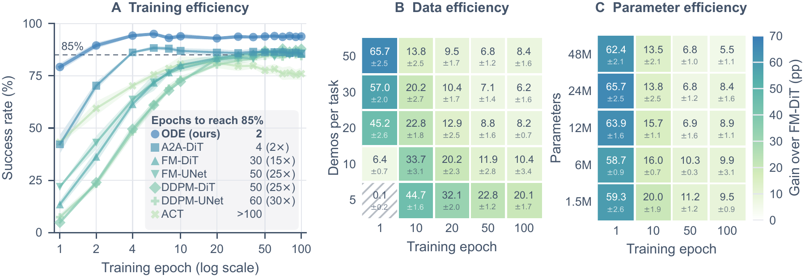

**图 4。** 视觉运动模仿学习的学习效率。LIBERO 成功率在四个套件和三个随机种子上取平均。（A）训练过程中的成功率，阴影表示跨随机种子的标准差。内嵌表列出各方法首次达到 85%（虚线）的训练轮次，以及该轮次相对于 ODE 策略的倍数。（B）每个任务的示范数和（C）编码器外的参数量变化时，ODE 策略相较 FM-DiT 的提升，单位为百分点。

#### 6.1.1 视觉运动模仿学习

**训练效率。** 与 LIBERO 上的六种视觉运动基线相比，ODE 策略从第一轮就学得很快（图 [4](#S6.F4)（A））。训练一轮后，它在 79.2% 的回合中成功，接近最强基线的两倍，而扩散和流匹配策略此时几乎才起步。它在第 2 轮突破 85%，所需轮数比流匹配和扩散策略少一个数量级，在第 100 轮仍然领先。沿机器人的物理时间积分使策略更易学习，同时保住了最终表现。

**数据效率。** 当每个任务使用 5 至 50 条示范时（图 [4](#S6.F4)（B）），从第 10 轮起，ODE 策略在每种数据规模下都领先 FM-DiT，且数据越少，差距越大。每个任务使用 20 条示范时，它在第 100 轮达到 87.7%，超过 FM-DiT 使用全部 50 条时的 85.4%。所用示范不到一半，ODE 策略即可达到 FM-DiT 的表现。

**参数效率。** 将编码器外的参数量从 150 万扩大到 4800 万（图 [4](#S6.F4)（C）），优势几乎不变。最小的 ODE 策略（150 万参数）在第 10 轮达到 92.5%，超过最大的 FM-DiT（4800 万参数）在任何一轮的表现（最高 87.5%）。这一优势源于 ODE 表述本身。

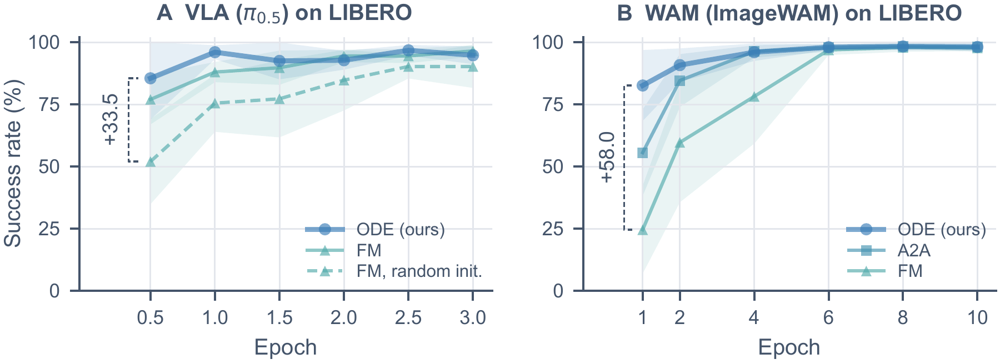

**图 5。** 大规模模仿学习的学习效率。比较 ODE 动作头（本文方法）、原流匹配动作头（FM）及（B）中的 A2A 动作头在 LIBERO 上的成功率，使用一个随机种子。（A）$\pi_{0.5}$ VLA（每个任务 10 个回合）。FM 专家用 $\pi_{0.5}$ 的权重初始化（实线）或随机初始化（虚线）。（B）ImageWAM（每个任务 25 个回合）。括号标出（A）中相对随机初始化 FM 专家的提升，以及（B）中相对原动作头的提升。阴影表示四个套件间的标准差。分套件结果见附录 [B.4](#A2.SS4) 和 [B.5](#A2.SS5)。

#### 6.1.2 大规模模仿学习

为检验优势能否延续到大型预训练模型，我们用随机初始化的 ODE 动作头替换 $\pi_{0.5}$ （[Physical Intelligence et al., 2025](#bib.bib60)） 的动作专家，参数量约为原专家的 3%（图 [5](#S6.F5)（A））。虽然没有预训练动作权重，它在训练早期仍领先两种 FM 专家，第一轮达到 96.0%，随机初始化的 FM 专家为 75.5%，预训练的专家从第二轮起才追上。在拥有 45 亿可训练参数的 ImageWAM 中（图 [5](#S6.F5)（B）），一轮后 ODE 动作头的成功率为 82.6%，原动作头为 24.6%，A2A （[Zuo et al., 2026](#bib.bib82)） 介于两者之间。三种方法从第 6 轮起均收敛。即便动作头只占整个网络的一小部分，ODE 策略在大型预训练模型中仍保持了学习效率。

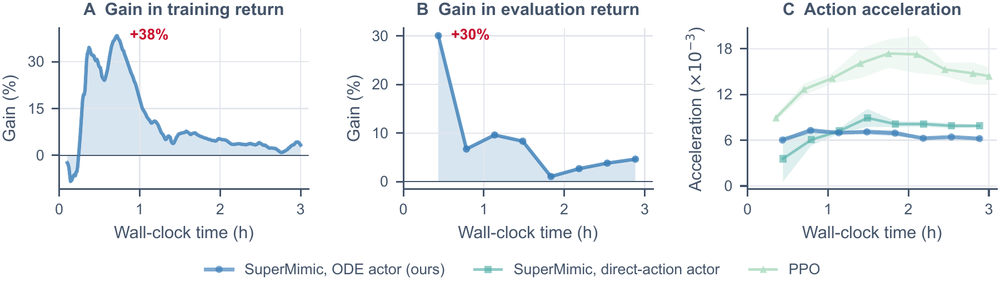

**图 6。** 强化学习的学习效率。在单张 GPU 上，以实际用时为横轴，比较 ODE 行动器、SuperMimic 的直接动作行动器及 PPO 使用 G1 人形机器人跟踪 LAFAN1 全部 40 段片段的表现。（A）ODE 行动器的训练回报提升和（B）在所有片段上的归一化评估回报提升。摔倒后的步数按零回报计，两图均基于三个随机种子的均值。（C）已执行动作的加速度（越低越平滑），报告三个随机种子的均值和标准差。0.4 小时时，直接动作行动器还几乎无法运动。

#### 6.1.3 强化学习

最后，我们替换 SuperMimic 的行动器，沿用其世界模型、评价器、奖励和超参数（图 [6](#S6.F6)）。PPO 以相同训练时间作为无需世界模型的参照。ODE 行动器在早期就取得领先。训练 0.75 小时后，训练回报高出 37%（$0.630\pm 0.007$ 对 $0.460\pm 0.008$）。0.4 小时后，在全部 40 段片段上的回报高出 30%，且一直领先至训练结束（$0.885\pm 0.007$ 对 $0.845\pm 0.009$）。PPO 训练 3 小时后仅达到 $0.452\pm 0.021$（对比见图 [S4](#A2.F4)）。这种差异可能来自沿动作序列传播的梯度路径（第 [4.5](#S4.SS5) 节）。相对于最后一个想象动作，第一个想象动作对应的梯度范数比例，在直接动作行动器中约为 0.57，在 ODE 行动器中为 1.0 至 1.1。因此，早期动作得到更强的学习信号。ODE 策略无需更改算法，就进一步加快了这种原本已相当高效的 RL 方法。

### 6.2 执行质量

接下来，我们考察 ODE 策略生成动作的速度，以及机器人执行动作的平滑程度。

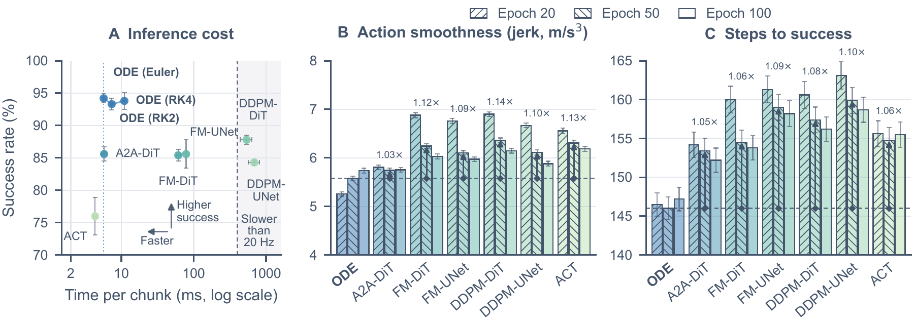

**图 7。** 推理开销与动作平滑度。结果来自 LIBERO。（A）每个 8 动作分块的推理时间与第 100 轮的成功率。阴影区域超出 20 Hz 下 8 个控制步所允许的 400 ms。ODE 策略采用 RK4、RK2 和*欧拉法*（点线）。误差条分别表示一个随机种子的成功回合间推理时间的标准差，以及三个随机种子间成功率的标准差。（B）末端执行器位置的均方根加加速度（jerk）和（C）完成任务所需的控制步数。二者在第 20、50 和 100 轮（用斜线区分）的成功回合上计算，给出三个随机种子相应回合上的标准误。虚线标出 ODE 策略在第 50 轮的表现，箭头标出各基线相对它的倍数（越低越好）。

**推理开销。** 由于求解器对成功率的影响很小（图 [16](#S7.F16)（C）），我们用采用*欧拉法*的 ODE 策略参与比较（图 [7](#S6.F7)（A））。它生成一个包含 8 个动作的分块耗时 5.7 ms，与 A2A-DiT 相当，速度为 FM-DiT 的 10.8 倍、DDPM 的约 100 倍。DDPM 超出 20 Hz 控制器的时间预算。只有 ACT 略快，但成功率低得多。即便采用 RK4，它仍比 FM-DiT 快数倍，在空闲 GPU 上测得的排名也一致（表 [S1](#A2.T1)）。ODE 策略兼具单次前向策略的速度和高于生成式策略的成功率。

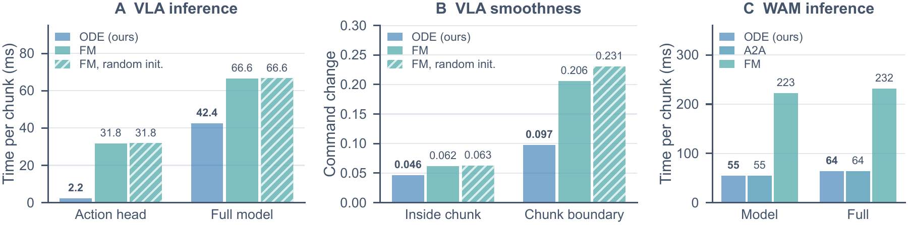

**图 8。** 大模型中的推理开销与动作平滑度。在 LIBERO 上使用一个随机种子所得结果。（A）$\pi_{0.5}$ 在第 3 轮时，每个 8 动作分块的推理用时，分别测量动作头和完整模型，在一张 A100 GPU 上、批量大小为 1。（B）$\pi_{0.5}$ 中，分块内部以及新分块第一步处归一化位置指令的平均变化量。（C）缓存文本特征的 ImageWAM 每分块推理用时，分别测量模型和完整本地流程。带斜线的柱表示随机初始化的动作头。

**大模型中的推理开销。** 在 $\pi_{0.5}$ 中，ODE 动作头每分块只读取一次条件，速度约为采用 10 步去噪的 FM 专家的 14 倍，也为完整模型节省了约三分之一的时间（图 [8](#S6.F8)（A））。分块边界处的指令变化量也约为后者的一半（图 [8](#S6.F8)（B））。在 ImageWAM 中，动作 Transformer 每分块只运行一次，由一个较小的向量场完成积分。原动作头则在 10 个去噪步中每步都运行 Transformer。新方法将每分块用时缩至约四分之一，与 A2A 相当（图 [8](#S6.F8)（C））。此外，ODE 策略每积分得到一个动作就能发给控制器（第 [4.3](#S4.SS3) 节），而基线需要先生成完整的分块。

**动作平滑度。** 在成功回合中，ODE 策略在每个检查点的末端执行器加加速度均最低，并且完成任务所需的控制步比所有基线更少（图 [7](#S6.F7)（B、C））。在 RL 中，训练 3 小时后，ODE 行动器的动作加速度比直接动作行动器低 21%，不到 PPO 的一半（图 [6](#S6.F6)（C））。积分连接相邻动作，无缝分块连接相邻分块（第 [8](#S8) 节），因此实际运动更平滑，执行也更高效。

### 6.3 泛化性能

接下来，我们评估 ODE 策略对训练中未见过的扰动的泛化能力，分别将它用作视觉运动策略，以及 VLA 和 WAM 的动作头。

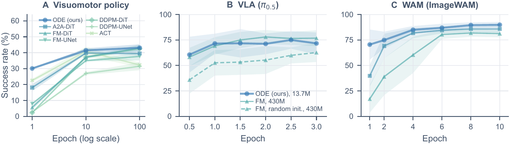

**图 9。** 对未见扰动的泛化。LIBERO-plus 上覆盖全部扰动类型的零样本成功率。（A）视觉运动策略在四个套件上汇总，阴影表示三个随机种子间的标准差。（B）$\pi_{0.5}$ 和（C）ImageWAM 在同一组 2008 个实例上的结果，使用一个随机种子，阴影表示四个套件间的标准差。虚线表示随机初始化的动作头。（B）的图例标出了各动作头的大小。按扰动类型细分的结果见图 [S1](#A2.F1) 和表 [S4](#A2.T4)。

#### 6.3.1 视觉运动模仿学习

在 LIBERO-plus 上进行零样本评估，每种扰动、每个套件使用 50 个扰动实例（图 [9](#S6.F9)（A））。ODE 策略在一轮后明显领先（30.1%，ACT 为 22.6%），之后与最强基线相当。分扰动类型来看（图 [S1](#A2.F1)），它在传感器噪声下领先最多。FM-DiT 和 DDPM-DiT 更擅长应对机器人初始位姿的改变，而相机改变后，各种方法都难以成功。

#### 6.3.2 大规模模仿学习

大型预训练模型的泛化明显强于视觉运动策略（图 [9](#S6.F9)（B、C））。在 $\pi_{0.5}$ 中，ODE 动作头只有约 3% 的参数，且未使用预训练动作权重，却在整个训练过程中领先随机初始化的 FM 专家。在 ImageWAM 中，ODE 策略全程领先，早期优势尤为明显（一轮后达到 70.5%，原动作头为 17.1%）。ODE 策略在训练中更早获得鲁棒性，在真机上也能迁移从其他实验室的公开数据中学得的灵巧技能（第 [7.3](#S7.SS3) 节）。

### 6.4 多模态能力

单一向量场可能会把不同的行为平均掉。我们用一项二维导航任务检验 ODE 策略能否保留示范中的不同模态。智能体须穿过墙上的四个缺口之一到达目标，每条路线有 50 条示范。对路线取平均的策略会撞墙。我们报告成功率和模态均衡度 $\gamma=4\min_{r}p_{r}\in[0,1]$，其中 $p_{r}\in[0,1]$ 为成功轨迹中经过缺口 $r\in\{1,\dots,4\}$ 的比例（图 [10](#S6.F10)）。只需在分块开始时随机改变向量场的方向，就能让积分路径进入另一模态，无需多步生成式采样。

采用多样性头后，ODE 策略从第一轮起就能走遍四条路线（图 [S2](#A2.F2)）。前五轮中，它比 FM-DiT 更均衡。第一轮后，它的 $\gamma$ 是 FM-DiT 的 3.9 倍，成功率也更高。第 10 轮时 FM-DiT 更均衡。到第 20 轮，两者的均衡程度相近，且几乎总能成功。使用初始噪声扰动的 A2A-DiT （[Zuo et al., 2026](#bib.bib82)） 只学到内侧两条路线（$\gamma=0$）。MARS 覆盖全部路线，但学习较慢。ODE 策略学得快，同时保留了多样化行为，在真实双臂任务上也是如此（第 [7.2](#S7.SS2) 节）。

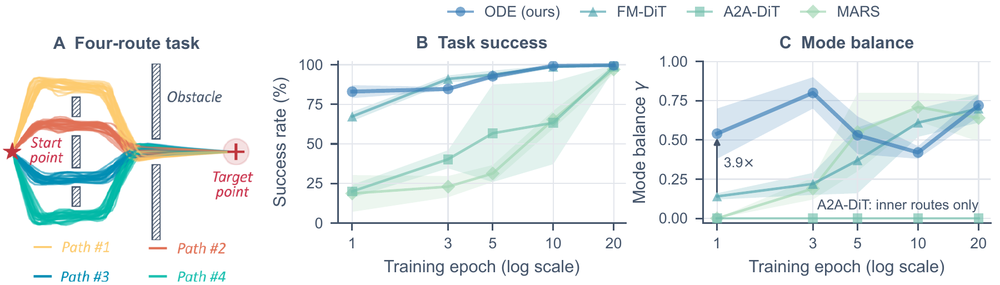

**图 10。** 具有四条可行路线的二维导航任务，用于测试多模态能力。（A）智能体从起点出发，穿过四个缺口之一到达目标。（B）训练过程中的成功率和（C）模态均衡度 $\gamma$，报告三个随机种子的均值和标准差，每个种子进行 100 次轨迹展开。箭头标出训练一轮后 ODE 策略相对 FM-DiT 的 $\gamma$ 倍数。

## 7 真机实验结果

随后，我们将 ODE 策略部署到四种真机上，检验其优势能否延续到高精度、长时程、可变形物体、多模态、灵巧操控和移动操控任务，最后比较不同机器人上的推理开销与平滑度。

### 7.1 单臂机器人

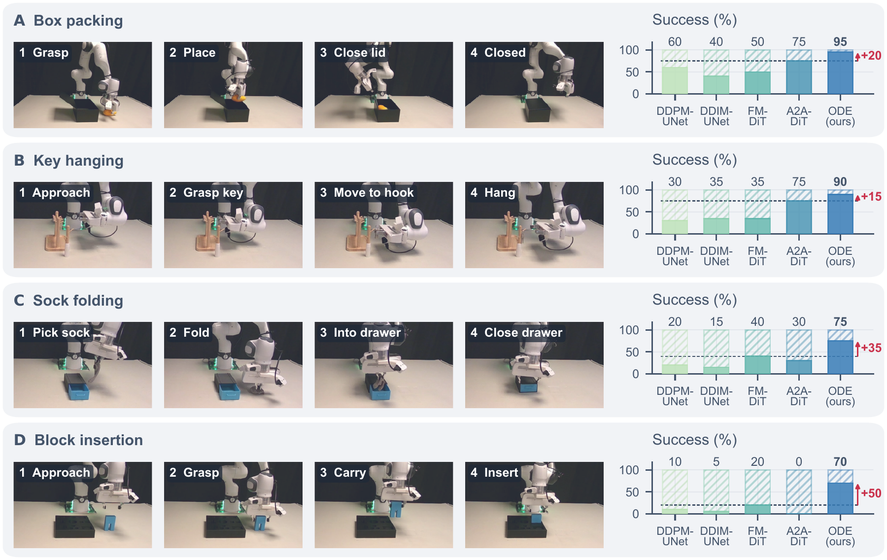

**图 11。** 真实单臂机器人上的任务。ODE 策略控制一台 Franka Research 3 机械臂，每行一项任务。（A）将芒果放入盒中并盖上盒盖。（B）将钥匙挂到钥匙架上。（C）折叠袜子并放入抽屉。（D）将方块插入板上的孔中。右侧是在 20 次试验中的成功率，斜线表示失败试验，箭头从最佳基线指向本文方法。

在 Franka Research 3 机械臂上，每项任务使用 40 条示范，各策略只训练 50 轮，以考察早期表现。ODE 策略在四项任务上均取得最高成功率（图 [11](#S7.F11)）。折袜子和插方块的优势最明显，20 次试验中分别成功 15 次和 14 次，最佳基线分别成功 8 次和 4 次。A2A-DiT 在前两项任务上最接近 ODE 策略，可能是因为它也从先前动作生成每个分块，但所有插入试验均失败。在分块边界，ODE 策略在各任务中的指令加速度也最低，分别为 3.6、1.1、2.5 和 2.2 rad/s2。A2A-DiT 为 2.8 至 9.1 rad/s2，扩散和流匹配基线为 8.3 至 26.0 rad/s2。ODE 策略能以数十条示范，在较短的训练时间内可靠学会多阶段、可变形物体和高精度任务。

### 7.2 双臂机器人

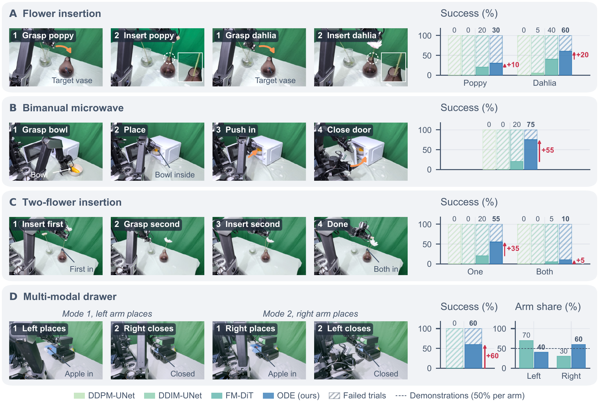

**图 12。** 真实双臂机器人上的四项任务。ODE 策略控制 Galaxea R1 Lite，每行一项任务。（A）将罂粟花或大丽花插入花瓶的窄口（虚线圆圈及放大图）。（B）将碗放入微波炉、推到里面，再关门。（C）先后插入两朵花。（D）任一手臂将苹果放入抽屉，另一手臂关抽屉，每种模态展示两帧。右侧给出每种花或每项任务在 20 次试验中的成功率，斜线表示失败试验，箭头从最佳基线出发。（D）在两臂旁标出了各臂伸向苹果的试验占比，虚线表示示范中的占比。

在 Galaxea R1 Lite 上，我们用四项任务测试 ODE 策略，其中两项需要双臂协作（图 [12](#S7.F12)）。

**高精度与长时程任务。** 插花时，细花茎必须对准花瓶的窄口，罂粟较长的花茎会放大夹爪的微小误差。对两种花，ODE 策略都比 FM-DiT 更常成功（大丽花为 60% 对 40%），可能因为其运动在到达瓶口前始终平滑。微波炉任务仅用 34 条示范训练，ODE 策略的成功率为 75%，FM-DiT 为 20%。FM-DiT 的 16 次失败中有 9 次未关门，ODE 策略的 5 次失败中有 2 次。在同一花瓶中连续插两朵花时，ODE 策略插入第一朵花的成功率远高于 FM-DiT（55% 对 20%），但当瓶中已有一根花茎时，对所有方法而言，插入第二朵都很难。两种扩散策略在这三项任务上几乎每次都失败。由此可见，ODE 策略可将各步误差控制在足够小的范围，满足双臂精细操作和长序列操作的需要。

**多模态任务。** 在抽屉任务中（图 [12](#S7.F12)（D）），一条手臂将苹果放入打开的抽屉，另一条关抽屉，两种分工在示范中出现的频次相等。借助多样性头（第 [4.4](#S4.SS4) 节），ODE 策略采用了两种模态。20 次试验中，8 次由左臂负责放苹果，12 次由右臂负责，分别成功 5 次和 7 次，总成功率为 60%。FM-DiT 的试验也涵盖以两臂分别去拿苹果的情况，但始终未能放入。导航中观察到的多模态能力同样出现在双臂机器人上。

### 7.3 灵巧手

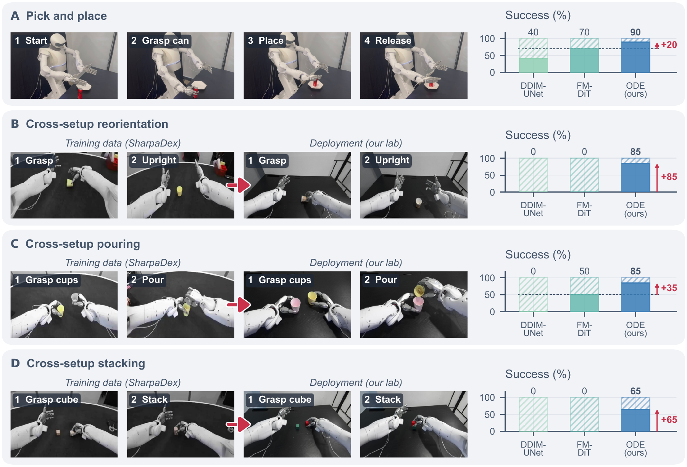

**图 13。** 配备灵巧手的真机任务。ODE 策略控制装有 Sharpa 灵巧手的 Sharpa North 机器人，每行一项任务。（A）拿起罐子并放到盘子里。（B–D）仅用另一实验室的公开示范 （[Sharpa Robotics, 2026](#bib.bib67)）（左）学习，在本实验室部署（右）。（B）扶正倒下的杯子。（C）用双手将药片从一个杯子倒入另一个杯子。（D）将一个立方块叠在另一个上。右侧给出 20 次试验的成功率，斜线表示失败试验，箭头从最佳基线出发。

**用灵巧手抓放。** 在配备 Sharpa 灵巧手的 Sharpa North 机器人上，手部关节大幅扩大了动作空间。使用 50 条示范训练后，ODE 策略在 20 次试验中有 18 次成功拿起罐子并放到盘中。FM-DiT 成功 14 次，DDIM-UNet 成功 8 次（图 [13](#S7.F13)（A））。

**跨实验环境迁移。** 接下来，我们从 SharpaDex 公开数据集 （[Sharpa Robotics, 2026](#bib.bib67)） 中为每项任务选取 50 条示范进行训练。这些示范由 Sharpa 在自己的实验室使用同款机器人和灵巧手录制。我们直接将策略部署到本实验室，无需本地环境的任何示范（图 [13](#S7.F13)（B–D））。扶正倒下的杯子时，杯子和背景均已更换，ODE 策略在 20 次试验中成功 17 次。FM-DiT 从未抓起杯子，DDIM-UNet 则悬停在杯子上方，手以一个分块为周期抖动。双手在两个杯子之间倒药片时，改用不同颜色的杯子，ODE 策略成功 17 次，FM-DiT 成功 10 次，DDIM-UNet 无一成功。叠方块时，示范使用木制方块，测试则要求将红色方块叠到绿色方块上。ODE 策略在 20 次试验中成功 13 次，两种基线均失败。ODE 策略因此能在不同实验环境间迁移技能，这也与其在仿真中对未见扰动的鲁棒性一致（第 [6.3](#S6.SS3) 节）。

### 7.4 人形机器人

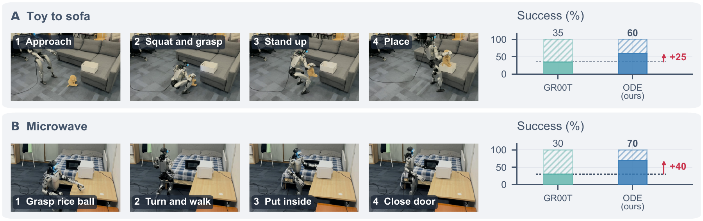

**图 14。** 真实人形机器人的移动操控任务。ODE 策略作为 GR00T N1.7 的动作头，控制装有 Inspire DFX 灵巧手的 Unitree G1 机器人，每行一项任务。（A）走向地上的玩具，蹲下抓取，起身后将其放入沙发上的盒子。（B）从桌上拿起饭团，转身走向微波炉，将饭团放入并关门。右侧给出 20 次试验的成功率，斜线表示失败试验，箭头从基线出发。

最后，我们检验 ODE 策略能否驱动人形机器人的全身运动。在配备 Inspire DFX 灵巧手的 Unitree G1 上，它替换了 GR00T N1.7 （[Bjorck et al., 2025](#bib.bib7)） 的动作头（图 [14](#S7.F14)）。两项任务都是长时程任务，且需要将行走与精准抓取结合起来。在玩具任务中，机器人走向地上的玩具，蹲下抓取，起身后将其放入沙发上的盒子。这要求双腿、躯干和双臂协调运动。在微波炉任务中，机器人从桌上抓起一个小饭团，转身走向微波炉，放入饭团并关门。每项任务用 90 条示范训练 90 轮后，在各 20 次试验中，ODE 策略的成功率分别为 60% 和 70%，GR00T 原动作头分别为 35% 和 30%。由此可见，向量场也能支撑全身移动操控，尽管站姿和抓取的微小误差很可能在长任务中不断累积。

### 7.5 推理开销与平滑度

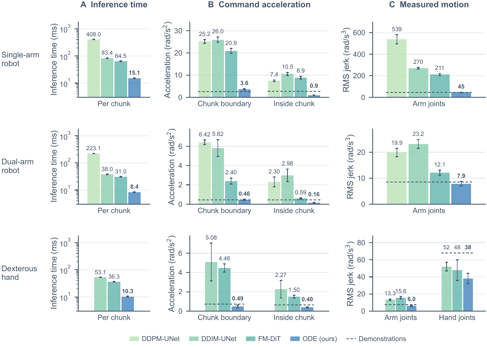

**图 15。** 真机上的推理开销与平滑度。自上而下分别是关盒、微波炉和罐子任务。（A）在单张 RTX 5080、RTX 5090 和 RTX 4090 上测得的每分块推理用时，采用对数刻度。（B）分块边界和分块内部的关节指令加速度。（C）实测关节运动的均方根加加速度。报告各回合的均值和标准差，单臂机器人仅统计成功回合，虚线表示示范。

在前三种机器人上各选一项任务，即关盒、微波炉和罐子任务（图 [15](#S7.F15)）。即使用 RK4，ODE 策略生成分块的速度仍为扩散和流匹配基线的 3.5 至 27 倍。由于每个分块接续上一分块的末尾，ODE 策略在分块边界的指令加速度在双臂机器人和灵巧手上不高于示范，在单臂机器人上也接近示范，而基线会达到示范的数倍。机械臂和手的实测关节加加速度也达到或低于示范水平，基线的机械臂则最高超出一个数量级。A2A-DiT 同样以上一分块的动作为起点，在单臂机器上的运动平滑度与之接近（39 rad/s3），生成分块更快（8.6 ms），但在分块边界的加速度更大（9.1 对 3.6 rad/s2）。附录 [B.6](#A2.SS6) 报告杯子和药片任务上的相同指标。

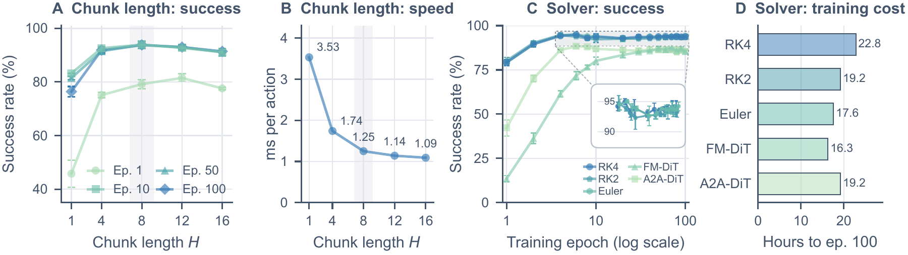

**图 16。** 对分块长度和积分求解器的消融。ODE 策略在 LIBERO 四个套件上的平均结果。（A）分块长度为 $H$ 时，第 1、10、50 和 100 轮的成功率。（B）第 100 轮模型在单张空闲 GPU 上每个动作的推理用时，默认 $H=8$ 用灰色标示。（C）采用三种求解器时训练过程中的成功率，以 FM-DiT 和 A2A-DiT 为参照，附内嵌图以展示求解器之间的差别。（D）训练至第 100 轮的耗时，每次运行用一张 RTX 4090，同时运行 8 次。报告三个随机种子的均值和标准差（$H=16$ 仅用两个种子，第三个训练发散）。

## 8 消融研究

每次固定其余设置，只改变 ODE 策略的一项设计，分别考察分块长度和求解器（图 [16](#S7.F16)），收缩扰动、无缝分块及本体感知的输入位置（图 [17](#S8.F17)），以及多样性头的分量数（图 [18](#S8.F18)）。对推理时的多样性头及向量场架构的消融见附录 [B.8](#A2.SS8)。

**分块长度。** 训练和执行均采用分块长度 $H=1$ 时（图 [16](#S7.F16)（A、B）），策略在第 100 轮的成功率仅为 76.4%，且每个动作耗时最长，因为每一步都要运行编码器。从 $H=4$ 起，成功率始终高于 91%（默认 $H=8$ 的结果最佳），而每个动作的用时持续下降，不过 $H\geq 12$ 在训练时偶尔会出现损失尖峰。这与分块可减轻行为克隆误差累积的发现一致 （[Lazzati et al., 2026](#bib.bib42)；[Park, 2026](#bib.bib56)）。分块是关键，$H=8$ 在成功率和推理用时之间取得平衡。

**积分求解器。** 将 RK4 换成 RK2 或*欧拉法*，第 100 轮的成功率变化不到 1 个百分点，落在随机种子间的波动范围内，且三种求解器在训练全程均领先 FM-DiT 和 A2A-DiT（图 [16](#S7.F16)（C））。开销更小的求解器同时缩短训练和推理时间（图 [16](#S7.F16)（D））。采用*欧拉法*时，训练耗时与 FM-DiT 大致相当，比 A2A-DiT 更短，可见提升并非来自更长的训练。即使用*欧拉法*，每步也应用相同的向量场，说明性能优势来自 ODE 表述，对求解器精度的要求并不高。

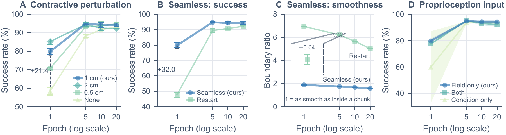

**图 17。** 对收缩扰动、无缝分块和本体感知的消融。ODE 策略在 LIBERO 四个套件上的平均结果，每个任务 10 个回合。（A）不使用收缩扰动，以及采用三个扰动幅度。（B、C）比较无缝分块与从实测状态重启每个分块的成功率及边界比，即分块第一步的指令变化量除以分块内部的变化量。（D）比较本体感知仅输入向量场、同时输入条件和向量场，以及仅输入条件三种方式。（A）和（B）的箭头标出一轮后的差距。报告三个随机种子的均值和标准差。（C）的内嵌图展示最大的标准差。

**收缩扰动。** 去掉收缩扰动后（图 [17](#S8.F17)（A）），训练一轮后的成功率从 79.8% 降至 58.4%，到第 20 轮差距消失。这里每个任务评估 10 个回合，因此默认设置得到的是 79.8%，而非 79.2%。训练初期向量场尚不准确，无缝分块容易偏离示范轨迹。收缩扰动让向量场学会拉回轨迹。增大扰动幅度会加快学习，但用默认幅度的两倍时，后期表现略低，可能因为较大的偏移让向量场偏离了示范中的精细运动。即使不用扰动，ODE 策略一轮后仍大幅领先 FM-DiT 和 A2A-DiT。

**无缝分块。** 每个分块改从实测状态重启（图 [17](#S8.F17)（B、C）），会丢失期望动作相对于实测状态的超前量，将训练一轮后的成功率从 79.8% 降至 47.8%。训练结束后，两种方式的成功率相近，但重启策略在每个分块边界都会跳变，边界比达到无缝分块的 3 至 4 倍，加加速度达到 1.3 至 2.2 倍，回合延长 8% 至 19%。因此，无缝分块对加快学习和平滑执行都至关重要。

**本体感知。** 本体感知仅输入向量场、同时输入条件和向量场、或仅输入条件，这三种方式从第 5 轮起表现相近（图 [17](#S8.F17)（D））。一轮后，仅输入向量场的变体表现最好，而仅输入条件的变体在不同种子间波动很大。将本体感知输入向量场的效果至少与传统方式相当，且能让早期学习更稳定。

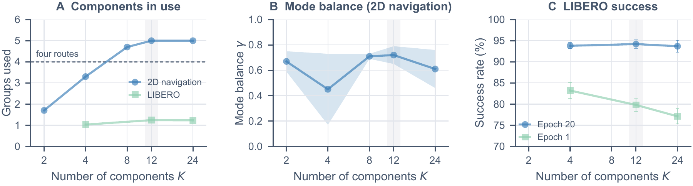

**图 18。** 对分量数的消融。（A）多样性头在二维导航起点和 LIBERO 各状态下使用的不同分量组，四条路线用虚线表示。（B）第 20 轮的导航任务模态均衡度 $\gamma$。（C）第 1 和第 20 轮在 LIBERO 上的成功率，每个任务 10 个回合。报告三个随机种子的均值和标准差，默认 $K=12$ 用灰色标示。

**分量数。** 分量数 $K$ 只限定多样性头能够表示多少种模态（图 [18](#S8.F18)）。在 $K=4$ 时，头无法稳定区分导航任务的四条路线，$\gamma$ 在不同种子间波动很大。从 $K=8$ 起，它在起点使用约五个分量组，接近四条路线的数量，在单模态的 LIBERO 上每个状态约使用一组。较小的 $K$ 在一轮后略好，可能因为尚未训练好的头对动作的偏移较小。到第 20 轮，成功率几乎不随分量数变化。$K$ 只需大于模态数，因此我们统一采用 $K=12$。

## 9 讨论与未来方向

本文提出 ODE 策略，用 ODE 对机器人动作在物理时间中的演化建模，使每个动作都从上一个动作积分得到。在 IL 中，它通过短动作分块内的积分学习向量场。无缝分块让相邻分块无跳变地衔接，收缩扰动则使策略保持在示范轨迹附近。在 LIBERO 上，ODE 策略在第一轮后达到 79.2%，在第 100 轮达到 93.8%。它只用不到一半的示范就能达到 FM-DiT 的表现，并能在 5.7 ms 内生成含 8 个动作的分块。用作 $\pi_{0.5}$ VLA 的动作头时，它以原流匹配专家约 3% 的参数量，在一轮后达到 96.0%，原专家为 75.5%。用作世界动作模型 ImageWAM 的动作头时，一轮后达到 82.6%，原动作头为 24.6%，且分块生成速度是原来的 4.1 倍。在涵盖单臂、双臂、灵巧手和人形机器人的 14 项真机任务上，它在每一项任务中都取得最高成功率，且多数情况下比人类示范更平滑。作为 SuperMimic 的行动器，它在早期训练中就取得更高回报，训练结束时仍为 0.885，对照组为 0.845。

结果表明，将物理运动的连续性直接纳入策略，可以提高机器人策略在学习、数据利用、参数和执行上的效率。这种优势可从小型视觉运动策略扩展到大型预训练模型，也可从 IL 延伸至 RL。把策略视为沿机器人真实时间演化的向量场，还带来了直接动作策略难以自然支持的新用途。下面借助初步实验讨论三个方向，供后续研究探索，最后进一步思考这一向量场可能表征什么。

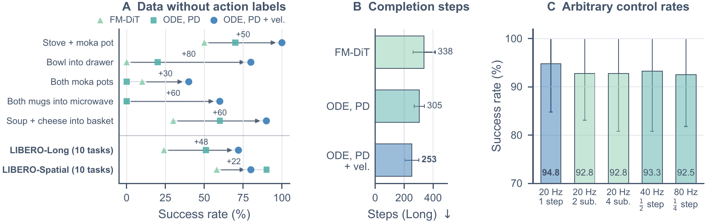

**图 19。** 连续时间向量场的两种潜在用途。（A、B）用无动作标签的数据学习。所有策略都仅在 LIBERO 的实测位姿上训练，并在第 100 轮评估。带 PD $+$ 速度项的 ODE 策略将其向量场给出的速度送入 PD 控制器。（A）五项对时间敏感的 LIBERO-Long 任务的成功率，以及 LIBERO-Long 和 LIBERO-Spatial 各自的平均成功率。（B）Long 套件上成功回合的步数。（C）任意控制频率。部署时只改变已训练模型的积分方式，可以在 20 Hz 下将每个控制步划分为多个子步，也可以用更小的步长，在 40 或 80 Hz 下发出每个中间点。图中报告四个套件的平均成功率。采用一个随机种子，每个任务 10 个回合。（A）中的箭头标出带 PD $+$ 速度项的 ODE 策略较 FM-DiT 的提升。（B）和（C）的误差线表示任务之间的标准差。

### 9.1 从无动作标签的数据中学习

用 UMI 等手持接口采集的数据 （[Chi et al., 2024](#bib.bib13)） 或人类视频 （[Kareer et al., 2026](#bib.bib37)） 记录了实测位姿，却没有给出发送给控制器的指令。如此一来，策略只能学习滞后于目标的实测状态，机器人就会比示范中移动得慢 （[Zhao et al., 2026](#bib.bib78)）。ODE 策略学习的是向量场，无需额外计算即可取得各动作的速度。我们将其送入 PD 控制器的阻尼项，即用 $k_{p}(\mathbf{p}_{\text{ref}}-\mathbf{p})+k_{d}(\dot{\mathbf{p}}_{\text{ref}}-\dot{\mathbf{p}})$ 替代 $k_{p}(\mathbf{p}_{\text{ref}}-\mathbf{p})-k_{d}\dot{\mathbf{p}}$，其中 $\mathbf{p},\mathbf{p}_{\text{ref}}\in\mathbb{R}^{d_{a}}$ 分别为实测位姿和参考位姿，$k_{p},k_{d}\in\mathbb{R}_{>0}$ 分别为比例增益和微分增益。所有策略均只用 LIBERO 的实测位姿训练（图 [19](#S9.F19)（A、B））。加入速度后，机器人能保持示范中的节奏。Long 套件成功回合的步数从 305 减至 253。原先因超时未完成的长任务得以完成，Long 的成功率从 51% 提高到 72%（FM-DiT 为 24%）。不过，移动更快也使精准放置更难，Spatial 上的成功率从 90% 降至 80%。这说明或许可以按任务阶段调节速度，例如在自由空间加快，接近接触时减慢。这类调节易于用向量场表达，用直接动作策略则较难实现。

### 9.2 任意控制频率

ODE 策略是连续时间上的向量场，因此可以在部署时选择积分步长。我们取一个以 20 Hz 训练、每个控制步执行一步 RK4 的模型，部署时仅修改积分方式（图 [19](#S9.F19)（C））。将每个控制步划分为 2 或 4 个积分子步，积分路径最多偏移 1 mm，而相邻动作相距约 10 mm，成功率从 94.8% 变为 92.8%。将步长减至 $1/2$ 或 $1/4$，并发出每个中间点，同一模型即可在 40 或 80 Hz 下运行，每个分块包含 16 或 32 个动作。成功率分别为 93.3% 和 92.5%，完成时间不变。传统策略按训练数据的固定步长输出动作，若要提高频率则须插值。即便以物理时间为条件的策略也使用固定的动作频率 （[Wang et al., 2026](#bib.bib73)）。因此，同一模型无需重新训练就可能服务于不同频率的底层控制器。积分步长甚至可以在线调整，例如在精确控制最重要的接触附近缩小步长。

### 9.3 离散动作信号

ODE 描述连续变化的信号，但 ODE 策略依然擅长接触任务。例如，在 LIBERO 的 8 项接触密集任务上，第 10 轮达到 96.2%，而 FM-DiT 为 78.8%。有些机器人（如 LIBERO 中的机器人）的夹爪指令为二值信号，我们的真机则使用连续的夹爪指令。上述 LIBERO 实验用单独的分类头预测二值指令。这个简单的头效果良好，机械臂的平滑运动仍由向量场负责。为单独考察 ODE，我们把夹爪作为向量场的另一项状态一起积分，发送该状态的符号，并用上一条夹爪指令作为每个分块的夹爪状态初值。在没有额外设计的情况下，第 1、5 和 10 轮的成功率分别从 79.2%、95.0% 和 92.8% 降至 74.5%、91.8% 和 92.2%。下降主要发生在需要反复抓取和释放的 Long 套件。即便如此，它在第 1 轮（74.5% 对最高 43.2%）和第 10 轮（92.2% 对最高 86.9%）仍领先所有基线。能够处理不连续动力学的神经 ODE，例如使用可学习事件函数 （[Chen et al., 2021a](#bib.bib11)） 或跳跃项 （[Jia and Benson, 2019](#bib.bib35)） 的方法，或许可以进一步提升 ODE 策略的能力。

无示范情况下学得的动作也未必连续。我们早期的无模型 RL 实验中，学得的动作经常在控制步之间跳变，柔顺的 PD 控制器仍能让运动保持平滑。这时，ODE 策略带来的提升很小，有时甚至适得其反，可能是因为连续性的要求也平滑了探索过程。这类跳变通常被视为问题，因为它们增大电机负载并扩大仿真与现实的差距，因此机器人 RL 一般会惩罚动作变化 （[Mysore et al., 2021](#bib.bib54)；[Rudin et al., 2022](#bib.bib64)）。ODE 策略最适合指令本身需要平滑的场景，例如模仿示范或部署到硬件。

### 9.4 动作是意图的逐步展开

在物理学中，微分方程描述状态如何变化。机器人的动作则是指令，表达下一步去往何处的意图。这种意图是否也遵循类似规律，并不显而易见。神经科学提供了一些线索。猴子伸手时，运动皮层的活动从准备状态出发，像动力系统一样演化，运动由此逐步展开，远不止对目标进行编码 （[Churchland et al., 2012](#bib.bib15)；[Shenoy et al., 2013](#bib.bib68)）。人类伸手的动作也很平滑，接近最小加加速度轨迹 （[Flash and Hogan, 1985](#bib.bib19)）。ODE 策略也以类似方式工作。在每个分块的起点，它先作出一个离散选择，例如由哪条手臂放苹果，随后向量场将这个选择展开为运动。因此，策略也许只需在任务的少数关键时刻作决定，例如模态分岔时，其余交给学得的动力学。

## 致谢

感谢 Sharpa Robotics 公开 SharpaDex 数据集 （[Sharpa Robotics, 2026](#bib.bib67)）。我们用其中的示范训练了扶正杯子、倾倒药片和堆叠方块三项任务。感谢他们就 Sharpa North 机器人及 Sharpa 灵巧手提供支持。

## 参考文献

An et al. (2026) — Tuo An, Jindou Jia, Gen Li, Jingliang Li, Chuhao Zhou, Pengfei Liu, Bofan Lyu, Jiaqi Bai, Xinying Guo, Geng Li, and Jianfei Yang. Feedback world model enables precise guidance of diffusion policy. In *Proceedings of the Conference on Neural Information Processing Systems*, 2026.

Bahl et al. (2020) — Shikhar Bahl, Mustafa Mukadam, Abhinav Gupta, and Deepak Pathak. Neural dynamic policies for end-to-end sensorimotor learning. In *Proceedings of the Conference on Neural Information Processing Systems*, 2020.

Bai et al. (2026) — Jiaqi Bai, Jindou Jia, Yuxuan Hu, Gen Li, Xiangyu Chen, Tuo An, Kuangji Zuo, and Jianfei Yang. FLASH: Efficient visuomotor policy via sparse sampling. In *Proceedings of the Conference on Neural Information Processing Systems*, 2026.

Beik-Mohammadi et al. (2024) — Hadi Beik-Mohammadi, Søren Hauberg, Georgios Arvanitidis, Nadia Figueroa, Gerhard Neumann, and Leonel Rozo. Neural contractive dynamical systems. In *Proceedings of the International Conference on Learning Representations*, 2024.

Bhatt et al. (2024) — Aditya Bhatt, Daniel Palenicek, Boris Belousov, Max Argus, Artemij Amiranashvili, Thomas Brox, and Jan Peters. CrossQ: Batch normalization in deep reinforcement learning for greater sample efficiency and simplicity. In *Proceedings of the International Conference on Learning Representations*, 2024.

Bishop (1994) — Christopher M. Bishop. Mixture density networks. Technical Report NCRG/94/004, Aston University, 1994.

Bjorck et al. (2025) — Johan Bjorck, Fernando Castañeda, Nikita Cherniadev, Xingye Da, Runyu Ding, Linxi Fan, Yu Fang, Dieter Fox, Fengyuan Hu, Spencer Huang, et al. GR00T N1: An open foundation model for generalist humanoid robots. *arXiv preprint arXiv:2503.14734*, 2025.

Black et al. (2024) — Kevin Black, Noah Brown, Danny Driess, Adnan Esmail, Michael Equi, Chelsea Finn, Niccolo Fusai, Lachy Groom, Karol Hausman, Brian Ichter, et al. $\pi_{0}$: A vision-language-action flow model for general robot control. *arXiv preprint arXiv:2410.24164*, 2024.

Black et al. (2025) — Kevin Black, Manuel Galliker, and Sergey Levine. Real-time execution of action chunking flow policies. In *Proceedings of the Conference on Neural Information Processing Systems*, volume 38, 2025.

Chen et al. (2018) — Ricky T. Q. Chen, Yulia Rubanova, Jesse Bettencourt, and David Duvenaud. Neural ordinary differential equations. In *Proceedings of the Conference on Neural Information Processing Systems*, 2018.

Chen et al. (2021a) — Ricky T. Q. Chen, Brandon Amos, and Maximilian Nickel. Learning neural event functions for ordinary differential equations. In *Proceedings of the International Conference on Learning Representations*, 2021a.

Chen et al. (2021b) — Xinyue Chen, Che Wang, Zijian Zhou, and Keith W. Ross. Randomized ensembled double Q-learning: Learning fast without a model. In *Proceedings of the International Conference on Learning Representations*, 2021b.

Chi et al. (2024) — Cheng Chi, Zhenjia Xu, Chuer Pan, Eric Cousineau, Benjamin Burchfiel, Siyuan Feng, Russ Tedrake, and Shuran Song. Universal manipulation interface: In-the-wild robot teaching without in-the-wild robots. In *Proceedings of Robotics: Science and Systems*, 2024.

Chi et al. (2025) — Cheng Chi, Zhenjia Xu, Siyuan Feng, Eric Cousineau, Yilun Du, Benjamin Burchfiel, Russ Tedrake, and Shuran Song. Diffusion policy: Visuomotor policy learning via action diffusion. *The International Journal of Robotics Research*, 2025.

Churchland et al. (2012) — Mark M. Churchland, John P. Cunningham, Matthew T. Kaufman, Justin D. Foster, Paul Nuyujukian, Stephen I. Ryu, and Krishna V. Shenoy. Neural population dynamics during reaching. *Nature*, 2012.

Dai et al. (2026) — Meipo Dai, Qiyuan Zhuang, He-Yang Xu, Ying-Jie Shuai, Yijun Wang, Qi Dou, and Xiu-Shen Wei. Where should action generation begin? A learnable source prior for generative robot policies. *arXiv preprint arXiv:2606.17408*, 2026.

Fang et al. (2025) — Han Fang, Yize Huang, Yuheng Zhao, Paul Weng, Xiao Li, and Yutong Ban. OMP: One-step meanflow policy with directional alignment. *arXiv preprint arXiv:2512.19347*, 2025.

Fei et al. (2025) — Senyu Fei, Siyin Wang, Junhao Shi, Zihao Dai, Jikun Cai, Pengfang Qian, Li Ji, Xinzhe He, Shiduo Zhang, Zhaoye Fei, et al. LIBERO-Plus: In-depth robustness analysis of vision-language-action models. *arXiv preprint arXiv:2510.13626*, 2025.

Flash and Hogan (1985) — Tamar Flash and Neville Hogan. The coordination of arm movements: An experimentally confirmed mathematical model. *Journal of Neuroscience*, 1985.

Gao et al. (2026) — Dechen Gao, Boqi Zhao, Andrew Lee, Ian Chuang, Hanchu Zhou, Hang Wang, Zhe Zhao, Junshan Zhang, and Iman Soltani. VITA: Vision-to-action flow matching policy. In *Proceedings of the International Conference on Learning Representations*, 2026.

Geng et al. (2025) — Zhengyang Geng, Mingyang Deng, Xingjian Bai, Zico Kolter, and Kaiming He. Mean flows for one-step generative modeling. In *Proceedings of the Conference on Neural Information Processing Systems*, volume 38, 2025.

Hansen et al. (2024) — Nicklas Hansen, Hao Su, and Xiaolong Wang. TD-MPC2: Scalable, robust world models for continuous control. In *Proceedings of the International Conference on Learning Representations*, 2024.

Harvey et al. (2020) — Félix G. Harvey, Mike Yurick, Derek Nowrouzezahrai, and Christopher Pal. Robust motion in-betweening. *ACM Transactions on Graphics*, 39(4):60, 2020.

Hasani et al. (2022) — Ramin Hasani, Mathias Lechner, Alexander Amini, Lucas Liebenwein, Aaron Ray, Max Tschaikowski, Gerald Teschl, and Daniela Rus. Closed-form continuous-time neural networks. *Nature Machine Intelligence*, 2022.

He et al. (2016) — Kaiming He, Xiangyu Zhang, Shaoqing Ren, and Jian Sun. Deep residual learning for image recognition. In *Proceedings of the IEEE Conference on Computer Vision and Pattern Recognition*, 2016.

Hiraoka et al. (2022) — Takuya Hiraoka, Takahisa Imagawa, Taisei Hashimoto, Takashi Onishi, and Yoshimasa Tsuruoka. Dropout Q-functions for doubly efficient reinforcement learning. In *Proceedings of the International Conference on Learning Representations*, 2022.

Ho et al. (2020) — Jonathan Ho, Ajay Jain, and Pieter Abbeel. Denoising diffusion probabilistic models. In *Proceedings of the Conference on Neural Information Processing Systems*, 2020.

Hou et al. (2026) — Bohan Hou, Gen Li, Jindou Jia, Tuo An, Xinying Guo, Sicong Leng, Haoran Geng, Yanjie Ze, Tatsuya Harada, Philip Torr, Oier Mees, Marc Pollefeys, Zhuang Liu, Jiajun Wu, Pieter Abbeel, Jitendra Malik, Yilun Du, and Jianfei Yang. World model for robot learning: A comprehensive survey. *The International Journal of Robotics Research*, 2026.

Ijspeert et al. (2013) — Auke Jan Ijspeert, Jun Nakanishi, Heiko Hoffmann, Peter Pastor, and Stefan Schaal. Dynamical movement primitives: Learning attractor models for motor behaviors. *Neural Computation*, 2013.

Jia et al. (2025a) — Jindou Jia, Kexin Guo, Yuyang Wang, Sicheng Zhou, Jiayi Zhang, Yuhang Liu, Xiang Yu, Yang Shi, and Lei Guo. FORESEER: Recognize and utilize uncertainties by integrating data-based learning and symbolic feedback. *The International Journal of Robotics Research*, 2025a.

Jia et al. (2025b) — Jindou Jia, Zihan Yang, Meng Wang, Kexin Guo, Jianfei Yang, Xiang Yu, and Lei Guo. Feedback favors the generalization of neural ODEs. In *Proceedings of the International Conference on Learning Representations*, 2025b.

Jia et al. (2026a) — Jindou Jia, Tuo An, Yuxuan Hu, Gen Li, Jingliang Li, Bohan Hou, Xiangyu Chen, Jiaqi Bai, Bofan Lyu, and Jianfei Yang. MARS policy: Multimodality only when it matters. *arXiv preprint arXiv:2605.29766*, 2026a.

Jia et al. (2026b) — Jindou Jia, Shixuan Han, Meng Wang, Gen Li, Zihan Yang, Sicheng Zhou, Kexin Guo, Jianfei Yang, Xiang Yu, Wei Wang, and Lei Guo. Physics filtering favors the generalization of robot learning. *npj Robotics*, 2026b.

Jia et al. (2026c) — Jindou Jia, Gen Li, Xiangyu Chen, Tuo An, Yuxuan Hu, Jingliang Li, Xinying Guo, and Jianfei Yang. Action-to-action flow matching. In *Proceedings of Robotics: Science and Systems*, 2026c.

Jia and Benson (2019) — Junteng Jia and Austin R. Benson. Neural jump stochastic differential equations. In *Proceedings of the Conference on Neural Information Processing Systems*, 2019.

Jiang et al. (2025) — Sunshine Jiang, Xiaolin Fang, Nicholas Roy, Tomás Lozano-Pérez, Leslie Pack Kaelbling, and Siddharth Ancha. Streaming flow policy: Simplifying diffusion/flow-matching policies by treating action trajectories as flow trajectories. In *Proceedings of the Conference on Robot Learning*, Proceedings of Machine Learning Research, 2025.

Kareer et al. (2026) — Simar Kareer, Karl Pertsch, James Darpinian, Judy Hoffman, Danfei Xu, Sergey Levine, Chelsea Finn, and Suraj Nair. Emergence of human to robot transfer in vision-language-action models. In *Proceedings of Robotics: Science and Systems*, 2026.

Khansari-Zadeh and Billard (2011) — S. Mohammad Khansari-Zadeh and Aude Billard. Learning stable nonlinear dynamical systems with Gaussian mixture models. *IEEE Transactions on Robotics*, 2011.

Khatib (1987) — Oussama Khatib. A unified approach for motion and force control of robot manipulators: The operational space formulation. *IEEE Journal on Robotics and Automation*, 1987.

Kim et al. (2026) — Donghu Kim, Youngdo Lee, Minho Park, Kinam Kim, Takuma Seno, I. Made Aswin Nahrendra, Sehee Min, Daniel Palenicek, Florian Vogt, Danica Kragic, Jan Peters, Jaegul Choo, and Hojoon Lee. FlashSAC: Fast and stable off-policy reinforcement learning for high-dimensional robot control. In *Proceedings of Robotics: Science and Systems*, 2026.

Kim et al. (2025) — Moo Jin Kim, Karl Pertsch, Siddharth Karamcheti, Ted Xiao, Ashwin Balakrishna, Suraj Nair, Rafael Rafailov, Ethan P. Foster, Pannag R. Sanketi, Quan Vuong, Thomas Kollar, Benjamin Burchfiel, Russ Tedrake, Dorsa Sadigh, Sergey Levine, Percy Liang, and Chelsea Finn. OpenVLA: An open-source vision-language-action model. In *Proceedings of the Conference on Robot Learning*, volume 270 of *Proceedings of Machine Learning Research*, pages 2679–2713, 2025.

Lazzati et al. (2026) — Filippo Lazzati, Kyle Stachowicz, William Chen, Alberto Maria Metelli, Andrew Wagenmaker, and Sergey Levine. Why does action chunking improve behavioral cloning performance in robotic control? *arXiv preprint arXiv:2608.02547*, 2026.

Lee et al. (2025) — Hojoon Lee, Dongyoon Hwang, Donghu Kim, Hyunseung Kim, Jun Jet Tai, Kaushik Subramanian, Peter R. Wurman, Jaegul Choo, Peter Stone, and Takuma Seno. SimBa: Simplicity bias for scaling up parameters in deep reinforcement learning. In *Proceedings of the International Conference on Learning Representations*, 2025.

Li et al. (2026) — Shaolong Li, Lichao Sun, and Yongchao Chen. One-step flow policy: Self-distillation for fast visuomotor policies. *arXiv preprint arXiv:2603.12480*, 2026.

Liao et al. (2026a) — Qiayuan Liao, Yiyang Shao, Junfeng Long, Kevin Zakka, Roberto Horowitz, Pieter Abbeel, and Koushil Sreenath. SuperMimic: Scaling humanoid whole-body control with one differentiable world model. *arXiv preprint arXiv:2610.28480*, 2026a.

Liao et al. (2026b) — Qiayuan Liao, Takara E. Truong, Xiaoyu Huang, Yuman Gao, Guy Tevet, Koushil Sreenath, and C. Karen Liu. BeyondMimic: From motion tracking to versatile humanoid control via guided diffusion. *Science Robotics*, 11(117):eadx8924, 2026b.

Lipman et al. (2023) — Yaron Lipman, Ricky T. Q. Chen, Heli Ben-Hamu, Maximilian Nickel, and Matt Le. Flow matching for generative modeling. In *Proceedings of the International Conference on Learning Representations*, 2023.

Liu et al. (2023a) — Bo Liu, Yifeng Zhu, Chongkai Gao, Yihao Feng, Qiang Liu, Yuke Zhu, and Peter Stone. LIBERO: Benchmarking knowledge transfer for lifelong robot learning. In *Proceedings of the Conference on Neural Information Processing Systems*, 2023a.

Liu et al. (2023b) — Xingchao Liu, Chengyue Gong, and Qiang Liu. Flow straight and fast: Learning to generate and transfer data with rectified flow. In *Proceedings of the International Conference on Learning Representations*, 2023b.

Loshchilov and Hutter (2019) — Ilya Loshchilov and Frank Hutter. Decoupled weight decay regularization. In *Proceedings of the International Conference on Learning Representations*, 2019.

Luo et al. (2025) — Jianlan Luo, Charles Xu, Jeffrey Wu, and Sergey Levine. Precise and dexterous robotic manipulation via human-in-the-loop reinforcement learning. *Science Robotics*, 2025.

Ma et al. (2026) — Zirun Ma, Jindou Jia, Tuo An, Jiaqi Bai, Jiahua Dong, and Jianfei Yang. MOSS: Mode-oriented source shaping for robot flow matching policies. *arXiv preprint arXiv:2610.22193*, 2026.

Mittal et al. (2023) — Mayank Mittal, Calvin Yu, Qinxi Yu, Jingzhou Liu, Nikita Rudin, David Hoeller, Jia Lin Yuan, Ritvik Singh, Yunrong Guo, Hammad Mazhar, Ajay Mandlekar, Buck Babich, Gavriel State, Marco Hutter, and Animesh Garg. Orbit: A unified simulation framework for interactive robot learning environments. *IEEE Robotics and Automation Letters*, 2023.

Mysore et al. (2021) — Siddharth Mysore, Bassel Mabsout, Renato Mancuso, and Kate Saenko. Regularizing action policies for smooth control with reinforcement learning. In *Proceedings of the IEEE International Conference on Robotics and Automation*, 2021.

Pan et al. (2026) — Chaoyi Pan, Giridharan Anantharaman, Nai-Chieh Huang, Claire Jin, Daniel Pfrommer, Chenyang Yuan, Frank Permenter, Guannan Qu, Nicholas Boffi, Guanya Shi, and Max Simchowitz. Much ado about noising: Dispelling the myths of generative robotic control. In *Proceedings of the International Conference on Learning Representations*, 2026.

Park (2026) — Seohong Park. Behavioral cloning mystery. Blog post, August 2026. [https://seohong.me/blog/behavioral-cloning-mystery/](https://seohong.me/blog/behavioral-cloning-mystery/).

Peebles and Xie (2023) — William Peebles and Saining Xie. Scalable diffusion models with transformers. In *Proceedings of the IEEE/CVF International Conference on Computer Vision*, 2023.

Peng et al. (2020) — Xue Bin Peng, Erwin Coumans, Tingnan Zhang, Tsang-Wei Edward Lee, Jie Tan, and Sergey Levine. Learning agile robotic locomotion skills by imitating animals. In *Proceedings of Robotics: Science and Systems*, 2020.

Perez et al. (2018) — Ethan Perez, Florian Strub, Harm De Vries, Vincent Dumoulin, and Aaron Courville. FiLM: Visual reasoning with a general conditioning layer. In *Proceedings of the AAAI Conference on Artificial Intelligence*, 2018.

Physical Intelligence et al. (2025) — Physical Intelligence, Kevin Black, Noah Brown, James Darpinian, Karan Dhabalia, Danny Driess, Adnan Esmail, Michael Equi, Chelsea Finn, Niccolo Fusai, et al. $\pi_{0.5}$: A vision-language-action model with open-world generalization. *arXiv preprint arXiv:2504.16054*, 2025.

Pomerleau (1989) — Dean A. Pomerleau. ALVINN: An autonomous land vehicle in a neural network. In *Proceedings of the Conference on Neural Information Processing Systems*, volume 1, 1989.

Radford et al. (2021) — Alec Radford, Jong Wook Kim, Chris Hallacy, Aditya Ramesh, Gabriel Goh, Sandhini Agarwal, Girish Sastry, Amanda Askell, Pamela Mishkin, Jack Clark, Gretchen Krueger, and Ilya Sutskever. Learning transferable visual models from natural language supervision. In *Proceedings of the International Conference on Machine Learning*, 2021.

Raffin et al. (2022) — Antonin Raffin, Jens Kober, and Freek Stulp. Smooth exploration for robotic reinforcement learning. In *Proceedings of the Conference on Robot Learning*, 2022.

Rudin et al. (2022) — Nikita Rudin, David Hoeller, Philipp Reist, and Marco Hutter. Learning to walk in minutes using massively parallel deep reinforcement learning. In *Proceedings of the Conference on Robot Learning*, 2022.

Scholz and Turner (2025) — Jonas Scholz and Richard E. Turner. Warm starts accelerate conditional diffusion. *arXiv preprint arXiv:2507.09212*, 2025.

Schulman et al. (2017) — John Schulman, Filip Wolski, Prafulla Dhariwal, Alec Radford, and Oleg Klimov. Proximal policy optimization algorithms. *arXiv preprint arXiv:1707.06347*, 2017.

Sharpa Robotics (2026) — Sharpa Robotics. SharpaDex-v1.0: A dexterous manipulation dataset. Dataset on Hugging Face, 2026. [https://huggingface.co/datasets/Sharpa-Robotics/SharpaDex-v1.0](https://huggingface.co/datasets/Sharpa-Robotics/SharpaDex-v1.0).

Shenoy et al. (2013) — Krishna V. Shenoy, Maneesh Sahani, and Mark M. Churchland. Cortical control of arm movements: A dynamical systems perspective. *Annual Review of Neuroscience*, 2013.

Sochopoulos et al. (2024) — Andreas Sochopoulos, Michael Gienger, and Sethu Vijayakumar. Learning deep dynamical systems using stable neural ODEs. In *Proceedings of the IEEE/RSJ International Conference on Intelligent Robots and Systems*, 2024.

Song et al. (2021) — Jiaming Song, Chenlin Meng, and Stefano Ermon. Denoising diffusion implicit models. In *Proceedings of the International Conference on Learning Representations*, 2021.

Song et al. (2023) — Yang Song, Prafulla Dhariwal, Mark Chen, and Ilya Sutskever. Consistency models. In *Proceedings of the International Conference on Machine Learning*, 2023.

Totsila et al. (2023) — Dionis Totsila, Konstantinos Chatzilygeroudis, Denis Hadjivelichkov, Valerio Modugno, Ioannis Hatzilygeroudis, and Dimitrios Kanoulas. End-to-end stable imitation learning via autonomous neural dynamic policies. *arXiv preprint arXiv:2305.12886*, 2023.

Wang et al. (2026) — Changhao Wang, Jaden Clark, and Shuran Song. Chronos policy: Learning robot policies on physical time. *arXiv preprint arXiv:2610.13929*, 2026.

Wu and He (2018) — Yuxin Wu and Kaiming He. Group normalization. In *Proceedings of the European Conference on Computer Vision*, 2018.

Yildiz et al. (2021) — Cagatay Yildiz, Markus Heinonen, and Harri Lähdesmäki. Continuous-time model-based reinforcement learning. In *Proceedings of the International Conference on Machine Learning*, 2021.

Zhang et al. (2025) — Qinglun Zhang, Zhen Liu, Haoqiang Fan, Guanghui Liu, Bing Zeng, and Shuaicheng Liu. FlowPolicy: Enabling fast and robust 3D flow-based policy via consistency flow matching for robot manipulation. In *Proceedings of the AAAI Conference on Artificial Intelligence*, 2025.

Zhang et al. (2026) — Yuyang Zhang, Wenyao Zhang, Zekun Qi, He Zhang, Haitao Lin, Jingbo Zhang, Yao Mu, Xiaokang Yang, Wenjun Zeng, and Xin Jin. ImageWAM: Do world action models really need video generation, or just image editing? *arXiv preprint arXiv:2606.19531*, 2026.

Zhao et al. (2026) — Mengfei Zhao, Chenxi Jiang, Tuo An, Jindou Jia, and Jianfei Yang. APEX: Adaptive policy execution for precise manipulation. *arXiv preprint arXiv:2606.16504*, 2026.

Zhao et al. (2023) — Tony Z. Zhao, Vikash Kumar, Sergey Levine, and Chelsea Finn. Learning fine-grained bimanual manipulation with low-cost hardware. In *Proceedings of Robotics: Science and Systems*, 2023.

Zhu et al. (2020) — Yuke Zhu, Josiah Wong, Ajay Mandlekar, Roberto Martín-Martín, Abhishek Joshi, Soroush Nasiriany, and Yifeng Zhu. robosuite: A modular simulation framework and benchmark for robot learning. *arXiv preprint arXiv:2009.12293*, 2020.

Zitkovich et al. (2023) — Brianna Zitkovich, Tianhe Yu, Sichun Xu, Peng Xu, Ted Xiao, Fei Xia, Jialin Wu, Paul Wohlhart, Stefan Welker, Ayzaan Wahid, Quan Vuong, Vincent Vanhoucke, Huong Tran, Radu Soricut, Anikait Singh, Jaspiar Singh, Pierre Sermanet, Pannag R. Sanketi, Grecia Salazar, Michael S. Ryoo, Krista Reymann, Kanishka Rao, Karl Pertsch, Igor Mordatch, Henryk Michalewski, Yao Lu, Sergey Levine, Lisa Lee, Tsang-Wei Edward Lee, Isabel Leal, Yuheng Kuang, Dmitry Kalashnikov, Ryan Julian, Nikhil J. Joshi, Alex Irpan, Brian Ichter, Jasmine Hsu, Alexander Herzog, Karol Hausman, Keerthana Gopalakrishnan, Chuyuan Fu, Pete Florence, Chelsea Finn, Kumar Avinava Dubey, Danny Driess, Tianli Ding, Krzysztof Marcin Choromanski, Xi Chen, Yevgen Chebotar, Justice Carbajal, Noah Brown, Anthony Brohan, Montserrat Gonzalez Arenas, and Kehang Han. RT-2: Vision-language-action models transfer web knowledge to robotic control. In *Proceedings of the Conference on Robot Learning*, volume 229 of *Proceedings of Machine Learning Research*, pages 2165–2183, 2023.

Zuo et al. (2026) — Kuangji Zuo, Tuo An, Xinying Guo, Gen Li, Mengfei Zhao, Jiaqi Bai, Bofan Lyu, Zhuoyuan Yu, Jinghan Yang, Jiayi Li, Jindou Jia, and Jianfei Yang. $\Delta$ flow matching for robot foundation models. *arXiv preprint arXiv:2610.15794*, 2026.

## 附录目录

- [A 实验细节](#A1)
- [B 补充结果](#A2)
  - [B.1 执行质量](#A2.SS1)
  - [B.2 泛化](#A2.SS2)
  - [B.3 多模态性](#A2.SS3)
  - [B.4 视觉-语言-动作模型](#A2.SS4)
  - [B.5 世界动作模型](#A2.SS5)
  - [B.6 真机实验](#A2.SS6)
  - [B.7 强化学习](#A2.SS7)
  - [B.8 消融研究](#A2.SS8)

## 附录 A 实验细节

**仿真基准。** LIBERO 有四个套件（Object、Spatial、Goal 和 Long），每个套件含 10 项任务，每项任务有 50 条示范。我们在全部 40 项任务上训练一个模型，再按套件分别评估。LIBERO-plus 会对相机、机器人初始位姿、物体布局、背景、照明和传感器噪声施加扰动。$\pi_{0.5}$ 和 ImageWAM 在 LIBERO 和同一组 2008 个 LIBERO-plus 实例上测试，后者还对语言指令施加扰动。

**单臂机器人任务。** Franka Research 3 机械臂的四项任务均使用多台相机，以关节角度作为动作。盒子任务要求将一个芒果放进盒子，再盖上盒盖。用 SpaceMouse 和 HIL-SERL 遥操作框架 （[Luo et al., 2025](#bib.bib51)） 采集了 40 条示范。钥匙任务要求抓起钥匙，挂到木质钥匙架的挂钩上，使用同样方式采集的 40 条示范训练。袜子任务要求从小柜子顶部拿起一只袜子，在桌上折好，放入打开的抽屉，再关上抽屉，用 40 条示范训练。插入任务要求抓起一个蓝色方块，将其插入黑色板上与之匹配的孔中，用 40 条示范训练。该机器人的推理时间在单张 RTX 5080 上测量。

**双臂机器人任务。** 双臂机器人和灵巧手机器人的所有任务都以 15 Hz 的频率使用关节角作为动作。插花任务中，Galaxea R1 Lite 的一条手臂从玻璃花瓶中抓起长茎罂粟花或短茎大丽花，将细茎插入另一只花瓶的窄口。夹爪位姿的微小误差就足以让花茎错过瓶口。使用两种花的共 95 条示范（罂粟 38 条，大丽花 57 条）联合训练同一模型，使用一台头部相机和一台腕部相机。在微波炉任务中，一条手臂抓起一碗玉米，将碗放入微波炉并推到里面，另一条手臂随后关门。该任务用 34 条示范训练，使用一台头部相机和两台腕部相机。在双花任务中，一条手臂先后将两朵花插入同一只花瓶，用 95 条示范训练。在抽屉任务中，一条手臂将柜顶上的苹果放进敞开的抽屉，另一条手臂关闭抽屉。示范包括两种手臂分工，左臂和右臂放苹果的示范各 25 条，使用一台头部相机和两台腕部相机。

**灵巧手任务。** 策略以 15 Hz 运行，每个预测分块经线性插值转为 60 Hz 的关节位置目标，用于控制手臂及每只手的 22 个关节。在罐子任务中，Sharpa North 机器人用 Sharpa 灵巧手拿起一个罐子并放在盘子上，用 50 条示范训练。在杯子任务中，灵巧手拿起倒下的杯子，调整朝向后将其竖直放回。从 SharpaDex 公开数据集 （[Sharpa Robotics, 2026](#bib.bib67)） 的 `reorient_cup_upright` 任务中随机抽取 50 条示范。这些示范由 Sharpa 在另一实验室录制，而我们的测试使用不同的杯子和背景。在药片任务中，两只手将药片从一个杯子倒进另一个杯子，再把两个杯子放回原处。50 条示范取自 SharpaDex 的 `transfer_pills_between_cups` 任务中杯子摆放方式最接近本地设置的一次录制，测试使用不同颜色的杯子。堆叠任务要求将红色方块叠到绿色方块上。50 条示范来自 SharpaDex 的 `stack_cube` 任务，示范使用木制方块，本实验室的测试则使用彩色方块。

**人形机器人任务。** 配备两只 Inspire DFX 灵巧手的 Unitree G1 人形机器人通过 GR00T N1.7 （[Bjorck et al., 2025](#bib.bib7)） 控制。与在 ImageWAM 中一样，ODE 策略每分块从 GR00T 读取一次条件。在 GR00T 之上微调一个约 500 万参数的向量场，用*欧拉法*对包含 $H=16$ 步的分块积分，并像所有 IL 实验一样使用多样性头。基线是 GR00T N1.7 的原动作头。

**视觉运动策略。** 所有方法共用一个观测编码器。它使用配有组归一化 （[Wu and He, 2018](#bib.bib74)） 和随机裁剪的 ResNet-18 （[He et al., 2016](#bib.bib25)） 对最近 8 帧图像进行编码，并用 CLIP 文本嵌入 （[Radford et al., 2021](#bib.bib62)） 表示指令。除模型规模研究外，各方法的编码器外参数量匹配到约 2400 万（ODE-MLP 为 2440 万，ODE-DiT 为 2415 万，FM-DiT 为 2393 万，其他方法均在 5% 的范围内）。各方法都采用 AdamW （[Loshchilov and Hutter, 2019](#bib.bib50)） 训练，学习率为 $10^{-4}$，批量大小为 32，余弦调度按 100 轮定义，较短的训练沿用同一调度并提前结束。模型规模研究调整动作头的宽度，两种方法都采用 4 层。对于 150 万参数的 ODE 策略，将观测特征映射为条件的网络也相应缩窄（条件宽度由 512 改为 136），因为默认宽度下，仅这一网络就有 420 万参数。除 ODE-DiT 只用一个随机种子外，其余视觉运动实验均使用三个随机种子。数据效率实验只改变每个任务的示范数，因此较少的示范也意味着每轮的梯度更新步数较少。

**ODE 策略。** 向量场使用一个宽度为 1732 的 4 层 FiLM-MLP，以动作状态和本体感知为输入，由条件对其进行调制。它对应 FM-UNet 和 DDPM-UNet 的一维 UNet 中的条件残差块，但不含时序卷积，因为向量场只输入单个状态。我们在表中将其称为 ODE-MLP。ODE-DiT 改用宽度为 512 的 4 层 AdaLN Transformer 块（附录 [B.8](#A2.SS8)）。状态为 LIBERO 操作空间控制器的期望动作，即当前位置和姿态分别加上按 0.05 m 和 0.5 rad 缩放的归一化指令，因此单位跟踪增益可精确复现示范指令。以 20 Hz 用 RK4 对每个包含 8 步的分块积分。半数训练片段施加约 1 cm 和 0.03 rad 的扰动，其中 $\rho=0.7$。多样性头包含 $K=12$ 个分量。LIBERO 使用分量均值，导航任务在分量内采样。二值夹爪指令由单独的头预测。

**基线。** FM-DiT、FM-UNet、DDPM-DiT 和 DDPM-UNet 使用对应生成模型的 DiT 或一维 UNet 动作头预测包含 8 个动作的分块。A2A-DiT 用加入*高斯*噪声的历史动作作为流的起点，噪声的标准差为 0.5。ACT 使用其 CVAE Transformer 解码器。FM-DiT 和 FM-UNet 用 10 个中点法积分步求解流，即每分块调用网络 20 次。DDPM-DiT 和 DDPM-UNet 执行 100 步去噪。A2A-DiT 只用一个流匹配步就生成一个分块。与 ODE 策略一样，每种基线都读取最近 8 帧图像，预测包含 8 个动作的分块，并在下一次观测前执行全部动作。

**评估与指标。** 每个 LIBERO 检查点都从基准提供的固定初始状态出发，在各套件的 10 个任务上分别运行 20 个回合。执行质量在成功回合上测量。加加速度指标为实测末端执行器位置的均方根加加速度。分块内和跨分块平滑度分别以分块内部相邻两步之间的平均指令变化量、以及新分块第一步的平均指令变化量衡量，两者相除得到边界比。任务完成时间以控制步数表示。正文的推理用时是在共享 GPU 上执行这些评估时测得的。单张空闲 RTX 4090 上的用时见表 [S1](#A2.T1)。LIBERO-plus 为每种扰动类型、每个套件抽取 50 个实例，所有方法采用相同的采样种子。

## 附录 B 补充结果

### B.1 执行质量

表 [S1](#A2.T1) 在单张空闲 RTX 4090 上重复了图 [7](#S6.F7)（A）的计时实验，排名一致。使用 RK4 时，ODE 策略每次调用耗时 8.82 ms，速度为 FM-DiT 的 4.8 倍、DDPM-UNet 的 38 倍。只有单次前向的 ACT 和 A2A-DiT 更快。采用*欧拉法*时耗时 4.25 ms，与这些单次前向策略接近。每种方法的编码器耗时均约为 1.2 ms，因此耗时差异来自动作头。分块越长，一次调用可摊至越多动作，每个动作耗时从 $H=1$ 时的 3.53 ms 降到 $H=16$ 时的 1.09 ms。

**表 S1。** 第 100 轮检查点在单张空闲 RTX 4090 上的推理用时（ms）。微基准计时对固定输入重复 200 次。每次调用和每个动作的时间在 LIBERO-Goal 的前三项任务上闭环测量（各 10 个回合）。其中 SR 为成功率（%），参数量以百万计。

| 方法 | 微基准／调用 | 微基准／编码器 | 微基准／动作头 | 每次调用 | 每个动作 | SR | 参数量 |
| --- | --- | --- | --- | --- | --- | --- | --- |
| ODE-MLP（本文方法） | 8.82 | 1.22 | 7.6 | 9.69 | 1.25 | 96.7 | 35.6 |
| FM-DiT | 42.1 | 1.28 | 40.8 | 41.3 | 5.31 | 93.3 | 35.1 |
| FM-UNet | 58.8 | 1.22 | 57.5 | 60.1 | 7.7 | 86.7 | 36.0 |
| A2A-DiT | 3.68 | 1.24 | 2.44 | 4.79 | 0.617 | 96.7 | 35.1 |
| DDPM-DiT | 235 | 1.24 | 233 | 237 | 30.5 | 90.0 | 34.7 |
| DDPM-UNet | 335 | 1.25 | 333 | 341 | 43.5 | 93.3 | 36.0 |
| ACT | **3.19** | 1.26 | **1.94** | 4.29 | **0.549** | 80.0 | 35.2 |
| ODE-MLP，$H=1$ | 3.39 | **1.21** | 2.18 | **3.53** | 3.53 | 80.0 | 35.6 |
| ODE-MLP，$H=4$ | 6.22 | 1.28 | 4.94 | 6.86 | 1.74 | **100.0** | 35.6 |
| ODE-MLP，$H=12$ | 12.4 | 1.24 | 11.2 | 13.1 | 1.14 | 96.7 | 35.6 |
| ODE-MLP，$H=16$ | 15.8 | 1.22 | 14.5 | 16.2 | 1.09 | **100.0** | 35.6 |
| ODE-MLP, RK2 | 5.65 | **1.21** | 4.44 | 6.33 | 0.819 | **100.0** | 35.6 |
| ODE-MLP，欧拉法 | 4.25 | 1.23 | 3.02 | 4.86 | 0.623 | **100.0** | 35.6 |

除另有说明外，ODE-MLP 使用 $H=8$ 和 RK4。

### B.2 泛化

图 [S1](#A2.F1) 按扰动类型列出了各视觉运动策略在第 100 轮检查点的 LIBERO-plus 零样本成功率。概述见第 [6.3](#S6.SS3) 节。

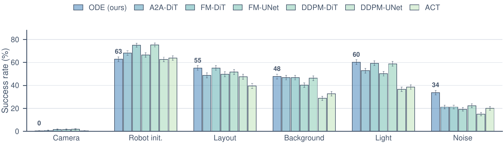

**图 S1。** 各视觉运动策略第 100 轮检查点在 LIBERO-plus 不同扰动类型上的零样本成功率，汇总四个套件和三个随机种子。每组上方的数字为 ODE 策略的结果，误差条表示汇总实例上的标准误。

### B.3 多模态性

图 [S2](#A2.F2) 展示图 [10](#S6.F10) 所依据的一个随机种子的展开轨迹。一轮后，ODE 策略已能穿过全部四个缺口，失败很少。FM-DiT 有许多轨迹失败，且主要经过内侧路线。A2A-DiT 在整个训练过程中始终只走两条内侧路线，发生了模态坍塌。MARS 覆盖全部四条路线，但到第 10 轮仍有许多失败轨迹。

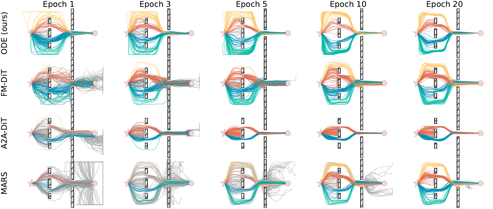

**图 S2。** 二维导航任务在第 1、3、5、10 和 20 轮的展开轨迹，每幅图 100 条。星号表示起点，圆圈表示目标，颜色表示从哪个缺口通过，灰色表示失败。结果来自三个随机种子中的一个。

### B.4 视觉-语言-动作模型

使用一个随机种子，在 LIBERO 的四个套件（1693 条示范）上联合微调 $\pi_{0.5}$ （[Physical Intelligence et al., 2025](#bib.bib60)） 三轮。所有参数均参与训练，包括有 29.2 亿参数的 VLM。使用 AdamW，在八张 A100 GPU 上训练，峰值学习率为 $5\times 10^{-5}$，全局批量大小为 384。各方法以 $224\times 224$ 处理外部相机和腕部相机的当前图像，并预测和执行包含 8 个动作的分块。ODE 策略将 $\pi_{0.5}$ 的动作专家（含投影层共 4.3 亿参数）替换为一个每分块读取一次 VLM 图像和语言特征的可学习查询、一个由 4 层宽度为 512 的残差层组成的 FiLM-MLP 向量场，以及一个夹爪头。这些模块共有 1370 万参数，均随机初始化。与所有 IL 实验一样，此处也使用多样性头。本体感知仅输入向量场和夹爪头。向量场用 RK4 从前一分块的终点开始积分，并在一半的训练分块上施加收缩扰动（1 cm 和 0.03 rad）。FM 则用 10 个*欧拉*步对其流积分。所有方法都使用预训练 VLM，后缀 -R 只表示动作专家为随机初始化。LIBERO 的每个检查点在每个任务的 10 个固定初始状态上评估。LIBERO-plus 则使用同一组 2008 个实例，每个实例运行一个回合。ODE 策略在 VLM 之外的参数量约为原动作专家的 3%，因此比较中的模型容量并不相同。

表 [S2](#A2.T2) 列出第一轮时各套件的成功率。ODE 策略在早期领先预训练 FM 专家的优势遍及四个套件，在 Long 上最大（92.0% 对 81.0%）。两者的成功回合所需控制步数相近，分别为 156.7 和 156.1。

**表 S2。** $\pi_{0.5}$ VLA 在 LIBERO 各套件上的第 1 轮成功率（%）。采用一个随机种子，每个任务 10 个回合。FM 以 $\pi_{0.5}$ 预训练动作专家的权重为起点，-R 代表随机初始化。LIBERO-plus 使用同一组 2008 个实例。

| 方法 | Spatial | Object | Goal | Long | LIBERO | LIBERO-plus |
| --- | --- | --- | --- | --- | --- | --- |
| ODE（本文方法） | **96.0** | **100.0** | **96.0** | **92.0** | **96.0** | **71.5** |
| FM | 90.0 | 91.0 | 90.0 | 81.0 | 88.0 | 69.2 |
| FM-R | 83.0 | 89.0 | 71.0 | 59.0 | 75.5 | 52.6 |

### B.5 世界动作模型

我们在 LIBERO 的四个套件（1712 条示范）上使用一个随机种子联合微调 ImageWAM （[Zhang et al., 2026](#bib.bib77)） 10 轮。微调其图像 Transformer（39 亿参数）和动作 Transformer，冻结文本编码器。ODE 策略保留动作 Transformer 的 25 个块，通过一个可学习查询每分块读取一次 512 维条件，并用一个由 4 层宽度为 512 的残差层组成的 FiLM-MLP 向量场替换其输入层、时间嵌入层和输出层。本体感知仅输入向量场。向量场用*欧拉法*对包含 12 步的分块积分，采用收缩扰动（1 cm 和 0.03 rad，用于半数训练分块）、无缝分块以及多样性头，并用单独的头预测夹爪。各动作头设置的差异见表 [S3](#A2.T3)。LIBERO-plus 共用同一组 2008 个实例，每个实例运行一个回合，各方法使用同一个种子，且按扰动类型加权计算成功率。本小节的标准差均在任务间计算。

图 [S3](#A2.F3) 展示各套件的结果。ODE 策略在 LIBERO 的 Spatial 和 Long 套件上早期优势最大，在 LIBERO-plus 的 Spatial 套件上领先至第 10 轮。表 [S4](#A2.T4) 列出按扰动类型划分的成功率。在含 10030 个实例的完整 LIBERO-plus 数据集上，ODE 策略第 10 轮的成功率为 88.7%，接近共享子集上的 89.9%。基线未在完整数据集上评估。

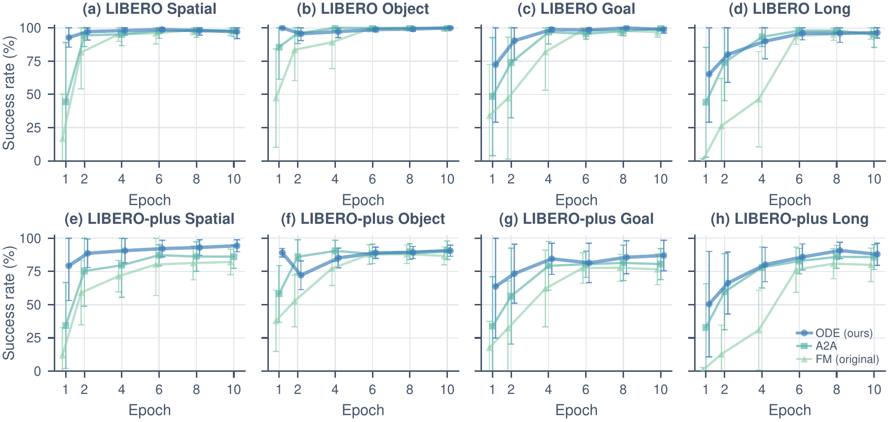

**图 S3。** ImageWAM 在 LIBERO **（A–D）** 及 LIBERO-plus 共享子集 **（E–H）** 各套件上的结果，比较 ODE 动作头（本文方法）、A2A 动作头和原流匹配动作头（FM）。误差线表示每个套件的十项任务间的标准差。

**表 S3。** ImageWAM 各动作头的不同设置。各动作头均采用 AdamW，学习率为 $10^{-4}$，预热半轮后余弦衰减至 $10^{-6}$。各动作头在 $224\times 224$ 下使用两台相机的当前图像，无图像历史，也不使用指数移动平均（EMA）。每轮均完整遍历同一批数据一次。每个 LIBERO 检查点在每项任务上评估 25 个回合。

| 设置 | FM（原动作头） | A2A | ODE（本文方法） |
| --- | --- | --- | --- |
| 动作生成 | 10 步流匹配 | 从历史动作出发进行 1 步流匹配 | 读取 1 次条件并执行 12 步欧拉积分 |
| 每分块预测／执行的动作数 | 16 / 12 | 16 / 12 | 12 / 12 |
| 动作空间 | 控制器指令 | 控制器指令 | 期望动作（转换为控制器指令） |
| 本体感知 | 条件词元 | 条件词元 | 向量场输入 |
| 夹爪 | 动作流的一部分 | 动作流的一部分 | 独立预测头 |
| 可训练参数 | 4517.6M | 4517.6M | 4518.2M |

**表 S4。** ImageWAM 在 LIBERO-plus 不同扰动类型上的成功率（%），附任务间标准差。左边是在共享的 2008 个实例上的表现，使用各动作头的最佳检查点（FM 和 A2A 为第 8 轮，ODE 为第 10 轮）。右边是第 10 轮的 ODE 策略在全部 10030 个实例上的分套件结果。

| 扰动 | 共享子集（2008）／ FM | 共享子集（2008）／ A2A | 共享子集（2008）／ ODE（本文方法） | ODE（本文方法）完整集（10030）／ Spatial | ODE（本文方法）完整集（10030）／ Object | ODE（本文方法）完整集（10030）／ Goal | ODE（本文方法）完整集（10030）／ Long | ODE（本文方法）完整集（10030）／总体 |
| --- | --- | --- | --- | --- | --- | --- | --- | --- |
| 相机 | $78.7\pm 29.5$ | $82.9\pm 24.6$ | $\mathbf{91.1}\pm 15.2$ | $92.6\pm 9.5$ | $99.2\pm 1.0$ | $92.2\pm 12.2$ | $75.7\pm 21.2$ | $89.7\pm 15.2$ |
| 机器人初始位姿 | $52.5\pm 26.7$ | $61.6\pm 24.6$ | $\mathbf{71.7}\pm 22.8$ | $77.1\pm 11.8$ | $63.3\pm 11.4$ | $67.0\pm 17.0$ | $68.7\pm 13.3$ | $68.8\pm 14.2$ |
| 语言 | $89.2\pm 17.0$ | $\mathbf{92.1}\pm 14.8$ | $\mathbf{92.1}\pm 14.2$ | $96.7\pm 9.8$ | $93.8\pm 11.1$ | $89.0\pm 10.6$ | $88.8\pm 21.1$ | $92.0\pm 13.6$ |
| 照明 | $97.4\pm 5.9$ | $95.6\pm 16.2$ | $\mathbf{98.7}\pm 3.7$ | $99.7\pm 0.9$ | $100.0\pm 0.0$ | $94.6\pm 9.5$ | $96.4\pm 4.4$ | $97.7\pm 5.2$ |
| 背景 | $88.5\pm 16.6$ | $\mathbf{95.1}\pm 12.7$ | $93.8\pm 16.5$ | $95.3\pm 15.6$ | $96.8\pm 4.9$ | $94.0\pm 12.6$ | $91.7\pm 11.0$ | $94.3\pm 11.4$ |
| 传感器噪声 | $92.9\pm 11.3$ | $95.6\pm 10.5$ | $\mathbf{98.3}\pm 4.7$ | $97.7\pm 3.6$ | $99.1\pm 2.4$ | $98.2\pm 3.4$ | $94.4\pm 7.0$ | $97.3\pm 4.6$ |
| 布局 | $79.9\pm 23.3$ | $83.1\pm 23.3$ | $\mathbf{86.6}\pm 21.8$ | $94.3\pm 13.1$ | $85.9\pm 5.4$ | $70.4\pm 19.6$ | $92.9\pm 7.2$ | $85.1\pm 16.1$ |
| 总体 | $81.9\pm 10.8$ | $85.8\pm 10.3$ | $\mathbf{89.9}\pm 8.0$ | $93.2\pm 4.8$ | $90.5\pm 2.0$ | $85.4\pm 7.4$ | $86.1\pm 7.0$ | $88.7\pm 6.3$ |

### B.6 真机实验

表 [S5](#A2.T5) 报告灵巧手杯子任务的推理开销和平滑度。基线在该任务上从未成功，因此对应指标均来自失败试验，仅供参考。ODE 策略生成分块的速度分别为 FM-DiT 和 DDIM-UNet 的 3.4 倍和 5.1 倍。它在分块边界的加速度是分块内部的 0.86 倍，接近示范的 0.96，两个基线分别达到 2.03 和 2.97。与罐子任务一样，ODE 策略的手臂加加速度约为基线的三分之一，也低于示范。

**表 S5。** 真机杯子任务的推理开销和平滑度。使用单张 RTX 4090，在所有试验的全部分块上测量推理耗时。平滑度按策略接管后的前 12 s 计算，报告试验间的均值 $\pm$ 标准差。指令加速度按手臂的 14 个关节计算，实测运动的加加速度按手臂的 14 个关节及右手的 22 个关节计算。示范来自 SharpaDex 的 50 条训练示范，切成每块 8 步。

|  | 示范 | ODE policy（本文方法） | FM-DiT | DDIM-UNet |
| --- | --- | --- | --- | --- |
| 每分块用时（ms） | – | **10.2** | 35.0 | 51.8 |
| 第 95 百分位和最大用时（ms） | – | **12.1 和 65.8** | 36.6 和 49.5 | 53.6 和 65.2 |
| 分块边界加速度（rad/s2） | 1.04 | $\mathbf{0.29\pm 0.06}$ | $6.40\pm 0.82$ | $10.9\pm 4.5$ |
| 分块内加速度（rad/s2） | 1.09 | $\mathbf{0.34\pm 0.06}$ | $3.15\pm 0.10$ | $4.02\pm 2.30$ |
| 边界／块内加速度之比 | 0.96 | **0.86** | 2.03 | 2.97 |
| 手臂加加速度（rad/s3） | 10.3 | $\mathbf{6.1\pm 0.6}$ | $19.6\pm 1.7$ | $18.1\pm 1.4$ |
| 手部加加速度（rad/s3） | 47 | $\mathbf{37\pm 15}$ | $62\pm 8$ | $49\pm 6$ |

表 [S6](#A2.T6) 所示的药片任务得出了相同的结论，该任务上也有基线能够成功。ODE 策略生成分块的速度是 FM-DiT 的 3.5 倍。它的分块边界加速度与分块内部加速度之比为 1.45，接近示范的 1.24，FM-DiT 则为 2.17。ODE 策略的手臂加加速度是 FM-DiT 的一半，也低于示范。两种方法的手部加加速度接近，均低于示范。

**表 S6。** 真机药片任务的推理开销和平滑度。使用单张 RTX 4090，在所有试验的全部分块上测量推理耗时。平滑度按策略接管后的前 12 s 计算，报告均值 $\pm$ 标准差，其中 ODE 策略统计 17 次成功试验，FM-DiT 统计全部 20 次试验。指令加速度按手臂的 14 个关节计算，实测运动的加加速度按手臂的 14 个关节和右手的 22 个关节计算。示范来自 SharpaDex 的 50 条训练示范，切成每块 8 步。

|  | 示范 | ODE policy（本文方法） | FM-DiT |
| --- | --- | --- | --- |
| 每分块用时（ms） | – | **10.3** | 36.3 |
| 第 95 百分位和最大用时（ms） | – | **12.7 和 30.5** | 42.6 和 89.4 |
| 分块边界加速度（rad/s2） | 1.57 | $\mathbf{1.14\pm 0.15}$ | $6.12\pm 0.58$ |
| 分块内加速度（rad/s2） | 1.27 | $\mathbf{0.78\pm 0.07}$ | $2.83\pm 0.20$ |
| 边界／块内加速度之比 | 1.24 | **1.45** | 2.17 |
| 手臂加加速度（rad/s3） | 12.8 | $\mathbf{9.8\pm 0.6}$ | $19.6\pm 1.5$ |
| 手部加加速度（rad/s3） | 47 | $\mathbf{30\pm 3}$ | $31\pm 4$ |

### B.7 强化学习

我们基于 SuperMimic 的一个开源复现 （[Liao et al., 2026a](#bib.bib45)） 开展实验。每次迭代将 4096 个仿真环境各推进一步，存储状态转移，再利用这些转移训练世界模型。随后在冻结的世界模型中想象 32 步，将这些步的折扣回报与最后一步的评价器价值相加，并反向传播梯度以更新行动器。任务是用有 29 个驱动关节的 Unitree G1 人形机器人对 LAFAN1 全部 40 段完整片段进行全身动作跟踪（50 Hz 下合计 2.45 小时，每段 100 至 300 s）。动作是关节位置目标相对于默认姿态的偏移，由 PD 控制器跟踪。行动器将目标动作编码为隐变量 $\mathbf{z}_{t}\in\mathbb{R}^{32}$，再结合 10 帧本体感知信息将其解码为动作，共 891 万参数。我们在两种行动器的目标中都加入了 BeyondMimic （[Liao et al., 2026b](#bib.bib46)） 的相对锚点位姿，因为仅依靠本体感知时，航向在如此长的片段中会漂移，回报在约 0.58 处饱和。

ODE 行动器沿用该网络及其初始化，只将解码器的输出解释为式（[11](#S4.E11)）中的速度。前一个动作采用行动器无噪声的输出，以免探索噪声沿积分累积。没有约束时，有一次运行中，积分将世界模型早期的误差转化为动作漂移，造成回报骤降。为此，我们将单步变化量限制在 1.62，并对动作的各关节分别设置限值。两项限制分别略高于两个行动器收敛策略的动作分布的第 99 和第 99.9 百分位，因此很少触发。

其余设置均沿用复现，包括世界模型、评价器、奖励、训练噪声和超参数。每次运行在一张 NVIDIA H200 GPU 上训练 3 小时，约 3.3 万次迭代。遵循 SuperMimic 的评估方式，用确定性策略从第一帧开始播放每一片段一次，无噪声或随机化。当骨盆与参考轨迹的偏差超过阈值时，回合结束。我们先用最大奖励归一化每步奖励，将摔倒后的步数按零奖励计入，对每段片段的全部步数取平均，再对 40 段取平均。我们还报告已执行动作二阶差分的均方值。

PPO （[Schulman et al., 2017](#bib.bib66)） 和 SuperMimic 使用相同的环境、观测、奖励、终止条件、域随机化方式和片段，但不使用世界模型。PPO 自行采样用于探索的动作，因此关闭环境中的执行噪声。超参数遵循 BeyondMimic （[Liao et al., 2026b](#bib.bib46)） 的 G1 跟踪配置，使用 8192 个并行环境及 SuperMimic 的网络规模。每次运行也在单张 H200 GPU 上训练 3 小时。由于 PPO 和 SuperMimic 的单次迭代不同，所有曲线均以实际用时为横轴。图 [S4](#A2.F4) 比较了 ODE 行动器和 PPO 的回报。PPO 的训练回报包含自身的探索噪声，仅供参考。

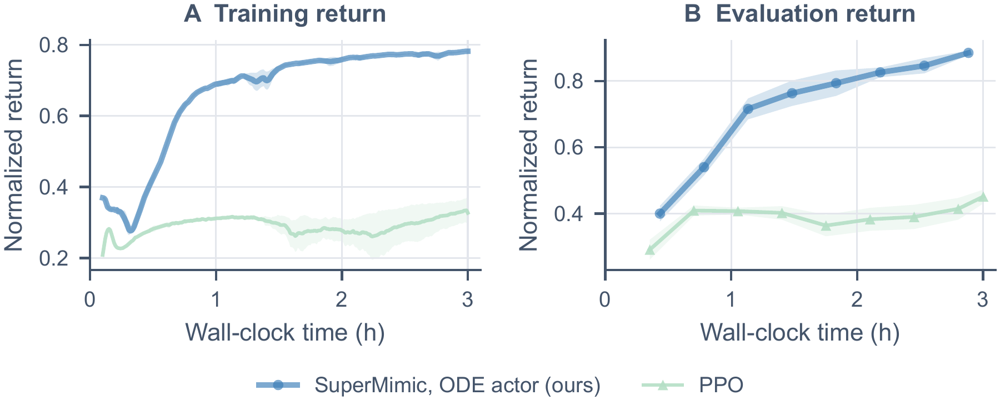

**图 S4。** 强化学习回报。在单张 GPU 上以实际用时为横轴，比较 SuperMimic 的 ODE 行动器和 PPO 对 LAFAN1 全部 40 段片段进行全身跟踪的结果。（A）训练回报。（B）确定性策略在全部 40 段片段上的归一化回报，摔倒后的步数按零回报计。曲线和阴影分别表示三个随机种子的均值和标准差。

### B.8 消融研究

**多样性头。** 多样性头读取向量场特征时会截断梯度，其损失也不向向量场回传。因此，使用或去掉多样性头，向量场收到的梯度完全相同（第 [4.4](#S4.SS4) 节）。多样性头只在推理时改变动作。我们对三个随机种子的同一组模型评估三种设置：无偏移（$\boldsymbol{\epsilon}=\mathbf{0}$，即原始 ODE）、使用抽中分量的均值，以及在分量内完整采样（表 [S8](#A2.T8)）。一轮后，多样性头尚未充分训练，加入偏移会让成功率从 $85.3\pm 1.9$% 降至使用分量均值时的 $79.8\pm 1.6$%，或完整采样时的 $52.1\pm 0.1$%。从第 5 轮起，三者相差至多 4.2 个百分点，完整采样甚至在第 20 轮取得最高的 $94.8\pm 0.4$%。因此，多样性头主要影响早期表现。使用分量均值可大体保持早期表现，所以单模态任务采用分量均值。

**表 S7。** 向量场架构消融，以 DiT 基线作参照。两种 ODE 变体均使用 RK4，$H=8$。表中报告 LIBERO 四个套件的平均成功率（%）、训练速度（批量大小为 32 时每秒的迭代次数）以及共享评估 GPU 上每个 8 动作分块的推理用时（ms）。成功率取三个随机种子的均值，ODE-DiT 除外，只使用一个种子。每个套件包含 10 项任务 $\times$ 20 个回合。两种 ODE 变体在编码器外的参数量相匹配。

| 方法 | 向量场 | 第 1 轮 | 第 10 轮 | 第 100 轮 | 迭代次数／秒 | ms／分块 |
| --- | --- | --- | --- | --- | --- | --- |
| ODE-MLP（本文方法） | FiLM-MLP | **79.2** | **93.9** | **93.8** | 17.1 | 11.0 |
| ODE-DiT（本文方法） | AdaLN Transformer | 77.2 | 89.6 | 91.2 | 3.5 | 51.9 |
| FM-DiT | – | 13.5 | 80.1 | 85.4 | **31.6** | 61.4 |
| A2A-DiT | – | 42.2 | 86.9 | 85.6 | 23.3 | **5.8** |

**向量场架构。** 我们用 FM-DiT 的 AdaLN Transformer 块替换 FiLM-MLP 向量场，同时保持参数量（ODE-DiT，表 [S7](#A2.T7)）。改用 Transformer 后，ODE 策略仍优于所有基线。一轮后和第 100 轮分别达到 77.2% 和 91.2%（一个随机种子），同期基线最高为 43.2% 和 87.8%。它在第 100 轮比采用相同网络块的 FM-DiT 高出 5.8 个百分点。但它在每个检查点都低于 MLP 向量场，速度也慢得多。训练速度从每秒 17.1 次迭代降至 3.5 次，每分块耗时由 11.0 ms 增至 51.9 ms（表 [S9](#A2.T9)）。有两个原因。第一，无论训练还是执行，RK4 对每个分块都要评估向量场 32 次，因此每次 Transformer 调用的开销被放大。第二，FM-DiT 的 Transformer 对同一分块内的动作依赖关系建模，而在 ODE 策略中，积分已逐步生成了分块，向量场只需将当前状态映射到相应速度。这是适合用 MLP 拟合的低维映射。由于分块的时序结构由积分承担，简单的 MLP 向量场已足够。

**表 S8。** 在同一组模型上比较推理时使用多样性头的方式：无偏移（$\boldsymbol{\epsilon}=\mathbf{0}$，即原始 ODE）、使用抽中分量的均值，以及在分量内完整采样。报告 LIBERO 四个套件的平均成功率（%），以三个随机种子的均值 $\pm$ 标准差表示。括号内是各套件的均值（Object / Spatial / Goal / Long），每项任务评估 10 个回合。

| 推理设置 | 第 1 轮 | 第 5 轮 | 第 10 轮 | 第 20 轮 |
| --- | --- | --- | --- | --- |
| 无偏移 | $\mathbf{85.3}\pm 1.9$ (98/81/91/72) | $\mathbf{95.0}\pm 1.0$ (99/97/96/87) | $92.8\pm 1.0$ (99/94/93/85) | $93.1\pm 1.2$ (99/97/93/84) |
| 分量均值（本文方法） | $79.8\pm 1.6$ (98/78/83/60) | $94.8\pm 0.4$ (100/97/96/87) | $\mathbf{94.3}\pm 1.3$ (99/98/95/86) | $94.2\pm 1.0$ (99/95/95/87) |
| 完整采样 | $52.1\pm 0.1$ (79/50/52/28) | $90.8\pm 0.0$ (96/94/90/82) | $93.7\pm 1.1$ (98/93/96/87) | $\mathbf{94.8}\pm 0.4$ (99/99/94/87) |

**表 S9。** 向量场架构消融。两个 ODE 变体均使用 RK4，$H=8$。表中报告 LIBERO 上的执行质量和推理用时，统计全部套件及随机种子的成功回合（各回合的均值 $\pm$ 标准差）。SR 为三个随机种子的成功率均值和标准差。「分块内」和「跨分块」分别表示分块内部相邻步之间的平均指令变化量，以及新分块第一步的平均指令变化量。加加速度为实测末端执行器位置的均方根加加速度（m/s3）。步数指成功回合的控制步数。每动作和每调用的推理用时（ms）在共享评估 GPU 上对一个种子测量。ODE-DiT 使用一个随机种子训练。

| 方法 | 训练轮次 | SR | 分块内 | 跨分块 | 加加速度 | 控制步数 | ms／动作 | ms／调用 |
| --- | --- | --- | --- | --- | --- | --- | --- | --- |
| ODE-MLP（本文方法） | 20 | $\mathbf{92.9}\pm 0.5$ | $\mathbf{0.01871}\pm 0.0051$ | $\mathbf{0.02855}\pm 0.0059$ | $\mathbf{5.257}\pm 2.1$ | $\mathbf{146.5}\pm 71$ | $\mathbf{1.43}\pm 0.079$ | $\mathbf{11.11}\pm 0.55$ |
| ODE-MLP（本文方法） | 50 | $\mathbf{93.8}\pm 0.3$ | $\mathbf{0.0196}\pm 0.0053$ | $\mathbf{0.0257}\pm 0.0054$ | $\mathbf{5.577}\pm 2.3$ | $\mathbf{146}\pm 70$ | $\mathbf{1.432}\pm 0.072$ | $\mathbf{11.15}\pm 0.56$ |
| ODE-MLP（本文方法） | 100 | $\mathbf{93.8}\pm 1.3$ | $\mathbf{0.02017}\pm 0.0054$ | $\mathbf{0.02453}\pm 0.0053$ | $\mathbf{5.736}\pm 2.3$ | $147.2\pm 72$ | $\mathbf{1.414}\pm 0.069$ | $\mathbf{11}\pm 0.47$ |
| ODE-DiT（本文方法） | 20 | 89.4 | $0.01914\pm 0.005$ | $0.02893\pm 0.0057$ | $5.276\pm 2.1$ | $148.5\pm 73$ | $7.192\pm 0.23$ | $55.97\pm 1.3$ |
| ODE-DiT（本文方法） | 50 | 90.8 | $0.02058\pm 0.0052$ | $0.02596\pm 0.0059$ | $5.734\pm 2.3$ | $146.6\pm 73$ | $7.155\pm 0.26$ | $55.63\pm 1.5$ |
| ODE-DiT（本文方法） | 100 | 91.2 | $0.02133\pm 0.0053$ | $0.02516\pm 0.0057$ | $5.942\pm 2.3$ | $\mathbf{144.5}\pm 69$ | $6.672\pm 0.19$ | $51.91\pm 0.92$ |
